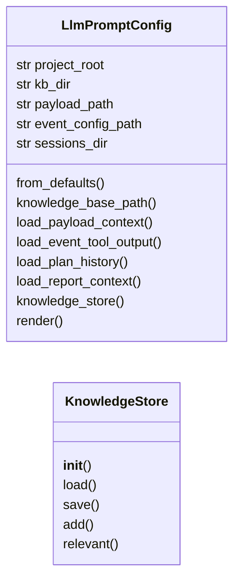
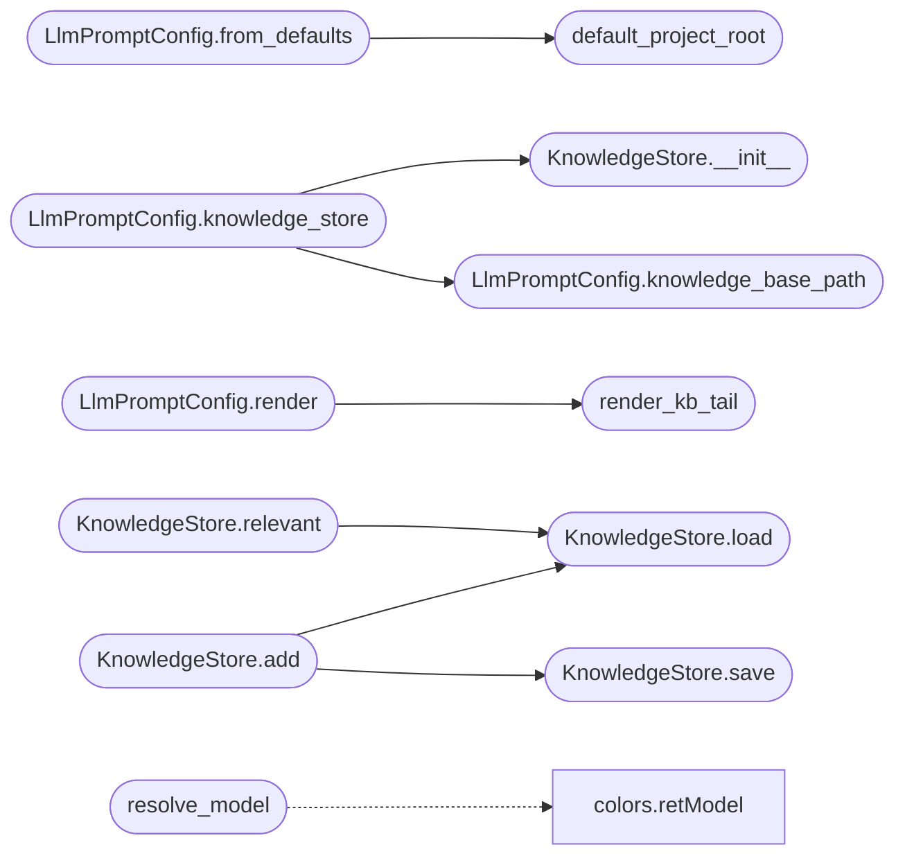

# `modules.llm_prompts`

> Source: [modules/llm_prompts.py:1](../../modules/llm_prompts.py#L1) | language `py` | coverage 100.0% | [API index](../index.md)

Canonical prompt-template and knowledge-base contract for LLM consumers.

Owns every task-domain prompt template used by the Groq chat family and the
structured helpers (truncation, knowledge-base CRUD, relevance filtering,
payload/event context loading) that were previously duplicated across the
retired ``modules.legacy.lazygptcli*`` scripts.

This module is pure: it never imports a vendor SDK, never performs network
calls, and never reads process environment directly. All filesystem locations
and tunables are resolved through [`LlmPromptConfig`](#llmpromptconfig) so tests can point
every read/write at temporary fixtures.

Usage::

    from modules.llm_prompts import LlmPromptConfig, KnowledgeStore

    config = LlmPromptConfig(project_root="/tmp/x")
    store = config.knowledge_store("vuln")
    kb = store.relevant("nmap output", limit=5)
    prompt = config.render("vuln", "raw nmpa output", context=ctx)

## Contents

- **Classes:** [`LlmPromptConfig`](#llmpromptconfig), [`KnowledgeStore`](#knowledgestore)
- **Functions:** [`default_project_root`](#default_project_root), [`resolve_model`](#resolve_model), [`truncate_message`](#truncate_message), [`render_kb_tail`](#render_kb_tail)
- **Constants:** [`PROMPT_MAX_CHARS`](#prompt_max_chars), [`KNOWLEDGE_TAIL_LIMIT`](#knowledge_tail_limit), [`DEFAULT_SYSTEM_PROMPT`](#default_system_prompt), [`KB_FILE_NAMES`](#kb_file_names), [`PAYLOAD_KEY_ORDER`](#payload_key_order), [`TEMPLATES`](#templates), [`TEMPLATE_MODELS`](#template_models), [`TEMPLATE_KB_DOMAINS`](#template_kb_domains)

## Type Diagram



## Call Graph

Solid arrows stay in this module, dashed arrows leave it.



## Classes

<a id="llmpromptconfig"></a>

### `LlmPromptConfig`

`class` `dataclass` | [modules/llm_prompts.py:111](../../modules/llm_prompts.py#L111)

Decorators: `@dataclass(frozen=True)`

```python
class LlmPromptConfig
```

Resolved filesystem and behavioural configuration for prompt rendering.

**Attributes**

| Name | Type | Default | Description |
|---|---|---|---|
| [`project_root`](#llmpromptconfig-project_root) | `str` |  | Repository root used to locate payload, event and session artefacts. |
| [`kb_dir`](#llmpromptconfig-kb_dir) | `str` | `field(default='')` | Directory that stores the knowledge-base JSON files. |
| [`payload_path`](#llmpromptconfig-payload_path) | `str` | `field(default='')` | Absolute path to payload.json. |
| [`event_config_path`](#llmpromptconfig-event_config_path) | `str` | `field(default='')` | Absolute path to event_config.json or None. |
| [`sessions_dir`](#llmpromptconfig-sessions_dir) | `str` | `field(default='')` | Directory that stores per-session plan history. |

**Members**

| Member | Kind | Summary |
|---|---|---|
| [`from_defaults`](#llmpromptconfig-from_defaults) | classmethod | Build a config rooted at the given project root. |
| [`knowledge_base_path`](#llmpromptconfig-knowledge_base_path) | method | Return the absolute path for a knowledge-base domain file. |
| [`load_payload_context`](#llmpromptconfig-load_payload_context) | method | Load the operator context keyed by [`PAYLOAD_KEY_ORDER`](#payload_key_order). |
| [`load_event_tool_output`](#llmpromptconfig-load_event_tool_output) | method | Load tool output attached to a named event in event_config.json. |
| [`load_plan_history`](#llmpromptconfig-load_plan_history) | method | Load the session plan history text if present. |
| [`load_report_context`](#llmpromptconfig-load_report_context) | method | Load the JSON artefacts consumed by the report template. |
| [`knowledge_store`](#llmpromptconfig-knowledge_store) | method | Build a knowledge store bound to a domain file. |
| [`render`](#llmpromptconfig-render) | method | Render a named template with shared knowledge and context. |

<a id="llmpromptconfig-from_defaults"></a>

#### `LlmPromptConfig.from_defaults`

`classmethod` | [modules/llm_prompts.py:130](../../modules/llm_prompts.py#L130)

Decorators: `@classmethod`

```python
def from_defaults(cls, project_root: str | None = None) -> LlmPromptConfig
```

Build a config rooted at the given project root.

**Parameters**

| Name | Type | Default | Description |
|---|---|---|---|
| `project_root` | `str \| None` | `None` | Repository root override; defaults to the detected repository root. |

**Returns:** `LlmPromptConfig` - A fully-resolved [`LlmPromptConfig`](#llmpromptconfig).

*Calls:* [`default_project_root`](#default_project_root)

*Called by:* [`AiCommandSet.do_groq`](cli.commands.ai.py.md#aicommandset-do_groq)

<a id="llmpromptconfig-knowledge_base_path"></a>

#### `LlmPromptConfig.knowledge_base_path`

`method` | [modules/llm_prompts.py:150](../../modules/llm_prompts.py#L150)

```python
def knowledge_base_path(self, domain: str) -> str
```

Return the absolute path for a knowledge-base domain file.

**Parameters**

| Name | Type | Default | Description |
|---|---|---|---|
| `domain` | `str` |  | One of the keys in [`KB_FILE_NAMES`](#kb_file_names). |

**Returns:** `str` - Absolute path to the knowledge-base JSON file.

*Called by:* [`LlmPromptConfig.knowledge_store`](#llmpromptconfig-knowledge_store)

<a id="llmpromptconfig-load_payload_context"></a>

#### `LlmPromptConfig.load_payload_context`

`method` | [modules/llm_prompts.py:161](../../modules/llm_prompts.py#L161)

```python
def load_payload_context(self) -> dict[str, str]
```

Load the operator context keyed by [`PAYLOAD_KEY_ORDER`](#payload_key_order).

**Returns:** `dict[str, str]` - Mapping of every payload key to its value or an empty string.

<a id="llmpromptconfig-load_event_tool_output"></a>

#### `LlmPromptConfig.load_event_tool_output`

`method` | [modules/llm_prompts.py:176](../../modules/llm_prompts.py#L176)

```python
def load_event_tool_output(self, event_name: str) -> str
```

Load tool output attached to a named event in event_config.json.

**Parameters**

| Name | Type | Default | Description |
|---|---|---|---|
| `event_name` | `str` |  | Event whose ``tool_output`` path should be read. |

**Returns:** `str` - File content, or an empty string when no event or file matches.

<a id="llmpromptconfig-load_plan_history"></a>

#### `LlmPromptConfig.load_plan_history`

`method` | [modules/llm_prompts.py:203](../../modules/llm_prompts.py#L203)

```python
def load_plan_history(self) -> str
```

Load the session plan history text if present.

**Returns:** `str` - Plan file content, or an empty string when unavailable.

<a id="llmpromptconfig-load_report_context"></a>

#### `LlmPromptConfig.load_report_context`

`method` | [modules/llm_prompts.py:218](../../modules/llm_prompts.py#L218)

```python
def load_report_context(self) -> dict[str, Any]
```

Load the JSON artefacts consumed by the report template.

**Returns:** `dict[str, Any]` - Mapping of basename to its parsed JSON content.

<a id="llmpromptconfig-knowledge_store"></a>

#### `LlmPromptConfig.knowledge_store`

`method` | [modules/llm_prompts.py:238](../../modules/llm_prompts.py#L238)

```python
def knowledge_store(self, domain: str) -> KnowledgeStore
```

Build a knowledge store bound to a domain file.

**Parameters**

| Name | Type | Default | Description |
|---|---|---|---|
| `domain` | `str` |  | Knowledge-base domain key. |

**Returns:** `KnowledgeStore` - A [`KnowledgeStore`](#knowledgestore) reading and writing the domain file.

*Calls:* [`KnowledgeStore.__init__`](#knowledgestore-__init__), [`LlmPromptConfig.knowledge_base_path`](#llmpromptconfig-knowledge_base_path)

<a id="llmpromptconfig-render"></a>

#### `LlmPromptConfig.render`

`method` | [modules/llm_prompts.py:249](../../modules/llm_prompts.py#L249)

```python
def render(self, template: str, base_prompt: str, *, kb_lines: list[str] | None = None) -> str
```

Render a named template with shared knowledge and context.

**Parameters**

| Name | Type | Default | Description |
|---|---|---|---|
| `template` | `str` |  | Template key in [`TEMPLATES`](#templates). |
| `base_prompt` | `str` |  | Operator prompt substituted into the template. |
| `kb_lines` | `list[str] \| None` | `None` | Relevant knowledge lines; latest ones are embedded. |

**Returns:** `str` - Fully rendered system prompt string.

*Calls:* [`render_kb_tail`](#render_kb_tail)

---

<a id="knowledgestore"></a>

### `KnowledgeStore`

`class` | [modules/llm_prompts.py:286](../../modules/llm_prompts.py#L286)

```python
class KnowledgeStore
```

List-of-dict knowledge base persisted as JSON on disk.

**Members**

| Member | Kind | Summary |
|---|---|---|
| [`__init__`](#knowledgestore-__init__) | constructor | Initialize a store bound to a single JSON file. |
| [`load`](#knowledgestore-load) | method | Load the knowledge-base records from disk. |
| [`save`](#knowledgestore-save) | method | Persist a full record list to disk, creating parent directories. |
| [`add`](#knowledgestore-add) | method | Append a prompt/response record to the knowledge base. |
| [`relevant`](#knowledgestore-relevant) | method | Return knowledge responses whose text shares keywords with the prompt. |

<a id="knowledgestore-__init__"></a>

#### `KnowledgeStore.__init__`

`constructor` | [modules/llm_prompts.py:289](../../modules/llm_prompts.py#L289)

```python
def __init__(self, path: str) -> None
```

Initialize a store bound to a single JSON file.

**Parameters**

| Name | Type | Default | Description |
|---|---|---|---|
| `path` | `str` |  | Absolute path of the knowledge-base file. |

*Called by:* [`LlmPromptConfig.knowledge_store`](#llmpromptconfig-knowledge_store)

<a id="knowledgestore-load"></a>

#### `KnowledgeStore.load`

`method` | [modules/llm_prompts.py:297](../../modules/llm_prompts.py#L297)

```python
def load(self) -> list[dict[str, str]]
```

Load the knowledge-base records from disk.

**Returns:** `list[dict[str, str]]` - List of ``{"prompt", "response"}`` records; empty on any read error.

*Called by:* [`KnowledgeStore.add`](#knowledgestore-add), [`KnowledgeStore.relevant`](#knowledgestore-relevant)

<a id="knowledgestore-save"></a>

#### `KnowledgeStore.save`

`method` | [modules/llm_prompts.py:312](../../modules/llm_prompts.py#L312)

```python
def save(self, records: list[dict[str, str]]) -> None
```

Persist a full record list to disk, creating parent directories.

**Parameters**

| Name | Type | Default | Description |
|---|---|---|---|
| `records` | `list[dict[str, str]]` |  | List of knowledge-base records to write. |

*Called by:* [`KnowledgeStore.add`](#knowledgestore-add)

<a id="knowledgestore-add"></a>

#### `KnowledgeStore.add`

`method` | [modules/llm_prompts.py:324](../../modules/llm_prompts.py#L324)

```python
def add(self, prompt: str, response: str) -> None
```

Append a prompt/response record to the knowledge base.

**Parameters**

| Name | Type | Default | Description |
|---|---|---|---|
| `prompt` | `str` |  | Operator prompt that produced the response. |
| `response` | `str` |  | Model response to remember. |

*Calls:* [`KnowledgeStore.load`](#knowledgestore-load), [`KnowledgeStore.save`](#knowledgestore-save)

<a id="knowledgestore-relevant"></a>

#### `KnowledgeStore.relevant`

`method` | [modules/llm_prompts.py:335](../../modules/llm_prompts.py#L335)

```python
def relevant(self, prompt: str, limit: int = KNOWLEDGE_TAIL_LIMIT) -> list[str]
```

Return knowledge responses whose text shares keywords with the prompt.

**Parameters**

| Name | Type | Default | Description |
|---|---|---|---|
| `prompt` | `str` |  | Query used to select relevant records. |
| `limit` | `int` | `KNOWLEDGE_TAIL_LIMIT` | Maximum number of responses to return. |

**Returns:** `list[str]` - List of matching knowledge responses.

*Calls:* [`KnowledgeStore.load`](#knowledgestore-load)

---

## Functions

<a id="default_project_root"></a>

### `default_project_root`

`function` | [modules/llm_prompts.py:67](../../modules/llm_prompts.py#L67)

```python
def default_project_root() -> str
```

Return the repository root that owns the LLM prompt configuration.

**Returns:** `str` - Absolute path to the LazyOwn repository root.

*Called by:* [`LlmPromptConfig.from_defaults`](#llmpromptconfig-from_defaults)

---

<a id="resolve_model"></a>

### `resolve_model`

`function` | [modules/llm_prompts.py:76](../../modules/llm_prompts.py#L76)

```python
def resolve_model(model: str | None) -> str
```

Resolve an explicit model or fall back to the randomized Groq model.

**Parameters**

| Name | Type | Default | Description |
|---|---|---|---|
| `model` | `str \| None` |  | Explicit Groq model identifier or None. |

**Returns:** `str` - The model to send to the chat completion endpoint.

*Calls:* [`retModel`](modules.colors.py.md#retmodel)

---

<a id="truncate_message"></a>

### `truncate_message`

`function` | [modules/llm_prompts.py:95](../../modules/llm_prompts.py#L95)

```python
def truncate_message(message: str, max_chars: int = PROMPT_MAX_CHARS) -> str
```

Truncate a message with an ellipsis marker when it exceeds the limit.

**Parameters**

| Name | Type | Default | Description |
|---|---|---|---|
| `message` | `str` |  | Source text. |
| `max_chars` | `int` | `PROMPT_MAX_CHARS` | Maximum allowed character length. |

**Returns:** `str` - Truncated text, or the original when it fits within ``max_chars``.

*Called by:* [`AiCommandSet.do_groq`](cli.commands.ai.py.md#aicommandset-do_groq)

---

<a id="render_kb_tail"></a>

### `render_kb_tail`

`function` | [modules/llm_prompts.py:271](../../modules/llm_prompts.py#L271)

```python
def render_kb_tail(lines: list[str]) -> str
```

Join the most recent knowledge lines for embedding into a prompt.

**Parameters**

| Name | Type | Default | Description |
|---|---|---|---|
| `lines` | `list[str]` |  | Candidate knowledge strings. |

**Returns:** `str` - Newline-joined tail of the input limited by
[`KNOWLEDGE_TAIL_LIMIT`](#knowledge_tail_limit).

*Called by:* [`LlmPromptConfig.render`](#llmpromptconfig-render)

---

## Constants

<a id="prompt_max_chars"></a>

### `PROMPT_MAX_CHARS`

`constant` | [modules/llm_prompts.py:30](../../modules/llm_prompts.py#L30)

```python
PROMPT_MAX_CHARS = 18000
```

---

<a id="knowledge_tail_limit"></a>

### `KNOWLEDGE_TAIL_LIMIT`

`constant` | [modules/llm_prompts.py:31](../../modules/llm_prompts.py#L31)

```python
KNOWLEDGE_TAIL_LIMIT = 5
```

---

<a id="default_system_prompt"></a>

### `DEFAULT_SYSTEM_PROMPT`

`constant` | [modules/llm_prompts.py:33](../../modules/llm_prompts.py#L33)

```python
DEFAULT_SYSTEM_PROMPT = 'You are a helpful penetration testing assistant.'
```

---

<a id="kb_file_names"></a>

### `KB_FILE_NAMES`

`constant` | [modules/llm_prompts.py:35](../../modules/llm_prompts.py#L35)

```python
KB_FILE_NAMES
```

---

<a id="payload_key_order"></a>

### `PAYLOAD_KEY_ORDER`

`constant` | [modules/llm_prompts.py:43](../../modules/llm_prompts.py#L43)

```python
PAYLOAD_KEY_ORDER
```

---

<a id="templates"></a>

### `TEMPLATES`

`constant` | [modules/llm_prompts.py:478](../../modules/llm_prompts.py#L478)

```python
TEMPLATES
```

---

<a id="template_models"></a>

### `TEMPLATE_MODELS`

`constant` | [modules/llm_prompts.py:489](../../modules/llm_prompts.py#L489)

```python
TEMPLATE_MODELS = {'oneliner': _ONE_LINER_MODEL, 'adversary': _ADVERSARY_MODEL}
```

---

<a id="template_kb_domains"></a>

### `TEMPLATE_KB_DOMAINS`

`constant` | [modules/llm_prompts.py:494](../../modules/llm_prompts.py#L494)

```python
TEMPLATE_KB_DOMAINS
```

---
