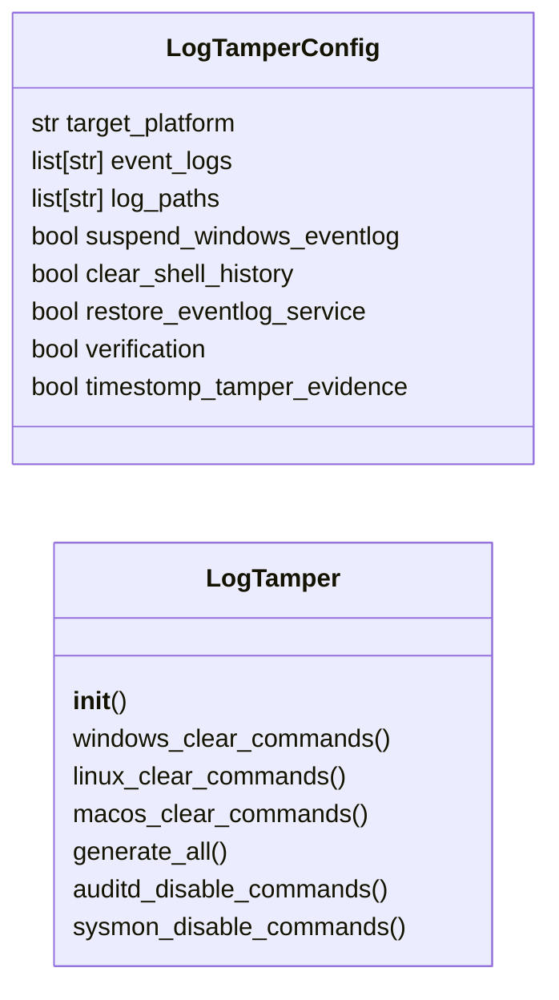
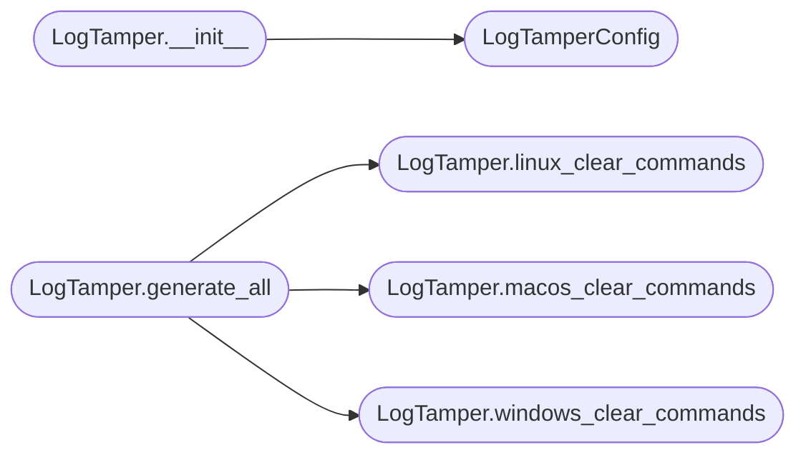

# `modules.log_tamper`

> Source: [modules/log_tamper.py:1](../../modules/log_tamper.py#L1) | language `py` | coverage 90.0% | [API index](../index.md)

Log tampering — Windows Event Log, Linux journald/auditd, macOS unified log.

Provides cross-platform log management for operational security: clearing
Windows Event Logs (Security, System, Application), suspending the EventLog
service, Linux journalctl vacuum and wtmp/btmp wiping, auditd rule removal,
and macOS unified log stream filtering.

All operations produce detailed post-tamper verification reports for the
operator to confirm log cleanup success.

## Contents

- **Classes:** [`LogTamperConfig`](#logtamperconfig), [`LogTamper`](#logtamper)
- **Constants:** [`SESSIONS_DIR`](#sessions_dir), [`WINDOWS_EVENT_LOGS`](#windows_event_logs), [`LINUX_LOG_PATHS`](#linux_log_paths), [`MACOS_LOG_PATHS`](#macos_log_paths)

## Type Diagram



## Call Graph

Solid arrows stay in this module, dashed arrows leave it.



## Classes

<a id="logtamperconfig"></a>

### `LogTamperConfig`

`class` `dataclass` | [modules/log_tamper.py:71](../../modules/log_tamper.py#L71)

Decorators: `@dataclass`

```python
class LogTamperConfig
```

Configuration for log tampering operations.

**Attributes**

| Name | Type | Default | Description |
|---|---|---|---|
| [`target_platform`](#logtamperconfig-target_platform) | `str` | `'linux'` | windows, linux, or macos. |
| [`event_logs`](#logtamperconfig-event_logs) | `list[str]` | `field(default_factory=lambda: WINDOWS_EVENT_LOGS.copy())` | List of Windows event log names to clear. |
| [`log_paths`](#logtamperconfig-log_paths) | `list[str]` | `field(default_factory=list)` | List of Linux/macOS log file paths. |
| [`suspend_windows_eventlog`](#logtamperconfig-suspend_windows_eventlog) | `bool` | `True` | Suspend the EventLog service before clearing. |
| [`clear_shell_history`](#logtamperconfig-clear_shell_history) | `bool` | `True` | Clear bash/zsh/fish history files. |
| [`restore_eventlog_service`](#logtamperconfig-restore_eventlog_service) | `bool` | `True` | Restart EventLog after tampering. |
| [`verification`](#logtamperconfig-verification) | `bool` | `True` | Perform post-tamper verification checks. |
| [`timestomp_tamper_evidence`](#logtamperconfig-timestomp_tamper_evidence) | `bool` | `True` | Modify file timestamps of tampered logs. |

---

<a id="logtamper"></a>

### `LogTamper`

`class` | [modules/log_tamper.py:95](../../modules/log_tamper.py#L95)

```python
class LogTamper
```

Cross-platform log tampering with verification.

Generates platform-specific commands for clearing, suspending,
and verifying log tampering on Windows, Linux, and macOS.

**Members**

| Member | Kind | Summary |
|---|---|---|
| [`__init__`](#logtamper-__init__) | constructor |  |
| [`windows_clear_commands`](#logtamper-windows_clear_commands) | method | Generate Windows Event Log clearing commands. |
| [`linux_clear_commands`](#logtamper-linux_clear_commands) | method | Generate Linux log clearing commands. |
| [`macos_clear_commands`](#logtamper-macos_clear_commands) | method | Generate macOS log clearing commands. |
| [`generate_all`](#logtamper-generate_all) | method | Generate log tampering commands for all platforms. |
| [`auditd_disable_commands`](#logtamper-auditd_disable_commands) | method | Commands to temporarily disable or reconfigure auditd on Linux. |
| [`sysmon_disable_commands`](#logtamper-sysmon_disable_commands) | method | Commands to disable or degrade Sysmon on Windows. |

<a id="logtamper-__init__"></a>

#### `LogTamper.__init__`

`constructor` | [modules/log_tamper.py:105](../../modules/log_tamper.py#L105)

```python
def __init__(self, config: LogTamperConfig | None = None)
```

**Parameters**

| Name | Type | Default | Description |
|---|---|---|---|
| `config` | `LogTamperConfig \| None` | `None` |  |

*Calls:* [`LogTamperConfig`](#logtamperconfig)

*Called by:* [`OpsecCleanupCommandSet.do_auditd_disable`](cli.commands.opsec_cleanup.py.md#opseccleanupcommandset-do_auditd_disable), [`OpsecCleanupCommandSet.do_log_tamper`](cli.commands.opsec_cleanup.py.md#opseccleanupcommandset-do_log_tamper), [`OpsecCleanupCommandSet.do_sysmon_disable`](cli.commands.opsec_cleanup.py.md#opseccleanupcommandset-do_sysmon_disable)

<a id="logtamper-windows_clear_commands"></a>

#### `LogTamper.windows_clear_commands`

`method` | [modules/log_tamper.py:108](../../modules/log_tamper.py#L108)

```python
def windows_clear_commands(self) -> dict[str, Any]
```

Generate Windows Event Log clearing commands.

Includes EventLog service suspension, individual log clearing,
PowerShell operational logs, Sysmon, and Defender logs.

**Returns:** `dict[str, Any]` - Dict with powershell commands, batch commands, and verification.

*Called by:* [`LogTamper.generate_all`](#logtamper-generate_all)

<a id="logtamper-linux_clear_commands"></a>

#### `LogTamper.linux_clear_commands`

`method` | [modules/log_tamper.py:176](../../modules/log_tamper.py#L176)

```python
def linux_clear_commands(self) -> dict[str, Any]
```

Generate Linux log clearing commands.

Covers systemd journal, auth logs, shell history, wtmp/btmp,
and optional auditd rule removal.

**Returns:** `dict[str, Any]` - Dict with bash commands, verification steps, and risk notes.

*Called by:* [`LogTamper.generate_all`](#logtamper-generate_all)

<a id="logtamper-macos_clear_commands"></a>

#### `LogTamper.macos_clear_commands`

`method` | [modules/log_tamper.py:243](../../modules/log_tamper.py#L243)

```python
def macos_clear_commands(self) -> dict[str, Any]
```

Generate macOS log clearing commands.

Covers unified log, system log, TCC database reset, and
shell history.

**Returns:** `dict[str, Any]` - Dict with zsh commands, verification, and TCC notes.

*Called by:* [`LogTamper.generate_all`](#logtamper-generate_all)

<a id="logtamper-generate_all"></a>

#### `LogTamper.generate_all`

`method` | [modules/log_tamper.py:295](../../modules/log_tamper.py#L295)

```python
def generate_all(self) -> dict[str, Any]
```

Generate log tampering commands for all platforms.

**Returns:** `dict[str, Any]` - Dict with per-platform command lists and verification.

*Calls:* [`LogTamper.linux_clear_commands`](#logtamper-linux_clear_commands), [`LogTamper.macos_clear_commands`](#logtamper-macos_clear_commands), [`LogTamper.windows_clear_commands`](#logtamper-windows_clear_commands)

*Called by:* [`OpsecCleanupCommandSet.do_log_tamper`](cli.commands.opsec_cleanup.py.md#opseccleanupcommandset-do_log_tamper)

<a id="logtamper-auditd_disable_commands"></a>

#### `LogTamper.auditd_disable_commands`

`method` | [modules/log_tamper.py:307](../../modules/log_tamper.py#L307)

```python
def auditd_disable_commands(self) -> dict[str, Any]
```

Commands to temporarily disable or reconfigure auditd on Linux.

auditd is the Linux Audit Framework — critical for forensic
analysis. Disabling or reconfiguring it significantly reduces
forensic evidence of attacker activity.

**Returns:** `dict[str, Any]` - Dict with auditd manipulation commands.

*Called by:* [`OpsecCleanupCommandSet.do_auditd_disable`](cli.commands.opsec_cleanup.py.md#opseccleanupcommandset-do_auditd_disable)

<a id="logtamper-sysmon_disable_commands"></a>

#### `LogTamper.sysmon_disable_commands`

`method` | [modules/log_tamper.py:341](../../modules/log_tamper.py#L341)

```python
def sysmon_disable_commands(self) -> dict[str, Any]
```

Commands to disable or degrade Sysmon on Windows.

Sysmon (System Monitor) provides detailed process creation,
network connection, and file creation logging. Disabling it
significantly reduces EDR telemetry.

**Returns:** `dict[str, Any]` - Dict with Sysmon manipulation commands.

*Called by:* [`OpsecCleanupCommandSet.do_sysmon_disable`](cli.commands.opsec_cleanup.py.md#opseccleanupcommandset-do_sysmon_disable)

---

## Constants

<a id="sessions_dir"></a>

### `SESSIONS_DIR`

`constant` | [modules/log_tamper.py:18](../../modules/log_tamper.py#L18)

```python
SESSIONS_DIR = Path(__file__).resolve().parent.parent / 'sessions'
```

---

<a id="windows_event_logs"></a>

### `WINDOWS_EVENT_LOGS`

`constant` | [modules/log_tamper.py:20](../../modules/log_tamper.py#L20)

```python
WINDOWS_EVENT_LOGS
```

---

<a id="linux_log_paths"></a>

### `LINUX_LOG_PATHS`

`constant` | [modules/log_tamper.py:36](../../modules/log_tamper.py#L36)

```python
LINUX_LOG_PATHS
```

---

<a id="macos_log_paths"></a>

### `MACOS_LOG_PATHS`

`constant` | [modules/log_tamper.py:59](../../modules/log_tamper.py#L59)

```python
MACOS_LOG_PATHS
```

---
