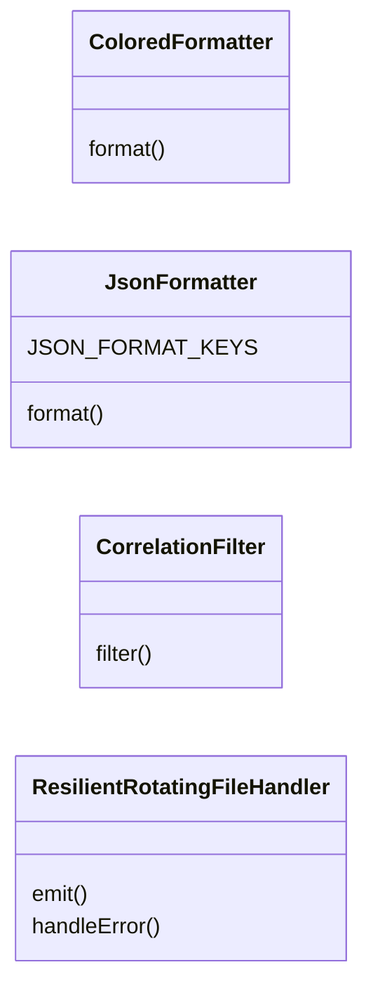
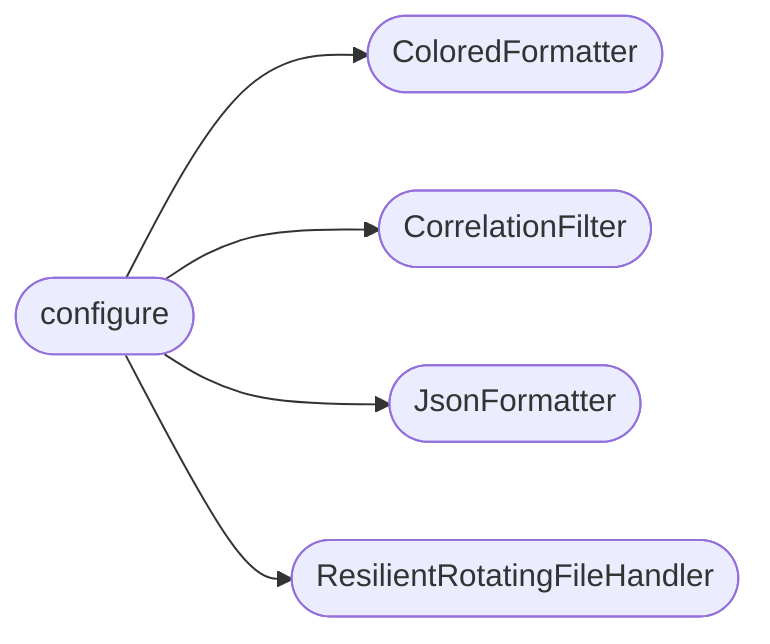

# `modules.logging_config`

> Source: [modules/logging_config.py:1](../../modules/logging_config.py#L1) | language `py` | coverage 85.0% | [API index](../index.md)

Centralized logging configuration for the LazyOwn framework.

Provides a single point of logging configuration to replace the 61+
scattered `logging.basicConfig()` calls across the codebase.

Usage:
    from modules.logging_config import configure, get_logger

    configure(level=logging.INFO, log_dir="sessions/logs", console=True, file=True)
    logger = get_logger(__name__)
    logger.info("Framework started")

## Contents

- **Classes:** [`ColoredFormatter`](#coloredformatter), [`JsonFormatter`](#jsonformatter), [`CorrelationFilter`](#correlationfilter), [`ResilientRotatingFileHandler`](#resilientrotatingfilehandler)
- **Functions:** [`set_correlation_id`](#set_correlation_id), [`get_correlation_id`](#get_correlation_id), [`clear_correlation_id`](#clear_correlation_id), [`configure`](#configure), [`get_logger`](#get_logger), [`set_level`](#set_level), [`set_quiet`](#set_quiet), [`set_verbose`](#set_verbose), [`silence_module`](#silence_module), [`reset`](#reset)
- **Constants:** [`LOG_FORMAT_CONSOLE`](#log_format_console), [`LOG_FORMAT_FILE`](#log_format_file), [`LOG_DATE_FORMAT`](#log_date_format)

## Type Diagram



## Call Graph

Solid arrows stay in this module, dashed arrows leave it.



## Classes

<a id="coloredformatter"></a>

### `ColoredFormatter`

`class` | [modules/logging_config.py:36](../../modules/logging_config.py#L36)

```python
class ColoredFormatter(logging.Formatter)
```

Bases: `logging.Formatter`

ANSI-colored console formatter matching core.console.py style.

**Members**

| Member | Kind | Summary |
|---|---|---|
| [`format`](#coloredformatter-format) | method |  |

<a id="coloredformatter-format"></a>

#### `ColoredFormatter.format`

`method` | [modules/logging_config.py:39](../../modules/logging_config.py#L39)

```python
def format(self, record: logging.LogRecord) -> str
```

**Parameters**

| Name | Type | Default | Description |
|---|---|---|---|
| `record` | `logging.LogRecord` |  |  |

**Returns:** `str`

---

<a id="jsonformatter"></a>

### `JsonFormatter`

`class` | [modules/logging_config.py:53](../../modules/logging_config.py#L53)

```python
class JsonFormatter(logging.Formatter)
```

Bases: `logging.Formatter`

JSON-line formatter for structured log output.

Outputs each log record as a JSON object with timestamp, level, logger,
message, and optional ``correlation_id``, ``command``, and ``module``.

**Attributes**

| Name | Type | Default | Description |
|---|---|---|---|
| [`JSON_FORMAT_KEYS`](#jsonformatter-json_format_keys) |  | `('timestamp', 'level', 'logger', 'message', 'correlation_id', 'command', 'module', 'filename', 'lineno')` |  |

**Members**

| Member | Kind | Summary |
|---|---|---|
| [`format`](#jsonformatter-format) | method |  |

<a id="jsonformatter-format"></a>

#### `JsonFormatter.format`

`method` | [modules/logging_config.py:72](../../modules/logging_config.py#L72)

```python
def format(self, record: logging.LogRecord) -> str
```

**Parameters**

| Name | Type | Default | Description |
|---|---|---|---|
| `record` | `logging.LogRecord` |  |  |

**Returns:** `str`

---

<a id="correlationfilter"></a>

### `CorrelationFilter`

`class` | [modules/logging_config.py:91](../../modules/logging_config.py#L91)

```python
class CorrelationFilter(logging.Filter)
```

Bases: `logging.Filter`

Injects ``correlation_id`` from a ``ContextVar`` into log records.

**Members**

| Member | Kind | Summary |
|---|---|---|
| [`filter`](#correlationfilter-filter) | method |  |

<a id="correlationfilter-filter"></a>

#### `CorrelationFilter.filter`

`method` | [modules/logging_config.py:94](../../modules/logging_config.py#L94)

```python
def filter(self, record: logging.LogRecord) -> bool
```

**Parameters**

| Name | Type | Default | Description |
|---|---|---|---|
| `record` | `logging.LogRecord` |  |  |

**Returns:** `bool`

---

<a id="resilientrotatingfilehandler"></a>

### `ResilientRotatingFileHandler`

`class` | [modules/logging_config.py:103](../../modules/logging_config.py#L103)

```python
class ResilientRotatingFileHandler(logging.handlers.RotatingFileHandler)
```

Bases: `logging.handlers.RotatingFileHandler`

RotatingFileHandler that degrades gracefully when the log file becomes unwritable mid-session.

`[`fast_run_as_r00t.sh`](fast_run_as_r00t.sh.md)` runs the framework as root while the chown
watcher periodically re-owns the tree to the operator UID, so the log
file can flip ownership and start raising `[`PermissionError`](core.errors.py.md#permissionerror)`. The base
``BaseRotatingHandler.emit`` catches that failure and calls
`[`handleError`](#resilientrotatingfilehandler-handleerror)`, which by default prints a full traceback for every log
record. This subclass overrides `[`handleError`](#resilientrotatingfilehandler-handleerror)` to emit a single stderr
notice instead, and skips every subsequent record.

**Members**

| Member | Kind | Summary |
|---|---|---|
| [`emit`](#resilientrotatingfilehandler-emit) | method | Write one record, no-op after the file has become unwritable. |
| [`handleError`](#resilientrotatingfilehandler-handleerror) | method | Suppress the default per-record traceback; notify once via stderr. |

<a id="resilientrotatingfilehandler-emit"></a>

#### `ResilientRotatingFileHandler.emit`

`method` | [modules/logging_config.py:116](../../modules/logging_config.py#L116)

```python
def emit(self, record: logging.LogRecord) -> None
```

Write one record, no-op after the file has become unwritable.

**Parameters**

| Name | Type | Default | Description |
|---|---|---|---|
| `record` | `logging.LogRecord` |  |  |

<a id="resilientrotatingfilehandler-handleerror"></a>

#### `ResilientRotatingFileHandler.handleError`

`method` | [modules/logging_config.py:122](../../modules/logging_config.py#L122)

```python
def handleError(self, record: logging.LogRecord) -> None
```

Suppress the default per-record traceback; notify once via stderr.

**Parameters**

| Name | Type | Default | Description |
|---|---|---|---|
| `record` | `logging.LogRecord` |  |  |

---

## Functions

<a id="set_correlation_id"></a>

### `set_correlation_id`

`function` | [modules/logging_config.py:134](../../modules/logging_config.py#L134)

```python
def set_correlation_id(cid: str) -> None
```

Set the correlation ID for the current async/task context.

**Parameters**

| Name | Type | Default | Description |
|---|---|---|---|
| `cid` | `str` |  |  |

---

<a id="get_correlation_id"></a>

### `get_correlation_id`

`function` | [modules/logging_config.py:139](../../modules/logging_config.py#L139)

```python
def get_correlation_id() -> str | None
```

Return the current correlation ID, or None.

**Returns:** `str | None`

---

<a id="clear_correlation_id"></a>

### `clear_correlation_id`

`function` | [modules/logging_config.py:144](../../modules/logging_config.py#L144)

```python
def clear_correlation_id() -> None
```

Reset the correlation ID for the current context.

---

<a id="configure"></a>

### `configure`

`function` | [modules/logging_config.py:244](../../modules/logging_config.py#L244)

```python
def configure(level: int = logging.INFO, log_dir: str | None = None, console: bool = True, file: bool = True, format_console: str = LOG_FORMAT_CONSOLE, format_file: str = LOG_FORMAT_FILE, max_bytes: int = 10 * 1024 * 1024, backup_count: int = 5, module_levels: dict | None = None) -> None
```

Configure LazyOwn's centralized logging system.

**Parameters**

| Name | Type | Default | Description |
|---|---|---|---|
| `level` | `int` | `logging.INFO` | Default log level for all loggers. |
| `log_dir` | `str \| None` | `None` | Directory for log files. Defaults to sessions/. |
| `console` | `bool` | `True` | Enable console logging. |
| `file` | `bool` | `True` | Enable file logging. |
| `format_console` | `str` | `LOG_FORMAT_CONSOLE` | Format string for console output. |
| `format_file` | `str` | `LOG_FORMAT_FILE` | Format string for file output. |
| `max_bytes` | `int` | `10 * 1024 * 1024` | Maximum log file size before rotation. |
| `backup_count` | `int` | `5` | Number of rotated log files to keep. |
| `module_levels` | `dict \| None` | `None` | Dict mapping module names to specific log levels. |

*Calls:* [`ColoredFormatter`](#coloredformatter), [`CorrelationFilter`](#correlationfilter), [`JsonFormatter`](#jsonformatter), [`ResilientRotatingFileHandler`](#resilientrotatingfilehandler)

*Called by:* [`configure_logging`](modules.agent_runner.py.md#configure_logging), [`main`](modules.icmp_server.py.md#main), [`VulnBotCLI.__init__`](modules.vulnbot.py.md#vulnbotcli-__init__), [`main`](skills.aci_planner.py.md#main), [`FactStore.__init__`](skills.lazyown_facts.py.md#factstore-__init__), [`main`](skills.lazyown_llm.py.md#main)

---

<a id="get_logger"></a>

### `get_logger`

`function` | [modules/logging_config.py:328](../../modules/logging_config.py#L328)

```python
def get_logger(name: str, level: int | None = None) -> logging.Logger
```

Get a logger with the given name.

Ensures all loggers use the centralized configuration without
needing individual basicConfig calls.

**Parameters**

| Name | Type | Default | Description |
|---|---|---|---|
| `name` | `str` |  | Logger name (e.g., module path). |
| `level` | `int \| None` | `None` | Optional override log level. |

**Returns:** `logging.Logger` - Configured logger instance.

---

<a id="set_level"></a>

### `set_level`

`function` | [modules/logging_config.py:357](../../modules/logging_config.py#L357)

```python
def set_level(name: str, level: int) -> None
```

Set the log level for a specific logger.

**Parameters**

| Name | Type | Default | Description |
|---|---|---|---|
| `name` | `str` |  | Logger name. |
| `level` | `int` |  | Log level constant. |

---

<a id="set_quiet"></a>

### `set_quiet`

`function` | [modules/logging_config.py:367](../../modules/logging_config.py#L367)

```python
def set_quiet() -> None
```

Silence all logging below WARNING level.

---

<a id="set_verbose"></a>

### `set_verbose`

`function` | [modules/logging_config.py:373](../../modules/logging_config.py#L373)

```python
def set_verbose() -> None
```

Enable DEBUG level logging.

---

<a id="silence_module"></a>

### `silence_module`

`function` | [modules/logging_config.py:379](../../modules/logging_config.py#L379)

```python
def silence_module(name: str) -> None
```

Completely silence a noisy module.

**Parameters**

| Name | Type | Default | Description |
|---|---|---|---|
| `name` | `str` |  | Module name pattern (e.g., 'urllib3'). |

---

<a id="reset"></a>

### `reset`

`function` | [modules/logging_config.py:388](../../modules/logging_config.py#L388)

```python
def reset() -> None
```

Reset the logging system to defaults.

---

## Constants

<a id="log_format_console"></a>

### `LOG_FORMAT_CONSOLE`

`constant` | [modules/logging_config.py:22](../../modules/logging_config.py#L22)

```python
LOG_FORMAT_CONSOLE = '%(asctime)s [%(levelname)-7s] %(name)-20s %(message)s'
```

---

<a id="log_format_file"></a>

### `LOG_FORMAT_FILE`

`constant` | [modules/logging_config.py:23](../../modules/logging_config.py#L23)

```python
LOG_FORMAT_FILE = '%(asctime)s [%(levelname)-7s] %(name)-20s %(filename)s:%(lineno)d %(message)s'
```

---

<a id="log_date_format"></a>

### `LOG_DATE_FORMAT`

`constant` | [modules/logging_config.py:24](../../modules/logging_config.py#L24)

```python
LOG_DATE_FORMAT = '%Y-%m-%d %H:%M:%S'
```

---
