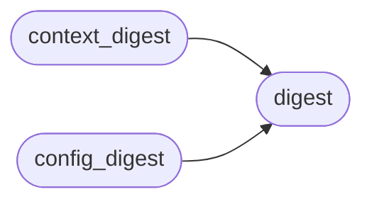

# `modules.loop.decision_log`

> Source: [modules/loop/decision_log.py:1](../../modules/loop/decision_log.py#L1) | language `py` | coverage 100.0% | [API index](../index.md)

Reproducible decision ledger for the autonomous loop.

Every next-action choice the loop makes is recorded here as one bounded
JSONL row, so an operator can answer "why did the harness run this?" and
re-execute a campaign deterministically. The schema is a decision audit:
digests of the decision inputs (the engagement context, the model prompt, the
deterministic-relevant config) plus a model-versus-rule fallback flag make each
decision auditable without storing raw secrets.

A decision produced by a deterministic selector ([`modules.selection`](modules.selection.__init__.py.md))
carries ``model_fallback=False`` and empty prompt/reply digests; one produced
by the LLM planner carries ``model_fallback=True`` with both digests set. The
`[`filtered`](#decisionrecord-filtered)` list names every candidate the harness rejected and the reason,
so a silently dropped command is never invisible again.

The ledger is append-only and self-rotating, mirroring
``modules.lazy_loop.record_worker_traces`` so the two ledgers share one I/O
discipline. Nothing here imports the loop runtime, keeping the module free of
import cycles and usable from tests in isolation.

## Contents

- **Classes:** [`DecisionRecord`](#decisionrecord)
- **Functions:** [`digest`](#digest), [`context_digest`](#context_digest), [`config_digest`](#config_digest), [`new_run_id`](#new_run_id), [`record`](#record), [`read_records`](#read_records), [`filtered_rows`](#filtered_rows)
- **Constants:** [`DECISIONS_FILE`](#decisions_file)

## Call Graph

Solid arrows stay in this module, dashed arrows leave it.



## Classes

<a id="decisionrecord"></a>

### `DecisionRecord`

`class` `dataclass` | [modules/loop/decision_log.py:143](../../modules/loop/decision_log.py#L143)

Decorators: `@dataclass(frozen=True)`

```python
class DecisionRecord
```

One auditable next-action decision made by the loop.

**Attributes**

| Name | Type | Default | Description |
|---|---|---|---|
| [`run_id`](#decisionrecord-run_id) | `str` |  | Identifier shared by every decision in one loop run. |
| [`step`](#decisionrecord-step) | `int` |  | The intent node id this decision advanced; stable per intent and combined with `[`ts`](#decisionrecord-ts)` to order repeated decisions on one intent. |
| [`source`](#decisionrecord-source) | `str` |  | Selector name, or ``"llm"`` for the model planner. |
| [`model_fallback`](#decisionrecord-model_fallback) | `bool` | `False` | True when the LLM produced the action rather than a deterministic selector. |
| [`chosen`](#decisionrecord-chosen) | `str` | `''` | The command the harness committed to, empty when every candidate was rejected. |
| [`reason`](#decisionrecord-reason) | `str` | `''` | Short rationale carried from the selector or planner. |
| [`ctx_digest`](#decisionrecord-ctx_digest) | `str` | `''` | Fingerprint of the engagement context at decision time. |
| [`config_digest`](#decisionrecord-config_digest) | `str` | `''` | Fingerprint of the reproducibility-relevant config. |
| [`prompt_digest`](#decisionrecord-prompt_digest) | `str` | `''` | Fingerprint of the model prompt, empty for selectors. |
| [`reply_digest`](#decisionrecord-reply_digest) | `str` | `''` | Fingerprint of the raw model reply, empty for selectors. |
| [`candidates`](#decisionrecord-candidates) | `tuple[str, ...]` | `()` | Every command proposed before filtering. |
| [`filtered`](#decisionrecord-filtered) | `tuple[Mapping[str, str], ...]` | `()` | Rejected candidates as ``{"command", "reason"}`` rows. |
| [`truncated`](#decisionrecord-truncated) | `bool` | `False` | True when any recorded field was clipped for size. |
| [`ts`](#decisionrecord-ts) | `float` | `field(default_factory=time.time)` | UTC epoch seconds when the decision was captured. |

---

## Functions

<a id="digest"></a>

### `digest`

`function` | [modules/loop/decision_log.py:51](../../modules/loop/decision_log.py#L51)

```python
def digest(text: str) -> str
```

Return the stable short digest used to fingerprint a decision input.

**Parameters**

| Name | Type | Default | Description |
|---|---|---|---|
| `text` | `str` |  | Arbitrary input text (a prompt, a reply, a serialised context). |

**Returns:** `str` - The first `_DIGEST_WIDTH` hex characters of the SHA-256 of
``text``; an empty string maps to an empty digest so absence is
distinguishable from content.

*Called by:* [`config_digest`](#config_digest), [`context_digest`](#context_digest)

---

<a id="context_digest"></a>

### `context_digest`

`function` | [modules/loop/decision_log.py:90](../../modules/loop/decision_log.py#L90)

```python
def context_digest(ctx: Any) -> str
```

Fingerprint a selection context independent of field ordering.

The context's ``extra`` mapping is unordered by construction, so a naive
repr would make equal states hash differently. This canonicalises every
field first, which is what lets a caller memoise a decision by state.

**Parameters**

| Name | Type | Default | Description |
|---|---|---|---|
| `ctx` | `Any` |  | A `[`SelectionContext`](modules.selection.base.py.md#selectioncontext)`-shaped object, or any object exposing the same attributes. |

**Returns:** `str` - The short digest of the canonical context, or an empty string when the
object exposes no recognisable fields.

*Calls:* [`digest`](#digest)

---

<a id="config_digest"></a>

### `config_digest`

`function` | [modules/loop/decision_log.py:115](../../modules/loop/decision_log.py#L115)

```python
def config_digest(config: Mapping[str, Any] | None) -> str
```

Fingerprint the config keys that change a decision's reproducibility.

Only the keys in `_CONFIG_KEYS` participate (planner temperature, the
determinism and guard-rule flags, and model selection), so unrelated config
churn does not invalidate a replay while a change that alters the decision
correctly does.

**Parameters**

| Name | Type | Default | Description |
|---|---|---|---|
| `config` | `Mapping[str, Any] \| None` |  | A payload mapping, or ``None`` when unavailable. |

**Returns:** `str` - The short digest of the relevant config subset.

*Calls:* [`digest`](#digest)

---

<a id="new_run_id"></a>

### `new_run_id`

`function` | [modules/loop/decision_log.py:137](../../modules/loop/decision_log.py#L137)

```python
def new_run_id() -> str
```

Return a fresh identifier grouping all decisions of one loop run.

**Returns:** `str`

---

<a id="record"></a>

### `record`

`function` | [modules/loop/decision_log.py:192](../../modules/loop/decision_log.py#L192)

```python
def record(rec: DecisionRecord, path: Path | None = None) -> bool
```

Append one decision to the ledger, rotating it when oversized.

The write never raises: a decision ledger failure must not abort a live
engagement, so an I/O error is swallowed and reported as ``False``.

**Parameters**

| Name | Type | Default | Description |
|---|---|---|---|
| `rec` | `DecisionRecord` |  | The decision to persist. |
| `path` | `Path \| None` | `None` | Optional ledger path override for tests. |

**Returns:** `bool` - True when the row was written, False on any I/O failure.

---

<a id="read_records"></a>

### `read_records`

`function` | [modules/loop/decision_log.py:221](../../modules/loop/decision_log.py#L221)

```python
def read_records(path: Path | None = None) -> list[dict[str, Any]]
```

Return every decision row in order, for audit or deterministic replay.

**Parameters**

| Name | Type | Default | Description |
|---|---|---|---|
| `path` | `Path \| None` | `None` | Optional ledger path override for tests. |

**Returns:** `list[dict[str, Any]]` - The parsed rows; a corrupt line is skipped rather than aborting the
read so a partially written tail never hides earlier history.

---

<a id="filtered_rows"></a>

### `filtered_rows`

`function` | [modules/loop/decision_log.py:248](../../modules/loop/decision_log.py#L248)

```python
def filtered_rows(items: Iterable[tuple[str, str]]) -> tuple[dict[str, str], ...]
```

Shape ``(command, reason)`` pairs into ledger-ready rejection rows.

**Parameters**

| Name | Type | Default | Description |
|---|---|---|---|
| `items` | `Iterable[tuple[str, str]]` |  | Rejected candidates with their reason. |

**Returns:** `tuple[dict[str, str], ...]` - An immutable tuple of ``{"command", "reason"}`` mappings.

---

## Constants

<a id="decisions_file"></a>

### `DECISIONS_FILE`

`constant` | [modules/loop/decision_log.py:34](../../modules/loop/decision_log.py#L34)

```python
DECISIONS_FILE = _BASE_DIR / 'sessions' / 'decisions.jsonl'
```

---
