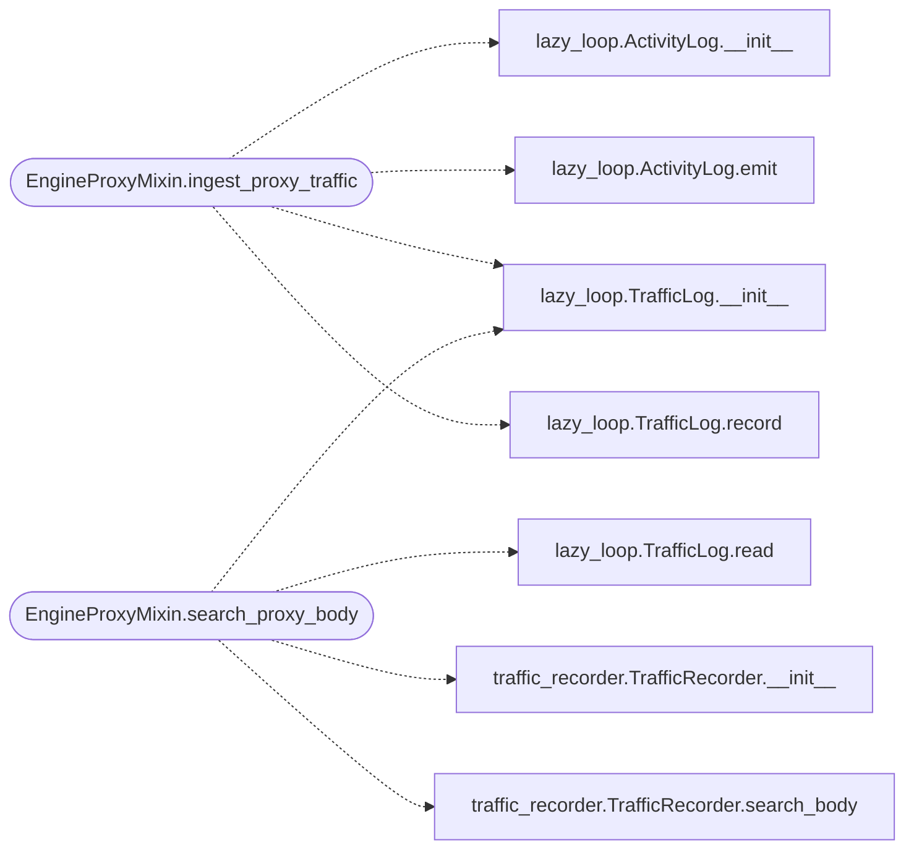

# `modules.loop.engine_proxy`

> Source: [modules/loop/engine_proxy.py:1](../../modules/loop/engine_proxy.py#L1) | language `py` | coverage 87.5% | [API index](../index.md)

## Contents

- **Classes:** [`EngineProxyMixin`](#engineproxymixin)

## Call Graph

Solid arrows stay in this module, dashed arrows leave it.



## Classes

<a id="engineproxymixin"></a>

### `EngineProxyMixin`

`class` | [modules/loop/engine_proxy.py:4](../../modules/loop/engine_proxy.py#L4)

```python
class EngineProxyMixin
```

Subclasses: [`LazyLoopEngine`](modules.lazy_loop.py.md#lazyloopengine)

Recorder-proxy lifecycle and traffic ingestion for the loop engine.

Groups the engine's control of the shared recording proxy (start, stop,
status, environment), the per-task mirroring of captured exchanges into
the task traffic log, body search and retention sweeps. Every method binds
to the host `[`LazyLoopEngine`](modules.lazy_loop.py.md#lazyloopengine)` through ``self`` and relies on the proxy
retention attributes it sets in `[`__init__`](init__.py.md)` (``proxy_gc_interval_sec``,
``proxy_gc_days``). Module-level helpers from [`modules.lazy_loop`](modules.lazy_loop.py.md) are
imported lazily to avoid a circular import at module load time.

**Members**

| Member | Kind | Summary |
|---|---|---|
| [`proxy_start`](#engineproxymixin-proxy_start) | method | Start the shared recorder proxy and apply its trust environment. |
| [`proxy_stop`](#engineproxymixin-proxy_stop) | method | Stop the recorder proxy and clear its trust environment. |
| [`proxy_status`](#engineproxymixin-proxy_status) | method | Return recorder proxy state (running, address, CA, exchanges). |
| [`proxy_env`](#engineproxymixin-proxy_env) | method | Return the environment overrides that route tools via proxy. |
| [`ingest_proxy_traffic`](#engineproxymixin-ingest_proxy_traffic) | method | Mirror new recorder exchanges into the task traffic log. |
| [`search_proxy_body`](#engineproxymixin-search_proxy_body) | method | Full-text search proxy bodies scoped to one task's exchanges. |

<a id="engineproxymixin-proxy_start"></a>

#### `EngineProxyMixin.proxy_start`

`method` | [modules/loop/engine_proxy.py:16](../../modules/loop/engine_proxy.py#L16)

```python
def proxy_start(self, host: str = '', port: int = 0, task_id: str = '', trust: bool = True, upstream: str = '') -> dict
```

Start the shared recorder proxy and apply its trust environment.

**Parameters**

| Name | Type | Default | Description |
|---|---|---|---|
| `host` | `str` | `''` | Bind address (default 127.0.0.1). |
| `port` | `int` | `0` | Bind port (default 8899). |
| `task_id` | `str` | `''` | Task tag stored with each exchange. |
| `trust` | `bool` | `True` | Also install the CA into the system trust store, prompting sudo only when the anchor is missing or stale. |
| `upstream` | `str` | `''` | Optional ``[user:pass@]host:port`` proxy to chain. |

**Returns:** `dict` - Proxy status dict including the CA path and trust outcome.

*Called by:* [`handle`](skills.mcp_tools.lazy_proxy.py.md#handle)

<a id="engineproxymixin-proxy_stop"></a>

#### `EngineProxyMixin.proxy_stop`

`method` | [modules/loop/engine_proxy.py:52](../../modules/loop/engine_proxy.py#L52)

```python
def proxy_stop(self) -> dict
```

Stop the recorder proxy and clear its trust environment.

**Returns:** `dict`

<a id="engineproxymixin-proxy_status"></a>

#### `EngineProxyMixin.proxy_status`

`method` | [modules/loop/engine_proxy.py:60](../../modules/loop/engine_proxy.py#L60)

```python
def proxy_status(self) -> dict
```

Return recorder proxy state (running, address, CA, exchanges).

**Returns:** `dict`

*Called by:* [`handle`](skills.mcp_tools.lazy_proxy.py.md#handle)

<a id="engineproxymixin-proxy_env"></a>

#### `EngineProxyMixin.proxy_env`

`method` | [modules/loop/engine_proxy.py:66](../../modules/loop/engine_proxy.py#L66)

```python
def proxy_env(self) -> dict
```

Return the environment overrides that route tools via proxy.

**Returns:** `dict`

*Called by:* [`handle`](skills.mcp_tools.lazy_proxy.py.md#handle)

<a id="engineproxymixin-ingest_proxy_traffic"></a>

#### `EngineProxyMixin.ingest_proxy_traffic`

`method` | [modules/loop/engine_proxy.py:75](../../modules/loop/engine_proxy.py#L75)

```python
def ingest_proxy_traffic(self, task_id: str, limit: int = 200) -> int
```

Mirror new recorder exchanges into the task traffic log.

A per-task rowid watermark keeps repeated rounds cheap; the
recorder exchange id rides in meta so ``lazy_traffic body`` can
fetch stored request/response bodies from the proxy store.

**Parameters**

| Name | Type | Default | Description |
|---|---|---|---|
| `task_id` | `str` |  | Task receiving the mirrored rows. |
| `limit` | `int` | `200` | Max rows per ingest page. |

**Returns:** `int` - Number of freshly ingested exchanges.

*Calls:* [`ActivityLog.__init__`](modules.lazy_loop.py.md#activitylog-__init__), [`ActivityLog.emit`](modules.lazy_loop.py.md#activitylog-emit), [`TrafficLog.__init__`](modules.lazy_loop.py.md#trafficlog-__init__), [`TrafficLog.record`](modules.lazy_loop.py.md#trafficlog-record)

<a id="engineproxymixin-search_proxy_body"></a>

#### `EngineProxyMixin.search_proxy_body`

`method` | [modules/loop/engine_proxy.py:130](../../modules/loop/engine_proxy.py#L130)

```python
def search_proxy_body(self, task_id: str, query: str, limit: int = 20) -> list[dict]
```

Full-text search proxy bodies scoped to one task's exchanges.

**Parameters**

| Name | Type | Default | Description |
|---|---|---|---|
| `task_id` | `str` |  | Task whose ingested exchanges are searched. |
| `query` | `str` |  | Phrase to search for. |
| `limit` | `int` | `20` | Max hits. |

**Returns:** `list[dict]` - Hits with exchange_id, url, status, host and snippet.

*Calls:* [`TrafficLog.__init__`](modules.lazy_loop.py.md#trafficlog-__init__), [`TrafficLog.read`](modules.lazy_loop.py.md#trafficlog-read), [`TrafficRecorder.__init__`](modules.traffic_recorder.py.md#trafficrecorder-__init__), [`TrafficRecorder.search_body`](modules.traffic_recorder.py.md#trafficrecorder-search_body)

---
