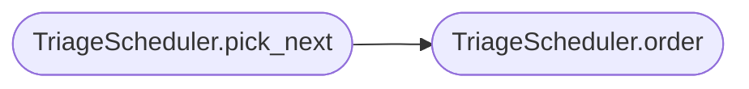

# `modules.loop.triage_scheduler`

> Source: [modules/loop/triage_scheduler.py:1](../../modules/loop/triage_scheduler.py#L1) | language `py` | coverage 100.0% | [API index](../index.md)

Difficulty-triage scheduling for the autonomous multi-target loop.

Ports the sapper-v2 scheduling doctrine into LazyOwn terms: a short triage
estimates each target's difficulty, the queue is drained easy-first so quick
wins land before hard assaults, a stop-loss abandons targets that burn attempts
without progress, and near a deadline partially-solved targets are salvaged
first. The scheduler is pure: it operates on plain task records (dicts) and
performs no I/O, so the engine can order its own queue and the policy stays
unit-testable in isolation.

Task records may carry these optional triage fields; all default to neutral so
an unannotated queue degrades to easy-first-by-arrival ordering:
    ``difficulty`` (0.0 easy .. 1.0 hard), ``attempts`` (int),
    ``progress`` (0.0 .. 1.0), ``partial`` (bool, has salvageable partial).

## Contents

- **Classes:** [`TriageScheduler`](#triagescheduler)
- **Functions:** [`estimate_difficulty`](#estimate_difficulty)

## Call Graph

Solid arrows stay in this module, dashed arrows leave it.



## Classes

<a id="triagescheduler"></a>

### `TriageScheduler`

`class` | [modules/loop/triage_scheduler.py:85](../../modules/loop/triage_scheduler.py#L85)

```python
class TriageScheduler
```

Order a target queue easy-first with stop-loss and deadline salvage.

The scheduler holds only policy thresholds; it keeps no per-target state,
so one instance safely serves the whole engine.

**Members**

| Member | Kind | Summary |
|---|---|---|
| [`__init__`](#triagescheduler-__init__) | constructor | Initialize the scheduler with its policy thresholds. |
| [`should_stop`](#triagescheduler-should_stop) | method | Return True when a target has burned its attempt budget unproductively. |
| [`route`](#triagescheduler-route) | method | Return the worker tier for a target: ``general`` (hard) or ``soldier``. |
| [`order`](#triagescheduler-order) | method | Return records ordered for draining. |
| [`pick_next`](#triagescheduler-pick_next) | method | Return the single record to drain next, or None when empty. |

<a id="triagescheduler-__init__"></a>

#### `TriageScheduler.__init__`

`constructor` | [modules/loop/triage_scheduler.py:92](../../modules/loop/triage_scheduler.py#L92)

```python
def __init__(self, stop_loss_attempts: int = _DEFAULT_STOP_LOSS_ATTEMPTS, salvage_progress: float = _DEFAULT_SALVAGE_PROGRESS, hard_threshold: float = _DEFAULT_HARD_THRESHOLD) -> None
```

Initialize the scheduler with its policy thresholds.

**Parameters**

| Name | Type | Default | Description |
|---|---|---|---|
| `stop_loss_attempts` | `int` | `_DEFAULT_STOP_LOSS_ATTEMPTS` | Attempts without progress before abandoning. |
| `salvage_progress` | `float` | `_DEFAULT_SALVAGE_PROGRESS` | Minimum progress for a partial to be salvaged. |
| `hard_threshold` | `float` | `_DEFAULT_HARD_THRESHOLD` | Difficulty at or above which a target is routed to a general (hard assault) rather than a soldier (mass run). |

<a id="triagescheduler-should_stop"></a>

#### `TriageScheduler.should_stop`

`method` | [modules/loop/triage_scheduler.py:110](../../modules/loop/triage_scheduler.py#L110)

```python
def should_stop(self, record: Mapping[str, Any]) -> bool
```

Return True when a target has burned its attempt budget unproductively.

**Parameters**

| Name | Type | Default | Description |
|---|---|---|---|
| `record` | `Mapping[str, Any]` |  | A task record with ``attempts`` and ``progress``. |

**Returns:** `bool` - True when attempts reached the stop-loss limit with no progress.

<a id="triagescheduler-route"></a>

#### `TriageScheduler.route`

`method` | [modules/loop/triage_scheduler.py:122](../../modules/loop/triage_scheduler.py#L122)

```python
def route(self, record: Mapping[str, Any]) -> str
```

Return the worker tier for a target: ``general`` (hard) or ``soldier``.

**Parameters**

| Name | Type | Default | Description |
|---|---|---|---|
| `record` | `Mapping[str, Any]` |  | A task record with a ``difficulty`` field. |

**Returns:** `str` - ``"general"`` for hard targets, otherwise ``"soldier"``.

<a id="triagescheduler-order"></a>

#### `TriageScheduler.order`

`method` | [modules/loop/triage_scheduler.py:133](../../modules/loop/triage_scheduler.py#L133)

```python
def order(self, records: Iterable[Mapping[str, Any]], *, deadline_near: bool = False) -> list[Mapping[str, Any]]
```

Return records ordered for draining.

Normal order is easy-first (lowest difficulty), breaking ties toward
more progress and earlier arrival. Near a deadline, salvageable
partials are floated to the front so almost-won targets finish before
time runs out.

**Parameters**

| Name | Type | Default | Description |
|---|---|---|---|
| `records` | `Iterable[Mapping[str, Any]]` |  | The queued task records. |
| `deadline_near` | `bool` | `False` | When True, prioritise salvageable partials. |

**Returns:** `list[Mapping[str, Any]]` - A new list of the same records in drain order.

*Called by:* [`TaskStore.dequeue_next`](modules.lazy_loop.py.md#taskstore-dequeue_next), [`TriageScheduler.pick_next`](#triagescheduler-pick_next), [`validate_shellcode`](plugins.validate_shellcode.lua.md#validate_shellcode)

<a id="triagescheduler-pick_next"></a>

#### `TriageScheduler.pick_next`

`method` | [modules/loop/triage_scheduler.py:172](../../modules/loop/triage_scheduler.py#L172)

```python
def pick_next(self, records: Sequence[Mapping[str, Any]], *, deadline_near: bool = False) -> Mapping[str, Any] | None
```

Return the single record to drain next, or None when empty.

**Parameters**

| Name | Type | Default | Description |
|---|---|---|---|
| `records` | `Sequence[Mapping[str, Any]]` |  | The queued task records. |
| `deadline_near` | `bool` | `False` | When True, prioritise salvageable partials. |

**Returns:** `Mapping[str, Any] | None` - The highest-priority record, or None.

*Calls:* [`TriageScheduler.order`](#triagescheduler-order)

---

## Functions

<a id="estimate_difficulty"></a>

### `estimate_difficulty`

`function` | [modules/loop/triage_scheduler.py:36](../../modules/loop/triage_scheduler.py#L36)

```python
def estimate_difficulty(facts: Mapping[str, Any]) -> float
```

Estimate a target's difficulty in ``[0.0, 1.0]`` from known facts.

Wide attack surface is an opportunity, not an obstacle: a host exposing many
ports and varied services offers more vectors and more known exploits, so it
is usually a quicker win than a hardened host with a single service. Surface
therefore lowers difficulty from a neutral baseline rather than raising it,
which is what lets the easy-first scheduler drain a rich target like a full
gym host before a locked-down bastion. A target with no surface facts yet
scores the neutral ``0.5`` rather than ``0.0``, so an unscanned host never
leapfrogs a target already known to be easy.

The estimate is deliberately coarse; it only ranks targets relative to one
another and is expected to be refined by proven-chain history elsewhere.

**Parameters**

| Name | Type | Default | Description |
|---|---|---|---|
| `facts` | `Mapping[str, Any]` |  | A mapping that may carry ``open_ports`` (a sized collection or int) and ``services`` (a sized collection of service names). |

**Returns:** `float` - A difficulty score between 0.0 (easy, rich surface) and 1.0 (hard).

---
