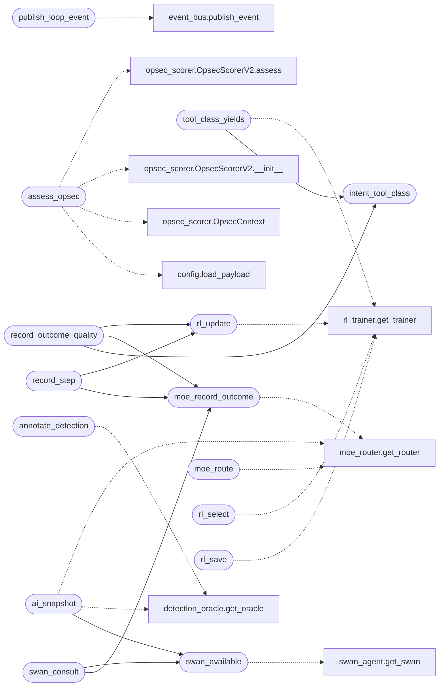

# `modules.loop_ai_bridge`

> Source: [modules/loop_ai_bridge.py:1](../../modules/loop_ai_bridge.py#L1) | language `py` | coverage 100.0% | [API index](../index.md)

Single edge between the autonomous loop and the LazyOwn AI stack.

The loop does not reimplement AI plumbing: this bridge is the one place
where it publishes events to the unified event bus, feeds the episodic
Hive Mind memory, consults the detection oracle, uses the MoE router
and RL trainer for expert selection and outcome learning, and can ask
SWAN for an ensemble plan. Every call is guarded and gated by an
orchestrator stage toggle, so disabling a stage (or an unavailable
dependency) degrades to a no-op instead of breaking the loop.

## Contents

- **Functions:** [`publish_loop_event`](#publish_loop_event), [`assess_opsec`](#assess_opsec), [`intent_tool_class`](#intent_tool_class), [`record_outcome_quality`](#record_outcome_quality), [`tool_class_yields`](#tool_class_yields), [`annotate_detection`](#annotate_detection), [`moe_route`](#moe_route), [`moe_record_outcome`](#moe_record_outcome), [`rl_select`](#rl_select), [`rl_update`](#rl_update), [`rl_save`](#rl_save), [`record_step`](#record_step), [`swan_available`](#swan_available), [`swan_consult`](#swan_consult), [`ai_snapshot`](#ai_snapshot)

## Call Graph

Solid arrows stay in this module, dashed arrows leave it.



## Functions

<a id="publish_loop_event"></a>

### `publish_loop_event`

`function` | [modules/loop_ai_bridge.py:74](../../modules/loop_ai_bridge.py#L74)

```python
def publish_loop_event(task_id: str, worker: str, kind: str, text: str, severity: str = 'info') -> None
```

Publish one loop activity to the unified bus and Hive memory.

Raw stream kinds (tool output, LLM chatter) are skipped so the event
ledger stays meaningful; everything else gets a category, severity
and the task id in its payload.

**Parameters**

| Name | Type | Default | Description |
|---|---|---|---|
| `task_id` | `str` |  |  |
| `worker` | `str` |  |  |
| `kind` | `str` |  |  |
| `text` | `str` |  |  |
| `severity` | `str` | `'info'` |  |

*Calls:* [`publish_event`](modules.event_bus.py.md#publish_event)

*Called by:* [`TelemetryMediator.publish_event`](modules.mediation.telemetry_mediator.py.md#telemetrymediator-publish_event)

---

<a id="assess_opsec"></a>

### `assess_opsec`

`function` | [modules/loop_ai_bridge.py:125](../../modules/loop_ai_bridge.py#L125)

```python
def assess_opsec(command: str, rhost: str = '') -> dict | None
```

Return a pre-execution OPSEC gate assessment, or None when unavailable.

Wraps [`modules.opsec_scorer.OpsecScorerV2`](modules.opsec_scorer.py.md#opsecscorerv2) with a fresh context
per call, so the autonomous loop gates noisy commands (allow / warn /
confirm / block) the same way ``detection_oracle`` annotates sigma-rule
matches, without the two systems' thresholds colliding. Evasion state
is read from ``payload.json`` so a caller never has to thread it
through the worker.

**Parameters**

| Name | Type | Default | Description |
|---|---|---|---|
| `command` | `str` |  | Shell command line about to be executed. |
| `rhost` | `str` | `''` | Target host, used for sensitivity context. |

**Returns:** `dict | None` - Mapping with `[`gate`](modules.harness.py.md#gate)`, `[`noise`](modules.verb_manifest.py.md#verbmanifest-noise)`, `[`risk_label`](modules.opsec_scorer.py.md#gatedopsecscore-risk_label)`, ``explanation``
and `[`mitigations`](modules.opsec_scorer.py.md#gatedopsecscore-mitigations)`, or None when the stage is off or scoring
failed.

*Calls:* [`load_payload`](core.config.py.md#load_payload), [`OpsecContext`](modules.opsec_scorer.py.md#opseccontext), [`OpsecScorerV2.__init__`](modules.opsec_scorer.py.md#opsecscorerv2-__init__), [`OpsecScorerV2.assess`](modules.opsec_scorer.py.md#opsecscorerv2-assess)

---

<a id="intent_tool_class"></a>

### `intent_tool_class`

`function` | [modules/loop_ai_bridge.py:169](../../modules/loop_ai_bridge.py#L169)

```python
def intent_tool_class(summary: str) -> str
```

Return the coarse tool class an intent summary belongs to.

This is the shared vocabulary that makes the decision-quality reward a
closed loop: the planner ranks candidate summaries, and the worker
rewards the *same* class derived from the intent it finished, so what
the trainer learns is exactly what the planner later queries. Keying
on the summary (known at planning time) rather than the eventual
command token (known only after execution) is what lets the two sides
line up.

**Parameters**

| Name | Type | Default | Description |
|---|---|---|---|
| `summary` | `str` |  | Intent summary text as the planner emits it. |

**Returns:** `str` - A stable lower-case class key, or an empty string for empty input.

*Called by:* [`record_outcome_quality`](#record_outcome_quality), [`tool_class_yields`](#tool_class_yields)

---

<a id="record_outcome_quality"></a>

### `record_outcome_quality`

`function` | [modules/loop_ai_bridge.py:213](../../modules/loop_ai_bridge.py#L213)

```python
def record_outcome_quality(worker: str, intent_summary: str, facts: int, findings: int) -> None
```

Feed one intent's net yield back to MoE/RL as a decision-quality reward.

`[`record_step`](#record_step)` rewards whether a single command executed without
failure; it says nothing about whether the exploration intent it
belonged to actually produced intel. This reward closes that gap: a
confirmed finding scores highest (1.0), a recorded fact scores partial
credit (0.5), and an intent that settled with nothing persisted scores
zero. The action key is the intent's tool class (see
[`intent_tool_class`](#intent_tool_class)), the same key [`tool_class_yields`](#tool_class_yields)
reads back, so the planner can demote classes that have stopped
producing intel for this engagement.

**Parameters**

| Name | Type | Default | Description |
|---|---|---|---|
| `worker` | `str` |  | Emitting worker name. |
| `intent_summary` | `str` |  | Summary of the finished intent. |
| `facts` | `int` |  | Facts persisted by the intent's writeback. |
| `findings` | `int` |  | Findings persisted by the intent's writeback. |

*Calls:* [`intent_tool_class`](#intent_tool_class), [`moe_record_outcome`](#moe_record_outcome), [`rl_update`](#rl_update)

---

<a id="tool_class_yields"></a>

### `tool_class_yields`

`function` | [modules/loop_ai_bridge.py:240](../../modules/loop_ai_bridge.py#L240)

```python
def tool_class_yields(summaries: list[str], phase: str = DECISION_PHASE) -> dict[str, float]
```

Return the learned decision-quality yield for each candidate summary.

Consumer side of the decision-quality reward: maps each summary to its
[`intent_tool_class`](#intent_tool_class) and returns the trainer's current Q-value for
that class. Unseen classes come back at the optimistic init (``1.0``),
classes that kept producing intel climb above it, and classes that
stopped producing decay below it, so the planner can rank on the gap.

**Parameters**

| Name | Type | Default | Description |
|---|---|---|---|
| `summaries` | `list[str]` |  | Candidate summaries the planner is about to rank. |
| `phase` | `str` | `DECISION_PHASE` | Engagement phase key the reward was recorded under. |

**Returns:** `dict[str, float]` - Mapping of summary to its class Q-value; empty when the stage is
off, the trainer is unavailable, or no summary maps to a class.

*Calls:* [`intent_tool_class`](#intent_tool_class), [`get_trainer`](modules.rl_trainer.py.md#get_trainer)

---

<a id="annotate_detection"></a>

### `annotate_detection`

`function` | [modules/loop_ai_bridge.py:280](../../modules/loop_ai_bridge.py#L280)

```python
def annotate_detection(command: str, action_category: str = 'execution') -> dict | None
```

Return oracle details for one command, or None when unavailable.

**Parameters**

| Name | Type | Default | Description |
|---|---|---|---|
| `command` | `str` |  |  |
| `action_category` | `str` | `'execution'` |  |

**Returns:** `dict | None`

*Calls:* [`get_oracle`](modules.detection_oracle.py.md#get_oracle)

---

<a id="moe_route"></a>

### `moe_route`

`function` | [modules/loop_ai_bridge.py:304](../../modules/loop_ai_bridge.py#L304)

```python
def moe_route(task_type: str, goal: str = '')
```

Return the MoE router's preferred expert for a task type, or None.

**Parameters**

| Name | Type | Default | Description |
|---|---|---|---|
| `task_type` | `str` |  |  |
| `goal` | `str` | `''` |  |

*Calls:* [`get_router`](modules.moe_router.py.md#get_router)

---

<a id="moe_record_outcome"></a>

### `moe_record_outcome`

`function` | [modules/loop_ai_bridge.py:321](../../modules/loop_ai_bridge.py#L321)

```python
def moe_record_outcome(expert_id: str, task_type: str, reward: float, detection_prob: float = 0.0) -> None
```

Feed one execution outcome back to the MoE performance store.

**Parameters**

| Name | Type | Default | Description |
|---|---|---|---|
| `expert_id` | `str` |  |  |
| `task_type` | `str` |  |  |
| `reward` | `float` |  |  |
| `detection_prob` | `float` | `0.0` |  |

*Calls:* [`get_router`](modules.moe_router.py.md#get_router)

*Called by:* [`record_outcome_quality`](#record_outcome_quality), [`record_step`](#record_step), [`swan_consult`](#swan_consult)

---

<a id="rl_select"></a>

### `rl_select`

`function` | [modules/loop_ai_bridge.py:340](../../modules/loop_ai_bridge.py#L340)

```python
def rl_select(task_type: str, phase: str, candidates: list[str], deterministic: bool = False) -> str
```

Pick an expert with the RL policy; first candidate when unavailable.

**Parameters**

| Name | Type | Default | Description |
|---|---|---|---|
| `task_type` | `str` |  |  |
| `phase` | `str` |  |  |
| `candidates` | `list[str]` |  |  |
| `deterministic` | `bool` | `False` |  |

**Returns:** `str`

*Calls:* [`get_trainer`](modules.rl_trainer.py.md#get_trainer)

---

<a id="rl_update"></a>

### `rl_update`

`function` | [modules/loop_ai_bridge.py:362](../../modules/loop_ai_bridge.py#L362)

```python
def rl_update(task_type: str, phase: str, action: str, reward: float, candidates: list[str], detection_prob: float = 0.0) -> None
```

Apply one Q-learning update for an executed action.

**Parameters**

| Name | Type | Default | Description |
|---|---|---|---|
| `task_type` | `str` |  |  |
| `phase` | `str` |  |  |
| `action` | `str` |  |  |
| `reward` | `float` |  |  |
| `candidates` | `list[str]` |  |  |
| `detection_prob` | `float` | `0.0` |  |

*Calls:* [`get_trainer`](modules.rl_trainer.py.md#get_trainer)

*Called by:* [`record_outcome_quality`](#record_outcome_quality), [`record_step`](#record_step)

---

<a id="rl_save"></a>

### `rl_save`

`function` | [modules/loop_ai_bridge.py:385](../../modules/loop_ai_bridge.py#L385)

```python
def rl_save() -> None
```

Persist the RL tables after a run.

*Calls:* [`get_trainer`](modules.rl_trainer.py.md#get_trainer)

---

<a id="record_step"></a>

### `record_step`

`function` | [modules/loop_ai_bridge.py:404](../../modules/loop_ai_bridge.py#L404)

```python
def record_step(task_id: str, worker: str, command: str, output: str, detection_prob: float = 0.0) -> None
```

Feed one executed command outcome to MoE and the RL trainer.

Reward is 1.0 for a productive run (output present, no execution
failure) and 0.0 otherwise; the action is the command's first token
so the trainer learns which tool classes work for this engagement.

**Parameters**

| Name | Type | Default | Description |
|---|---|---|---|
| `task_id` | `str` |  |  |
| `worker` | `str` |  |  |
| `command` | `str` |  |  |
| `output` | `str` |  |  |
| `detection_prob` | `float` | `0.0` |  |

*Calls:* [`moe_record_outcome`](#moe_record_outcome), [`rl_update`](#rl_update)

---

<a id="swan_available"></a>

### `swan_available`

`function` | [modules/loop_ai_bridge.py:419](../../modules/loop_ai_bridge.py#L419)

```python
def swan_available() -> bool
```

Return True when the SWAN orchestrator can be constructed.

**Returns:** `bool`

*Calls:* [`get_swan`](skills.swan_agent.py.md#get_swan)

*Called by:* [`ai_snapshot`](#ai_snapshot), [`swan_consult`](#swan_consult)

---

<a id="swan_consult"></a>

### `swan_consult`

`function` | [modules/loop_ai_bridge.py:432](../../modules/loop_ai_bridge.py#L432)

```python
def swan_consult(prompt: str, task_type: str = 'recon', phase: str = 'enumeration', timeout: float = 120.0) -> str
```

Ask SWAN for an ensemble answer; empty string when unavailable.

**Parameters**

| Name | Type | Default | Description |
|---|---|---|---|
| `prompt` | `str` |  |  |
| `task_type` | `str` | `'recon'` |  |
| `phase` | `str` | `'enumeration'` |  |
| `timeout` | `float` | `120.0` |  |

**Returns:** `str`

*Calls:* [`moe_record_outcome`](#moe_record_outcome), [`swan_available`](#swan_available)

---

<a id="ai_snapshot"></a>

### `ai_snapshot`

`function` | [modules/loop_ai_bridge.py:469](../../modules/loop_ai_bridge.py#L469)

```python
def ai_snapshot() -> dict
```

Compact status of the wired AI stack for the operator log.

**Returns:** `dict`

*Calls:* [`get_oracle`](modules.detection_oracle.py.md#get_oracle), [`swan_available`](#swan_available), [`get_router`](modules.moe_router.py.md#get_router), [`get_trainer`](modules.rl_trainer.py.md#get_trainer)

---
