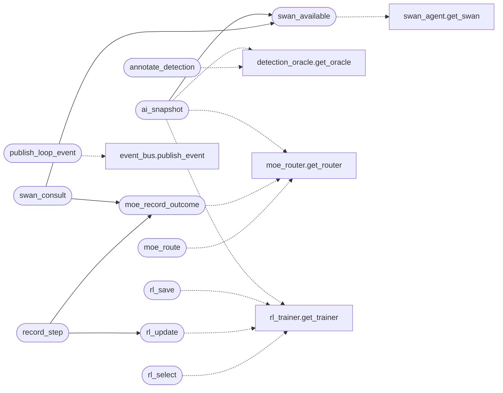

# `modules.loop_ai_bridge`

> Source: [modules/loop_ai_bridge.py:1](../../modules/loop_ai_bridge.py#L1) | language `py` | coverage 100.0% | [API index](../index.md)

Single edge between the autonomous loop and the LazyOwn AI stack.

The loop does not reimplement AI plumbing: this bridge is the one place
where it publishes events to the unified event bus, feeds the episodic
Hive Mind memory, consults the detection oracle, uses the MoE router
and RL trainer for expert selection and outcome learning, and can ask
SWAN for an ensemble plan. Every call is guarded and gated by an
orchestrator stage toggle, so disabling a stage (or an unavailable
dependency) degrades to a no-op instead of breaking the loop.

## Contents

- **Functions:** [`publish_loop_event`](#publish_loop_event), [`annotate_detection`](#annotate_detection), [`moe_route`](#moe_route), [`moe_record_outcome`](#moe_record_outcome), [`rl_select`](#rl_select), [`rl_update`](#rl_update), [`rl_save`](#rl_save), [`record_step`](#record_step), [`swan_available`](#swan_available), [`swan_consult`](#swan_consult), [`ai_snapshot`](#ai_snapshot)

## Call Graph

Solid arrows stay in this module, dashed arrows leave it.



## Functions

<a id="publish_loop_event"></a>

### `publish_loop_event`

`function` | [modules/loop_ai_bridge.py:74](../../modules/loop_ai_bridge.py#L74)

```python
def publish_loop_event(task_id: str, worker: str, kind: str, text: str, severity: str = 'info') -> None
```

Publish one loop activity to the unified bus and Hive memory.

Raw stream kinds (tool output, LLM chatter) are skipped so the event
ledger stays meaningful; everything else gets a category, severity
and the task id in its payload.

**Parameters**

| Name | Type | Default | Description |
|---|---|---|---|
| `task_id` | `str` |  |  |
| `worker` | `str` |  |  |
| `kind` | `str` |  |  |
| `text` | `str` |  |  |
| `severity` | `str` | `'info'` |  |

*Calls:* [`publish_event`](modules.event_bus.py.md#publish_event)

*Called by:* [`TelemetryMediator.publish_event`](modules.mediation.telemetry_mediator.py.md#telemetrymediator-publish_event)

---

<a id="annotate_detection"></a>

### `annotate_detection`

`function` | [modules/loop_ai_bridge.py:125](../../modules/loop_ai_bridge.py#L125)

```python
def annotate_detection(command: str, action_category: str = 'execution') -> dict | None
```

Return oracle details for one command, or None when unavailable.

**Parameters**

| Name | Type | Default | Description |
|---|---|---|---|
| `command` | `str` |  |  |
| `action_category` | `str` | `'execution'` |  |

**Returns:** `dict | None`

*Calls:* [`get_oracle`](modules.detection_oracle.py.md#get_oracle)

---

<a id="moe_route"></a>

### `moe_route`

`function` | [modules/loop_ai_bridge.py:149](../../modules/loop_ai_bridge.py#L149)

```python
def moe_route(task_type: str, goal: str = '')
```

Return the MoE router's preferred expert for a task type, or None.

**Parameters**

| Name | Type | Default | Description |
|---|---|---|---|
| `task_type` | `str` |  |  |
| `goal` | `str` | `''` |  |

*Calls:* [`get_router`](modules.moe_router.py.md#get_router)

---

<a id="moe_record_outcome"></a>

### `moe_record_outcome`

`function` | [modules/loop_ai_bridge.py:166](../../modules/loop_ai_bridge.py#L166)

```python
def moe_record_outcome(expert_id: str, task_type: str, reward: float, detection_prob: float = 0.0) -> None
```

Feed one execution outcome back to the MoE performance store.

**Parameters**

| Name | Type | Default | Description |
|---|---|---|---|
| `expert_id` | `str` |  |  |
| `task_type` | `str` |  |  |
| `reward` | `float` |  |  |
| `detection_prob` | `float` | `0.0` |  |

*Calls:* [`get_router`](modules.moe_router.py.md#get_router)

*Called by:* [`record_step`](#record_step), [`swan_consult`](#swan_consult)

---

<a id="rl_select"></a>

### `rl_select`

`function` | [modules/loop_ai_bridge.py:185](../../modules/loop_ai_bridge.py#L185)

```python
def rl_select(task_type: str, phase: str, candidates: list[str], deterministic: bool = False) -> str
```

Pick an expert with the RL policy; first candidate when unavailable.

**Parameters**

| Name | Type | Default | Description |
|---|---|---|---|
| `task_type` | `str` |  |  |
| `phase` | `str` |  |  |
| `candidates` | `list[str]` |  |  |
| `deterministic` | `bool` | `False` |  |

**Returns:** `str`

*Calls:* [`get_trainer`](modules.rl_trainer.py.md#get_trainer)

---

<a id="rl_update"></a>

### `rl_update`

`function` | [modules/loop_ai_bridge.py:207](../../modules/loop_ai_bridge.py#L207)

```python
def rl_update(task_type: str, phase: str, action: str, reward: float, candidates: list[str], detection_prob: float = 0.0) -> None
```

Apply one Q-learning update for an executed action.

**Parameters**

| Name | Type | Default | Description |
|---|---|---|---|
| `task_type` | `str` |  |  |
| `phase` | `str` |  |  |
| `action` | `str` |  |  |
| `reward` | `float` |  |  |
| `candidates` | `list[str]` |  |  |
| `detection_prob` | `float` | `0.0` |  |

*Calls:* [`get_trainer`](modules.rl_trainer.py.md#get_trainer)

*Called by:* [`record_step`](#record_step)

---

<a id="rl_save"></a>

### `rl_save`

`function` | [modules/loop_ai_bridge.py:230](../../modules/loop_ai_bridge.py#L230)

```python
def rl_save() -> None
```

Persist the RL tables after a run.

*Calls:* [`get_trainer`](modules.rl_trainer.py.md#get_trainer)

---

<a id="record_step"></a>

### `record_step`

`function` | [modules/loop_ai_bridge.py:249](../../modules/loop_ai_bridge.py#L249)

```python
def record_step(task_id: str, worker: str, command: str, output: str, detection_prob: float = 0.0) -> None
```

Feed one executed command outcome to MoE and the RL trainer.

Reward is 1.0 for a productive run (output present, no execution
failure) and 0.0 otherwise; the action is the command's first token
so the trainer learns which tool classes work for this engagement.

**Parameters**

| Name | Type | Default | Description |
|---|---|---|---|
| `task_id` | `str` |  |  |
| `worker` | `str` |  |  |
| `command` | `str` |  |  |
| `output` | `str` |  |  |
| `detection_prob` | `float` | `0.0` |  |

*Calls:* [`moe_record_outcome`](#moe_record_outcome), [`rl_update`](#rl_update)

---

<a id="swan_available"></a>

### `swan_available`

`function` | [modules/loop_ai_bridge.py:264](../../modules/loop_ai_bridge.py#L264)

```python
def swan_available() -> bool
```

Return True when the SWAN orchestrator can be constructed.

**Returns:** `bool`

*Calls:* [`get_swan`](skills.swan_agent.py.md#get_swan)

*Called by:* [`ai_snapshot`](#ai_snapshot), [`swan_consult`](#swan_consult)

---

<a id="swan_consult"></a>

### `swan_consult`

`function` | [modules/loop_ai_bridge.py:277](../../modules/loop_ai_bridge.py#L277)

```python
def swan_consult(prompt: str, task_type: str = 'recon', phase: str = 'enumeration', timeout: float = 120.0) -> str
```

Ask SWAN for an ensemble answer; empty string when unavailable.

**Parameters**

| Name | Type | Default | Description |
|---|---|---|---|
| `prompt` | `str` |  |  |
| `task_type` | `str` | `'recon'` |  |
| `phase` | `str` | `'enumeration'` |  |
| `timeout` | `float` | `120.0` |  |

**Returns:** `str`

*Calls:* [`moe_record_outcome`](#moe_record_outcome), [`swan_available`](#swan_available)

---

<a id="ai_snapshot"></a>

### `ai_snapshot`

`function` | [modules/loop_ai_bridge.py:314](../../modules/loop_ai_bridge.py#L314)

```python
def ai_snapshot() -> dict
```

Compact status of the wired AI stack for the operator log.

**Returns:** `dict`

*Calls:* [`get_oracle`](modules.detection_oracle.py.md#get_oracle), [`swan_available`](#swan_available), [`get_router`](modules.moe_router.py.md#get_router), [`get_trainer`](modules.rl_trainer.py.md#get_trainer)

---
