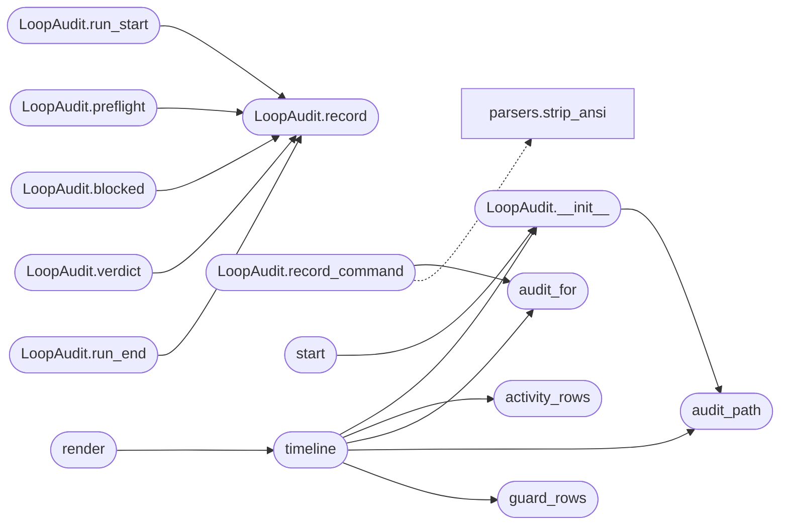

# `modules.loop_audit`

> Source: [modules/loop_audit.py:1](../../modules/loop_audit.py#L1) | language `py` | coverage 100.0% | [API index](../index.md)

Operator audit trail for autonomous loop runs.

One question drives this module: what exactly did the loop do, when,
who triggered it, with what confidence, and with what outcome? The
engine already persists fragments (activity, traffic, guard audits,
findings) but no single timeline exists, so a finished run is a sea of
logs the operator cannot navigate.

This module owns one append-only JSONL timeline per task:
``sessions/lazy/audit_<task>.jsonl``. Every executed command lands as a
``command`` event carrying:

- when: wall-clock ``ts`` plus the offset from run start;
- what: the full command and the module/verb that runs it;
- who and why: worker name, intent id, guard verdict (allow/ask/deny),
  judge source and reason, opsec gate and detection probability —
  supplied by the worker through a thread-local step context;
- outcome: ok/failed, duration and a bounded output tail.

The runner (`[`modules.lazy_runner`](modules.lazy_runner.py.md)`) starts the audit, emits
`[`run_start`](#loopaudit-run_start)`/`[`preflight`](#loopaudit-preflight)`/`[`verdict`](#loopaudit-verdict)`/`[`run_end`](#loopaudit-run_end)` lifecycle events and
hooks the executor so every executed command is recorded exactly once.
Rendering (`[`render`](#render)`) merges the audit timeline with guard decisions
(``guard_audit_<task>.jsonl``) and engine lifecycle activity
(``activity_<task>.jsonl``) so ``loop_audit`` can navigate the campaign
timeline from start to end. Never raises on I/O; a lost audit row must
never kill a step that already ran.

## Contents

- **Classes:** [`LoopAudit`](#loopaudit)
- **Functions:** [`step_context`](#step_context), [`audit_path`](#audit_path), [`start`](#start), [`audit_for`](#audit_for), [`stop`](#stop), [`guard_rows`](#guard_rows), [`activity_rows`](#activity_rows), [`timeline`](#timeline), [`render`](#render), [`list_runs`](#list_runs), [`render_summary`](#render_summary)
- **Constants:** [`AUDIT_DIR`](#audit_dir), [`AUDIT_MAX_RECORDS`](#audit_max_records)

## Call Graph

Solid arrows stay in this module, dashed arrows leave it.



## Classes

<a id="loopaudit"></a>

### `LoopAudit`

`class` | [modules/loop_audit.py:114](../../modules/loop_audit.py#L114)

```python
class LoopAudit
```

Append-only per-task audit timeline (one JSON object per line).

**Parameters**

| Name | Type | Default | Description |
|---|---|---|---|
| `task_id` |  |  | Task identifier the timeline belongs to. |
| `path` |  |  | File override (tests); defaults to ``sessions/lazy/audit_<task>.jsonl``. |

**Members**

| Member | Kind | Summary |
|---|---|---|
| [`__init__`](#loopaudit-__init__) | constructor | Bind the audit file and start the run clock. |
| [`path`](#loopaudit-path) | property | Return the timeline file path. |
| [`record`](#loopaudit-record) | method | Append one event and enforce the file cap. |
| [`run_start`](#loopaudit-run_start) | method | Record the loop lifecycle start. |
| [`preflight`](#loopaudit-preflight) | method | Record the target preflight verdict. |
| [`blocked`](#loopaudit-blocked) | method | Record a command that never ran because a gate blocked it. |
| [`verdict`](#loopaudit-verdict) | method | Record the independent goal-evaluation verdict. |
| [`run_end`](#loopaudit-run_end) | method | Record the loop lifecycle end with the final engine status. |
| [`record_command`](#loopaudit-record_command) | method | Record one executed command with its trigger context. |

<a id="loopaudit-__init__"></a>

#### `LoopAudit.__init__`

`constructor` | [modules/loop_audit.py:123](../../modules/loop_audit.py#L123)

```python
def __init__(self, task_id: str, path: Path | None = None) -> None
```

Bind the audit file and start the run clock.

**Parameters**

| Name | Type | Default | Description |
|---|---|---|---|
| `task_id` | `str` |  |  |
| `path` | `Path \| None` | `None` |  |

*Calls:* [`audit_path`](#audit_path)

*Called by:* [`start`](#start), [`timeline`](#timeline)

<a id="loopaudit-path"></a>

#### `LoopAudit.path`

`property` | [modules/loop_audit.py:131](../../modules/loop_audit.py#L131)

Decorators: `@property`

```python
def path(self) -> Path
```

Return the timeline file path.

**Returns:** `Path`

<a id="loopaudit-record"></a>

#### `LoopAudit.record`

`method` | [modules/loop_audit.py:135](../../modules/loop_audit.py#L135)

```python
def record(self, kind: str, **fields) -> dict | None
```

Append one event and enforce the file cap.

**Parameters**

| Name | Type | Default | Description |
|---|---|---|---|
| `kind` | `str` |  | Event family (``command``, `[`blocked`](#loopaudit-blocked)`, `[`run_start`](#loopaudit-run_start)`, ...). |
| `**fields` |  |  | Event payload; long text fields are bounded. |

**Returns:** `dict | None` - The stored event mapping, or None when the write failed.

*Called by:* [`LoopAudit.blocked`](#loopaudit-blocked), [`LoopAudit.preflight`](#loopaudit-preflight), [`LoopAudit.run_end`](#loopaudit-run_end), [`LoopAudit.run_start`](#loopaudit-run_start), [`LoopAudit.verdict`](#loopaudit-verdict)

<a id="loopaudit-run_start"></a>

#### `LoopAudit.run_start`

`method` | [modules/loop_audit.py:155](../../modules/loop_audit.py#L155)

```python
def run_start(self, goal: str = '', target: str = '', rounds: int = 0, workers: int = 0, mode: str = '', profile: str = '') -> dict | None
```

Record the loop lifecycle start.

**Parameters**

| Name | Type | Default | Description |
|---|---|---|---|
| `goal` | `str` | `''` |  |
| `target` | `str` | `''` |  |
| `rounds` | `int` | `0` |  |
| `workers` | `int` | `0` |  |
| `mode` | `str` | `''` |  |
| `profile` | `str` | `''` |  |

**Returns:** `dict | None`

*Calls:* [`LoopAudit.record`](#loopaudit-record)

<a id="loopaudit-preflight"></a>

#### `LoopAudit.preflight`

`method` | [modules/loop_audit.py:168](../../modules/loop_audit.py#L168)

```python
def preflight(self, outcome: dict) -> dict | None
```

Record the target preflight verdict.

**Parameters**

| Name | Type | Default | Description |
|---|---|---|---|
| `outcome` | `dict` |  |  |

**Returns:** `dict | None`

*Calls:* [`LoopAudit.record`](#loopaudit-record)

<a id="loopaudit-blocked"></a>

#### `LoopAudit.blocked`

`method` | [modules/loop_audit.py:178](../../modules/loop_audit.py#L178)

```python
def blocked(self, source: str, reason: str, command: str = '', worker: str = '', intent: int = 0) -> dict | None
```

Record a command that never ran because a gate blocked it.

**Parameters**

| Name | Type | Default | Description |
|---|---|---|---|
| `source` | `str` |  |  |
| `reason` | `str` |  |  |
| `command` | `str` | `''` |  |
| `worker` | `str` | `''` |  |
| `intent` | `int` | `0` |  |

**Returns:** `dict | None`

*Calls:* [`LoopAudit.record`](#loopaudit-record)

<a id="loopaudit-verdict"></a>

#### `LoopAudit.verdict`

`method` | [modules/loop_audit.py:189](../../modules/loop_audit.py#L189)

```python
def verdict(self, verdict: dict) -> dict | None
```

Record the independent goal-evaluation verdict.

**Parameters**

| Name | Type | Default | Description |
|---|---|---|---|
| `verdict` | `dict` |  |  |

**Returns:** `dict | None`

*Calls:* [`LoopAudit.record`](#loopaudit-record)

<a id="loopaudit-run_end"></a>

#### `LoopAudit.run_end`

`method` | [modules/loop_audit.py:203](../../modules/loop_audit.py#L203)

```python
def run_end(self, status: str = '', rounds: int = 0, verdict: dict | None = None, error: str = '') -> dict | None
```

Record the loop lifecycle end with the final engine status.

**Parameters**

| Name | Type | Default | Description |
|---|---|---|---|
| `status` | `str` | `''` |  |
| `rounds` | `int` | `0` |  |
| `verdict` | `dict \| None` | `None` |  |
| `error` | `str` | `''` |  |

**Returns:** `dict | None`

*Calls:* [`LoopAudit.record`](#loopaudit-record)

<a id="loopaudit-record_command"></a>

#### `LoopAudit.record_command`

`method` | [modules/loop_audit.py:216](../../modules/loop_audit.py#L216)

```python
def record_command(self, command: str, output: str, duration: float, ok: bool | None = None, task_id: str = '') -> dict | None
```

Record one executed command with its trigger context.

Called by the loop executor for every command it dispatches. The
thread-local step context (when the caller wrapped the step) is
consumed and merged, so the event carries the full trigger
picture in a single row.

**Parameters**

| Name | Type | Default | Description |
|---|---|---|---|
| `command` | `str` |  | The command string as executed. |
| `output` | `str` |  | Raw command output (bounded tail is stored). |
| `duration` | `float` |  | Execution seconds. |
| `ok` | `bool \| None` | `None` | Success override; derived from the output prefix when None. |
| `task_id` | `str` | `''` | Task override when the audit handle is task-less. |

**Returns:** `dict | None` - The stored event mapping, or None when the write failed.

*Calls:* [`strip_ansi`](core.parsers.py.md#strip_ansi), [`audit_for`](#audit_for)

---

## Functions

<a id="step_context"></a>

### `step_context`

`function` `generator` | [modules/loop_audit.py:80](../../modules/loop_audit.py#L80)

Decorators: `@contextmanager`

```python
def step_context(task_id: str = '', **fields)
```

Annotate every command executed inside the block with step context.

The worker wraps its execution path so the single ``command`` event
recorded by the executor also carries who ran the step (worker,
intent), why it was allowed (judge verdict, source, reason) and what
it cost in opsec terms (gate, detection probability).

**Parameters**

| Name | Type | Default | Description |
|---|---|---|---|
| `task_id` | `str` | `''` | Task the step belongs to. |
| `**fields` |  |  | Enrichment fields merged into the command event. |

---

<a id="audit_path"></a>

### `audit_path`

`function` | [modules/loop_audit.py:109](../../modules/loop_audit.py#L109)

```python
def audit_path(task_id: str) -> Path
```

Return the audit file path for one task.

**Parameters**

| Name | Type | Default | Description |
|---|---|---|---|
| `task_id` | `str` |  |  |

**Returns:** `Path`

*Called by:* [`LoopAuditCommandSet.do_loop_audit`](cli.commands.loop_audit.py.md#loopauditcommandset-do_loop_audit), [`LoopAudit.__init__`](#loopaudit-__init__), [`timeline`](#timeline)

---

<a id="start"></a>

### `start`

`function` | [modules/loop_audit.py:320](../../modules/loop_audit.py#L320)

```python
def start(task_id: str) -> LoopAudit | None
```

Create and register the audit for one task.

**Parameters**

| Name | Type | Default | Description |
|---|---|---|---|
| `task_id` | `str` |  | Task identifier. |

**Returns:** `LoopAudit | None` - The active audit handle, or None for an empty task id.

*Calls:* [`LoopAudit.__init__`](#loopaudit-__init__)

---

<a id="audit_for"></a>

### `audit_for`

`function` | [modules/loop_audit.py:338](../../modules/loop_audit.py#L338)

```python
def audit_for(task_id: str) -> LoopAudit | None
```

Return the active audit for one task, or None when not started.

**Parameters**

| Name | Type | Default | Description |
|---|---|---|---|
| `task_id` | `str` |  | Task identifier. |

**Returns:** `LoopAudit | None`

*Called by:* [`LoopAudit.record_command`](#loopaudit-record_command), [`timeline`](#timeline)

---

<a id="stop"></a>

### `stop`

`function` | [modules/loop_audit.py:349](../../modules/loop_audit.py#L349)

```python
def stop(task_id: str) -> None
```

Forget the registered audit for one task.

**Parameters**

| Name | Type | Default | Description |
|---|---|---|---|
| `task_id` | `str` |  |  |

---

<a id="guard_rows"></a>

### `guard_rows`

`function` | [modules/loop_audit.py:360](../../modules/loop_audit.py#L360)

```python
def guard_rows(task_id: str) -> list[dict]
```

Return guard decisions recorded for one task.

**Parameters**

| Name | Type | Default | Description |
|---|---|---|---|
| `task_id` | `str` |  |  |

**Returns:** `list[dict]`

*Called by:* [`timeline`](#timeline)

---

<a id="activity_rows"></a>

### `activity_rows`

`function` | [modules/loop_audit.py:365](../../modules/loop_audit.py#L365)

```python
def activity_rows(task_id: str) -> list[dict]
```

Return engine activity rows for one task.

**Parameters**

| Name | Type | Default | Description |
|---|---|---|---|
| `task_id` | `str` |  |  |

**Returns:** `list[dict]`

*Called by:* [`timeline`](#timeline)

---

<a id="timeline"></a>

### `timeline`

`function` | [modules/loop_audit.py:415](../../modules/loop_audit.py#L415)

```python
def timeline(task_id: str, audit: LoopAudit | None = None) -> list[dict]
```

Merge audit, guard and lifecycle rows into one timeline.

**Parameters**

| Name | Type | Default | Description |
|---|---|---|---|
| `task_id` | `str` |  | Task identifier. |
| `audit` | `LoopAudit \| None` | `None` | Audit handle override; resolved from the registry when None. |

**Returns:** `list[dict]` - Events sorted oldest first, each with ``ts``, `[`offset`](cli.toast_bus.py.md#toastevent-offset)`, ``kind``
and the raw ``row``.

*Calls:* [`LoopAudit.__init__`](#loopaudit-__init__), [`activity_rows`](#activity_rows), [`audit_for`](#audit_for), [`audit_path`](#audit_path), [`guard_rows`](#guard_rows)

*Called by:* [`render`](#render)

---

<a id="render"></a>

### `render`

`function` | [modules/loop_audit.py:505](../../modules/loop_audit.py#L505)

```python
def render(task_id: str, limit: int = 100, audit: LoopAudit | None = None) -> str
```

Render the merged campaign timeline for one task.

**Parameters**

| Name | Type | Default | Description |
|---|---|---|---|
| `task_id` | `str` |  | Task identifier. |
| `limit` | `int` | `100` | Maximum events to show (most recent tail). |
| `audit` | `LoopAudit \| None` | `None` | Audit handle override. |

**Returns:** `str` - Multi-line timeline string; empty when nothing was recorded.

*Calls:* [`timeline`](#timeline)

---

<a id="list_runs"></a>

### `list_runs`

`function` | [modules/loop_audit.py:526](../../modules/loop_audit.py#L526)

```python
def list_runs(limit: int = 20) -> list[dict]
```

Summarize every recorded loop run, newest first.

**Parameters**

| Name | Type | Default | Description |
|---|---|---|---|
| `limit` | `int` | `20` |  |

**Returns:** `list[dict]` - One summary dict per audit file: task, started, duration,
events, commands, ok/failed command counts and the final
run_end status when present.

*Called by:* [`LoopAuditCommandSet.do_loop_audit`](cli.commands.loop_audit.py.md#loopauditcommandset-do_loop_audit)

---

<a id="render_summary"></a>

### `render_summary`

`function` | [modules/loop_audit.py:563](../../modules/loop_audit.py#L563)

```python
def render_summary(summaries: list[dict]) -> str
```

Render `[`list_runs`](#list_runs)` summaries as an operator table.

**Parameters**

| Name | Type | Default | Description |
|---|---|---|---|
| `summaries` | `list[dict]` |  |  |

**Returns:** `str`

*Called by:* [`LoopAuditCommandSet.do_loop_audit`](cli.commands.loop_audit.py.md#loopauditcommandset-do_loop_audit)

---

## Constants

<a id="audit_dir"></a>

### `AUDIT_DIR`

`constant` | [modules/loop_audit.py:42](../../modules/loop_audit.py#L42)

```python
AUDIT_DIR = SESSIONS_DIR / 'lazy'
```

---

<a id="audit_max_records"></a>

### `AUDIT_MAX_RECORDS`

`constant` | [modules/loop_audit.py:43](../../modules/loop_audit.py#L43)

```python
AUDIT_MAX_RECORDS = 5000
```

---
