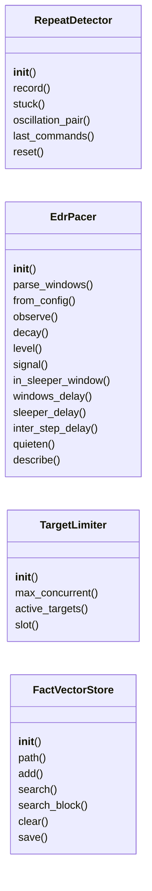
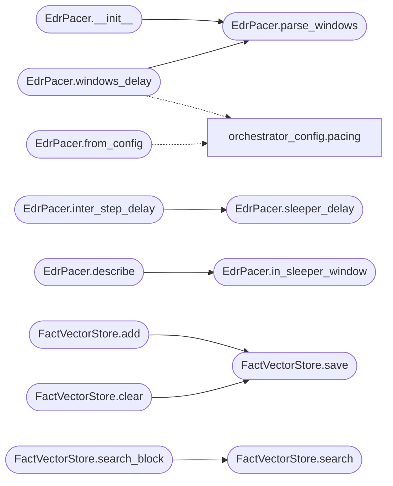

# `modules.loop_guardrails`

> Source: [modules/loop_guardrails.py:1](../../modules/loop_guardrails.py#L1) | language `py` | coverage 97.1% | [API index](../index.md)

Adaptive guardrails for the autonomous loop.

Four independent primitives, one contract each:

- [`RepeatDetector`](#repeatdetector): sliding window over the last executed
  commands; `[`stuck`](#repeatdetector-stuck)` flips when the window fills with identical
  commands, which is the operator-visible signal that the planner is
  going in circles.
- [`EdrPacer`](#edrpacer): observes per-command duration and output
  anomalies (high latency, connection resets, timeouts) and estimates
  a defense-telemetry level. At higher levels the loop inserts random
  inter-step sleeps and downgrades noisy verbs to quieter variants
  instead of burning bandwidth and blue-team attention.
- [`TargetLimiter`](#targetlimiter): semaphore that caps how many distinct
  targets the loop attacks simultaneously; per-thread re-entrant so a
  worker touching one target across many steps never self-deadlocks.
- [`FactVectorStore`](#factvectorstore): stdlib TF-IDF vector memory. Facts
  (command plus output digests) are embedded on write and retrieved by
  cosine similarity so the LLM context carries only the facts relevant
  to the current query instead of the whole transcript.

All four are persistence-friendly, exception-tolerant and safe to call
from worker threads.

## Contents

- **Classes:** [`RepeatDetector`](#repeatdetector), [`EdrPacer`](#edrpacer), [`TargetLimiter`](#targetlimiter), [`FactVectorStore`](#factvectorstore)
- **Constants:** [`DEFAULT_REPEAT_WINDOW`](#default_repeat_window), [`DEFAULT_TARGET_LIMIT`](#default_target_limit)

## Type Diagram



## Call Graph

Solid arrows stay in this module, dashed arrows leave it.



## Classes

<a id="repeatdetector"></a>

### `RepeatDetector`

`class` | [modules/loop_guardrails.py:94](../../modules/loop_guardrails.py#L94)

```python
class RepeatDetector
```

Sliding-window detector for identical and alternating repeats.

Two stuck-loop shapes are recognised:

- AAAA: every command in the window is identical.
- ABABAB: the window alternates between exactly two commands with at
  least two repetitions each, the oscillation the legacy loop vetoed.

**Parameters**

| Name | Type | Default | Description |
|---|---|---|---|
| `window` |  |  | How many recent commands to watch (minimum 6 for the alternating pattern). |

**Members**

| Member | Kind | Summary |
|---|---|---|
| [`__init__`](#repeatdetector-__init__) | constructor |  |
| [`record`](#repeatdetector-record) | method | Add one executed command; returns True when the window fills. |
| [`stuck`](#repeatdetector-stuck) | property | True when the loop is visibly not progressing. |
| [`oscillation_pair`](#repeatdetector-oscillation_pair) | method | Return the detected alternating pair, ('', '') when none. |
| [`last_commands`](#repeatdetector-last_commands) | method | Snapshot of the recent command window (oldest first). |
| [`reset`](#repeatdetector-reset) | method | Clear the window (operator intervention acknowledged). |

<a id="repeatdetector-__init__"></a>

#### `RepeatDetector.__init__`

`constructor` | [modules/loop_guardrails.py:110](../../modules/loop_guardrails.py#L110)

```python
def __init__(self, window: int = DEFAULT_REPEAT_WINDOW) -> None
```

**Parameters**

| Name | Type | Default | Description |
|---|---|---|---|
| `window` | `int` | `DEFAULT_REPEAT_WINDOW` | How many recent commands to watch (minimum 6 for the alternating pattern). |

*Called by:* [`Worker.__init__`](modules.lazy_loop.py.md#worker-__init__)

<a id="repeatdetector-record"></a>

#### `RepeatDetector.record`

`method` | [modules/loop_guardrails.py:116](../../modules/loop_guardrails.py#L116)

```python
def record(self, command: str) -> bool
```

Add one executed command; returns True when the window fills.

**Parameters**

| Name | Type | Default | Description |
|---|---|---|---|
| `command` | `str` |  | Exact command line as executed. |

**Returns:** `bool` - True when a stuck-loop shape fills the window.

*Called by:* [`Worker.execute`](modules.lazy_loop.py.md#worker-execute)

<a id="repeatdetector-stuck"></a>

#### `RepeatDetector.stuck`

`property` | [modules/loop_guardrails.py:151](../../modules/loop_guardrails.py#L151)

Decorators: `@property`

```python
def stuck(self) -> bool
```

True when the loop is visibly not progressing.

Either the window is all one identical command (AAAA), or the
window is at least `_OSCILLATION_MIN` long and holds
exactly two commands alternating (ABABAB).

**Returns:** `bool`

<a id="repeatdetector-oscillation_pair"></a>

#### `RepeatDetector.oscillation_pair`

`method` | [modules/loop_guardrails.py:175](../../modules/loop_guardrails.py#L175)

```python
def oscillation_pair(self) -> tuple[str, str]
```

Return the detected alternating pair, ('', '') when none.

**Returns:** `tuple[str, str]`

<a id="repeatdetector-last_commands"></a>

#### `RepeatDetector.last_commands`

`method` | [modules/loop_guardrails.py:179](../../modules/loop_guardrails.py#L179)

```python
def last_commands(self) -> list[str]
```

Snapshot of the recent command window (oldest first).

**Returns:** `list[str]`

*Called by:* [`Worker.execute`](modules.lazy_loop.py.md#worker-execute)

<a id="repeatdetector-reset"></a>

#### `RepeatDetector.reset`

`method` | [modules/loop_guardrails.py:183](../../modules/loop_guardrails.py#L183)

```python
def reset(self) -> None
```

Clear the window (operator intervention acknowledged).

---

<a id="edrpacer"></a>

### `EdrPacer`

`class` | [modules/loop_guardrails.py:190](../../modules/loop_guardrails.py#L190)

```python
class EdrPacer
```

Defense-aware pacing driven by observed execution anomalies.

The pacer never blocks by itself: it only recommends. `[`observe`](#edrpacer-observe)`
feeds one executed command with its wall-clock duration and output;
the internal score decays over time so a single anomaly does not
permanently slow the loop.

Delays are fully configurable through the orchestrator `[`pacing`](modules.orchestrator_config.py.md#pacing)`
block (see ``orchestrator_config.pacing``): per-level quiet ranges,
a jitter percentage applied to every drawn delay and ``HH:MM-HH:MM``
sleeper windows during which the recommended delay extends to the
window end (clamped to ``max_delay_sec`` so callers re-check the
window instead of oversleeping a cancellation).

**Members**

| Member | Kind | Summary |
|---|---|---|
| [`__init__`](#edrpacer-__init__) | constructor | Configure the pacer. |
| [`parse_windows`](#edrpacer-parse_windows) | staticmethod | Parse ``HH:MM-HH:MM`` window strings into minute tuples. |
| [`from_config`](#edrpacer-from_config) | classmethod | Build a pacer from the orchestrator pacing configuration. |
| [`observe`](#edrpacer-observe) | method | Feed one executed step and update the telemetry estimate. |
| [`decay`](#edrpacer-decay) | method | Cool the estimate down (call once per completed step). |
| [`level`](#edrpacer-level) | property | Current pacing level: 0 calm, 1 cautious, 2 stealth. |
| [`signal`](#edrpacer-signal) | property | Human-readable reason for the current level (may be empty). |
| [`in_sleeper_window`](#edrpacer-in_sleeper_window) | method | True when local time falls inside a configured quiet window. |
| [`windows_delay`](#edrpacer-windows_delay) | staticmethod | Static quiet-window delay for callers without a pacer instance. |
| [`sleeper_delay`](#edrpacer-sleeper_delay) | method | Recommended sleep because of a quiet window (0 when outside). |
| [`inter_step_delay`](#edrpacer-inter_step_delay) | method | Recommended sleep before the next step at the current level. |
| [`quieten`](#edrpacer-quieten) | method | Return a quieter variant of the command at the current level. |
| [`describe`](#edrpacer-describe) | method | Return a snapshot of the pacer state for admin surfaces. |

<a id="edrpacer-__init__"></a>

#### `EdrPacer.__init__`

`constructor` | [modules/loop_guardrails.py:206](../../modules/loop_guardrails.py#L206)

```python
def __init__(self, duration_threshold: float = _EDR_DURATION_THRESHOLD_SEC, *, pause_ranges: dict[int, tuple[float, float]] | None = None, jitter_pct: tuple[float, float] = (0.0, 0.0), max_delay_sec: float = _PAUSE_MAX_DELAY_SEC, sleeper_windows: tuple[str, ...] | list[str] = (), clock: Callable[[], float] | None = None, rng: Callable[[float, float], float] | None = None) -> None
```

Configure the pacer.

**Parameters**

| Name | Type | Default | Description |
|---|---|---|---|
| `duration_threshold` | `float` | `_EDR_DURATION_THRESHOLD_SEC` | Seconds after which a step counts as slow. |
| `pause_ranges` | `dict[int, tuple[float, float]] \| None` | `None` | Per-level ``(low, high)`` quiet ranges; None keeps the built-in table. An empty mapping disables level-based pauses entirely. |
| `jitter_pct` | `tuple[float, float]` | `(0.0, 0.0)` | ``(min, max)`` percentage applied to every drawn pause, e.g. ``(-30, 60)`` shrinks or stretches the delay. |
| `max_delay_sec` | `float` | `_PAUSE_MAX_DELAY_SEC` | Upper clamp for any recommended delay. |
| `sleeper_windows` | `tuple[str, ...] \| list[str]` | `()` | ``HH:MM-HH:MM`` quiet windows (local time). |
| `clock` | `Callable[[], float] \| None` | `None` | Injectable wall clock (epoch seconds) for tests. |
| `rng` | `Callable[[float, float], float] \| None` | `None` | Injectable ``uniform(low, high)`` sampler for tests. |

*Calls:* [`EdrPacer.parse_windows`](#edrpacer-parse_windows)

<a id="edrpacer-parse_windows"></a>

#### `EdrPacer.parse_windows`

`staticmethod` | [modules/loop_guardrails.py:252](../../modules/loop_guardrails.py#L252)

Decorators: `@staticmethod`

```python
def parse_windows(raw: tuple[str, ...] | list[str] | None) -> tuple[tuple[int, int, int, int], ...]
```

Parse ``HH:MM-HH:MM`` window strings into minute tuples.

**Parameters**

| Name | Type | Default | Description |
|---|---|---|---|
| `raw` | `tuple[str, ...] \| list[str] \| None` |  | Raw window declarations; invalid entries are skipped. |

**Returns:** `tuple[tuple[int, int, int, int], ...]` - Tuples of ``(start_h, start_m, end_h, end_m)`` in 24h local
time.

*Called by:* [`EdrPacer.__init__`](#edrpacer-__init__), [`EdrPacer.windows_delay`](#edrpacer-windows_delay)

<a id="edrpacer-from_config"></a>

#### `EdrPacer.from_config`

`classmethod` | [modules/loop_guardrails.py:274](../../modules/loop_guardrails.py#L274)

Decorators: `@classmethod`

```python
def from_config(cls, **overrides: Any) -> 'EdrPacer'
```

Build a pacer from the orchestrator pacing configuration.

**Parameters**

| Name | Type | Default | Description |
|---|---|---|---|
| `**overrides` | `Any` |  | Forwarded to the constructor verbatim, winning over the configuration (used by callers that clamp). |

**Returns:** `'EdrPacer'` - A configured pacer; when the orchestrator config is absent
or unreadable the built-in defaults apply, and
``pacing.enabled = false`` yields an inert pacer.

*Calls:* [`pacing`](modules.orchestrator_config.py.md#pacing)

*Called by:* [`ChainRunner.__init__`](modules.chain_runner.py.md#chainrunner-__init__), [`Worker.__init__`](modules.lazy_loop.py.md#worker-__init__)

<a id="edrpacer-observe"></a>

#### `EdrPacer.observe`

`method` | [modules/loop_guardrails.py:305](../../modules/loop_guardrails.py#L305)

```python
def observe(self, command: str, duration_sec: float, output: str) -> None
```

Feed one executed step and update the telemetry estimate.

**Parameters**

| Name | Type | Default | Description |
|---|---|---|---|
| `command` | `str` |  | Executed command line. |
| `duration_sec` | `float` |  | Wall-clock seconds the command took. |
| `output` | `str` |  | Captured output (scan for reset/timeout markers). |

<a id="edrpacer-decay"></a>

#### `EdrPacer.decay`

`method` | [modules/loop_guardrails.py:327](../../modules/loop_guardrails.py#L327)

```python
def decay(self, factor: float = _EDR_DECAY) -> None
```

Cool the estimate down (call once per completed step).

**Parameters**

| Name | Type | Default | Description |
|---|---|---|---|
| `factor` | `float` | `_EDR_DECAY` |  |

<a id="edrpacer-level"></a>

#### `EdrPacer.level`

`property` | [modules/loop_guardrails.py:333](../../modules/loop_guardrails.py#L333)

Decorators: `@property`

```python
def level(self) -> int
```

Current pacing level: 0 calm, 1 cautious, 2 stealth.

**Returns:** `int`

<a id="edrpacer-signal"></a>

#### `EdrPacer.signal`

`property` | [modules/loop_guardrails.py:343](../../modules/loop_guardrails.py#L343)

Decorators: `@property`

```python
def signal(self) -> str
```

Human-readable reason for the current level (may be empty).

**Returns:** `str`

*Called by:* [`main`](modules.rootkit.mr.c.md#main)

<a id="edrpacer-in_sleeper_window"></a>

#### `EdrPacer.in_sleeper_window`

`method` | [modules/loop_guardrails.py:374](../../modules/loop_guardrails.py#L374)

```python
def in_sleeper_window(self, now: float | None = None) -> bool
```

True when local time falls inside a configured quiet window.

**Parameters**

| Name | Type | Default | Description |
|---|---|---|---|
| `now` | `float \| None` | `None` |  |

**Returns:** `bool`

*Called by:* [`EdrPacer.describe`](#edrpacer-describe)

<a id="edrpacer-windows_delay"></a>

#### `EdrPacer.windows_delay`

`staticmethod` | [modules/loop_guardrails.py:380](../../modules/loop_guardrails.py#L380)

Decorators: `@staticmethod`

```python
def windows_delay(windows: tuple[str, ...] | list[str], now: float | None = None) -> float
```

Static quiet-window delay for callers without a pacer instance.

**Parameters**

| Name | Type | Default | Description |
|---|---|---|---|
| `windows` | `tuple[str, ...] \| list[str]` |  | ``HH:MM-HH:MM`` window declarations. |
| `now` | `float \| None` | `None` | Injectable epoch seconds (None uses the real clock). |

**Returns:** `float` - Seconds until the active window ends, clamped to the
configured maximum; 0 when outside every window.

*Calls:* [`EdrPacer.parse_windows`](#edrpacer-parse_windows), [`pacing`](modules.orchestrator_config.py.md#pacing)

<a id="edrpacer-sleeper_delay"></a>

#### `EdrPacer.sleeper_delay`

`method` | [modules/loop_guardrails.py:407](../../modules/loop_guardrails.py#L407)

```python
def sleeper_delay(self, now: float | None = None) -> float
```

Recommended sleep because of a quiet window (0 when outside).

The delay is the time until the window end, clamped to
``max_delay_sec`` so long windows sleep in bounded chunks and
every caller re-checks cancellation between chunks.

**Parameters**

| Name | Type | Default | Description |
|---|---|---|---|
| `now` | `float \| None` | `None` |  |

**Returns:** `float`

*Called by:* [`EdrPacer.inter_step_delay`](#edrpacer-inter_step_delay)

<a id="edrpacer-inter_step_delay"></a>

#### `EdrPacer.inter_step_delay`

`method` | [modules/loop_guardrails.py:420](../../modules/loop_guardrails.py#L420)

```python
def inter_step_delay(self) -> float
```

Recommended sleep before the next step at the current level.

Combines the level's quiet range (scaled by the configured
jitter percentage) with the sleeper-window delay, taking the
larger of the two and clamping to ``max_delay_sec``.

**Returns:** `float`

*Calls:* [`EdrPacer.sleeper_delay`](#edrpacer-sleeper_delay)

<a id="edrpacer-quieten"></a>

#### `EdrPacer.quieten`

`method` | [modules/loop_guardrails.py:437](../../modules/loop_guardrails.py#L437)

```python
def quieten(self, command: str) -> str
```

Return a quieter variant of the command at the current level.

Applies the first matching downgrade rule whose level threshold
the current level meets; a level of 0 returns the input
unchanged.

**Parameters**

| Name | Type | Default | Description |
|---|---|---|---|
| `command` | `str` |  |  |

**Returns:** `str`

<a id="edrpacer-describe"></a>

#### `EdrPacer.describe`

`method` | [modules/loop_guardrails.py:452](../../modules/loop_guardrails.py#L452)

```python
def describe(self) -> dict[str, Any]
```

Return a snapshot of the pacer state for admin surfaces.

**Returns:** `dict[str, Any]`

*Calls:* [`EdrPacer.in_sleeper_window`](#edrpacer-in_sleeper_window)

---

<a id="targetlimiter"></a>

### `TargetLimiter`

`class` | [modules/loop_guardrails.py:467](../../modules/loop_guardrails.py#L467)

```python
class TargetLimiter
```

Per-target concurrency cap shared by every loop worker.

**Parameters**

| Name | Type | Default | Description |
|---|---|---|---|
| `max_concurrent` |  |  | How many distinct targets may be worked at the same time (default 3). |

**Members**

| Member | Kind | Summary |
|---|---|---|
| [`__init__`](#targetlimiter-__init__) | constructor |  |
| [`max_concurrent`](#targetlimiter-max_concurrent) | property | Configured upper bound of simultaneous targets. |
| [`active_targets`](#targetlimiter-active_targets) | property | How many distinct targets currently hold a slot. |
| [`slot`](#targetlimiter-slot) | method | Hold one of at most `[`max_concurrent`](#targetlimiter-max_concurrent)` target slots. |

<a id="targetlimiter-__init__"></a>

#### `TargetLimiter.__init__`

`constructor` | [modules/loop_guardrails.py:475](../../modules/loop_guardrails.py#L475)

```python
def __init__(self, max_concurrent: int = DEFAULT_TARGET_LIMIT) -> None
```

**Parameters**

| Name | Type | Default | Description |
|---|---|---|---|
| `max_concurrent` | `int` | `DEFAULT_TARGET_LIMIT` | How many distinct targets may be worked at the same time (default 3). |

<a id="targetlimiter-max_concurrent"></a>

#### `TargetLimiter.max_concurrent`

`property` | [modules/loop_guardrails.py:482](../../modules/loop_guardrails.py#L482)

Decorators: `@property`

```python
def max_concurrent(self) -> int
```

Configured upper bound of simultaneous targets.

**Returns:** `int`

<a id="targetlimiter-active_targets"></a>

#### `TargetLimiter.active_targets`

`property` | [modules/loop_guardrails.py:487](../../modules/loop_guardrails.py#L487)

Decorators: `@property`

```python
def active_targets(self) -> int
```

How many distinct targets currently hold a slot.

**Returns:** `int`

<a id="targetlimiter-slot"></a>

#### `TargetLimiter.slot`

`method` `generator` | [modules/loop_guardrails.py:493](../../modules/loop_guardrails.py#L493)

Decorators: `@contextmanager`

```python
def slot(self, target: str)
```

Hold one of at most `[`max_concurrent`](#targetlimiter-max_concurrent)` target slots.

Re-entrant per thread: a worker already holding ``target``
acquires nothing new, so sequencing many commands against one
target never blocks on itself.

**Parameters**

| Name | Type | Default | Description |
|---|---|---|---|
| `target` | `str` |  | Target identifier (empty target bypasses the cap). |

---

<a id="factvectorstore"></a>

### `FactVectorStore`

`class` | [modules/loop_guardrails.py:537](../../modules/loop_guardrails.py#L537)

```python
class FactVectorStore
```

JSON-persisted TF-IDF fact memory with cosine retrieval.

Pure stdlib: no chromadb, no FAISS, no embeddings service. Facts
dedupe by content hash, persist atomically and trim to
``max_facts`` oldest-first.

**Members**

| Member | Kind | Summary |
|---|---|---|
| [`__init__`](#factvectorstore-__init__) | constructor |  |
| [`path`](#factvectorstore-path) | property | Backing file path. |
| [`add`](#factvectorstore-add) | method | Embed and store one fact; returns False for duplicates. |
| [`search`](#factvectorstore-search) | method | Return the ``k`` facts most similar to the query. |
| [`search_block`](#factvectorstore-search_block) | method | Render retrieved facts as a prompt-ready block (may be empty). |
| [`clear`](#factvectorstore-clear) | method | Drop every fact (manual reset path). |
| [`save`](#factvectorstore-save) | method | Persist atomically; I/O errors never surface to the loop. |

<a id="factvectorstore-__init__"></a>

#### `FactVectorStore.__init__`

`constructor` | [modules/loop_guardrails.py:545](../../modules/loop_guardrails.py#L545)

```python
def __init__(self, path: str | Path, max_facts: int = DEFAULT_MAX_FACTS) -> None
```

**Parameters**

| Name | Type | Default | Description |
|---|---|---|---|
| `path` | `str \| Path` |  |  |
| `max_facts` | `int` | `DEFAULT_MAX_FACTS` |  |

<a id="factvectorstore-path"></a>

#### `FactVectorStore.path`

`property` | [modules/loop_guardrails.py:553](../../modules/loop_guardrails.py#L553)

Decorators: `@property`

```python
def path(self) -> Path
```

Backing file path.

**Returns:** `Path`

<a id="factvectorstore-add"></a>

#### `FactVectorStore.add`

`method` | [modules/loop_guardrails.py:574](../../modules/loop_guardrails.py#L574)

```python
def add(self, text: str, meta: dict | None = None) -> bool
```

Embed and store one fact; returns False for duplicates.

**Parameters**

| Name | Type | Default | Description |
|---|---|---|---|
| `text` | `str` |  | Fact content (command plus output digest). |
| `meta` | `dict \| None` | `None` | Optional metadata attached to the fact. |

**Returns:** `bool` - True when a new fact was stored.

*Calls:* [`FactVectorStore.save`](#factvectorstore-save)

<a id="factvectorstore-search"></a>

#### `FactVectorStore.search`

`method` | [modules/loop_guardrails.py:608](../../modules/loop_guardrails.py#L608)

```python
def search(self, query: str, k: int = DEFAULT_SEARCH_RESULTS) -> list[dict]
```

Return the ``k`` facts most similar to the query.

**Parameters**

| Name | Type | Default | Description |
|---|---|---|---|
| `query` | `str` |  | Current goal or step context. |
| `k` | `int` | `DEFAULT_SEARCH_RESULTS` | Maximum results. |

**Returns:** `list[dict]` - List of ``{"text", "meta", "score"}`` dicts, best first.

*Called by:* [`FactVectorStore.search_block`](#factvectorstore-search_block)

<a id="factvectorstore-search_block"></a>

#### `FactVectorStore.search_block`

`method` | [modules/loop_guardrails.py:638](../../modules/loop_guardrails.py#L638)

```python
def search_block(self, query: str, k: int = DEFAULT_SEARCH_RESULTS, max_chars: int = 1200) -> str
```

Render retrieved facts as a prompt-ready block (may be empty).

**Parameters**

| Name | Type | Default | Description |
|---|---|---|---|
| `query` | `str` |  |  |
| `k` | `int` | `DEFAULT_SEARCH_RESULTS` |  |
| `max_chars` | `int` | `1200` |  |

**Returns:** `str`

*Calls:* [`FactVectorStore.search`](#factvectorstore-search)

<a id="factvectorstore-clear"></a>

#### `FactVectorStore.clear`

`method` | [modules/loop_guardrails.py:647](../../modules/loop_guardrails.py#L647)

```python
def clear(self) -> None
```

Drop every fact (manual reset path).

*Calls:* [`FactVectorStore.save`](#factvectorstore-save)

<a id="factvectorstore-save"></a>

#### `FactVectorStore.save`

`method` | [modules/loop_guardrails.py:653](../../modules/loop_guardrails.py#L653)

```python
def save(self) -> None
```

Persist atomically; I/O errors never surface to the loop.

*Called by:* [`FactVectorStore.add`](#factvectorstore-add), [`FactVectorStore.clear`](#factvectorstore-clear)

---

## Constants

<a id="default_repeat_window"></a>

### `DEFAULT_REPEAT_WINDOW`

`constant` | [modules/loop_guardrails.py:43](../../modules/loop_guardrails.py#L43)

```python
DEFAULT_REPEAT_WINDOW = 5
```

---

<a id="default_target_limit"></a>

### `DEFAULT_TARGET_LIMIT`

`constant` | [modules/loop_guardrails.py:44](../../modules/loop_guardrails.py#L44)

```python
DEFAULT_TARGET_LIMIT = 3
```

---
