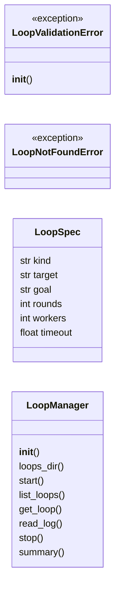
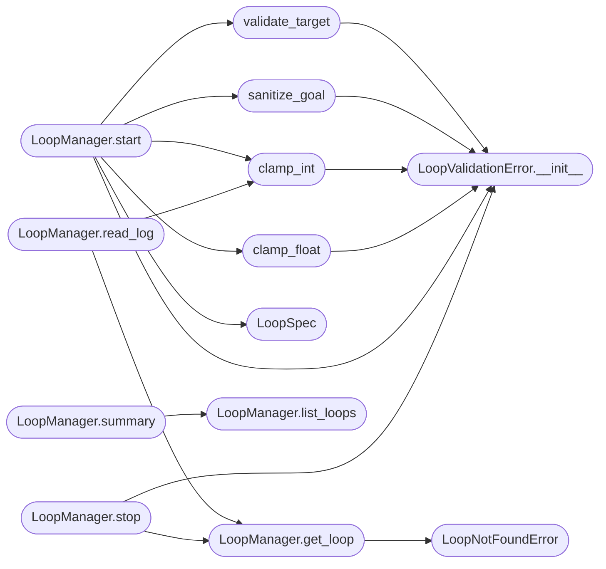

# `modules.loop_manager`

> Source: [modules/loop_manager.py:1](../../modules/loop_manager.py#L1) | language `py` | coverage 100.0% | [API index](../index.md)

Parallel autonomous loop orchestration for the LazyOwn C2 dashboard.

Contract: this module owns every autonomous loop started from the web
dashboard. Each loop is an isolated ``lazyown.py`` subprocess (argv form,
``shell=False``, own process session) with a dedicated workspace under
``sessions/loops/<loop_id>/`` holding its YAML profile, live output log
and metadata. A single JSON registry (``sessions/loops/registry.json``)
is the durable source of truth so loops survive dashboard restarts.

Invariants:

1. Every user-supplied field is strictly validated before it can reach
   a subprocess: the target must parse as an IP address, the goal must
   match a fixed safe charset, and numeric knobs are clamped to the
   ranges supported by [`modules.lazy_runner`](modules.lazy_runner.py.md).
2. Subprocesses are never started through a shell. ``argv`` lists only,
   ``shell=False``, ``stdin=DEVNULL`` and ``start_new_session=True`` so
   a loop can be stopped as a whole process group.
3. Log reads are path-safe: the loop id must match a strict hex pattern
   and the resolved log path must stay inside the loops directory.
4. The number of concurrently running loops is capped so the dashboard
   can never exhaust host processes.
5. Stop uses SIGTERM on the process group, waits a grace period, then
   escalates to SIGKILL. A stored process start-time counter prevents
   acting on a recycled PID.

Config keys owned: none (all knobs are module constants).

## Contents

- **Classes:** [`LoopSpec`](#loopspec), [`LoopManager`](#loopmanager)
- **Exceptions:** [`LoopValidationError`](#loopvalidationerror), [`LoopNotFoundError`](#loopnotfounderror)
- **Functions:** [`validate_target`](#validate_target), [`sanitize_goal`](#sanitize_goal), [`clamp_int`](#clamp_int), [`clamp_float`](#clamp_float)
- **Constants:** [`KIND_AUTO_LOOP`](#kind_auto_loop), [`KIND_LAZY_NMAP`](#kind_lazy_nmap), [`LOOP_KINDS`](#loop_kinds), [`DEFAULT_ROUNDS`](#default_rounds), [`DEFAULT_WORKERS`](#default_workers), [`MAX_ROUNDS`](#max_rounds), [`MAX_WORKERS`](#max_workers), [`MAX_CONCURRENT_LOOPS`](#max_concurrent_loops), [`DEFAULT_GOAL`](#default_goal)

## Type Diagram



## Call Graph

Solid arrows stay in this module, dashed arrows leave it.



## Classes

<a id="loopspec"></a>

### `LoopSpec`

`class` `dataclass` | [modules/loop_manager.py:264](../../modules/loop_manager.py#L264)

Decorators: `@dataclass(frozen=True)`

```python
class LoopSpec
```

Validated request to start one autonomous loop.

**Attributes**

| Name | Type | Default | Description |
|---|---|---|---|
| [`kind`](#loopspec-kind) | `str` |  | Either ``auto_loop`` or ``lazynmap``. |
| [`target`](#loopspec-target) | `str` |  | Validated IP address string. |
| [`goal`](#loopspec-goal) | `str` | `DEFAULT_GOAL` | Sanitized natural-language goal (auto_loop only). |
| [`rounds`](#loopspec-rounds) | `int` | `DEFAULT_ROUNDS` | Maximum orchestrator rounds (auto_loop only). |
| [`workers`](#loopspec-workers) | `int` | `DEFAULT_WORKERS` | Worker pool size (auto_loop only). |
| [`timeout`](#loopspec-timeout) | `float` | `0.0` | Optional wall-clock timeout in seconds (0 = none). |

---

<a id="loopmanager"></a>

### `LoopManager`

`class` | [modules/loop_manager.py:316](../../modules/loop_manager.py#L316)

```python
class LoopManager
```

Owns the lifecycle of autonomous loops started from the dashboard.

**Parameters**

| Name | Type | Default | Description |
|---|---|---|---|
| `loops_dir` |  |  | Root directory holding the registry and loop workspaces. |
| `python_executable` |  |  | Interpreter used to launch ``lazyown.py``; defaults to the current interpreter. |
| `max_concurrent` |  |  | Upper bound of simultaneously running loops. |
| `repo_root` |  |  | Repository root passed as the subprocess cwd. |

**Members**

| Member | Kind | Summary |
|---|---|---|
| [`__init__`](#loopmanager-__init__) | constructor | Create the manager and its persistence lock. |
| [`loops_dir`](#loopmanager-loops_dir) | property | Return the root directory for loop workspaces. |
| [`start`](#loopmanager-start) | method | Validate, spawn and register one autonomous loop. |
| [`list_loops`](#loopmanager-list_loops) | method | Return every registry record with refreshed live status. |
| [`get_loop`](#loopmanager-get_loop) | method | Return one registry record by id. |
| [`read_log`](#loopmanager-read_log) | method | Read one chunk of a loop's output log. |
| [`stop`](#loopmanager-stop) | method | Stop one running loop by terminating its process group. |
| [`summary`](#loopmanager-summary) | method | Return an aggregate view of loop activity for the report. |

<a id="loopmanager-__init__"></a>

#### `LoopManager.__init__`

`constructor` | [modules/loop_manager.py:327](../../modules/loop_manager.py#L327)

```python
def __init__(self, loops_dir: Path | str = LOOPS_DIR, python_executable: str | None = None, max_concurrent: int = MAX_CONCURRENT_LOOPS, repo_root: Path | str | None = None, lazyown_script: Path | str | None = None) -> None
```

Create the manager and its persistence lock.

**Parameters**

| Name | Type | Default | Description |
|---|---|---|---|
| `loops_dir` | `Path \| str` | `LOOPS_DIR` |  |
| `python_executable` | `str \| None` | `None` |  |
| `max_concurrent` | `int` | `MAX_CONCURRENT_LOOPS` |  |
| `repo_root` | `Path \| str \| None` | `None` |  |
| `lazyown_script` | `Path \| str \| None` | `None` |  |

<a id="loopmanager-loops_dir"></a>

#### `LoopManager.loops_dir`

`property` | [modules/loop_manager.py:349](../../modules/loop_manager.py#L349)

Decorators: `@property`

```python
def loops_dir(self) -> Path
```

Return the root directory for loop workspaces.

**Returns:** `Path`

<a id="loopmanager-start"></a>

#### `LoopManager.start`

`method` | [modules/loop_manager.py:353](../../modules/loop_manager.py#L353)

```python
def start(self, spec: LoopSpec, operator: str = '') -> dict[str, Any]
```

Validate, spawn and register one autonomous loop.

**Parameters**

| Name | Type | Default | Description |
|---|---|---|---|
| `spec` | `LoopSpec` |  | Validated loop specification. |
| `operator` | `str` | `''` | Authenticated username starting the loop. |

**Returns:** `dict[str, Any]` - The registry record for the new loop.

**Raises**

- [`LoopValidationError`](#loopvalidationerror): Any field failed validation or the concurrency cap is reached.
- `OSError`: The subprocess could not be spawned.

*Calls:* [`LoopSpec`](#loopspec), [`LoopValidationError.__init__`](#loopvalidationerror-__init__), [`clamp_float`](#clamp_float), [`clamp_int`](#clamp_int), [`sanitize_goal`](#sanitize_goal), [`validate_target`](#validate_target)

<a id="loopmanager-list_loops"></a>

#### `LoopManager.list_loops`

`method` | [modules/loop_manager.py:493](../../modules/loop_manager.py#L493)

```python
def list_loops(self) -> list[dict[str, Any]]
```

Return every registry record with refreshed live status.

**Returns:** `list[dict[str, Any]]` - Records sorted newest first.

*Called by:* [`LoopManager.summary`](#loopmanager-summary)

<a id="loopmanager-get_loop"></a>

#### `LoopManager.get_loop`

`method` | [modules/loop_manager.py:528](../../modules/loop_manager.py#L528)

```python
def get_loop(self, loop_id: object) -> dict[str, Any]
```

Return one registry record by id.

**Parameters**

| Name | Type | Default | Description |
|---|---|---|---|
| `loop_id` | `object` |  | Candidate loop identifier. |

**Returns:** `dict[str, Any]` - The matching registry record.

**Raises**

- [`LoopNotFoundError`](#loopnotfounderror): Unknown or malformed loop id.

*Calls:* [`LoopNotFoundError`](#loopnotfounderror)

*Called by:* [`LoopManager.read_log`](#loopmanager-read_log), [`LoopManager.stop`](#loopmanager-stop)

<a id="loopmanager-read_log"></a>

#### `LoopManager.read_log`

`method` | [modules/loop_manager.py:547](../../modules/loop_manager.py#L547)

```python
def read_log(self, loop_id: object, offset: object = 0) -> dict[str, Any]
```

Read one chunk of a loop's output log.

**Parameters**

| Name | Type | Default | Description |
|---|---|---|---|
| `loop_id` | `object` |  | Candidate loop identifier. |
| `offset` | `object` | `0` | Byte offset to read from (defaults to 0). |

**Returns:** `dict[str, Any]` - Dict with ``loop_id``, `[`offset`](cli.toast_bus.py.md#toastevent-offset)` (next read offset),
``size``, ``chunk`` (decoded text) and `[`truncated`](skills.lazyown_context.py.md#compactionresult-truncated)` flag.

**Raises**

- [`LoopNotFoundError`](#loopnotfounderror): Unknown loop id.
- [`LoopValidationError`](#loopvalidationerror): Negative or oversized offset.

*Calls:* [`LoopManager.get_loop`](#loopmanager-get_loop), [`clamp_int`](#clamp_int)

<a id="loopmanager-stop"></a>

#### `LoopManager.stop`

`method` | [modules/loop_manager.py:614](../../modules/loop_manager.py#L614)

```python
def stop(self, loop_id: object) -> dict[str, Any]
```

Stop one running loop by terminating its process group.

**Parameters**

| Name | Type | Default | Description |
|---|---|---|---|
| `loop_id` | `object` |  | Candidate loop identifier. |

**Returns:** `dict[str, Any]` - The updated registry record.

**Raises**

- [`LoopNotFoundError`](#loopnotfounderror): Unknown loop id.
- [`LoopValidationError`](#loopvalidationerror): The loop is not running.

*Calls:* [`LoopManager.get_loop`](#loopmanager-get_loop), [`LoopValidationError.__init__`](#loopvalidationerror-__init__)

<a id="loopmanager-summary"></a>

#### `LoopManager.summary`

`method` | [modules/loop_manager.py:679](../../modules/loop_manager.py#L679)

```python
def summary(self) -> dict[str, Any]
```

Return an aggregate view of loop activity for the report.

**Returns:** `dict[str, Any]` - Dict with total/running/finished counts, per-kind counts,
per-target counts and the most recent records.

*Calls:* [`LoopManager.list_loops`](#loopmanager-list_loops)

---

## Exceptions

<a id="loopvalidationerror"></a>

### `LoopValidationError`

`exception` | [modules/loop_manager.py:87](../../modules/loop_manager.py#L87)

```python
class LoopValidationError(ValueError)
```

Bases: `ValueError`

Raised when a loop request field fails validation.

**Members**

| Member | Kind | Summary |
|---|---|---|
| [`__init__`](#loopvalidationerror-__init__) | constructor | Store the offending field alongside the human message. |

<a id="loopvalidationerror-__init__"></a>

#### `LoopValidationError.__init__`

`constructor` | [modules/loop_manager.py:90](../../modules/loop_manager.py#L90)

```python
def __init__(self, field: str, message: str) -> None
```

Store the offending field alongside the human message.

**Parameters**

| Name | Type | Default | Description |
|---|---|---|---|
| `field` | `str` |  |  |
| `message` | `str` |  |  |

*Called by:* [`LoopManager.start`](#loopmanager-start), [`LoopManager.stop`](#loopmanager-stop), [`clamp_float`](#clamp_float), [`clamp_int`](#clamp_int), [`sanitize_goal`](#sanitize_goal), [`validate_target`](#validate_target)

---

<a id="loopnotfounderror"></a>

### `LoopNotFoundError`

`exception` | [modules/loop_manager.py:96](../../modules/loop_manager.py#L96)

```python
class LoopNotFoundError(KeyError)
```

Bases: `KeyError`

Raised when a loop id is unknown to the registry.

---

## Functions

<a id="validate_target"></a>

### `validate_target`

`function` | [modules/loop_manager.py:100](../../modules/loop_manager.py#L100)

```python
def validate_target(raw: object) -> str
```

Return the canonical string form of a validated IP address target.

**Parameters**

| Name | Type | Default | Description |
|---|---|---|---|
| `raw` | `object` |  | Candidate target value from an HTTP request. |

**Returns:** `str` - The canonical IP string.

**Raises**

- [`LoopValidationError`](#loopvalidationerror): The value is not a valid IPv4/IPv6 address.

*Calls:* [`LoopValidationError.__init__`](#loopvalidationerror-__init__)

*Called by:* [`LoopManager.start`](#loopmanager-start)

---

<a id="sanitize_goal"></a>

### `sanitize_goal`

`function` | [modules/loop_manager.py:123](../../modules/loop_manager.py#L123)

```python
def sanitize_goal(raw: object) -> str
```

Return a safe goal string accepted by the loop parser.

**Parameters**

| Name | Type | Default | Description |
|---|---|---|---|
| `raw` | `object` |  | Candidate goal value from an HTTP request. |

**Returns:** `str` - The sanitized goal. Empty input yields [`DEFAULT_GOAL`](#default_goal).

**Raises**

- [`LoopValidationError`](#loopvalidationerror): The goal exceeds the length cap or contains characters outside the safe charset.

*Calls:* [`LoopValidationError.__init__`](#loopvalidationerror-__init__)

*Called by:* [`LoopManager.start`](#loopmanager-start)

---

<a id="clamp_int"></a>

### `clamp_int`

`function` | [modules/loop_manager.py:150](../../modules/loop_manager.py#L150)

```python
def clamp_int(raw: object, field: str, default: int, minimum: int, maximum: int) -> int
```

Parse and clamp an integer knob to the supported range.

**Parameters**

| Name | Type | Default | Description |
|---|---|---|---|
| `raw` | `object` |  | Candidate integer value (string or number). |
| `field` | `str` |  | Field name used in the validation error. |
| `default` | `int` |  | Value used when ``raw`` is None or empty. |
| `minimum` | `int` |  | Inclusive lower bound. |
| `maximum` | `int` |  | Inclusive upper bound. |

**Returns:** `int` - The parsed and clamped integer.

**Raises**

- [`LoopValidationError`](#loopvalidationerror): The value is not numeric.

*Calls:* [`LoopValidationError.__init__`](#loopvalidationerror-__init__)

*Called by:* [`LoopManager.read_log`](#loopmanager-read_log), [`LoopManager.start`](#loopmanager-start)

---

<a id="clamp_float"></a>

### `clamp_float`

`function` | [modules/loop_manager.py:175](../../modules/loop_manager.py#L175)

```python
def clamp_float(raw: object, field: str, default: float, minimum: float, maximum: float) -> float
```

Parse and clamp a float knob to the supported range.

**Parameters**

| Name | Type | Default | Description |
|---|---|---|---|
| `raw` | `object` |  | Candidate float value (string or number). |
| `field` | `str` |  | Field name used in the validation error. |
| `default` | `float` |  | Value used when ``raw`` is None or empty. |
| `minimum` | `float` |  | Inclusive lower bound. |
| `maximum` | `float` |  | Inclusive upper bound. |

**Returns:** `float` - The parsed and clamped float.

**Raises**

- [`LoopValidationError`](#loopvalidationerror): The value is not numeric.

*Calls:* [`LoopValidationError.__init__`](#loopvalidationerror-__init__)

*Called by:* [`LoopManager.start`](#loopmanager-start)

---

## Constants

<a id="kind_auto_loop"></a>

### `KIND_AUTO_LOOP`

`constant` | [modules/loop_manager.py:53](../../modules/loop_manager.py#L53)

```python
KIND_AUTO_LOOP = 'auto_loop'
```

---

<a id="kind_lazy_nmap"></a>

### `KIND_LAZY_NMAP`

`constant` | [modules/loop_manager.py:54](../../modules/loop_manager.py#L54)

```python
KIND_LAZY_NMAP = 'lazynmap'
```

---

<a id="loop_kinds"></a>

### `LOOP_KINDS`

`constant` | [modules/loop_manager.py:55](../../modules/loop_manager.py#L55)

```python
LOOP_KINDS = frozenset({KIND_AUTO_LOOP, KIND_LAZY_NMAP})
```

---

<a id="default_rounds"></a>

### `DEFAULT_ROUNDS`

`constant` | [modules/loop_manager.py:57](../../modules/loop_manager.py#L57)

```python
DEFAULT_ROUNDS = 6
```

---

<a id="default_workers"></a>

### `DEFAULT_WORKERS`

`constant` | [modules/loop_manager.py:58](../../modules/loop_manager.py#L58)

```python
DEFAULT_WORKERS = 2
```

---

<a id="max_rounds"></a>

### `MAX_ROUNDS`

`constant` | [modules/loop_manager.py:59](../../modules/loop_manager.py#L59)

```python
MAX_ROUNDS = 50
```

---

<a id="max_workers"></a>

### `MAX_WORKERS`

`constant` | [modules/loop_manager.py:60](../../modules/loop_manager.py#L60)

```python
MAX_WORKERS = 5
```

---

<a id="max_concurrent_loops"></a>

### `MAX_CONCURRENT_LOOPS`

`constant` | [modules/loop_manager.py:63](../../modules/loop_manager.py#L63)

```python
MAX_CONCURRENT_LOOPS = 5
```

---

<a id="default_goal"></a>

### `DEFAULT_GOAL`

`constant` | [modules/loop_manager.py:70](../../modules/loop_manager.py#L70)

```python
DEFAULT_GOAL = 'gain initial access'
```

---
