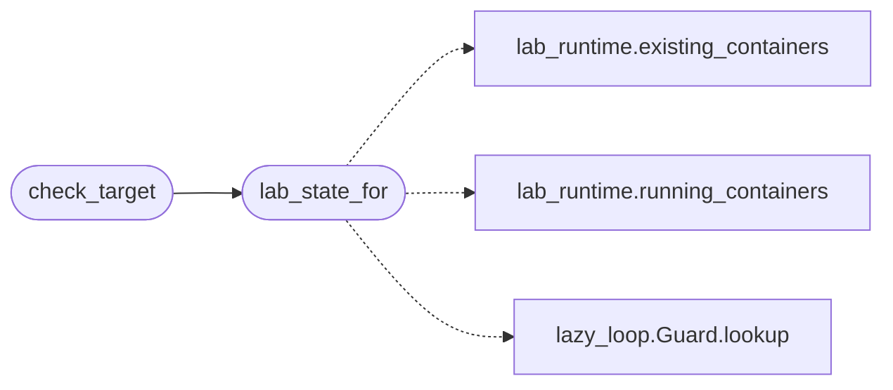

# `modules.loop_preflight`

> Source: [modules/loop_preflight.py:1](../../modules/loop_preflight.py#L1) | language `py` | coverage 100.0% | [API index](../index.md)

Target and lab preflight checks for autonomous loops and auto_pwn.

An autonomous loop that reports success against a target nobody can
reach is worse than a crash: the operator trusts a finished badge while
the gym was down all along. This module answers one question before any
round is spent — is the target actually up?

Two liveness sources, cheapest first:

1. Lab membership: when the target IP belongs to a known lab scenario
   (`[`modules.lab_runtime.LAB_SCENARIOS`](modules.lab_runtime.py.md#lab_scenarios)`), the authoritative state is
   the container state itself. A stopped or never-created lab container
   fails the run before a single command fires, with the exact recovery
   command in the reason.
2. TCP reachability: for non-lab targets a bounded parallel probe of
   common service ports answers whether anything at all listens there.

Never raises; every path returns a mapping. All docker and socket I/O
is injected so tests run without docker or a network.

## Contents

- **Functions:** [`lab_state_for`](#lab_state_for), [`probe_tcp`](#probe_tcp), [`check_target`](#check_target), [`recovery_hint`](#recovery_hint)
- **Constants:** [`PREFLIGHT_PROBE_PORTS`](#preflight_probe_ports), [`PREFLIGHT_CONNECT_TIMEOUT_SEC`](#preflight_connect_timeout_sec), [`PREFLIGHT_MAX_WORKERS`](#preflight_max_workers), [`NO_PREFLIGHT_HINT`](#no_preflight_hint)

## Call Graph

Solid arrows stay in this module, dashed arrows leave it.



## Functions

<a id="lab_state_for"></a>

### `lab_state_for`

`function` | [modules/loop_preflight.py:38](../../modules/loop_preflight.py#L38)

```python
def lab_state_for(target: str, scenarios: Iterable[str] | None = None, running: list[str] | None = None, existing: list[str] | None = None, ip_lookup: Callable[[str], str] | None = None) -> dict
```

Map a target IP to its lab scenario and container state.

**Parameters**

| Name | Type | Default | Description |
|---|---|---|---|
| `target` | `str` |  | Candidate IP address. |
| `scenarios` | `Iterable[str] \| None` | `None` | Scenario names to consider; defaults to every `[`LAB_SCENARIOS`](modules.lab_runtime.py.md#lab_scenarios)` key. |
| `running` | `list[str] \| None` | `None` | Running container names override (tests). |
| `existing` | `list[str] \| None` | `None` | All container names override (tests). |
| `ip_lookup` | `Callable[[str], str] \| None` | `None` | Container-name-to-IP resolver override (tests). |

**Returns:** `dict` - ``{"scenario": name, "container": name, "ip": ip, "running": bool}``
when the target matches a known lab container IP, else ``{}``.

*Calls:* [`existing_containers`](modules.lab_runtime.py.md#existing_containers), [`running_containers`](modules.lab_runtime.py.md#running_containers), [`Guard.lookup`](modules.lazy_loop.py.md#guard-lookup)

*Called by:* [`PwnCommandSet.do_auto_pwn`](cli.commands.pwn.py.md#pwncommandset-do_auto_pwn), [`check_target`](#check_target)

---

<a id="probe_tcp"></a>

### `probe_tcp`

`function` | [modules/loop_preflight.py:125](../../modules/loop_preflight.py#L125)

```python
def probe_tcp(target: str, ports: Iterable[int] | None = None, timeout: float | None = None) -> list[int]
```

Probe TCP ports in parallel and return the open ones.

**Parameters**

| Name | Type | Default | Description |
|---|---|---|---|
| `target` | `str` |  | Host or IP to probe. |
| `ports` | `Iterable[int] \| None` | `None` | Port list override; defaults to `[`PREFLIGHT_PROBE_PORTS`](#preflight_probe_ports)`. |
| `timeout` | `float \| None` | `None` | Per-connect timeout override. |

**Returns:** `list[int]` - Sorted open port numbers; empty when nothing answers or the
target cannot be resolved.

---

<a id="check_target"></a>

### `check_target`

`function` | [modules/loop_preflight.py:145](../../modules/loop_preflight.py#L145)

```python
def check_target(target: str, ports: Iterable[int] | None = None, connect_timeout: float | None = None, lab: dict | None = None) -> dict
```

Decide whether a loop may be spent against this target.

**Parameters**

| Name | Type | Default | Description |
|---|---|---|---|
| `target` | `str` |  | Target IP or hostname. |
| `ports` | `Iterable[int] \| None` | `None` | TCP probe ports override (non-lab targets). |
| `connect_timeout` | `float \| None` | `None` | TCP probe timeout override. |
| `lab` | `dict \| None` | `None` | Precomputed lab state override (tests); when omitted the state is resolved live. |

**Returns:** `dict` - ``{"ok": bool, "reason": str, "target": str, "lab": dict,
"open_ports": list[int], "hint": str}``. `[`ok`](scripts.top_tier_check.py.md#ok)` is True only
when a lab scenario for the target is running or at least one
probed TCP port answers. ``hint`` carries the recovery command
for lab scenarios that are down.

*Calls:* [`lab_state_for`](#lab_state_for)

---

<a id="recovery_hint"></a>

### `recovery_hint`

`function` | [modules/loop_preflight.py:211](../../modules/loop_preflight.py#L211)

```python
def recovery_hint(outcome: dict) -> str
```

Return the operator-facing recovery line for a failed preflight.

**Parameters**

| Name | Type | Default | Description |
|---|---|---|---|
| `outcome` | `dict` |  |  |

**Returns:** `str`

---

## Constants

<a id="preflight_probe_ports"></a>

### `PREFLIGHT_PROBE_PORTS`

`constant` | [modules/loop_preflight.py:29](../../modules/loop_preflight.py#L29)

```python
PREFLIGHT_PROBE_PORTS: tuple[int, ...]
```

---

<a id="preflight_connect_timeout_sec"></a>

### `PREFLIGHT_CONNECT_TIMEOUT_SEC`

`constant` | [modules/loop_preflight.py:33](../../modules/loop_preflight.py#L33)

```python
PREFLIGHT_CONNECT_TIMEOUT_SEC = 1.5
```

---

<a id="preflight_max_workers"></a>

### `PREFLIGHT_MAX_WORKERS`

`constant` | [modules/loop_preflight.py:34](../../modules/loop_preflight.py#L34)

```python
PREFLIGHT_MAX_WORKERS = 24
```

---

<a id="no_preflight_hint"></a>

### `NO_PREFLIGHT_HINT`

`constant` | [modules/loop_preflight.py:35](../../modules/loop_preflight.py#L35)

```python
NO_PREFLIGHT_HINT = '--no-preflight'
```

---
