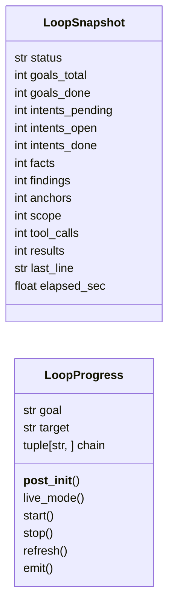
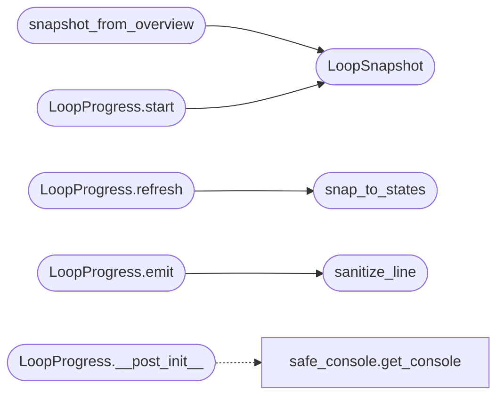

# `modules.loop_progress`

> Source: [modules/loop_progress.py:1](../../modules/loop_progress.py#L1) | language `py` | coverage 100.0% | [API index](../index.md)

Rich Live milestone panel for the autonomous loop.

Renders the orchestrator chain as persistent milestones — green done,
blue in-progress (spinner), red still pending — plus intent/fact/finding
counts, elapsed time and the latest activity line. The panel stays on
screen when the run finishes.

Robustness rules (learned the hard way):

- No markup strings anywhere: every cell is a ``Text`` object with an
  explicit style, so literal ``[green]`` tags can never leak and foreign
  ``[brackets]`` in activity lines can never crash rendering.
- Fixed panel width (100 cols) with non-wrapping cells: narrow sinks
  cannot corrupt the live region by wrapping.
- Non-terminal sinks never use ``Live`` (Rich would degrade to printing
  every refresh as a full new panel): they get one compact milestone
  line per stage change plus the final table at stop.
- All output goes through [`core.safe_console`](core.safe_console.py.md): no ANSI codes on
  non-tty sinks, ASCII box and markers when stdout cannot encode UTF-8.
- Stage states are inferred from the task overview, never asserted.

## Contents

- **Classes:** [`LoopSnapshot`](#loopsnapshot), [`LoopProgress`](#loopprogress)
- **Functions:** [`snapshot_from_overview`](#snapshot_from_overview), [`snap_to_states`](#snap_to_states), [`sanitize_line`](#sanitize_line)
- **Constants:** [`CHAIN_STAGES`](#chain_stages)

## Type Diagram



## Call Graph

Solid arrows stay in this module, dashed arrows leave it.



## Classes

<a id="loopsnapshot"></a>

### `LoopSnapshot`

`class` `dataclass` | [modules/loop_progress.py:80](../../modules/loop_progress.py#L80)

Decorators: `@dataclass`

```python
class LoopSnapshot
```

Point-in-time task state polled from the session stores.

**Attributes**

| Name | Type | Default | Description |
|---|---|---|---|
| [`status`](#loopsnapshot-status) | `str` | `'running'` |  |
| [`goals_total`](#loopsnapshot-goals_total) | `int` | `0` |  |
| [`goals_done`](#loopsnapshot-goals_done) | `int` | `0` |  |
| [`intents_pending`](#loopsnapshot-intents_pending) | `int` | `0` |  |
| [`intents_open`](#loopsnapshot-intents_open) | `int` | `0` |  |
| [`intents_done`](#loopsnapshot-intents_done) | `int` | `0` |  |
| [`facts`](#loopsnapshot-facts) | `int` | `0` |  |
| [`findings`](#loopsnapshot-findings) | `int` | `0` |  |
| [`anchors`](#loopsnapshot-anchors) | `int` | `0` |  |
| [`scope`](#loopsnapshot-scope) | `int` | `0` |  |
| [`tool_calls`](#loopsnapshot-tool_calls) | `int` | `0` |  |
| [`results`](#loopsnapshot-results) | `int` | `0` |  |
| [`last_line`](#loopsnapshot-last_line) | `str` | `''` |  |
| [`elapsed_sec`](#loopsnapshot-elapsed_sec) | `float` | `0.0` |  |

---

<a id="loopprogress"></a>

### `LoopProgress`

`class` `dataclass` | [modules/loop_progress.py:169](../../modules/loop_progress.py#L169)

Decorators: `@dataclass`

```python
class LoopProgress
```

Live milestone panel; call `refresh` from the poll loop.

**Attributes**

| Name | Type | Default | Description |
|---|---|---|---|
| [`goal`](#loopprogress-goal) | `str` | `''` |  |
| [`target`](#loopprogress-target) | `str` | `''` |  |
| [`chain`](#loopprogress-chain) | `tuple[str, ...]` | `CHAIN_STAGES` |  |

**Members**

| Member | Kind | Summary |
|---|---|---|
| [`__post_init__`](#loopprogress-__post_init__) | method | Bind the console to the real stdout captured at construction. |
| [`live_mode`](#loopprogress-live_mode) | property | True only when the sink supports a real live region. |
| [`start`](#loopprogress-start) | method | Open the Live display, or print the header in line mode. |
| [`stop`](#loopprogress-stop) | method | Freeze the final panel on screen (both modes). |
| [`refresh`](#loopprogress-refresh) | method | Re-render milestones from a fresh snapshot (thread-safe). |
| [`emit`](#loopprogress-emit) | method | Print a transcript line above the live panel, colors preserved. |

<a id="loopprogress-__post_init__"></a>

#### `LoopProgress.__post_init__`

`method` | [modules/loop_progress.py:182](../../modules/loop_progress.py#L182)

```python
def __post_init__(self) -> None
```

Bind the console to the real stdout captured at construction.

The loop runner redirects ``sys.stdout`` globally while the
orchestrator thread runs; a console resolving ``sys.stdout`` at
print time would write panel lines back into that redirect and
spin forever. Capturing the file here (before the redirect
starts) keeps panel output on the operator's terminal.

*Calls:* [`get_console`](core.safe_console.py.md#get_console)

<a id="loopprogress-live_mode"></a>

#### `LoopProgress.live_mode`

`property` | [modules/loop_progress.py:195](../../modules/loop_progress.py#L195)

Decorators: `@property`

```python
def live_mode(self) -> bool
```

True only when the sink supports a real live region.

**Returns:** `bool`

<a id="loopprogress-start"></a>

#### `LoopProgress.start`

`method` | [modules/loop_progress.py:202](../../modules/loop_progress.py#L202)

```python
def start(self) -> None
```

Open the Live display, or print the header in line mode.

*Calls:* [`LoopSnapshot`](#loopsnapshot)

<a id="loopprogress-stop"></a>

#### `LoopProgress.stop`

`method` | [modules/loop_progress.py:229](../../modules/loop_progress.py#L229)

```python
def stop(self) -> None
```

Freeze the final panel on screen (both modes).

<a id="loopprogress-refresh"></a>

#### `LoopProgress.refresh`

`method` | [modules/loop_progress.py:246](../../modules/loop_progress.py#L246)

```python
def refresh(self, snapshot: LoopSnapshot) -> None
```

Re-render milestones from a fresh snapshot (thread-safe).

**Parameters**

| Name | Type | Default | Description |
|---|---|---|---|
| `snapshot` | `LoopSnapshot` |  |  |

*Calls:* [`snap_to_states`](#snap_to_states)

<a id="loopprogress-emit"></a>

#### `LoopProgress.emit`

`method` | [modules/loop_progress.py:268](../../modules/loop_progress.py#L268)

```python
def emit(self, line: str) -> None
```

Print a transcript line above the live panel, colors preserved.

**Parameters**

| Name | Type | Default | Description |
|---|---|---|---|
| `line` | `str` |  |  |

*Calls:* [`sanitize_line`](#sanitize_line)

---

## Functions

<a id="snapshot_from_overview"></a>

### `snapshot_from_overview`

`function` | [modules/loop_progress.py:99](../../modules/loop_progress.py#L99)

```python
def snapshot_from_overview(overview: dict, record: dict | None = None, activity_tail: str = '', elapsed_sec: float = 0.0) -> LoopSnapshot
```

Build a snapshot from a graph overview dict plus task record.

**Parameters**

| Name | Type | Default | Description |
|---|---|---|---|
| `overview` | `dict` |  |  |
| `record` | `dict \| None` | `None` |  |
| `activity_tail` | `str` | `''` |  |
| `elapsed_sec` | `float` | `0.0` |  |

**Returns:** `LoopSnapshot`

*Calls:* [`LoopSnapshot`](#loopsnapshot)

---

<a id="snap_to_states"></a>

### `snap_to_states`

`function` | [modules/loop_progress.py:123](../../modules/loop_progress.py#L123)

```python
def snap_to_states(snapshot: LoopSnapshot) -> dict[str, str]
```

Infer done/active/pending per chain stage from a snapshot.

**Parameters**

| Name | Type | Default | Description |
|---|---|---|---|
| `snapshot` | `LoopSnapshot` |  |  |

**Returns:** `dict[str, str]`

*Called by:* [`LoopProgress.refresh`](#loopprogress-refresh)

---

<a id="sanitize_line"></a>

### `sanitize_line`

`function` | [modules/loop_progress.py:151](../../modules/loop_progress.py#L151)

```python
def sanitize_line(line: str, keep_ansi: bool = False) -> str
```

Strip ANSI codes and carriage returns from a transcript line.

**Parameters**

| Name | Type | Default | Description |
|---|---|---|---|
| `line` | `str` |  | Raw transcript chunk. |
| `keep_ansi` | `bool` | `False` | Keep SGR color sequences so live worker output keeps the colors the command emitted. |

**Returns:** `str` - Printable line without carriage returns.

*Called by:* [`LoopProgress.emit`](#loopprogress-emit)

---

## Constants

<a id="chain_stages"></a>

### `CHAIN_STAGES`

`constant` | [modules/loop_progress.py:40](../../modules/loop_progress.py#L40)

```python
CHAIN_STAGES: tuple[str, ...]
```

---
