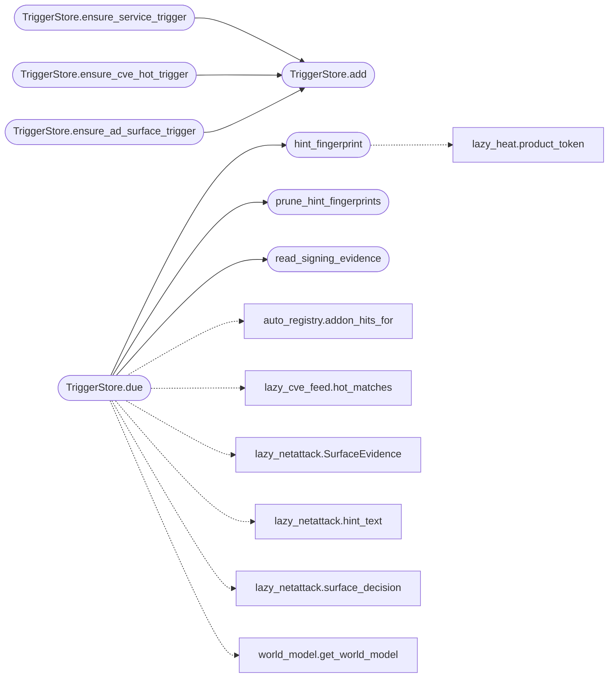

# `modules.loop_triggers`

> Source: [modules/loop_triggers.py:1](../../modules/loop_triggers.py#L1) | language `py` | coverage 100.0% | [API index](../index.md)

TriggerStore: persistent loop triggers extracted from the loop core.

Responsibility-only extraction (no behavior change): the trigger
catalogue used to live inside the loop core module. It now owns its own
file so the loop core shrinks and trigger semantics stay editable in
one place. Path resolution and JSON helpers are resolved through the
loop core at call time, so store redirections monkeypatched by tests
keep applying to every user of this module.

Verification hints from the ``cve_hot`` trigger are fingerprinted by
their evidence signature (``sha1`` of the normalized product and the
version-carrying banner text): the same signature never queues a
second pending hint inside the repeat window, a changed banner is new
evidence and re-proposes immediately.

## Contents

- **Classes:** [`TriggerStore`](#triggerstore)
- **Functions:** [`hint_fingerprint`](#hint_fingerprint), [`prune_hint_fingerprints`](#prune_hint_fingerprints), [`read_signing_evidence`](#read_signing_evidence)
- **Constants:** [`TRIGGER_KINDS`](#trigger_kinds), [`HINT_REPEAT_TTL_SEC`](#hint_repeat_ttl_sec), [`HINT_FINGERPRINT_STORE`](#hint_fingerprint_store)

## Call Graph

Solid arrows stay in this module, dashed arrows leave it.



## Classes

<a id="triggerstore"></a>

### `TriggerStore`

`class` | [modules/loop_triggers.py:88](../../modules/loop_triggers.py#L88)

```python
class TriggerStore
```

Persistent event/interval triggers like server/scheduler (P3).

**Members**

| Member | Kind | Summary |
|---|---|---|
| [`__init__`](#triggerstore-__init__) | constructor | Bind trigger table (global when task_id empty). |
| [`add`](#triggerstore-add) | method | Register a trigger; interval needs every_sec, events fire on new rows. |
| [`upsert_defaults`](#triggerstore-upsert_defaults) | method | Merge declarative seeds without duplicating or re-enabling. |
| [`remove`](#triggerstore-remove) | method | Delete a trigger. |
| [`set_enabled`](#triggerstore-set_enabled) | method | Flip one trigger's enabled flag in place. |
| [`list`](#triggerstore-list) | method | Return all triggers. |
| [`ensure_service_trigger`](#triggerstore-ensure_service_trigger) | method | Register the catalog trigger once so services fire the loop. |
| [`ensure_cve_hot_trigger`](#triggerstore-ensure_cve_hot_trigger) | method | Register the hot-CVE trigger once so fresh intel fires the loop. |
| [`ensure_ad_surface_trigger`](#triggerstore-ensure_ad_surface_trigger) | method | Register the AD-surface trigger once so Windows identity fires it. |
| [`due`](#triggerstore-due) | method | Evaluate triggers like the scheduler tick; fires at most once each. |

<a id="triggerstore-__init__"></a>

#### `TriggerStore.__init__`

`constructor` | [modules/loop_triggers.py:91](../../modules/loop_triggers.py#L91)

```python
def __init__(self, task_id: str = '') -> None
```

Bind trigger table (global when task_id empty).

**Parameters**

| Name | Type | Default | Description |
|---|---|---|---|
| `task_id` | `str` | `''` |  |

*Called by:* [`LazyCommandSet.do_lazy_scheduler`](cli.commands.lazyops.py.md#lazycommandset-do_lazy_scheduler), [`LazyCommandSet.do_lazy_trigger`](cli.commands.lazyops.py.md#lazycommandset-do_lazy_trigger), [`OrchestratorAssetsMixin.add_trigger`](cli.orchestrator_assets_tabs.py.md#orchestratorassetsmixin-add_trigger), [`OrchestratorAssetsMixin.remove_trigger`](cli.orchestrator_assets_tabs.py.md#orchestratorassetsmixin-remove_trigger), [`OrchestratorAssetsMixin.toggle_trigger`](cli.orchestrator_assets_tabs.py.md#orchestratorassetsmixin-toggle_trigger), [`triggers_add`](lazyc2.blueprints.orchestrator.py.md#triggers_add), [`triggers_delete`](lazyc2.blueprints.orchestrator.py.md#triggers_delete), [`export_store`](modules.trigger_policy.py.md#export_store), [`remove_seed`](modules.trigger_policy.py.md#remove_seed), [`seed_store`](modules.trigger_policy.py.md#seed_store)

<a id="triggerstore-add"></a>

#### `TriggerStore.add`

`method` | [modules/loop_triggers.py:101](../../modules/loop_triggers.py#L101)

```python
def add(self, kind: str, arg: str = '', every_sec: float = 0.0) -> dict
```

Register a trigger; interval needs every_sec, events fire on new rows.

**Parameters**

| Name | Type | Default | Description |
|---|---|---|---|
| `kind` | `str` |  |  |
| `arg` | `str` | `''` |  |
| `every_sec` | `float` | `0.0` |  |

**Returns:** `dict`

**Raises**

- `ValueError`: (raised in the body, not documented)

*Called by:* [`LazyCommandSet.do_lazy_trigger`](cli.commands.lazyops.py.md#lazycommandset-do_lazy_trigger), [`OrchestratorAssetsMixin.add_trigger`](cli.orchestrator_assets_tabs.py.md#orchestratorassetsmixin-add_trigger), [`triggers_add`](lazyc2.blueprints.orchestrator.py.md#triggers_add), [`TriggerStore.ensure_ad_surface_trigger`](#triggerstore-ensure_ad_surface_trigger), [`TriggerStore.ensure_cve_hot_trigger`](#triggerstore-ensure_cve_hot_trigger), [`TriggerStore.ensure_service_trigger`](#triggerstore-ensure_service_trigger)

<a id="triggerstore-upsert_defaults"></a>

#### `TriggerStore.upsert_defaults`

`method` | [modules/loop_triggers.py:123](../../modules/loop_triggers.py#L123)

```python
def upsert_defaults(self, seeds: list[dict]) -> list[dict]
```

Merge declarative seeds without duplicating or re-enabling.

**Parameters**

| Name | Type | Default | Description |
|---|---|---|---|
| `seeds` | `list[dict]` |  | Seed entries shaped like ``{kind, arg, every_sec, enabled}``. |

**Returns:** `list[dict]` - The trigger items added by this call.

*Called by:* [`seed_store`](modules.trigger_policy.py.md#seed_store)

<a id="triggerstore-remove"></a>

#### `TriggerStore.remove`

`method` | [modules/loop_triggers.py:165](../../modules/loop_triggers.py#L165)

```python
def remove(self, trigger_id: int) -> bool
```

Delete a trigger.

**Parameters**

| Name | Type | Default | Description |
|---|---|---|---|
| `trigger_id` | `int` |  |  |

**Returns:** `bool`

*Called by:* [`LazyCommandSet.do_lazy_trigger`](cli.commands.lazyops.py.md#lazycommandset-do_lazy_trigger), [`OrchestratorAssetsMixin.remove_trigger`](cli.orchestrator_assets_tabs.py.md#orchestratorassetsmixin-remove_trigger), [`triggers_delete`](lazyc2.blueprints.orchestrator.py.md#triggers_delete), [`remove_seed`](modules.trigger_policy.py.md#remove_seed)

<a id="triggerstore-set_enabled"></a>

#### `TriggerStore.set_enabled`

`method` | [modules/loop_triggers.py:176](../../modules/loop_triggers.py#L176)

```python
def set_enabled(self, trigger_id: int, enabled: bool) -> bool
```

Flip one trigger's enabled flag in place.

**Parameters**

| Name | Type | Default | Description |
|---|---|---|---|
| `trigger_id` | `int` |  |  |
| `enabled` | `bool` |  |  |

**Returns:** `bool`

*Called by:* [`LazyCommandSet.do_lazy_trigger`](cli.commands.lazyops.py.md#lazycommandset-do_lazy_trigger), [`OrchestratorAssetsMixin.toggle_trigger`](cli.orchestrator_assets_tabs.py.md#orchestratorassetsmixin-toggle_trigger)

<a id="triggerstore-list"></a>

#### `TriggerStore.list`

`method` | [modules/loop_triggers.py:190](../../modules/loop_triggers.py#L190)

```python
def list(self) -> list[dict]
```

Return all triggers.

**Returns:** `list[dict]`

<a id="triggerstore-ensure_service_trigger"></a>

#### `TriggerStore.ensure_service_trigger`

`method` | [modules/loop_triggers.py:194](../../modules/loop_triggers.py#L194)

```python
def ensure_service_trigger(self) -> bool
```

Register the catalog trigger once so services fire the loop.

The trigger is what turns ``lazyaddons`` / `[`tools`](cli.exploration.py.md#explorationengine-tools)` service
metadata into an orchestrator event: whenever a new service
asset lands, the next round fires with the matching addon and
tool names attached.

**Returns:** `bool`

*Calls:* [`TriggerStore.add`](#triggerstore-add)

<a id="triggerstore-ensure_cve_hot_trigger"></a>

#### `TriggerStore.ensure_cve_hot_trigger`

`method` | [modules/loop_triggers.py:207](../../modules/loop_triggers.py#L207)

```python
def ensure_cve_hot_trigger(self) -> bool
```

Register the hot-CVE trigger once so fresh intel fires the loop.

Every round, services newer than the watermark are correlated
against keyless exploit intelligence (KEV, EPSS, public
exploits); hot or warm matches steer the planner with a
verification hint instead of raw scanning.

**Returns:** `bool`

*Calls:* [`TriggerStore.add`](#triggerstore-add)

<a id="triggerstore-ensure_ad_surface_trigger"></a>

#### `TriggerStore.ensure_ad_surface_trigger`

`method` | [modules/loop_triggers.py:220](../../modules/loop_triggers.py#L220)

```python
def ensure_ad_surface_trigger(self) -> bool
```

Register the AD-surface trigger once so Windows identity fires it.

Every cycle, services newer than the watermark are graded for the
Windows network-attack families (LLMNR, SMB relay, mitm6,
NTLMv1 downgrade); only ``viable`` or ``needs_evidence`` grades
surface as operator hints, kinetic steps stay operator-gated.

**Returns:** `bool`

*Calls:* [`TriggerStore.add`](#triggerstore-add)

<a id="triggerstore-due"></a>

#### `TriggerStore.due`

`method` | [modules/loop_triggers.py:233](../../modules/loop_triggers.py#L233)

```python
def due(self, task_id: str, graph, activity, assets=None, store=None) -> Sequence[dict]
```

Evaluate triggers like the scheduler tick; fires at most once each.

The ``service`` and ``task_create`` kinds need the asset graph /
task store: pass them to enable those events, the rest stay
graph/activity driven.

**Parameters**

| Name | Type | Default | Description |
|---|---|---|---|
| `task_id` | `str` |  |  |
| `graph` |  |  |  |
| `activity` |  |  |  |
| `assets` |  | `None` |  |
| `store` |  | `None` |  |

**Returns:** `Sequence[dict]`

*Calls:* [`addon_hits_for`](modules.auto_registry.py.md#addon_hits_for), [`hot_matches`](modules.lazy_cve_feed.py.md#hot_matches), [`SurfaceEvidence`](modules.lazy_netattack.py.md#surfaceevidence), [`hint_text`](modules.lazy_netattack.py.md#hint_text), [`surface_decision`](modules.lazy_netattack.py.md#surface_decision), [`hint_fingerprint`](#hint_fingerprint), [`prune_hint_fingerprints`](#prune_hint_fingerprints), [`read_signing_evidence`](#read_signing_evidence), [`get_world_model`](modules.world_model.py.md#get_world_model)

*Called by:* [`LazyCommandSet.do_lazy_scheduler`](cli.commands.lazyops.py.md#lazycommandset-do_lazy_scheduler)

---

## Functions

<a id="hint_fingerprint"></a>

### `hint_fingerprint`

`function` | [modules/loop_triggers.py:28](../../modules/loop_triggers.py#L28)

```python
def hint_fingerprint(row: dict) -> str
```

Return the evidence signature of one hot-CVE candidate.

The signature covers the CVE id, the normalized product token
(generic words dropped, case folded) and the raw version banner:
a bump of the banner version is new evidence and re-proposes the
hint even inside the repeat window.

**Parameters**

| Name | Type | Default | Description |
|---|---|---|---|
| `row` | `dict` |  | Hot match row with `[`cve`](lazyc2.py.md#cve)`, ``product`` and ``version``. |

**Returns:** `str` - Hex digest string.

*Calls:* [`product_token`](modules.lazy_heat.py.md#product_token)

*Called by:* [`TriggerStore.due`](#triggerstore-due)

---

<a id="prune_hint_fingerprints"></a>

### `prune_hint_fingerprints`

`function` | [modules/loop_triggers.py:60](../../modules/loop_triggers.py#L60)

```python
def prune_hint_fingerprints(store: dict, now: float, ttl: float = HINT_REPEAT_TTL_SEC) -> dict
```

Return only the fresh fingerprints of a stored fingerprint map.

**Parameters**

| Name | Type | Default | Description |
|---|---|---|---|
| `store` | `dict` |  | ``{fingerprint: last_seen_epoch}`` mapping. |
| `now` | `float` |  | Current epoch seconds. |
| `ttl` | `float` | `HINT_REPEAT_TTL_SEC` | Seconds a signature stays valid. |

**Returns:** `dict` - Filtered mapping, ''-safe on malformed rows.

*Called by:* [`TriggerStore.due`](#triggerstore-due)

---

<a id="read_signing_evidence"></a>

### `read_signing_evidence`

`function` | [modules/loop_triggers.py:499](../../modules/loop_triggers.py#L499)

```python
def read_signing_evidence(store_dir=None) -> dict[str, str]
```

Load operator-attested SMB signing evidence per host.

Evidence file: ``sessions/smb_signing.json`` — operator writes ``{"host":
"nmap smb-security-mode output..."}`` after the discovery probe; the
ad_surface trigger grades relay viability from it. Untrusted text: the
hint only repeats what was attested.

**Parameters**

| Name | Type | Default | Description |
|---|---|---|---|
| `store_dir` |  | `None` |  |

**Returns:** `dict[str, str]` - Mapping of host to signing evidence text, ``{}`` when unset.

*Called by:* [`TriggerStore.due`](#triggerstore-due)

---

## Constants

<a id="trigger_kinds"></a>

### `TRIGGER_KINDS`

`constant` | [modules/loop_triggers.py:22](../../modules/loop_triggers.py#L22)

```python
TRIGGER_KINDS
```

---

<a id="hint_repeat_ttl_sec"></a>

### `HINT_REPEAT_TTL_SEC`

`constant` | [modules/loop_triggers.py:24](../../modules/loop_triggers.py#L24)

```python
HINT_REPEAT_TTL_SEC = 86400.0
```

---

<a id="hint_fingerprint_store"></a>

### `HINT_FINGERPRINT_STORE`

`constant` | [modules/loop_triggers.py:25](../../modules/loop_triggers.py#L25)

```python
HINT_FINGERPRINT_STORE = 'hint_fingerprints.json'
```

---
