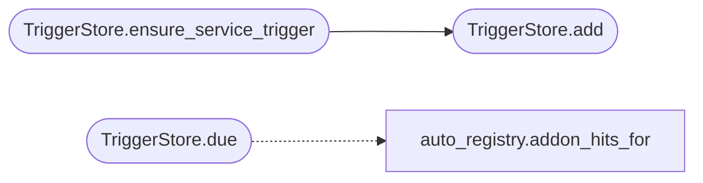

# `modules.loop_triggers`

> Source: [modules/loop_triggers.py:1](../../modules/loop_triggers.py#L1) | language `py` | coverage 100.0% | [API index](../index.md)

TriggerStore: persistent loop triggers extracted from the loop core.

Responsibility-only extraction (no behavior change): the trigger
catalogue used to live inside the loop core module. It now owns its own
file so the loop core shrinks and trigger semantics stay editable in
one place. Path resolution and JSON helpers are resolved through the
loop core at call time, so store redirections monkeypatched by tests
keep applying to every user of this module.

## Contents

- **Classes:** [`TriggerStore`](#triggerstore)
- **Constants:** [`TRIGGER_KINDS`](#trigger_kinds)

## Call Graph

Solid arrows stay in this module, dashed arrows leave it.



## Classes

<a id="triggerstore"></a>

### `TriggerStore`

`class` | [modules/loop_triggers.py:23](../../modules/loop_triggers.py#L23)

```python
class TriggerStore
```

Persistent event/interval triggers like server/scheduler (P3).

**Members**

| Member | Kind | Summary |
|---|---|---|
| [`__init__`](#triggerstore-__init__) | constructor | Bind trigger table (global when task_id empty). |
| [`add`](#triggerstore-add) | method | Register a trigger; interval needs every_sec, events fire on new rows. |
| [`upsert_defaults`](#triggerstore-upsert_defaults) | method | Merge declarative seeds without duplicating or re-enabling. |
| [`remove`](#triggerstore-remove) | method | Delete a trigger. |
| [`set_enabled`](#triggerstore-set_enabled) | method | Flip one trigger's enabled flag in place. |
| [`list`](#triggerstore-list) | method | Return all triggers. |
| [`ensure_service_trigger`](#triggerstore-ensure_service_trigger) | method | Register the catalog trigger once so services fire the loop. |
| [`due`](#triggerstore-due) | method | Evaluate triggers like the scheduler tick; fires at most once each. |

<a id="triggerstore-__init__"></a>

#### `TriggerStore.__init__`

`constructor` | [modules/loop_triggers.py:26](../../modules/loop_triggers.py#L26)

```python
def __init__(self, task_id: str = '') -> None
```

Bind trigger table (global when task_id empty).

**Parameters**

| Name | Type | Default | Description |
|---|---|---|---|
| `task_id` | `str` | `''` |  |

*Called by:* [`LazyCommandSet.do_lazy_scheduler`](cli.commands.lazyops.py.md#lazycommandset-do_lazy_scheduler), [`LazyCommandSet.do_lazy_trigger`](cli.commands.lazyops.py.md#lazycommandset-do_lazy_trigger), [`OrchestratorAssetsMixin.add_trigger`](cli.orchestrator_assets_tabs.py.md#orchestratorassetsmixin-add_trigger), [`OrchestratorAssetsMixin.remove_trigger`](cli.orchestrator_assets_tabs.py.md#orchestratorassetsmixin-remove_trigger), [`OrchestratorAssetsMixin.toggle_trigger`](cli.orchestrator_assets_tabs.py.md#orchestratorassetsmixin-toggle_trigger), [`triggers_add`](lazyc2.blueprints.orchestrator.py.md#triggers_add), [`triggers_delete`](lazyc2.blueprints.orchestrator.py.md#triggers_delete), [`export_store`](modules.trigger_policy.py.md#export_store), [`remove_seed`](modules.trigger_policy.py.md#remove_seed), [`seed_store`](modules.trigger_policy.py.md#seed_store)

<a id="triggerstore-add"></a>

#### `TriggerStore.add`

`method` | [modules/loop_triggers.py:36](../../modules/loop_triggers.py#L36)

```python
def add(self, kind: str, arg: str = '', every_sec: float = 0.0) -> dict
```

Register a trigger; interval needs every_sec, events fire on new rows.

**Parameters**

| Name | Type | Default | Description |
|---|---|---|---|
| `kind` | `str` |  |  |
| `arg` | `str` | `''` |  |
| `every_sec` | `float` | `0.0` |  |

**Returns:** `dict`

**Raises**

- `ValueError`: (raised in the body, not documented)

*Called by:* [`LazyCommandSet.do_lazy_trigger`](cli.commands.lazyops.py.md#lazycommandset-do_lazy_trigger), [`OrchestratorAssetsMixin.add_trigger`](cli.orchestrator_assets_tabs.py.md#orchestratorassetsmixin-add_trigger), [`triggers_add`](lazyc2.blueprints.orchestrator.py.md#triggers_add), [`TriggerStore.ensure_service_trigger`](#triggerstore-ensure_service_trigger)

<a id="triggerstore-upsert_defaults"></a>

#### `TriggerStore.upsert_defaults`

`method` | [modules/loop_triggers.py:58](../../modules/loop_triggers.py#L58)

```python
def upsert_defaults(self, seeds: list[dict]) -> list[dict]
```

Merge declarative seeds without duplicating or re-enabling.

**Parameters**

| Name | Type | Default | Description |
|---|---|---|---|
| `seeds` | `list[dict]` |  | Seed entries shaped like ``{kind, arg, every_sec, enabled}``. |

**Returns:** `list[dict]` - The trigger items added by this call.

*Called by:* [`seed_store`](modules.trigger_policy.py.md#seed_store)

<a id="triggerstore-remove"></a>

#### `TriggerStore.remove`

`method` | [modules/loop_triggers.py:100](../../modules/loop_triggers.py#L100)

```python
def remove(self, trigger_id: int) -> bool
```

Delete a trigger.

**Parameters**

| Name | Type | Default | Description |
|---|---|---|---|
| `trigger_id` | `int` |  |  |

**Returns:** `bool`

*Called by:* [`LazyCommandSet.do_lazy_trigger`](cli.commands.lazyops.py.md#lazycommandset-do_lazy_trigger), [`OrchestratorAssetsMixin.remove_trigger`](cli.orchestrator_assets_tabs.py.md#orchestratorassetsmixin-remove_trigger), [`triggers_delete`](lazyc2.blueprints.orchestrator.py.md#triggers_delete), [`remove_seed`](modules.trigger_policy.py.md#remove_seed)

<a id="triggerstore-set_enabled"></a>

#### `TriggerStore.set_enabled`

`method` | [modules/loop_triggers.py:111](../../modules/loop_triggers.py#L111)

```python
def set_enabled(self, trigger_id: int, enabled: bool) -> bool
```

Flip one trigger's enabled flag in place.

**Parameters**

| Name | Type | Default | Description |
|---|---|---|---|
| `trigger_id` | `int` |  |  |
| `enabled` | `bool` |  |  |

**Returns:** `bool`

*Called by:* [`LazyCommandSet.do_lazy_trigger`](cli.commands.lazyops.py.md#lazycommandset-do_lazy_trigger), [`OrchestratorAssetsMixin.toggle_trigger`](cli.orchestrator_assets_tabs.py.md#orchestratorassetsmixin-toggle_trigger)

<a id="triggerstore-list"></a>

#### `TriggerStore.list`

`method` | [modules/loop_triggers.py:125](../../modules/loop_triggers.py#L125)

```python
def list(self) -> list[dict]
```

Return all triggers.

**Returns:** `list[dict]`

<a id="triggerstore-ensure_service_trigger"></a>

#### `TriggerStore.ensure_service_trigger`

`method` | [modules/loop_triggers.py:129](../../modules/loop_triggers.py#L129)

```python
def ensure_service_trigger(self) -> bool
```

Register the catalog trigger once so services fire the loop.

The trigger is what turns ``lazyaddons`` / `[`tools`](cli.exploration.py.md#explorationengine-tools)` service
metadata into an orchestrator event: whenever a new service
asset lands, the next round fires with the matching addon and
tool names attached.

**Returns:** `bool`

*Calls:* [`TriggerStore.add`](#triggerstore-add)

<a id="triggerstore-due"></a>

#### `TriggerStore.due`

`method` | [modules/loop_triggers.py:142](../../modules/loop_triggers.py#L142)

```python
def due(self, task_id: str, graph, activity, assets=None, store=None) -> list[dict]
```

Evaluate triggers like the scheduler tick; fires at most once each.

The ``service`` and ``task_create`` kinds need the asset graph /
task store: pass them to enable those events, the rest stay
graph/activity driven.

**Parameters**

| Name | Type | Default | Description |
|---|---|---|---|
| `task_id` | `str` |  |  |
| `graph` |  |  |  |
| `activity` |  |  |  |
| `assets` |  | `None` |  |
| `store` |  | `None` |  |

**Returns:** `list[dict]`

*Calls:* [`addon_hits_for`](modules.auto_registry.py.md#addon_hits_for)

*Called by:* [`LazyCommandSet.do_lazy_scheduler`](cli.commands.lazyops.py.md#lazycommandset-do_lazy_scheduler)

---

## Constants

<a id="trigger_kinds"></a>

### `TRIGGER_KINDS`

`constant` | [modules/loop_triggers.py:13](../../modules/loop_triggers.py#L13)

```python
TRIGGER_KINDS
```

---
