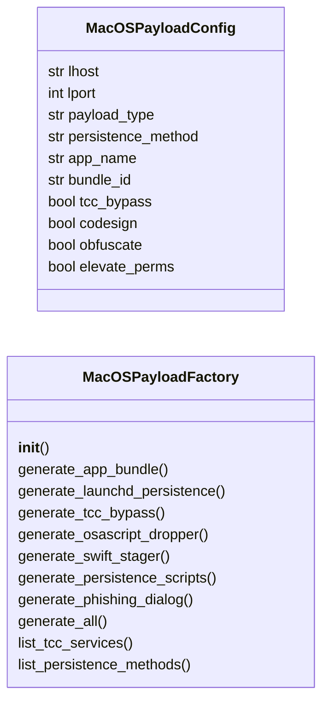
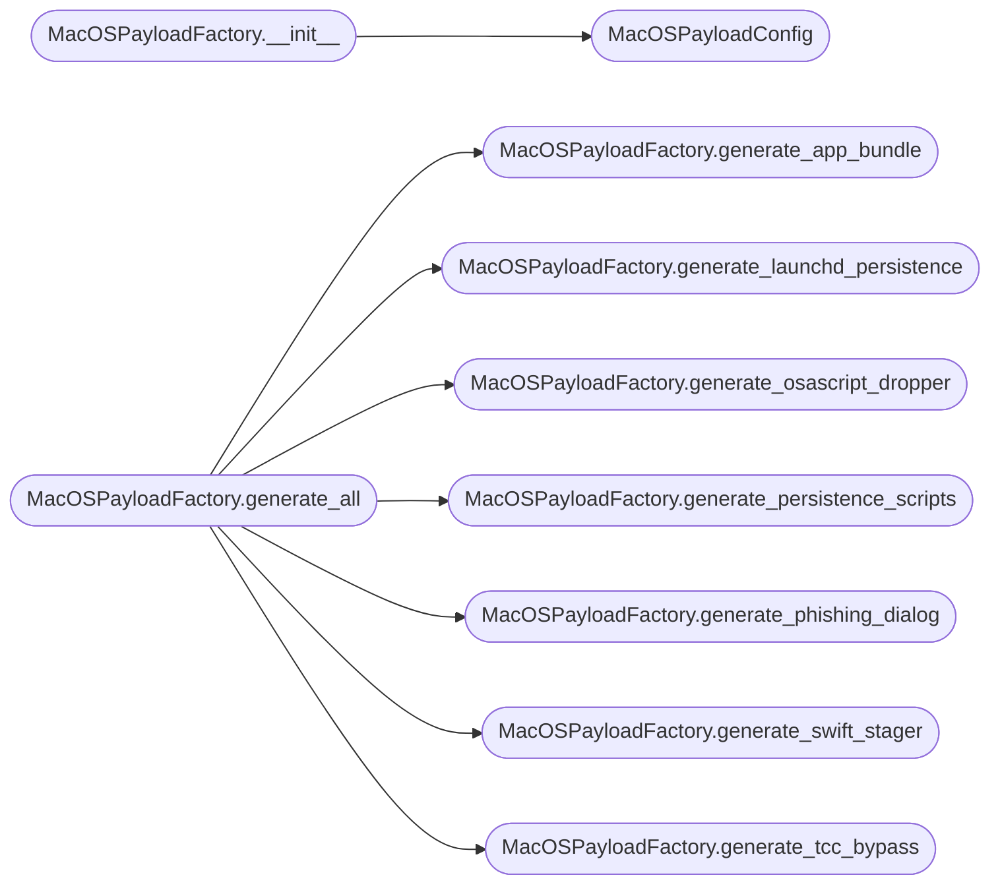

# `modules.macos_payloads`

> Source: [modules/macos_payloads.py:1](../../modules/macos_payloads.py#L1) | language `py` | coverage 92.9% | [API index](../index.md)

macOS payload generation — .app bundles, persistence, TCC bypass, Swift/ObjC.

Generates macOS-native payloads: .app bundle wrappers, LaunchDaemon/LaunchAgent
persistence, TCC database manipulation payloads, osascript droppers, Swift/ObjC
reverse shells, and AppleScript phishing dialogs. All payloads derive connection
parameters from payload.json.

## Contents

- **Classes:** [`MacOSPayloadConfig`](#macospayloadconfig), [`MacOSPayloadFactory`](#macospayloadfactory)
- **Constants:** [`SESSIONS_DIR`](#sessions_dir), [`TCC_SERVICES`](#tcc_services), [`LAUNCHD_PATHS`](#launchd_paths), [`PERSISTENCE_METHODS`](#persistence_methods)

## Type Diagram



## Call Graph

Solid arrows stay in this module, dashed arrows leave it.



## Classes

<a id="macospayloadconfig"></a>

### `MacOSPayloadConfig`

`class` `dataclass` | [modules/macos_payloads.py:60](../../modules/macos_payloads.py#L60)

Decorators: `@dataclass`

```python
class MacOSPayloadConfig
```

Configuration for macOS payload generation.

**Attributes**

| Name | Type | Default | Description |
|---|---|---|---|
| [`lhost`](#macospayloadconfig-lhost) | `str` | `''` | Attacker IP or hostname for reverse connections. |
| [`lport`](#macospayloadconfig-lport) | `int` | `443` | Listener port. |
| [`payload_type`](#macospayloadconfig-payload_type) | `str` | `'reverse_shell'` | generated payload type (reverse_shell, bind_shell, c2_beacon, dropper). |
| [`persistence_method`](#macospayloadconfig-persistence_method) | `str` | `'launchagent'` | How to persist (launchdaemon, cron, login_item, etc.). |
| [`app_name`](#macospayloadconfig-app_name) | `str` | `'SystemPreferences'` | Display name for .app bundles. |
| [`bundle_id`](#macospayloadconfig-bundle_id) | `str` | `'com.apple.systempreferences.helper'` | Reverse-DNS bundle identifier. |
| [`tcc_bypass`](#macospayloadconfig-tcc_bypass) | `bool` | `False` | Attempt to request/hijack TCC permissions. |
| [`codesign`](#macospayloadconfig-codesign) | `bool` | `False` | Attempt ad-hoc codesigning of the generated payload. |
| [`obfuscate`](#macospayloadconfig-obfuscate) | `bool` | `True` | Apply base64 + eval obfuscation to shell scripts. |
| [`elevate_perms`](#macospayloadconfig-elevate_perms) | `bool` | `False` | Craft payload to check for and exploit sudo/priv escalation. |

---

<a id="macospayloadfactory"></a>

### `MacOSPayloadFactory`

`class` | [modules/macos_payloads.py:88](../../modules/macos_payloads.py#L88)

```python
class MacOSPayloadFactory
```

Generate macOS-native payloads for initial access, persistence, and evasion.

Produces .app bundles, LaunchDaemon/Agent plists, TCC manipulation scripts,
AppleScript phishing dialogs, and Swift/ObjC stagers.

**Members**

| Member | Kind | Summary |
|---|---|---|
| [`__init__`](#macospayloadfactory-__init__) | constructor |  |
| [`generate_app_bundle`](#macospayloadfactory-generate_app_bundle) | method | Generate a macOS .app bundle with embedded reverse shell. |
| [`generate_launchd_persistence`](#macospayloadfactory-generate_launchd_persistence) | method | Generate a LaunchDaemon or LaunchAgent plist for persistence. |
| [`generate_tcc_bypass`](#macospayloadfactory-generate_tcc_bypass) | method | Generate a TCC bypass script targeting common permissions. |
| [`generate_osascript_dropper`](#macospayloadfactory-generate_osascript_dropper) | method | Generate an AppleScript-based dropper that downloads and executes a stage. |
| [`generate_swift_stager`](#macospayloadfactory-generate_swift_stager) | method | Generate a Swift reverse shell stager. |
| [`generate_persistence_scripts`](#macospayloadfactory-generate_persistence_scripts) | method | Generate all available macOS persistence scripts. |
| [`generate_phishing_dialog`](#macospayloadfactory-generate_phishing_dialog) | method | Generate an AppleScript credential phishing dialog. |
| [`generate_all`](#macospayloadfactory-generate_all) | method | Generate all macOS payload artifacts. |
| [`list_tcc_services`](#macospayloadfactory-list_tcc_services) | staticmethod | Return the list of known TCC service identifiers. |
| [`list_persistence_methods`](#macospayloadfactory-list_persistence_methods) | staticmethod | Return the list of available persistence methods for macOS. |

<a id="macospayloadfactory-__init__"></a>

#### `MacOSPayloadFactory.__init__`

`constructor` | [modules/macos_payloads.py:111](../../modules/macos_payloads.py#L111)

```python
def __init__(self, config: MacOSPayloadConfig | None = None, output_dir: Path | None = None)
```

**Parameters**

| Name | Type | Default | Description |
|---|---|---|---|
| `config` | `MacOSPayloadConfig \| None` | `None` |  |
| `output_dir` | `Path \| None` | `None` |  |

*Calls:* [`MacOSPayloadConfig`](#macospayloadconfig)

*Called by:* [`PayloadArsenalCommandSet.do_macos_payload`](cli.commands.payload_arsenal.py.md#payloadarsenalcommandset-do_macos_payload)

<a id="macospayloadfactory-generate_app_bundle"></a>

#### `MacOSPayloadFactory.generate_app_bundle`

`method` | [modules/macos_payloads.py:137](../../modules/macos_payloads.py#L137)

```python
def generate_app_bundle(self) -> Path
```

Generate a macOS .app bundle with embedded reverse shell.

Creates a minimal .app directory structure with Info.plist,
executable script, and optional code signing. The .app appears
as a legitimate macOS application.

**Returns:** `Path` - Path to the generated .app bundle.

*Called by:* [`PayloadArsenalCommandSet.do_macos_payload`](cli.commands.payload_arsenal.py.md#payloadarsenalcommandset-do_macos_payload), [`MacOSPayloadFactory.generate_all`](#macospayloadfactory-generate_all)

<a id="macospayloadfactory-generate_launchd_persistence"></a>

#### `MacOSPayloadFactory.generate_launchd_persistence`

`method` | [modules/macos_payloads.py:212](../../modules/macos_payloads.py#L212)

```python
def generate_launchd_persistence(self) -> dict[str, Path]
```

Generate a LaunchDaemon or LaunchAgent plist for persistence.

**Returns:** `dict[str, Path]` - Dict with 'plist_path' and 'script_path' for the persistence artifact.

*Called by:* [`PayloadArsenalCommandSet.do_macos_payload`](cli.commands.payload_arsenal.py.md#payloadarsenalcommandset-do_macos_payload), [`MacOSPayloadFactory.generate_all`](#macospayloadfactory-generate_all)

<a id="macospayloadfactory-generate_tcc_bypass"></a>

#### `MacOSPayloadFactory.generate_tcc_bypass`

`method` | [modules/macos_payloads.py:268](../../modules/macos_payloads.py#L268)

```python
def generate_tcc_bypass(self) -> str
```

Generate a TCC bypass script targeting common permissions.

Exploits TCC database (TCC.db) manipulation, FDA (Full Disk Access)
request dialogs, and SSH access to bypass transparency consent.

**Returns:** `str` - Shell script for TCC bypass.

*Called by:* [`PayloadArsenalCommandSet.do_macos_payload`](cli.commands.payload_arsenal.py.md#payloadarsenalcommandset-do_macos_payload), [`MacOSPayloadFactory.generate_all`](#macospayloadfactory-generate_all)

<a id="macospayloadfactory-generate_osascript_dropper"></a>

#### `MacOSPayloadFactory.generate_osascript_dropper`

`method` | [modules/macos_payloads.py:314](../../modules/macos_payloads.py#L314)

```python
def generate_osascript_dropper(self) -> str
```

Generate an AppleScript-based dropper that downloads and executes a stage.

Uses osascript with minimal shell interaction to evade shell-based
detection while downloading a second stage via curl.

**Returns:** `str` - AppleScript dropper source.

*Called by:* [`PayloadArsenalCommandSet.do_macos_payload`](cli.commands.payload_arsenal.py.md#payloadarsenalcommandset-do_macos_payload), [`MacOSPayloadFactory.generate_all`](#macospayloadfactory-generate_all)

<a id="macospayloadfactory-generate_swift_stager"></a>

#### `MacOSPayloadFactory.generate_swift_stager`

`method` | [modules/macos_payloads.py:335](../../modules/macos_payloads.py#L335)

```python
def generate_swift_stager(self) -> str
```

Generate a Swift reverse shell stager.

Compiles to a native Mach-O binary with no external dependencies.
Uses Foundation for socket I/O — requires Xcode or swiftc.

**Returns:** `str` - Swift source code.

*Called by:* [`PayloadArsenalCommandSet.do_macos_payload`](cli.commands.payload_arsenal.py.md#payloadarsenalcommandset-do_macos_payload), [`MacOSPayloadFactory.generate_all`](#macospayloadfactory-generate_all)

<a id="macospayloadfactory-generate_persistence_scripts"></a>

#### `MacOSPayloadFactory.generate_persistence_scripts`

`method` | [modules/macos_payloads.py:398](../../modules/macos_payloads.py#L398)

```python
def generate_persistence_scripts(self) -> dict[str, str]
```

Generate all available macOS persistence scripts.

**Returns:** `dict[str, str]` - Dict mapping persistence method name to shell script content.

*Called by:* [`MacOSPayloadFactory.generate_all`](#macospayloadfactory-generate_all)

<a id="macospayloadfactory-generate_phishing_dialog"></a>

#### `MacOSPayloadFactory.generate_phishing_dialog`

`method` | [modules/macos_payloads.py:447](../../modules/macos_payloads.py#L447)

```python
def generate_phishing_dialog(self) -> str
```

Generate an AppleScript credential phishing dialog.

Presents a system-looking password prompt capturing credentials
via osascript with GUI dialog.

**Returns:** `str` - AppleScript for credential harvesting.

*Called by:* [`MacOSPayloadFactory.generate_all`](#macospayloadfactory-generate_all)

<a id="macospayloadfactory-generate_all"></a>

#### `MacOSPayloadFactory.generate_all`

`method` | [modules/macos_payloads.py:470](../../modules/macos_payloads.py#L470)

```python
def generate_all(self) -> dict[str, Any]
```

Generate all macOS payload artifacts.

**Returns:** `dict[str, Any]` - Dict with all generated payloads keyed by type.

*Calls:* [`MacOSPayloadFactory.generate_app_bundle`](#macospayloadfactory-generate_app_bundle), [`MacOSPayloadFactory.generate_launchd_persistence`](#macospayloadfactory-generate_launchd_persistence), [`MacOSPayloadFactory.generate_osascript_dropper`](#macospayloadfactory-generate_osascript_dropper), [`MacOSPayloadFactory.generate_persistence_scripts`](#macospayloadfactory-generate_persistence_scripts), [`MacOSPayloadFactory.generate_phishing_dialog`](#macospayloadfactory-generate_phishing_dialog), [`MacOSPayloadFactory.generate_swift_stager`](#macospayloadfactory-generate_swift_stager), [`MacOSPayloadFactory.generate_tcc_bypass`](#macospayloadfactory-generate_tcc_bypass)

*Called by:* [`PayloadArsenalCommandSet.do_macos_payload`](cli.commands.payload_arsenal.py.md#payloadarsenalcommandset-do_macos_payload)

<a id="macospayloadfactory-list_tcc_services"></a>

#### `MacOSPayloadFactory.list_tcc_services`

`staticmethod` | [modules/macos_payloads.py:517](../../modules/macos_payloads.py#L517)

Decorators: `@staticmethod`

```python
def list_tcc_services() -> list[str]
```

Return the list of known TCC service identifiers.

**Returns:** `list[str]`

<a id="macospayloadfactory-list_persistence_methods"></a>

#### `MacOSPayloadFactory.list_persistence_methods`

`staticmethod` | [modules/macos_payloads.py:522](../../modules/macos_payloads.py#L522)

Decorators: `@staticmethod`

```python
def list_persistence_methods() -> list[str]
```

Return the list of available persistence methods for macOS.

**Returns:** `list[str]`

---

## Constants

<a id="sessions_dir"></a>

### `SESSIONS_DIR`

`constant` | [modules/macos_payloads.py:19](../../modules/macos_payloads.py#L19)

```python
SESSIONS_DIR = Path(__file__).resolve().parent.parent / 'sessions'
```

---

<a id="tcc_services"></a>

### `TCC_SERVICES`

`constant` | [modules/macos_payloads.py:21](../../modules/macos_payloads.py#L21)

```python
TCC_SERVICES
```

---

<a id="launchd_paths"></a>

### `LAUNCHD_PATHS`

`constant` | [modules/macos_payloads.py:40](../../modules/macos_payloads.py#L40)

```python
LAUNCHD_PATHS
```

---

<a id="persistence_methods"></a>

### `PERSISTENCE_METHODS`

`constant` | [modules/macos_payloads.py:46](../../modules/macos_payloads.py#L46)

```python
PERSISTENCE_METHODS
```

---
