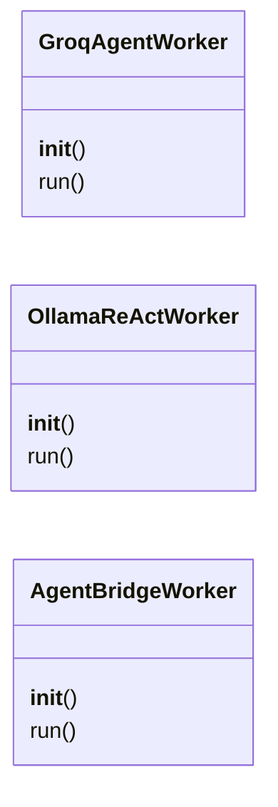
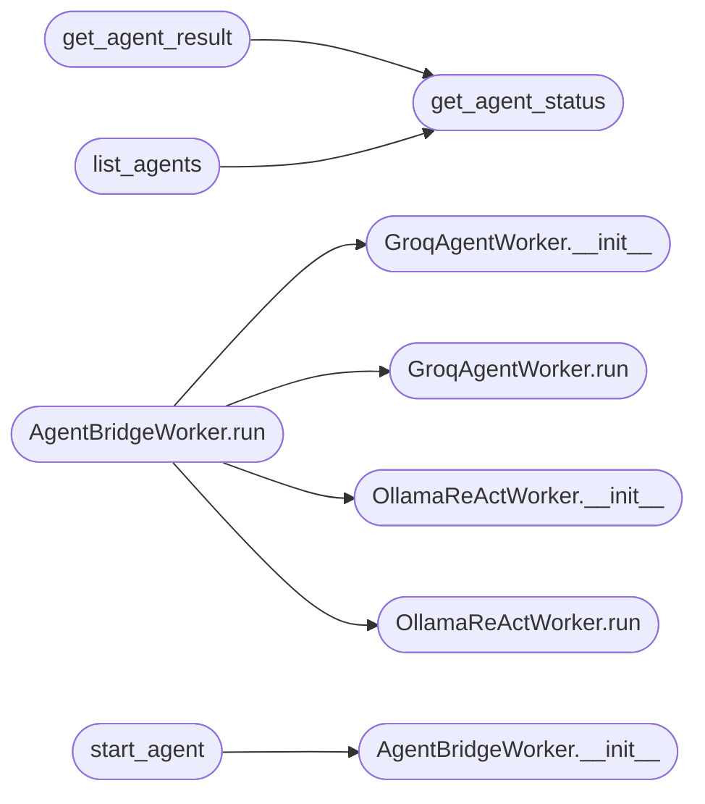

# `modules.mcp_agent_bridge`

> Source: [modules/mcp_agent_bridge.py:1](../../modules/mcp_agent_bridge.py#L1) | language `py` | coverage 42.9% | [API index](../index.md)

LazyOwn MCP Agent Bridge ======================== Allows Claude (via MCP) to delegate tasks to internal AI agents (Groq / Ollama) running inside LazyOwn, without blocking the MCP server.

Architecture:
  Claude → lazyown_run_agent(goal, model)
              → spawns AgentBridgeWorker in a thread
              → writes live log to sessions/agents/<id>.jsonl
  Claude → lazyown_agent_status(id)   → progress + last action
  Claude → lazyown_agent_result(id)   → final answer

Supported backends:
  - "groq"   : GroqModel via Groq SDK  (requires GROQ_API_KEY)
  - "ollama" : OllamaModel via OpenAI-compatible SDK → localhost:11434/v1

## Contents

- **Classes:** [`GroqAgentWorker`](#groqagentworker), [`OllamaReActWorker`](#ollamareactworker), [`AgentBridgeWorker`](#agentbridgeworker)
- **Functions:** [`get_agent_status`](#get_agent_status), [`get_agent_result`](#get_agent_result), [`list_agents`](#list_agents), [`start_agent`](#start_agent)
- **Constants:** [`BASE_DIR`](#base_dir), [`SESSIONS`](#sessions), [`AGENTS_DIR`](#agents_dir), [`GROQ_SYSTEM`](#groq_system), [`REACT_SYSTEM`](#react_system)

## Type Diagram



## Call Graph

Solid arrows stay in this module, dashed arrows leave it.



## Classes

<a id="groqagentworker"></a>

### `GroqAgentWorker`

`class` | [modules/mcp_agent_bridge.py:234](../../modules/mcp_agent_bridge.py#L234)

```python
class GroqAgentWorker
```

**Members**

| Member | Kind | Summary |
|---|---|---|
| [`__init__`](#groqagentworker-__init__) | constructor |  |
| [`run`](#groqagentworker-run) | method |  |

<a id="groqagentworker-__init__"></a>

#### `GroqAgentWorker.__init__`

`constructor` | [modules/mcp_agent_bridge.py:235](../../modules/mcp_agent_bridge.py#L235)

```python
def __init__(self, agent_id, goal, client, model, run_cmd, max_iter)
```

**Parameters**

| Name | Type | Default | Description |
|---|---|---|---|
| `agent_id` |  |  |  |
| `goal` |  |  |  |
| `client` |  |  |  |
| `model` |  |  |  |
| `run_cmd` |  |  |  |
| `max_iter` |  |  |  |

*Called by:* [`AgentBridgeWorker.run`](#agentbridgeworker-run)

<a id="groqagentworker-run"></a>

#### `GroqAgentWorker.run`

`method` | [modules/mcp_agent_bridge.py:264](../../modules/mcp_agent_bridge.py#L264)

```python
def run(self)
```

*Called by:* [`AgentBridgeWorker.run`](#agentbridgeworker-run)

---

<a id="ollamareactworker"></a>

### `OllamaReActWorker`

`class` | [modules/mcp_agent_bridge.py:367](../../modules/mcp_agent_bridge.py#L367)

```python
class OllamaReActWorker
```

**Members**

| Member | Kind | Summary |
|---|---|---|
| [`__init__`](#ollamareactworker-__init__) | constructor |  |
| [`run`](#ollamareactworker-run) | method |  |

<a id="ollamareactworker-__init__"></a>

#### `OllamaReActWorker.__init__`

`constructor` | [modules/mcp_agent_bridge.py:368](../../modules/mcp_agent_bridge.py#L368)

```python
def __init__(self, agent_id, goal, client, model, run_cmd, max_iter)
```

**Parameters**

| Name | Type | Default | Description |
|---|---|---|---|
| `agent_id` |  |  |  |
| `goal` |  |  |  |
| `client` |  |  |  |
| `model` |  |  |  |
| `run_cmd` |  |  |  |
| `max_iter` |  |  |  |

*Called by:* [`AgentBridgeWorker.run`](#agentbridgeworker-run)

<a id="ollamareactworker-run"></a>

#### `OllamaReActWorker.run`

`method` | [modules/mcp_agent_bridge.py:389](../../modules/mcp_agent_bridge.py#L389)

```python
def run(self)
```

*Called by:* [`AgentBridgeWorker.run`](#agentbridgeworker-run)

---

<a id="agentbridgeworker"></a>

### `AgentBridgeWorker`

`class` | [modules/mcp_agent_bridge.py:468](../../modules/mcp_agent_bridge.py#L468)

```python
class AgentBridgeWorker
```

Dispatches to GroqAgentWorker or OllamaReActWorker based on backend.

**Members**

| Member | Kind | Summary |
|---|---|---|
| [`__init__`](#agentbridgeworker-__init__) | constructor |  |
| [`run`](#agentbridgeworker-run) | method |  |

<a id="agentbridgeworker-__init__"></a>

#### `AgentBridgeWorker.__init__`

`constructor` | [modules/mcp_agent_bridge.py:471](../../modules/mcp_agent_bridge.py#L471)

```python
def __init__(self, agent_id, goal, backend, run_cmd, max_iterations)
```

**Parameters**

| Name | Type | Default | Description |
|---|---|---|---|
| `agent_id` |  |  |  |
| `goal` |  |  |  |
| `backend` |  |  |  |
| `run_cmd` |  |  |  |
| `max_iterations` |  |  |  |

*Called by:* [`start_agent`](#start_agent)

<a id="agentbridgeworker-run"></a>

#### `AgentBridgeWorker.run`

`method` | [modules/mcp_agent_bridge.py:478](../../modules/mcp_agent_bridge.py#L478)

```python
def run(self)
```

*Calls:* [`GroqAgentWorker.__init__`](#groqagentworker-__init__), [`GroqAgentWorker.run`](#groqagentworker-run), [`OllamaReActWorker.__init__`](#ollamareactworker-__init__), [`OllamaReActWorker.run`](#ollamareactworker-run)

---

## Functions

<a id="get_agent_status"></a>

### `get_agent_status`

`function` | [modules/mcp_agent_bridge.py:163](../../modules/mcp_agent_bridge.py#L163)

```python
def get_agent_status(agent_id: str) -> dict
```

Public: returns current status dict for an agent.

**Parameters**

| Name | Type | Default | Description |
|---|---|---|---|
| `agent_id` | `str` |  |  |

**Returns:** `dict`

*Called by:* [`get_agent_result`](#get_agent_result), [`list_agents`](#list_agents), [`call_tool`](skills.lazyown_mcp.py.md#call_tool)

---

<a id="get_agent_result"></a>

### `get_agent_result`

`function` | [modules/mcp_agent_bridge.py:188](../../modules/mcp_agent_bridge.py#L188)

```python
def get_agent_result(agent_id: str) -> dict
```

Public: returns final result + full action log.

**Parameters**

| Name | Type | Default | Description |
|---|---|---|---|
| `agent_id` | `str` |  |  |

**Returns:** `dict`

*Calls:* [`get_agent_status`](#get_agent_status)

*Called by:* [`UnifiedBridge.delegate`](modules.unified_bridge.py.md#unifiedbridge-delegate), [`call_tool`](skills.lazyown_mcp.py.md#call_tool)

---

<a id="list_agents"></a>

### `list_agents`

`function` | [modules/mcp_agent_bridge.py:211](../../modules/mcp_agent_bridge.py#L211)

```python
def list_agents(limit: int = 10) -> list[dict]
```

List recent agents sorted by start time.

**Parameters**

| Name | Type | Default | Description |
|---|---|---|---|
| `limit` | `int` | `10` |  |

**Returns:** `list[dict]`

*Calls:* [`get_agent_status`](#get_agent_status)

*Called by:* [`call_tool`](skills.lazyown_mcp.py.md#call_tool)

---

<a id="start_agent"></a>

### `start_agent`

`function` | [modules/mcp_agent_bridge.py:508](../../modules/mcp_agent_bridge.py#L508)

```python
def start_agent(goal: str, backend: str, lazyown_runner_fn, max_iterations: int = 8) -> str
```

Start an agent in a background thread.

Returns the agent_id for polling.

**Parameters**

| Name | Type | Default | Description |
|---|---|---|---|
| `goal` | `str` |  |  |
| `backend` | `str` |  |  |
| `lazyown_runner_fn` |  |  |  |
| `max_iterations` | `int` | `8` |  |

**Returns:** `str`

*Calls:* [`AgentBridgeWorker.__init__`](#agentbridgeworker-__init__)

*Called by:* [`UnifiedBridge.delegate`](modules.unified_bridge.py.md#unifiedbridge-delegate), [`call_tool`](skills.lazyown_mcp.py.md#call_tool)

---

## Constants

<a id="base_dir"></a>

### `BASE_DIR`

`constant` | [modules/mcp_agent_bridge.py:28](../../modules/mcp_agent_bridge.py#L28)

```python
BASE_DIR = Path(__file__).parent.parent
```

---

<a id="sessions"></a>

### `SESSIONS`

`constant` | [modules/mcp_agent_bridge.py:29](../../modules/mcp_agent_bridge.py#L29)

```python
SESSIONS = BASE_DIR / 'sessions'
```

---

<a id="agents_dir"></a>

### `AGENTS_DIR`

`constant` | [modules/mcp_agent_bridge.py:30](../../modules/mcp_agent_bridge.py#L30)

```python
AGENTS_DIR = SESSIONS / 'agents'
```

---

<a id="groq_system"></a>

### `GROQ_SYSTEM`

`constant` | [modules/mcp_agent_bridge.py:224](../../modules/mcp_agent_bridge.py#L224)

```python
GROQ_SYSTEM
```

---

<a id="react_system"></a>

### `REACT_SYSTEM`

`constant` | [modules/mcp_agent_bridge.py:348](../../modules/mcp_agent_bridge.py#L348)

```python
REACT_SYSTEM
```

---
