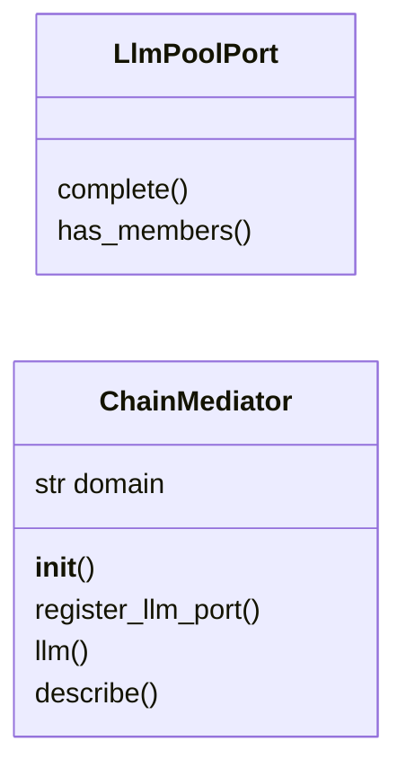
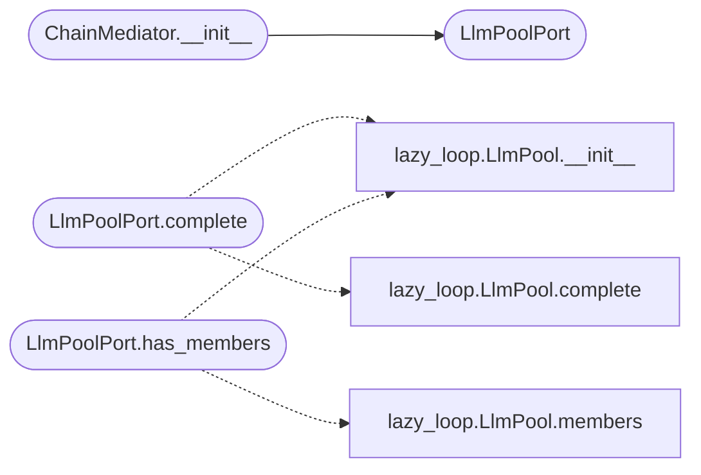

# `modules.mediation.chain_mediator`

> Source: [modules/mediation/chain_mediator.py:1](../../modules/mediation/chain_mediator.py#L1) | language `py` | coverage 100.0% | [API index](../index.md)

Specialised mediator for the APT chain pipeline.

Owns the LLM completion dependency so chain code never imports the loop
god file directly. The `[`modules.lazy_loop.LlmPool`](modules.lazy_loop.py.md#llmpool)` adapter lives here
and is resolved lazily at request time.

## Contents

- **Classes:** [`LlmPoolPort`](#llmpoolport), [`ChainMediator`](#chainmediator)

## Type Diagram



## Call Graph

Solid arrows stay in this module, dashed arrows leave it.



## Classes

<a id="llmpoolport"></a>

### `LlmPoolPort`

`class` | [modules/mediation/chain_mediator.py:13](../../modules/mediation/chain_mediator.py#L13)

```python
class LlmPoolPort
```

Completion port backed by the loop LLM pool (resolved lazily).

**Members**

| Member | Kind | Summary |
|---|---|---|
| [`complete`](#llmpoolport-complete) | method | Complete one prompt through the LLM pool. |
| [`has_members`](#llmpoolport-has_members) | method | Report whether any LLM member is configured. |

<a id="llmpoolport-complete"></a>

#### `LlmPoolPort.complete`

`method` | [modules/mediation/chain_mediator.py:16](../../modules/mediation/chain_mediator.py#L16)

```python
def complete(self, prompt: str, max_tokens: int = 300, task_id: str = '') -> str
```

Complete one prompt through the LLM pool.

**Parameters**

| Name | Type | Default | Description |
|---|---|---|---|
| `prompt` | `str` |  | User prompt text. |
| `max_tokens` | `int` | `300` | Upper bound of generated tokens. |
| `task_id` | `str` | `''` | Ledger id for usage accounting. |

**Returns:** `str` - Completion text, or an empty string when the pool is absent.

*Calls:* [`LlmPool.__init__`](modules.lazy_loop.py.md#llmpool-__init__), [`LlmPool.complete`](modules.lazy_loop.py.md#llmpool-complete)

<a id="llmpoolport-has_members"></a>

#### `LlmPoolPort.has_members`

`method` | [modules/mediation/chain_mediator.py:34](../../modules/mediation/chain_mediator.py#L34)

```python
def has_members(self) -> bool
```

Report whether any LLM member is configured.

**Returns:** `bool` - True when the pool exposes at least one member.

*Calls:* [`LlmPool.__init__`](modules.lazy_loop.py.md#llmpool-__init__), [`LlmPool.members`](modules.lazy_loop.py.md#llmpool-members)

---

<a id="chainmediator"></a>

### `ChainMediator`

`class` | [modules/mediation/chain_mediator.py:48](../../modules/mediation/chain_mediator.py#L48)

```python
class ChainMediator
```

Mediate LLM completion and recovery planning for APT chains.

**Attributes**

| Name | Type | Default | Description |
|---|---|---|---|
| [`domain`](#chainmediator-domain) | `str` | `'chain'` |  |

**Members**

| Member | Kind | Summary |
|---|---|---|
| [`__init__`](#chainmediator-__init__) | constructor | Start with the default pool port. |
| [`register_llm_port`](#chainmediator-register_llm_port) | method | Replace the completion port (injection point for tests/gyms). |
| [`llm`](#chainmediator-llm) | method | Return the completion port for pipeline requests. |
| [`describe`](#chainmediator-describe) | method | Return mediator metadata for diagnostics. |

<a id="chainmediator-__init__"></a>

#### `ChainMediator.__init__`

`constructor` | [modules/mediation/chain_mediator.py:53](../../modules/mediation/chain_mediator.py#L53)

```python
def __init__(self) -> None
```

Start with the default pool port.

*Calls:* [`LlmPoolPort`](#llmpoolport)

<a id="chainmediator-register_llm_port"></a>

#### `ChainMediator.register_llm_port`

`method` | [modules/mediation/chain_mediator.py:57](../../modules/mediation/chain_mediator.py#L57)

```python
def register_llm_port(self, port: Any) -> None
```

Replace the completion port (injection point for tests/gyms).

**Parameters**

| Name | Type | Default | Description |
|---|---|---|---|
| `port` | `Any` |  | Object satisfying [`LlmCompletionPort`](modules.mediation.contracts.py.md#llmcompletionport). |

<a id="chainmediator-llm"></a>

#### `ChainMediator.llm`

`method` | [modules/mediation/chain_mediator.py:65](../../modules/mediation/chain_mediator.py#L65)

```python
def llm(self) -> LlmPoolPort
```

Return the completion port for pipeline requests.

**Returns:** `LlmPoolPort` - The current LLM completion port.

<a id="chainmediator-describe"></a>

#### `ChainMediator.describe`

`method` | [modules/mediation/chain_mediator.py:73](../../modules/mediation/chain_mediator.py#L73)

```python
def describe(self) -> dict[str, Any]
```

Return mediator metadata for diagnostics.

**Returns:** `dict[str, Any]`

---
