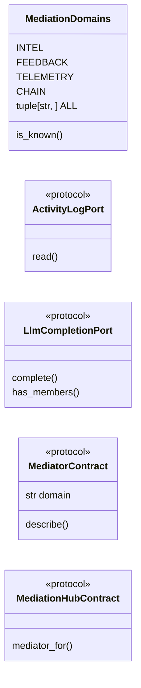

# `modules.mediation.contracts`

> Source: [modules/mediation/contracts.py:1](../../modules/mediation/contracts.py#L1) | language `py` | coverage 100.0% | [API index](../index.md)

Mediation contracts: the abstractions every participant depends on.

These interfaces carry no peer imports, so any module can participate in
coordination without importing the concrete loop or chain implementations.

## Contents

- **Classes:** [`MediationDomains`](#mediationdomains)
- **Protocols:** [`ActivityLogPort`](#activitylogport), [`LlmCompletionPort`](#llmcompletionport), [`MediatorContract`](#mediatorcontract), [`MediationHubContract`](#mediationhubcontract)
- **Functions:** [`resolve`](#resolve)

## Type Diagram



## Call Graph

Solid arrows stay in this module, dashed arrows leave it.


## Classes

<a id="mediationdomains"></a>

### `MediationDomains`

`class` | [modules/mediation/contracts.py:12](../../modules/mediation/contracts.py#L12)

```python
class MediationDomains
```

Domain keys used to route mediating requests.

**Attributes**

| Name | Type | Default | Description |
|---|---|---|---|
| [`INTEL`](#mediationdomains-intel) |  | `'loop.intel'` |  |
| [`FEEDBACK`](#mediationdomains-feedback) |  | `'loop.feedback'` |  |
| [`TELEMETRY`](#mediationdomains-telemetry) |  | `'loop.telemetry'` |  |
| [`CHAIN`](#mediationdomains-chain) |  | `'chain'` |  |
| [`ALL`](#mediationdomains-all) | `tuple[str, ...]` | `(INTEL, FEEDBACK, TELEMETRY, CHAIN)` |  |

**Members**

| Member | Kind | Summary |
|---|---|---|
| [`is_known`](#mediationdomains-is_known) | classmethod | Check whether a domain key is registered in the default set. |

<a id="mediationdomains-is_known"></a>

#### `MediationDomains.is_known`

`classmethod` | [modules/mediation/contracts.py:23](../../modules/mediation/contracts.py#L23)

Decorators: `@classmethod`

```python
def is_known(cls, domain: str) -> bool
```

Check whether a domain key is registered in the default set.

**Parameters**

| Name | Type | Default | Description |
|---|---|---|---|
| `domain` | `str` |  | Domain key candidate. |

**Returns:** `bool` - True when the domain belongs to the default coordination set.

---

## Protocols

<a id="activitylogport"></a>

### `ActivityLogPort`

`protocol` | [modules/mediation/contracts.py:35](../../modules/mediation/contracts.py#L35)

```python
class ActivityLogPort(Protocol)
```

Bases: `Protocol`

Read-port for task-scoped loop activity records.

Implemented by `[`modules.lazy_loop.ActivityLog`](modules.lazy_loop.py.md#activitylog)`; registered on the
intel mediator as a factory by the loop engine at construction time,
which is what breaks callers from importing the loop god file
directly.

**Members**

| Member | Kind | Summary |
|---|---|---|
| [`read`](#activitylogport-read) | method | Return the latest activity records oldest-first. |

<a id="activitylogport-read"></a>

#### `ActivityLogPort.read`

`method` | [modules/mediation/contracts.py:44](../../modules/mediation/contracts.py#L44)

```python
def read(self, limit: int = 200) -> list[dict]
```

Return the latest activity records oldest-first.

**Parameters**

| Name | Type | Default | Description |
|---|---|---|---|
| `limit` | `int` | `200` | Maximum records returned from the tail. |

**Returns:** `list[dict]` - Record dicts, oldest first.

---

<a id="llmcompletionport"></a>

### `LlmCompletionPort`

`protocol` | [modules/mediation/contracts.py:57](../../modules/mediation/contracts.py#L57)

Decorators: `@runtime_checkable`

```python
class LlmCompletionPort(Protocol)
```

Bases: `Protocol`

Request-port for LLM pool completion used by the chain pipeline.

**Members**

| Member | Kind | Summary |
|---|---|---|
| [`complete`](#llmcompletionport-complete) | method | Complete one prompt with the configured LLM pool. |
| [`has_members`](#llmcompletionport-has_members) | method | Report whether any LLM member is configured. |

<a id="llmcompletionport-complete"></a>

#### `LlmCompletionPort.complete`

`method` | [modules/mediation/contracts.py:60](../../modules/mediation/contracts.py#L60)

```python
def complete(self, prompt: str, max_tokens: int = 300, task_id: str = '') -> str
```

Complete one prompt with the configured LLM pool.

**Parameters**

| Name | Type | Default | Description |
|---|---|---|---|
| `prompt` | `str` |  | User prompt text. |
| `max_tokens` | `int` | `300` | Upper bound of generated tokens. |
| `task_id` | `str` | `''` | Ledger id for usage accounting. |

**Returns:** `str` - Completion text, or an empty string when unavailable.

<a id="llmcompletionport-has_members"></a>

#### `LlmCompletionPort.has_members`

`method` | [modules/mediation/contracts.py:78](../../modules/mediation/contracts.py#L78)

```python
def has_members(self) -> bool
```

Report whether any LLM member is configured.

**Returns:** `bool`

---

<a id="mediatorcontract"></a>

### `MediatorContract`

`protocol` | [modules/mediation/contracts.py:84](../../modules/mediation/contracts.py#L84)

Decorators: `@runtime_checkable`

```python
class MediatorContract(Protocol)
```

Bases: `Protocol`

Interface every specialised mediator implements.

**Attributes**

| Name | Type | Default | Description |
|---|---|---|---|
| [`domain`](#mediatorcontract-domain) | `str` |  |  |

**Members**

| Member | Kind | Summary |
|---|---|---|
| [`describe`](#mediatorcontract-describe) | method | Return introspection metadata for diagnostics. |

<a id="mediatorcontract-describe"></a>

#### `MediatorContract.describe`

`method` | [modules/mediation/contracts.py:89](../../modules/mediation/contracts.py#L89)

```python
def describe(self) -> dict[str, Any]
```

Return introspection metadata for diagnostics.

**Returns:** `dict[str, Any]`

---

<a id="mediationhubcontract"></a>

### `MediationHubContract`

`protocol` | [modules/mediation/contracts.py:95](../../modules/mediation/contracts.py#L95)

Decorators: `@runtime_checkable`

```python
class MediationHubContract(Protocol)
```

Bases: `Protocol`

Interface the routing hub exposes to consumers.

**Members**

| Member | Kind | Summary |
|---|---|---|
| [`mediator_for`](#mediationhubcontract-mediator_for) | method | Return the mediator registered for a domain key, or None. |

<a id="mediationhubcontract-mediator_for"></a>

#### `MediationHubContract.mediator_for`

`method` | [modules/mediation/contracts.py:98](../../modules/mediation/contracts.py#L98)

```python
def mediator_for(self, domain: str) -> MediatorContract | None
```

Return the mediator registered for a domain key, or None.

**Parameters**

| Name | Type | Default | Description |
|---|---|---|---|
| `domain` | `str` |  |  |

**Returns:** `MediatorContract | None`

---

## Functions

<a id="resolve"></a>

### `resolve`

`function` | [modules/mediation/contracts.py:103](../../modules/mediation/contracts.py#L103)

```python
def resolve(domain: str) -> MediatorContract
```

Return the default-hub mediator for a domain key.

**Parameters**

| Name | Type | Default | Description |
|---|---|---|---|
| `domain` | `str` |  | One of [`MediationDomains`](#mediationdomains). |

**Returns:** `MediatorContract` - The mediator registered under that domain.

**Raises**

- `KeyError`: when the domain is unknown to the default hub.

*Calls:* [`get_hub`](modules.mediation.hub.py.md#get_hub)

---
