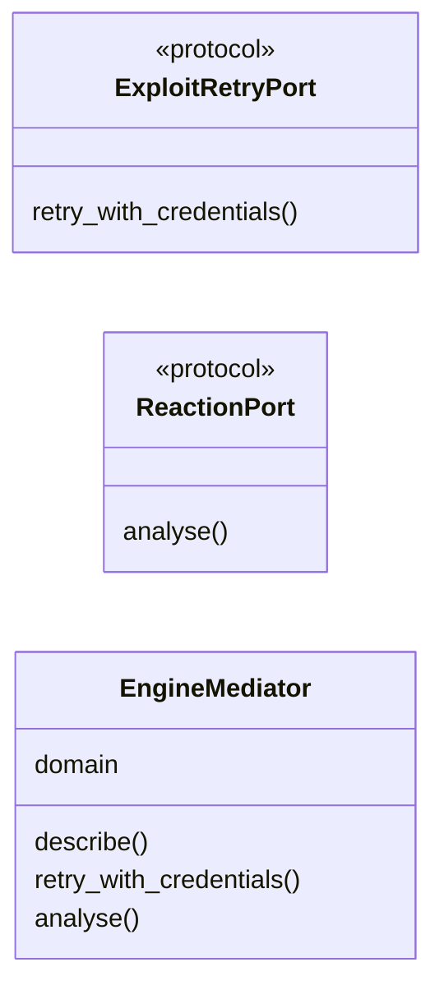
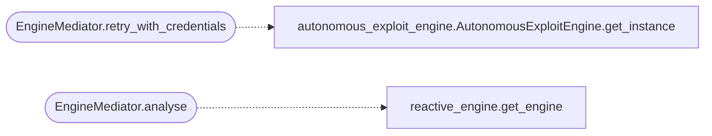

# `modules.mediation.engine_mediator`

> Source: [modules/mediation/engine_mediator.py:1](../../modules/mediation/engine_mediator.py#L1) | language `py` | coverage 100.0% | [API index](../index.md)

Engine mediator: the loop's single coordination point to the engines.

Domain ``loop.engines``. The unified autonomous loop (`[`LazyLoopEngine`](modules.lazy_loop.py.md#lazyloopengine)`)
and the CLI/MCP exploit surfaces used to import the exploit engines
directly (`[`modules.autonomous_exploit_engine`](modules.autonomous_exploit_engine.py.md)`,
`[`modules.reactive_engine`](modules.reactive_engine.py.md)`, `[`modules.ai_exploit_chain`](modules.ai_exploit_chain.py.md)`), which couples
the loop god file to every engine implementation. This mediator owns that
edge instead: consumers ask for a port, the mediator lazily resolves the
concrete engine at call time, so monkeypatching an engine stays effective
and import cycles die.

Ports:

- [`ExploitRetryPort`](#exploitretryport) — feed captured credentials back into the
  autonomous exploit engine's retry queue (credential reuse).
- [`ReactionPort`](#reactionport) — reactive-engine analysis of step output into
  next-action decisions.

Failure semantics: every port call degrades to a no-op answer (empty
list, empty string) when its engine import fails, so a missing engine
never breaks the loop round.

## Contents

- **Classes:** [`EngineMediator`](#enginemediator)
- **Protocols:** [`ExploitRetryPort`](#exploitretryport), [`ReactionPort`](#reactionport)

## Type Diagram



## Call Graph

Solid arrows stay in this module, dashed arrows leave it.



## Classes

<a id="enginemediator"></a>

### `EngineMediator`

`class` | [modules/mediation/engine_mediator.py:66](../../modules/mediation/engine_mediator.py#L66)

```python
class EngineMediator
```

Mediate engine access for the autonomous loop and CLI surfaces.

**Attributes**

| Name | Type | Default | Description |
|---|---|---|---|
| [`domain`](#enginemediator-domain) |  | `'loop.engines'` |  |

**Members**

| Member | Kind | Summary |
|---|---|---|
| [`describe`](#enginemediator-describe) | method | Return introspection metadata for diagnostics. |
| [`retry_with_credentials`](#enginemediator-retry_with_credentials) | method | Queue captured credentials into the exploit engine's retry loop. |
| [`analyse`](#enginemediator-analyse) | method | Run reactive-engine analysis over one step's output. |

<a id="enginemediator-describe"></a>

#### `EngineMediator.describe`

`method` | [modules/mediation/engine_mediator.py:71](../../modules/mediation/engine_mediator.py#L71)

```python
def describe(self) -> dict[str, Any]
```

Return introspection metadata for diagnostics.

**Returns:** `dict[str, Any]`

<a id="enginemediator-retry_with_credentials"></a>

#### `EngineMediator.retry_with_credentials`

`method` | [modules/mediation/engine_mediator.py:79](../../modules/mediation/engine_mediator.py#L79)

```python
def retry_with_credentials(self, target: str, credentials: list[dict]) -> int
```

Queue captured credentials into the exploit engine's retry loop.

**Parameters**

| Name | Type | Default | Description |
|---|---|---|---|
| `target` | `str` |  | Host the credentials were captured from. |
| `credentials` | `list[dict]` |  | Credential dicts from the reaction bridge. |

**Returns:** `int` - Attempts queued, or 0 when the engine is unavailable.

*Calls:* [`AutonomousExploitEngine.get_instance`](modules.autonomous_exploit_engine.py.md#autonomousexploitengine-get_instance)

<a id="enginemediator-analyse"></a>

#### `EngineMediator.analyse`

`method` | [modules/mediation/engine_mediator.py:100](../../modules/mediation/engine_mediator.py#L100)

```python
def analyse(self, output: str, command: str, platform: str) -> list[Any]
```

Run reactive-engine analysis over one step's output.

**Parameters**

| Name | Type | Default | Description |
|---|---|---|---|
| `output` | `str` |  | Captured output of the executed command. |
| `command` | `str` |  | Command line that produced the output. |
| `platform` | `str` |  | Target platform hint for decision scoping. |

**Returns:** `list[Any]` - Decision objects, or an empty list when unavailable.

*Calls:* [`get_engine`](modules.reactive_engine.py.md#get_engine)

---

## Protocols

<a id="exploitretryport"></a>

### `ExploitRetryPort`

`protocol` | [modules/mediation/engine_mediator.py:32](../../modules/mediation/engine_mediator.py#L32)

Decorators: `@runtime_checkable`

```python
class ExploitRetryPort(Protocol)
```

Bases: `Protocol`

Request-port for credential reuse through the exploit engine.

**Members**

| Member | Kind | Summary |
|---|---|---|
| [`retry_with_credentials`](#exploitretryport-retry_with_credentials) | method | Queue one retry attempt per captured credential pair. |

<a id="exploitretryport-retry_with_credentials"></a>

#### `ExploitRetryPort.retry_with_credentials`

`method` | [modules/mediation/engine_mediator.py:35](../../modules/mediation/engine_mediator.py#L35)

```python
def retry_with_credentials(self, target: str, credentials: list[dict]) -> int
```

Queue one retry attempt per captured credential pair.

**Parameters**

| Name | Type | Default | Description |
|---|---|---|---|
| `target` | `str` |  | Host the credentials were captured from. |
| `credentials` | `list[dict]` |  | Captured credential dicts. |

**Returns:** `int` - Number of attempts queued; 0 when the engine is unavailable.

---

<a id="reactionport"></a>

### `ReactionPort`

`protocol` | [modules/mediation/engine_mediator.py:49](../../modules/mediation/engine_mediator.py#L49)

Decorators: `@runtime_checkable`

```python
class ReactionPort(Protocol)
```

Bases: `Protocol`

Request-port for reactive decision analysis.

**Members**

| Member | Kind | Summary |
|---|---|---|
| [`analyse`](#reactionport-analyse) | method | Analyse one command's output for next-action decisions. |

<a id="reactionport-analyse"></a>

#### `ReactionPort.analyse`

`method` | [modules/mediation/engine_mediator.py:52](../../modules/mediation/engine_mediator.py#L52)

```python
def analyse(self, output: str, command: str, platform: str) -> list[Any]
```

Analyse one command's output for next-action decisions.

**Parameters**

| Name | Type | Default | Description |
|---|---|---|---|
| `output` | `str` |  | Captured command output. |
| `command` | `str` |  | The command that produced it. |
| `platform` | `str` |  | Target platform hint. |

**Returns:** `list[Any]` - Decision objects; empty when the engine is unavailable.

---
