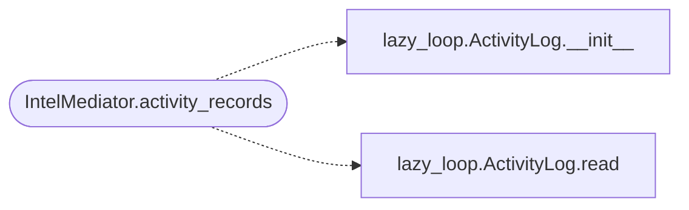

# `modules.mediation.intel_mediator`

> Source: [modules/mediation/intel_mediator.py:1](../../modules/mediation/intel_mediator.py#L1) | language `py` | coverage 100.0% | [API index](../index.md)

specialised mediator for recon-intel coordination.

Owns every interaction with `[`modules.lazy_intel`](modules.lazy_intel.py.md)` and the loop activity
log so the loop, planners and observability code depend on this mediator
instead of importing the intel module (or the loop god file) directly.

## Contents

- **Classes:** [`IntelMediator`](#intelmediator)

## Call Graph

Solid arrows stay in this module, dashed arrows leave it.



## Classes

<a id="intelmediator"></a>

### `IntelMediator`

`class` | [modules/mediation/intel_mediator.py:13](../../modules/mediation/intel_mediator.py#L13)

```python
class IntelMediator
```

Mediate intel routing, masking, stack signatures and activity spans.

**Attributes**

| Name | Type | Default | Description |
|---|---|---|---|
| [`domain`](#intelmediator-domain) | `str` | `'loop.intel'` |  |

**Members**

| Member | Kind | Summary |
|---|---|---|
| [`__init__`](#intelmediator-__init__) | constructor | Start with no registered activity-log factory. |
| [`register_activity_log_factory`](#intelmediator-register_activity_log_factory) | method | Register the loop-side activity log factory. |
| [`describe`](#intelmediator-describe) | method | Return mediator metadata for diagnostics. |
| [`activity_records`](#intelmediator-activity_records) | method | Return loop activity records for one task. |
| [`record_routing_decision`](#intelmediator-record_routing_decision) | method | Record which verb the loop chose for one intent. |
| [`record_routing_outcome`](#intelmediator-record_routing_outcome) | method | Record the terminal outcome of one executed command. |
| [`mask_configured`](#intelmediator-mask_configured) | method | Strip operator-configured secrets from LLM-bound context. |
| [`stack_signature`](#intelmediator-stack_signature) | method | Return the target stack fingerprint string. |

<a id="intelmediator-__init__"></a>

#### `IntelMediator.__init__`

`constructor` | [modules/mediation/intel_mediator.py:18](../../modules/mediation/intel_mediator.py#L18)

```python
def __init__(self) -> None
```

Start with no registered activity-log factory.

<a id="intelmediator-register_activity_log_factory"></a>

#### `IntelMediator.register_activity_log_factory`

`method` | [modules/mediation/intel_mediator.py:22](../../modules/mediation/intel_mediator.py#L22)

```python
def register_activity_log_factory(self, factory: Any) -> None
```

Register the loop-side activity log factory.

**Parameters**

| Name | Type | Default | Description |
|---|---|---|---|
| `factory` | `Any` |  | Callable receiving ``task_id`` and returning a task-scoped object exposing ``read(limit)`` for activity records (`[`modules.lazy_loop.ActivityLog`](modules.lazy_loop.py.md#activitylog)`). |

<a id="intelmediator-describe"></a>

#### `IntelMediator.describe`

`method` | [modules/mediation/intel_mediator.py:32](../../modules/mediation/intel_mediator.py#L32)

```python
def describe(self) -> dict[str, Any]
```

Return mediator metadata for diagnostics.

**Returns:** `dict[str, Any]`

<a id="intelmediator-activity_records"></a>

#### `IntelMediator.activity_records`

`method` | [modules/mediation/intel_mediator.py:39](../../modules/mediation/intel_mediator.py#L39)

```python
def activity_records(self, task_id: str, limit: int = 200) -> list[dict]
```

Return loop activity records for one task.

The factory is task-scoped (``ActivityLog(task_id)``), so records
return exactly as the per-task store yields them.

**Parameters**

| Name | Type | Default | Description |
|---|---|---|---|
| `task_id` | `str` |  | Loop task identifier. |
| `limit` | `int` | `200` | Maximum records to return. |

**Returns:** `list[dict]` - Record dicts oldest-first, empty when no factory is registered.

*Calls:* [`ActivityLog.__init__`](modules.lazy_loop.py.md#activitylog-__init__), [`ActivityLog.read`](modules.lazy_loop.py.md#activitylog-read)

<a id="intelmediator-record_routing_decision"></a>

#### `IntelMediator.record_routing_decision`

`method` | [modules/mediation/intel_mediator.py:64](../../modules/mediation/intel_mediator.py#L64)

```python
def record_routing_decision(self, task_id: str, intent_id: int, command: str, intent_text: str = '', target: str = '', stack: str = '') -> None
```

Record which verb the loop chose for one intent.

**Parameters**

| Name | Type | Default | Description |
|---|---|---|---|
| `task_id` | `str` |  | Loop task identifier. |
| `intent_id` | `int` |  | Exploration node the command serves. |
| `command` | `str` |  | Resolved shell command line. |
| `intent_text` | `str` | `''` | Original intent summary for source inference. |
| `target` | `str` | `''` | Bound target, if any. |
| `stack` | `str` | `''` | Target stack fingerprint. |

<a id="intelmediator-record_routing_outcome"></a>

#### `IntelMediator.record_routing_outcome`

`method` | [modules/mediation/intel_mediator.py:97](../../modules/mediation/intel_mediator.py#L97)

```python
def record_routing_outcome(self, task_id: str, intent_id: int, command: str, state: str = '', facts: int = 0, findings: int = 0, stack: str = '') -> None
```

Record the terminal outcome of one executed command.

**Parameters**

| Name | Type | Default | Description |
|---|---|---|---|
| `task_id` | `str` |  | Loop task identifier. |
| `intent_id` | `int` |  | Exploration node the command served. |
| `command` | `str` |  | Executed shell command line. |
| `state` | `str` | `''` | Terminal intent state. |
| `facts` | `int` | `0` | Facts persisted by the intent. |
| `findings` | `int` | `0` | Findings reported by the intent. |
| `stack` | `str` | `''` | Target stack fingerprint. |

<a id="intelmediator-mask_configured"></a>

#### `IntelMediator.mask_configured`

`method` | [modules/mediation/intel_mediator.py:133](../../modules/mediation/intel_mediator.py#L133)

```python
def mask_configured(self, text: str) -> str
```

Strip operator-configured secrets from LLM-bound context.

**Parameters**

| Name | Type | Default | Description |
|---|---|---|---|
| `text` | `str` |  | Raw prompt context. |

**Returns:** `str` - Masked text, or the input when masking is unavailable.

<a id="intelmediator-stack_signature"></a>

#### `IntelMediator.stack_signature`

`method` | [modules/mediation/intel_mediator.py:149](../../modules/mediation/intel_mediator.py#L149)

```python
def stack_signature(self, assets: Any = None) -> str
```

Return the target stack fingerprint string.

**Parameters**

| Name | Type | Default | Description |
|---|---|---|---|
| `assets` | `Any` | `None` | Asset graph to fingerprint. |

**Returns:** `str` - Fingerprint string, empty when the graph is unreadable.

---
