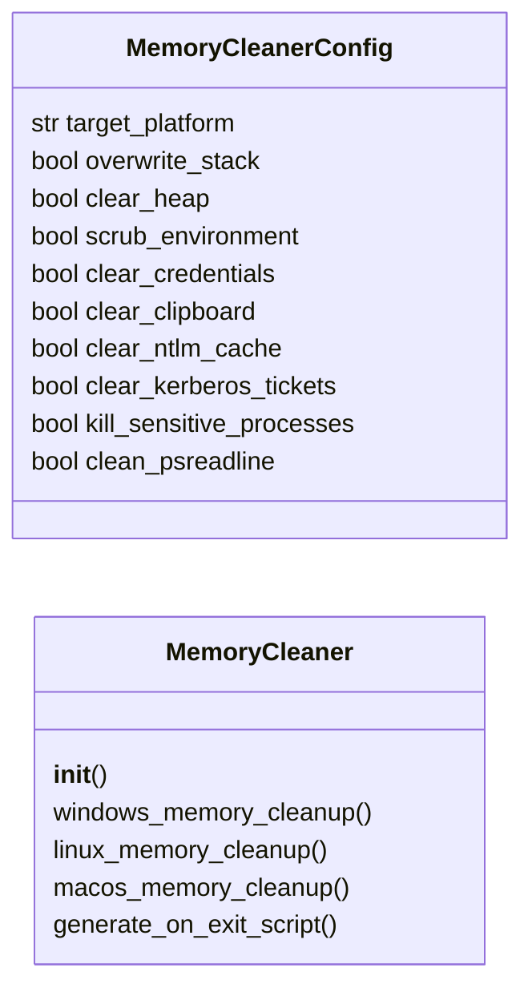

# `modules.memory_cleaner`

> Source: [modules/memory_cleaner.py:1](../../modules/memory_cleaner.py#L1) | language `py` | coverage 87.5% | [API index](../index.md)

Memory artifact cleanup — process memory wipe, environment variable scrub, clipboard clear.

Provides memory-level artifact removal to complement disk-level forensic
cleaning. Covers process memory overwrite before exit, command history
clearing in running processes, environment variable scrubbing, and
clipboard/credential cache clearing.

Designed for in-process cleanup on beacon exit to prevent memory forensics
from recovering attacker tools, commands, or credentials.

## Contents

- **Classes:** [`MemoryCleanerConfig`](#memorycleanerconfig), [`MemoryCleaner`](#memorycleaner)
- **Constants:** [`SESSIONS_DIR`](#sessions_dir)

## Type Diagram



## Call Graph

Solid arrows stay in this module, dashed arrows leave it.


## Classes

<a id="memorycleanerconfig"></a>

### `MemoryCleanerConfig`

`class` `dataclass` | [modules/memory_cleaner.py:22](../../modules/memory_cleaner.py#L22)

Decorators: `@dataclass`

```python
class MemoryCleanerConfig
```

Configuration for memory artifact cleanup operations.

**Attributes**

| Name | Type | Default | Description |
|---|---|---|---|
| [`target_platform`](#memorycleanerconfig-target_platform) | `str` | `'windows'` | windows, linux, or macos. |
| [`overwrite_stack`](#memorycleanerconfig-overwrite_stack) | `bool` | `True` | Overwrite stack memory before exit. |
| [`clear_heap`](#memorycleanerconfig-clear_heap) | `bool` | `True` | Free and zero-fill heap allocations. |
| [`scrub_environment`](#memorycleanerconfig-scrub_environment) | `bool` | `True` | Clear environment variables with sensitive data. |
| [`clear_credentials`](#memorycleanerconfig-clear_credentials) | `bool` | `True` | Wipe credential stores (DPAPI, keychain, keyring). |
| [`clear_clipboard`](#memorycleanerconfig-clear_clipboard) | `bool` | `True` | Clear clipboard contents. |
| [`clear_ntlm_cache`](#memorycleanerconfig-clear_ntlm_cache) | `bool` | `True` | Remove cached NTLM hashes from memory. |
| [`clear_kerberos_tickets`](#memorycleanerconfig-clear_kerberos_tickets) | `bool` | `True` | Purge all Kerberos tickets from memory. |
| [`kill_sensitive_processes`](#memorycleanerconfig-kill_sensitive_processes) | `bool` | `False` | Terminate processes that cache sensitive data. |
| [`clean_psreadline`](#memorycleanerconfig-clean_psreadline) | `bool` | `True` | Clear PowerShell PSReadline history from memory. |

---

<a id="memorycleaner"></a>

### `MemoryCleaner`

`class` | [modules/memory_cleaner.py:50](../../modules/memory_cleaner.py#L50)

```python
class MemoryCleaner
```

Generate memory artifact cleanup commands for post-operation stealth.

Produces platform-specific commands for wiping in-memory artifacts:
process memory, environment variables, credential caches, clipboard
data, and Kerberos tickets.

**Members**

| Member | Kind | Summary |
|---|---|---|
| [`__init__`](#memorycleaner-__init__) | constructor |  |
| [`windows_memory_cleanup`](#memorycleaner-windows_memory_cleanup) | method | Generate Windows memory artifact cleanup commands. |
| [`linux_memory_cleanup`](#memorycleaner-linux_memory_cleanup) | method | Generate Linux memory artifact cleanup commands. |
| [`macos_memory_cleanup`](#memorycleaner-macos_memory_cleanup) | method | Generate macOS memory artifact cleanup commands. |
| [`generate_on_exit_script`](#memorycleaner-generate_on_exit_script) | method | Generate an on-exit cleanup script for beacons. |

<a id="memorycleaner-__init__"></a>

#### `MemoryCleaner.__init__`

`constructor` | [modules/memory_cleaner.py:61](../../modules/memory_cleaner.py#L61)

```python
def __init__(self, config: MemoryCleanerConfig | None = None)
```

**Parameters**

| Name | Type | Default | Description |
|---|---|---|---|
| `config` | `MemoryCleanerConfig \| None` | `None` |  |

*Calls:* [`MemoryCleanerConfig`](#memorycleanerconfig)

*Called by:* [`OpsecCleanupCommandSet.do_memory_clean`](cli.commands.opsec_cleanup.py.md#opseccleanupcommandset-do_memory_clean)

<a id="memorycleaner-windows_memory_cleanup"></a>

#### `MemoryCleaner.windows_memory_cleanup`

`method` | [modules/memory_cleaner.py:64](../../modules/memory_cleaner.py#L64)

```python
def windows_memory_cleanup(self) -> dict[str, Any]
```

Generate Windows memory artifact cleanup commands.

**Returns:** `dict[str, Any]` - Dict with PowerShell and native commands for memory cleanup.

*Called by:* [`OpsecCleanupCommandSet.do_memory_clean`](cli.commands.opsec_cleanup.py.md#opseccleanupcommandset-do_memory_clean)

<a id="memorycleaner-linux_memory_cleanup"></a>

#### `MemoryCleaner.linux_memory_cleanup`

`method` | [modules/memory_cleaner.py:151](../../modules/memory_cleaner.py#L151)

```python
def linux_memory_cleanup(self) -> dict[str, Any]
```

Generate Linux memory artifact cleanup commands.

**Returns:** `dict[str, Any]` - Dict with bash commands for Linux memory cleanup.

*Called by:* [`OpsecCleanupCommandSet.do_memory_clean`](cli.commands.opsec_cleanup.py.md#opseccleanupcommandset-do_memory_clean)

<a id="memorycleaner-macos_memory_cleanup"></a>

#### `MemoryCleaner.macos_memory_cleanup`

`method` | [modules/memory_cleaner.py:206](../../modules/memory_cleaner.py#L206)

```python
def macos_memory_cleanup(self) -> dict[str, Any]
```

Generate macOS memory artifact cleanup commands.

**Returns:** `dict[str, Any]` - Dict with zsh commands for macOS memory cleanup.

*Called by:* [`OpsecCleanupCommandSet.do_memory_clean`](cli.commands.opsec_cleanup.py.md#opseccleanupcommandset-do_memory_clean)

<a id="memorycleaner-generate_on_exit_script"></a>

#### `MemoryCleaner.generate_on_exit_script`

`method` | [modules/memory_cleaner.py:255](../../modules/memory_cleaner.py#L255)

```python
def generate_on_exit_script(self) -> dict[str, Any]
```

Generate an on-exit cleanup script for beacons.

When a beacon is about to terminate, this script runs to clean
all in-memory artifacts before process exit.

**Returns:** `dict[str, Any]` - Dict with per-platform on-exit scripts.

---

## Constants

<a id="sessions_dir"></a>

### `SESSIONS_DIR`

`constant` | [modules/memory_cleaner.py:18](../../modules/memory_cleaner.py#L18)

```python
SESSIONS_DIR = Path(__file__).resolve().parent.parent / 'sessions'
```

---
