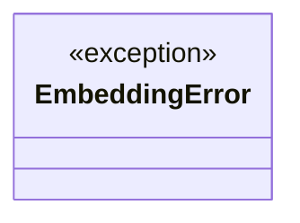
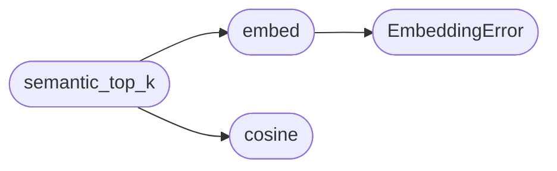

# `modules.memory_embeddings`

> Source: [modules/memory_embeddings.py:1](../../modules/memory_embeddings.py#L1) | language `py` | coverage 100.0% | [API index](../index.md)

Hashing-trick text embeddings for episodic memory recall.

Zero-dependency semantic search: every command + output + findings block
is mapped onto a sparse 512-float histogram with an FNV-1a token hash and
pronominal hashing (three token n-gram buckets per token) for light
fuzziness. Vectors are L2-normalised and stored as little-endian floats
in the ``memories.embedding`` BLOB that has been dead weight until now.
Recall compares cosine similarity — no model download, deterministic
across runs, constant memory.

## Contents

- **Exceptions:** [`EmbeddingError`](#embeddingerror)
- **Functions:** [`embed`](#embed), [`cosine`](#cosine), [`semantic_top_k`](#semantic_top_k), [`as_floats`](#as_floats)

## Type Diagram



## Call Graph

Solid arrows stay in this module, dashed arrows leave it.



## Exceptions

<a id="embeddingerror"></a>

### `EmbeddingError`

`exception` | [modules/memory_embeddings.py:30](../../modules/memory_embeddings.py#L30)

```python
class EmbeddingError(ValueError)
```

Bases: `ValueError`

Raised when callers pass unusable text to the embedder.

---

## Functions

<a id="embed"></a>

### `embed`

`function` | [modules/memory_embeddings.py:50](../../modules/memory_embeddings.py#L50)

```python
def embed(text: str) -> bytes
```

Map text to a normalised 512-float histogram BLOB.

**Parameters**

| Name | Type | Default | Description |
|---|---|---|---|
| `text` | `str` |  | Raw text (command, output snippet, findings...). |

**Returns:** `bytes` - Deterministic little-endian float32 BLOB of exactly _DIM values.

**Raises**

- [`EmbeddingError`](#embeddingerror): When text is empty or contains no bytes.

*Calls:* [`EmbeddingError`](#embeddingerror)

*Called by:* [`semantic_top_k`](#semantic_top_k), [`VectorSQLiteBackend.save`](modules.memory_store.py.md#vectorsqlitebackend-save)

---

<a id="cosine"></a>

### `cosine`

`function` | [modules/memory_embeddings.py:75](../../modules/memory_embeddings.py#L75)

```python
def cosine(a: bytes, b: bytes) -> float
```

Cosine similarity of two embedding BLOBs; legacy/partial input -> 0.0.

**Parameters**

| Name | Type | Default | Description |
|---|---|---|---|
| `a` | `bytes` |  |  |
| `b` | `bytes` |  |  |

**Returns:** `float`

*Called by:* [`semantic_top_k`](#semantic_top_k)

---

<a id="semantic_top_k"></a>

### `semantic_top_k`

`function` | [modules/memory_embeddings.py:85](../../modules/memory_embeddings.py#L85)

```python
def semantic_top_k(query: str, candidates: Sequence[tuple[int, bytes]], top_k: int) -> list[tuple[int, float]]
```

Rank candidate (id, embedding) pairs against the query.

**Parameters**

| Name | Type | Default | Description |
|---|---|---|---|
| `query` | `str` |  | Natural-language query text. |
| `candidates` | `Sequence[tuple[int, bytes]]` |  | Pairs of row id and stored embedding BLOB. |
| `top_k` | `int` |  | Maximum number of matches to return. |

**Returns:** `list[tuple[int, float]]` - Matches with cosine >= _MIN_COSINE, best first, capped at top_k.

*Calls:* [`cosine`](#cosine), [`embed`](#embed)

*Called by:* [`VectorSQLiteBackend.search_semantic`](modules.memory_store.py.md#vectorsqlitebackend-search_semantic)

---

<a id="as_floats"></a>

### `as_floats`

`function` | [modules/memory_embeddings.py:109](../../modules/memory_embeddings.py#L109)

```python
def as_floats(blob: bytes) -> 'array.array'
```

Decode a BLOB into a mutable float array (diagnostics/tests).

**Parameters**

| Name | Type | Default | Description |
|---|---|---|---|
| `blob` | `bytes` |  |  |

**Returns:** `'array.array'`

---
