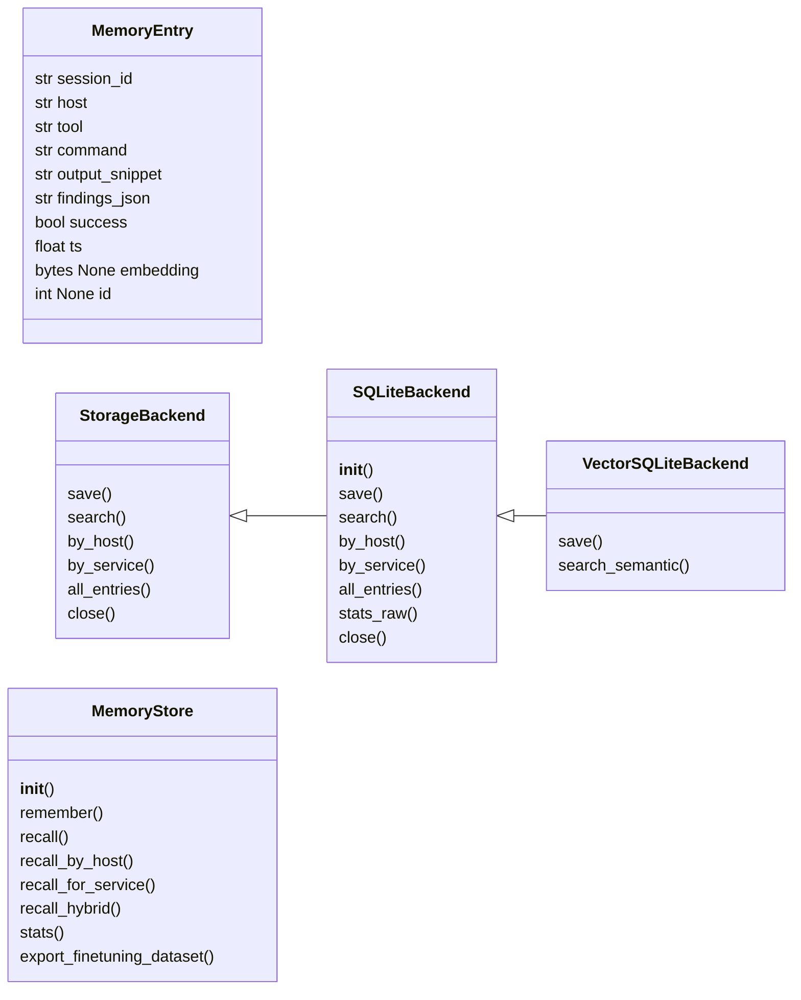
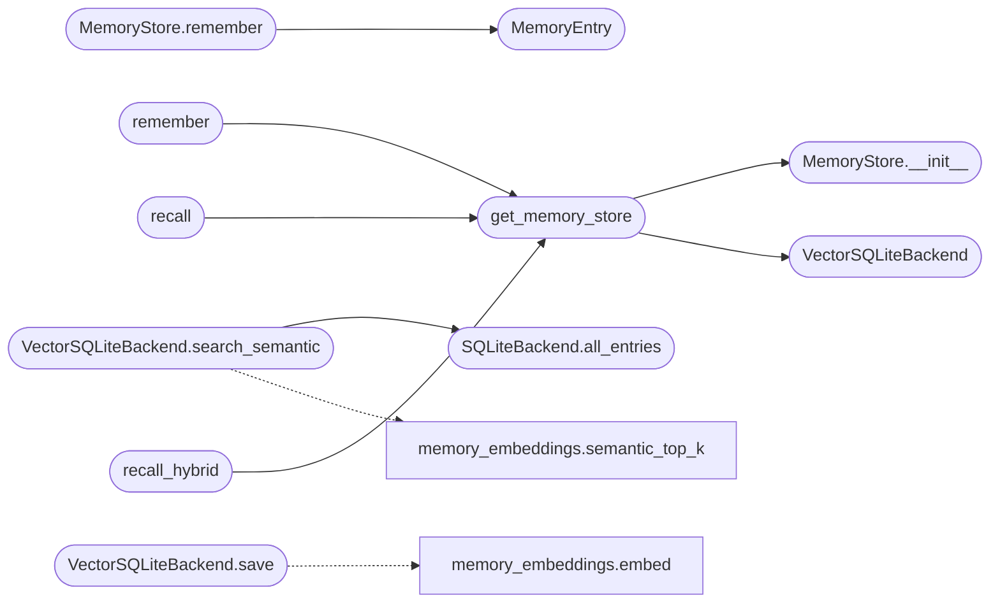

# `modules.memory_store`

> Source: [modules/memory_store.py:1](../../modules/memory_store.py#L1) | language `py` | coverage 8.8% | [API index](../index.md)

memory_store.py — Episodic memory for the LazyOwn auto_loop.

Stores (command, output, findings, host, tool, success) per session and
retrieves relevant past experiences via SQLite FTS5 keyword search.
Optionally uses numpy for cosine similarity when available.

## Contents

- **Classes:** [`MemoryEntry`](#memoryentry), [`StorageBackend`](#storagebackend), [`SQLiteBackend`](#sqlitebackend), [`MemoryStore`](#memorystore), [`VectorSQLiteBackend`](#vectorsqlitebackend)
- **Functions:** [`get_memory_store`](#get_memory_store), [`remember`](#remember), [`recall`](#recall), [`recall_hybrid`](#recall_hybrid)

## Type Diagram



## Call Graph

Solid arrows stay in this module, dashed arrows leave it.



## Classes

<a id="memoryentry"></a>

### `MemoryEntry`

`class` `dataclass` | [modules/memory_store.py:84](../../modules/memory_store.py#L84)

Decorators: `@dataclass`

```python
class MemoryEntry
```

**Attributes**

| Name | Type | Default | Description |
|---|---|---|---|
| [`session_id`](#memoryentry-session_id) | `str` |  |  |
| [`host`](#memoryentry-host) | `str` |  |  |
| [`tool`](#memoryentry-tool) | `str` |  |  |
| [`command`](#memoryentry-command) | `str` |  |  |
| [`output_snippet`](#memoryentry-output_snippet) | `str` |  |  |
| [`findings_json`](#memoryentry-findings_json) | `str` |  |  |
| [`success`](#memoryentry-success) | `bool` |  |  |
| [`ts`](#memoryentry-ts) | `float` |  |  |
| [`embedding`](#memoryentry-embedding) | `bytes \| None` | `field(default=None, repr=False)` |  |
| [`id`](#memoryentry-id) | `int \| None` | `field(default=None, repr=False)` |  |

---

<a id="storagebackend"></a>

### `StorageBackend`

`class` `abstract` | [modules/memory_store.py:97](../../modules/memory_store.py#L97)

```python
class StorageBackend(ABC)
```

Bases: `ABC`

Subclasses: [`SQLiteBackend`](#sqlitebackend)

**Members**

| Member | Kind | Summary |
|---|---|---|
| [`save`](#storagebackend-save) | method |  |
| [`search`](#storagebackend-search) | method |  |
| [`by_host`](#storagebackend-by_host) | method |  |
| [`by_service`](#storagebackend-by_service) | method |  |
| [`all_entries`](#storagebackend-all_entries) | method |  |
| [`close`](#storagebackend-close) | method |  |

<a id="storagebackend-save"></a>

#### `StorageBackend.save`

`method` `abstract` | [modules/memory_store.py:99](../../modules/memory_store.py#L99)

Decorators: `@abstractmethod`

```python
def save(self, entry: MemoryEntry) -> None
```

**Parameters**

| Name | Type | Default | Description |
|---|---|---|---|
| `entry` | `MemoryEntry` |  |  |

<a id="storagebackend-search"></a>

#### `StorageBackend.search`

`method` `abstract` | [modules/memory_store.py:102](../../modules/memory_store.py#L102)

Decorators: `@abstractmethod`

```python
def search(self, query: str, top_k: int) -> list[MemoryEntry]
```

**Parameters**

| Name | Type | Default | Description |
|---|---|---|---|
| `query` | `str` |  |  |
| `top_k` | `int` |  |  |

**Returns:** `list[MemoryEntry]`

<a id="storagebackend-by_host"></a>

#### `StorageBackend.by_host`

`method` `abstract` | [modules/memory_store.py:105](../../modules/memory_store.py#L105)

Decorators: `@abstractmethod`

```python
def by_host(self, host: str, top_k: int) -> list[MemoryEntry]
```

**Parameters**

| Name | Type | Default | Description |
|---|---|---|---|
| `host` | `str` |  |  |
| `top_k` | `int` |  |  |

**Returns:** `list[MemoryEntry]`

<a id="storagebackend-by_service"></a>

#### `StorageBackend.by_service`

`method` `abstract` | [modules/memory_store.py:108](../../modules/memory_store.py#L108)

Decorators: `@abstractmethod`

```python
def by_service(self, service: str, top_k: int) -> list[MemoryEntry]
```

**Parameters**

| Name | Type | Default | Description |
|---|---|---|---|
| `service` | `str` |  |  |
| `top_k` | `int` |  |  |

**Returns:** `list[MemoryEntry]`

<a id="storagebackend-all_entries"></a>

#### `StorageBackend.all_entries`

`method` `abstract` | [modules/memory_store.py:111](../../modules/memory_store.py#L111)

Decorators: `@abstractmethod`

```python
def all_entries(self, limit: int) -> list[MemoryEntry]
```

**Parameters**

| Name | Type | Default | Description |
|---|---|---|---|
| `limit` | `int` |  |  |

**Returns:** `list[MemoryEntry]`

<a id="storagebackend-close"></a>

#### `StorageBackend.close`

`method` `abstract` | [modules/memory_store.py:114](../../modules/memory_store.py#L114)

Decorators: `@abstractmethod`

```python
def close(self) -> None
```

---

<a id="sqlitebackend"></a>

### `SQLiteBackend`

`class` | [modules/memory_store.py:132](../../modules/memory_store.py#L132)

```python
class SQLiteBackend(StorageBackend)
```

Bases: [`StorageBackend`](#storagebackend)

Subclasses: [`VectorSQLiteBackend`](#vectorsqlitebackend)

**Members**

| Member | Kind | Summary |
|---|---|---|
| [`__init__`](#sqlitebackend-__init__) | constructor |  |
| [`save`](#sqlitebackend-save) | method |  |
| [`search`](#sqlitebackend-search) | method |  |
| [`by_host`](#sqlitebackend-by_host) | method |  |
| [`by_service`](#sqlitebackend-by_service) | method |  |
| [`all_entries`](#sqlitebackend-all_entries) | method |  |
| [`stats_raw`](#sqlitebackend-stats_raw) | method |  |
| [`close`](#sqlitebackend-close) | method |  |

<a id="sqlitebackend-__init__"></a>

#### `SQLiteBackend.__init__`

`constructor` | [modules/memory_store.py:133](../../modules/memory_store.py#L133)

```python
def __init__(self, db_path: Path = _DB_PATH) -> None
```

**Parameters**

| Name | Type | Default | Description |
|---|---|---|---|
| `db_path` | `Path` | `_DB_PATH` |  |

<a id="sqlitebackend-save"></a>

#### `SQLiteBackend.save`

`method` | [modules/memory_store.py:148](../../modules/memory_store.py#L148)

```python
def save(self, entry: MemoryEntry) -> None
```

**Parameters**

| Name | Type | Default | Description |
|---|---|---|---|
| `entry` | `MemoryEntry` |  |  |

<a id="sqlitebackend-search"></a>

#### `SQLiteBackend.search`

`method` | [modules/memory_store.py:180](../../modules/memory_store.py#L180)

```python
def search(self, query: str, top_k: int) -> list[MemoryEntry]
```

**Parameters**

| Name | Type | Default | Description |
|---|---|---|---|
| `query` | `str` |  |  |
| `top_k` | `int` |  |  |

**Returns:** `list[MemoryEntry]`

<a id="sqlitebackend-by_host"></a>

#### `SQLiteBackend.by_host`

`method` | [modules/memory_store.py:192](../../modules/memory_store.py#L192)

```python
def by_host(self, host: str, top_k: int) -> list[MemoryEntry]
```

**Parameters**

| Name | Type | Default | Description |
|---|---|---|---|
| `host` | `str` |  |  |
| `top_k` | `int` |  |  |

**Returns:** `list[MemoryEntry]`

<a id="sqlitebackend-by_service"></a>

#### `SQLiteBackend.by_service`

`method` | [modules/memory_store.py:203](../../modules/memory_store.py#L203)

```python
def by_service(self, service: str, top_k: int) -> list[MemoryEntry]
```

**Parameters**

| Name | Type | Default | Description |
|---|---|---|---|
| `service` | `str` |  |  |
| `top_k` | `int` |  |  |

**Returns:** `list[MemoryEntry]`

<a id="sqlitebackend-all_entries"></a>

#### `SQLiteBackend.all_entries`

`method` | [modules/memory_store.py:215](../../modules/memory_store.py#L215)

```python
def all_entries(self, limit: int) -> list[MemoryEntry]
```

**Parameters**

| Name | Type | Default | Description |
|---|---|---|---|
| `limit` | `int` |  |  |

**Returns:** `list[MemoryEntry]`

*Called by:* [`VectorSQLiteBackend.search_semantic`](#vectorsqlitebackend-search_semantic)

<a id="sqlitebackend-stats_raw"></a>

#### `SQLiteBackend.stats_raw`

`method` | [modules/memory_store.py:225](../../modules/memory_store.py#L225)

```python
def stats_raw(self) -> dict
```

**Returns:** `dict`

<a id="sqlitebackend-close"></a>

#### `SQLiteBackend.close`

`method` | [modules/memory_store.py:232](../../modules/memory_store.py#L232)

```python
def close(self) -> None
```

---

<a id="memorystore"></a>

### `MemoryStore`

`class` | [modules/memory_store.py:237](../../modules/memory_store.py#L237)

```python
class MemoryStore
```

**Members**

| Member | Kind | Summary |
|---|---|---|
| [`__init__`](#memorystore-__init__) | constructor |  |
| [`remember`](#memorystore-remember) | method |  |
| [`recall`](#memorystore-recall) | method |  |
| [`recall_by_host`](#memorystore-recall_by_host) | method |  |
| [`recall_for_service`](#memorystore-recall_for_service) | method |  |
| [`recall_hybrid`](#memorystore-recall_hybrid) | method | FTS5 keyword hits first; semantic fallback when keywords miss. |
| [`stats`](#memorystore-stats) | method |  |
| [`export_finetuning_dataset`](#memorystore-export_finetuning_dataset) | method |  |

<a id="memorystore-__init__"></a>

#### `MemoryStore.__init__`

`constructor` | [modules/memory_store.py:240](../../modules/memory_store.py#L240)

```python
def __init__(self, backend: StorageBackend) -> None
```

**Parameters**

| Name | Type | Default | Description |
|---|---|---|---|
| `backend` | `StorageBackend` |  |  |

*Called by:* [`get_memory_store`](#get_memory_store)

<a id="memorystore-remember"></a>

#### `MemoryStore.remember`

`method` | [modules/memory_store.py:243](../../modules/memory_store.py#L243)

```python
def remember(self, session_id: str, host: str, tool: str, command: str, output: str, findings: object, success: bool) -> None
```

**Parameters**

| Name | Type | Default | Description |
|---|---|---|---|
| `session_id` | `str` |  |  |
| `host` | `str` |  |  |
| `tool` | `str` |  |  |
| `command` | `str` |  |  |
| `output` | `str` |  |  |
| `findings` | `object` |  |  |
| `success` | `bool` |  |  |

*Calls:* [`MemoryEntry`](#memoryentry)

<a id="memorystore-recall"></a>

#### `MemoryStore.recall`

`method` | [modules/memory_store.py:270](../../modules/memory_store.py#L270)

```python
def recall(self, query: str, top_k: int = 5) -> list[MemoryEntry]
```

**Parameters**

| Name | Type | Default | Description |
|---|---|---|---|
| `query` | `str` |  |  |
| `top_k` | `int` | `5` |  |

**Returns:** `list[MemoryEntry]`

<a id="memorystore-recall_by_host"></a>

#### `MemoryStore.recall_by_host`

`method` | [modules/memory_store.py:273](../../modules/memory_store.py#L273)

```python
def recall_by_host(self, host: str, top_k: int = 10) -> list[MemoryEntry]
```

**Parameters**

| Name | Type | Default | Description |
|---|---|---|---|
| `host` | `str` |  |  |
| `top_k` | `int` | `10` |  |

**Returns:** `list[MemoryEntry]`

<a id="memorystore-recall_for_service"></a>

#### `MemoryStore.recall_for_service`

`method` | [modules/memory_store.py:276](../../modules/memory_store.py#L276)

```python
def recall_for_service(self, service_name: str, top_k: int = 5) -> list[MemoryEntry]
```

**Parameters**

| Name | Type | Default | Description |
|---|---|---|---|
| `service_name` | `str` |  |  |
| `top_k` | `int` | `5` |  |

**Returns:** `list[MemoryEntry]`

<a id="memorystore-recall_hybrid"></a>

#### `MemoryStore.recall_hybrid`

`method` | [modules/memory_store.py:279](../../modules/memory_store.py#L279)

```python
def recall_hybrid(self, query: str, top_k: int = 5) -> list[MemoryEntry]
```

FTS5 keyword hits first; semantic fallback when keywords miss.

**Parameters**

| Name | Type | Default | Description |
|---|---|---|---|
| `query` | `str` |  |  |
| `top_k` | `int` | `5` |  |

**Returns:** `list[MemoryEntry]`

<a id="memorystore-stats"></a>

#### `MemoryStore.stats`

`method` | [modules/memory_store.py:292](../../modules/memory_store.py#L292)

```python
def stats(self) -> dict
```

**Returns:** `dict`

<a id="memorystore-export_finetuning_dataset"></a>

#### `MemoryStore.export_finetuning_dataset`

`method` | [modules/memory_store.py:300](../../modules/memory_store.py#L300)

```python
def export_finetuning_dataset(self, path: Path) -> Path
```

**Parameters**

| Name | Type | Default | Description |
|---|---|---|---|
| `path` | `Path` |  |  |

**Returns:** `Path`

---

<a id="vectorsqlitebackend"></a>

### `VectorSQLiteBackend`

`class` | [modules/memory_store.py:315](../../modules/memory_store.py#L315)

```python
class VectorSQLiteBackend(SQLiteBackend)
```

Bases: [`SQLiteBackend`](#sqlitebackend)

SQLite backend that auto-embeds entries and adds semantic search.

**Members**

| Member | Kind | Summary |
|---|---|---|
| [`save`](#vectorsqlitebackend-save) | method |  |
| [`search_semantic`](#vectorsqlitebackend-search_semantic) | method |  |

<a id="vectorsqlitebackend-save"></a>

#### `VectorSQLiteBackend.save`

`method` | [modules/memory_store.py:320](../../modules/memory_store.py#L320)

```python
def save(self, entry: MemoryEntry) -> None
```

**Parameters**

| Name | Type | Default | Description |
|---|---|---|---|
| `entry` | `MemoryEntry` |  |  |

*Calls:* [`embed`](modules.memory_embeddings.py.md#embed)

<a id="vectorsqlitebackend-search_semantic"></a>

#### `VectorSQLiteBackend.search_semantic`

`method` | [modules/memory_store.py:328](../../modules/memory_store.py#L328)

```python
def search_semantic(self, query: str, top_k: int) -> list[MemoryEntry]
```

**Parameters**

| Name | Type | Default | Description |
|---|---|---|---|
| `query` | `str` |  |  |
| `top_k` | `int` |  |  |

**Returns:** `list[MemoryEntry]`

*Calls:* [`semantic_top_k`](modules.memory_embeddings.py.md#semantic_top_k), [`SQLiteBackend.all_entries`](#sqlitebackend-all_entries)

---

## Functions

<a id="get_memory_store"></a>

### `get_memory_store`

`function` | [modules/memory_store.py:339](../../modules/memory_store.py#L339)

```python
def get_memory_store() -> MemoryStore
```

**Returns:** `MemoryStore`

*Calls:* [`MemoryStore.__init__`](#memorystore-__init__), [`VectorSQLiteBackend`](#vectorsqlitebackend)

*Called by:* [`recall`](#recall), [`recall_hybrid`](#recall_hybrid), [`remember`](#remember)

---

<a id="remember"></a>

### `remember`

`function` | [modules/memory_store.py:348](../../modules/memory_store.py#L348)

```python
def remember(session_id: str, host: str, tool: str, command: str, output: str, findings: object, success: bool) -> None
```

**Parameters**

| Name | Type | Default | Description |
|---|---|---|---|
| `session_id` | `str` |  |  |
| `host` | `str` |  |  |
| `tool` | `str` |  |  |
| `command` | `str` |  |  |
| `output` | `str` |  |  |
| `findings` | `object` |  |  |
| `success` | `bool` |  |  |

*Calls:* [`get_memory_store`](#get_memory_store)

---

<a id="recall"></a>

### `recall`

`function` | [modules/memory_store.py:360](../../modules/memory_store.py#L360)

```python
def recall(query: str, top_k: int = 5) -> list[MemoryEntry]
```

**Parameters**

| Name | Type | Default | Description |
|---|---|---|---|
| `query` | `str` |  |  |
| `top_k` | `int` | `5` |  |

**Returns:** `list[MemoryEntry]`

*Calls:* [`get_memory_store`](#get_memory_store)

---

<a id="recall_hybrid"></a>

### `recall_hybrid`

`function` | [modules/memory_store.py:364](../../modules/memory_store.py#L364)

```python
def recall_hybrid(query: str, top_k: int = 5) -> list[MemoryEntry]
```

**Parameters**

| Name | Type | Default | Description |
|---|---|---|---|
| `query` | `str` |  |  |
| `top_k` | `int` | `5` |  |

**Returns:** `list[MemoryEntry]`

*Calls:* [`get_memory_store`](#get_memory_store)

---
