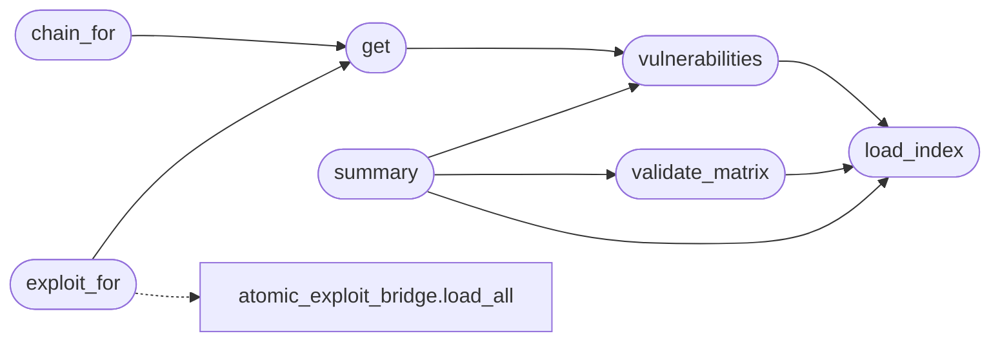

# `modules.metasploitable_gym`

> Source: [modules/metasploitable_gym.py:1](../../modules/metasploitable_gym.py#L1) | language `py` | coverage 100.0% | [API index](../index.md)

Metasploitable 2 gym catalogue loader and matrix validator.

The index playbook names every lab vector, its exploit YAML and its
chain. This module validates the three stay in sync so the operator
never discovers a broken lab path mid-engagement.

## Contents

- **Functions:** [`load_index`](#load_index), [`vulnerabilities`](#vulnerabilities), [`get`](#get), [`chain_for`](#chain_for), [`exploit_for`](#exploit_for), [`validate_matrix`](#validate_matrix), [`summary`](#summary)
- **Constants:** [`INDEX_PATH`](#index_path)

## Call Graph

Solid arrows stay in this module, dashed arrows leave it.



## Functions

<a id="load_index"></a>

### `load_index`

`function` | [modules/metasploitable_gym.py:42](../../modules/metasploitable_gym.py#L42)

```python
def load_index(path: Path | str = INDEX_PATH) -> dict
```

Load the gym index, returning an empty mapping on failure.

**Parameters**

| Name | Type | Default | Description |
|---|---|---|---|
| `path` | `Path \| str` | `INDEX_PATH` |  |

**Returns:** `dict`

*Called by:* [`summary`](#summary), [`validate_matrix`](#validate_matrix), [`vulnerabilities`](#vulnerabilities)

---

<a id="vulnerabilities"></a>

### `vulnerabilities`

`function` | [modules/metasploitable_gym.py:47](../../modules/metasploitable_gym.py#L47)

```python
def vulnerabilities(path: Path | str = INDEX_PATH) -> list[dict]
```

Return every indexed vulnerability.

**Parameters**

| Name | Type | Default | Description |
|---|---|---|---|
| `path` | `Path \| str` | `INDEX_PATH` |  |

**Returns:** `list[dict]`

*Calls:* [`load_index`](#load_index)

*Called by:* [`RedTeamGymCommandSet.do_gym_ms2`](cli.commands.redteam_gym.py.md#redteamgymcommandset-do_gym_ms2), [`get`](#get), [`summary`](#summary)

---

<a id="get"></a>

### `get`

`function` | [modules/metasploitable_gym.py:53](../../modules/metasploitable_gym.py#L53)

```python
def get(vuln_id: str, path: Path | str = INDEX_PATH) -> dict | None
```

Return one vulnerability by id, or None.

**Parameters**

| Name | Type | Default | Description |
|---|---|---|---|
| `vuln_id` | `str` |  |  |
| `path` | `Path \| str` | `INDEX_PATH` |  |

**Returns:** `dict | None`

*Calls:* [`vulnerabilities`](#vulnerabilities)

*Called by:* [`RedTeamGymCommandSet.do_gym_ms2`](cli.commands.redteam_gym.py.md#redteamgymcommandset-do_gym_ms2), [`chain_for`](#chain_for), [`exploit_for`](#exploit_for)

---

<a id="chain_for"></a>

### `chain_for`

`function` | [modules/metasploitable_gym.py:62](../../modules/metasploitable_gym.py#L62)

```python
def chain_for(vuln_id: str, path: Path | str = INDEX_PATH)
```

Return the resolved chain for one vulnerability, or None.

**Parameters**

| Name | Type | Default | Description |
|---|---|---|---|
| `vuln_id` | `str` |  |  |
| `path` | `Path \| str` | `INDEX_PATH` |  |

*Calls:* [`get`](#get)

*Called by:* [`RedTeamGymCommandSet.do_gym_ms2`](cli.commands.redteam_gym.py.md#redteamgymcommandset-do_gym_ms2)

---

<a id="exploit_for"></a>

### `exploit_for`

`function` | [modules/metasploitable_gym.py:72](../../modules/metasploitable_gym.py#L72)

```python
def exploit_for(vuln_id: str, path: Path | str = INDEX_PATH)
```

Return the exploit spec for one vulnerability, or None.

**Parameters**

| Name | Type | Default | Description |
|---|---|---|---|
| `vuln_id` | `str` |  |  |
| `path` | `Path \| str` | `INDEX_PATH` |  |

*Calls:* [`load_all`](modules.atomic_exploit_bridge.py.md#load_all), [`get`](#get)

---

<a id="validate_matrix"></a>

### `validate_matrix`

`function` | [modules/metasploitable_gym.py:82](../../modules/metasploitable_gym.py#L82)

```python
def validate_matrix(path: Path | str = INDEX_PATH) -> list[str]
```

Validate the index, exploit files and chains as one matrix.

**Parameters**

| Name | Type | Default | Description |
|---|---|---|---|
| `path` | `Path \| str` | `INDEX_PATH` | Index playbook path. |

**Returns:** `list[str]` - Human-readable errors; empty means the matrix is consistent.

*Calls:* [`load_index`](#load_index)

*Called by:* [`RedTeamGymCommandSet.do_gym_ms2`](cli.commands.redteam_gym.py.md#redteamgymcommandset-do_gym_ms2), [`summary`](#summary)

---

<a id="summary"></a>

### `summary`

`function` | [modules/metasploitable_gym.py:138](../../modules/metasploitable_gym.py#L138)

```python
def summary(path: Path | str = INDEX_PATH) -> dict[str, Any]
```

Return counts by severity and service for operators.

**Parameters**

| Name | Type | Default | Description |
|---|---|---|---|
| `path` | `Path \| str` | `INDEX_PATH` |  |

**Returns:** `dict[str, Any]`

*Calls:* [`load_index`](#load_index), [`validate_matrix`](#validate_matrix), [`vulnerabilities`](#vulnerabilities)

*Called by:* [`RedTeamGymCommandSet.do_gym_ms2`](cli.commands.redteam_gym.py.md#redteamgymcommandset-do_gym_ms2)

---

## Constants

<a id="index_path"></a>

### `INDEX_PATH`

`constant` | [modules/metasploitable_gym.py:22](../../modules/metasploitable_gym.py#L22)

```python
INDEX_PATH = BASE_DIR / 'playbooks' / 'gym_metasploitable.yaml'
```

---
