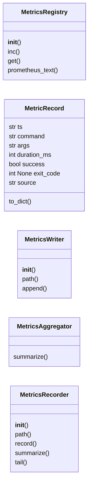
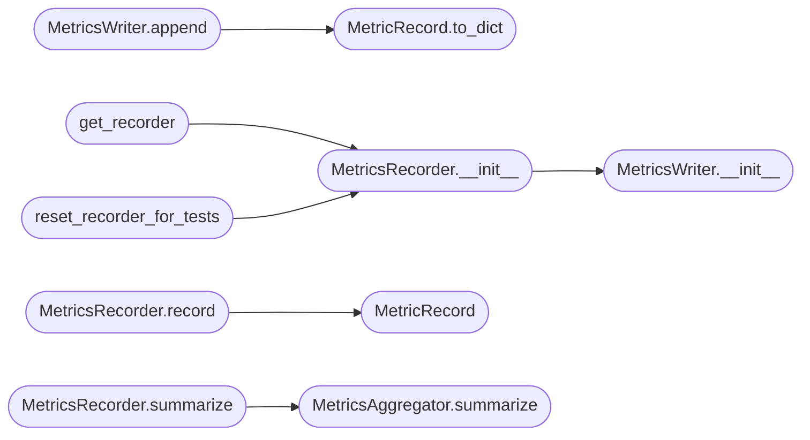

# `modules.metrics`

> Source: [modules/metrics.py:1](../../modules/metrics.py#L1) | language `py` | coverage 100.0% | [API index](../index.md)

LazyOwn metrics surface.

Two complementary subsystems live here:

* [`MetricsRegistry`](#metricsregistry) (with the [`REGISTRY`](#registry) singleton) — an
  in-memory Prometheus-style counter registry used by the C2 stack to
  expose live operational counters. Kept for backwards compatibility with
  ``lazyc2.py`` and `[`modules.c2_builder`](modules.c2_builder.py.md)`.
* [`MetricsRecorder`](#metricsrecorder) (with the [`get_recorder`](#get_recorder) singleton) — a
  durable append-only telemetry log written to ``sessions/metrics.jsonl``.
  Every command the operator executes through the cmd2 shell (and any
  other caller that opts in) is recorded so post-hoc analysis can answer
  "which commands fail most", "what is the p95 duration of nmap" or
  "where does the autonomous daemon stall".

The recorder splits responsibilities to keep each class small:

* [`MetricsWriter`](#metricswriter) only knows how to append a record to disk.
* [`MetricsAggregator`](#metricsaggregator) only knows how to compute summary statistics.
* [`MetricsRecorder`](#metricsrecorder) composes both behind a single public API.

Appends use a process-wide `threading.Lock` so concurrent post-command
hooks (cmd2, autonomous daemon, MCP tool) cannot interleave half-written
lines. Writes are line-atomic but not durable across power loss; that is an
acceptable trade-off for telemetry data.

## Contents

- **Classes:** [`MetricsRegistry`](#metricsregistry), [`MetricRecord`](#metricrecord), [`MetricsWriter`](#metricswriter), [`MetricsAggregator`](#metricsaggregator), [`MetricsRecorder`](#metricsrecorder)
- **Functions:** [`get_recorder`](#get_recorder), [`reset_recorder_for_tests`](#reset_recorder_for_tests)
- **Constants:** [`LAZYOWN_DIR`](#lazyown_dir), [`SESSIONS_DIR`](#sessions_dir), [`METRICS_FILE`](#metrics_file), [`DEFAULT_TAIL`](#default_tail), [`P95_PERCENTILE`](#p95_percentile), [`TOP_FAILURE_LIMIT`](#top_failure_limit), [`MAX_TAIL_LINES`](#max_tail_lines), [`REGISTRY`](#registry)

## Type Diagram



## Call Graph

Solid arrows stay in this module, dashed arrows leave it.



## Classes

<a id="metricsregistry"></a>

### `MetricsRegistry`

`class` | [modules/metrics.py:54](../../modules/metrics.py#L54)

```python
class MetricsRegistry
```

Thread-safe in-memory counter registry used by the C2 stack.

Counters are addressed by a name and an optional label dictionary; both
pieces compose to form a series key. The registry can render itself in
Prometheus exposition format when a scraper hits the C2 metrics
endpoint.

**Members**

| Member | Kind | Summary |
|---|---|---|
| [`__init__`](#metricsregistry-__init__) | constructor | Create an empty registry with its own lock. |
| [`inc`](#metricsregistry-inc) | method | Increment the named counter for the given labels. |
| [`get`](#metricsregistry-get) | method | Return the current value of a counter. |
| [`prometheus_text`](#metricsregistry-prometheus_text) | method | Render every counter in Prometheus text exposition format. |

<a id="metricsregistry-__init__"></a>

#### `MetricsRegistry.__init__`

`constructor` | [modules/metrics.py:63](../../modules/metrics.py#L63)

```python
def __init__(self) -> None
```

Create an empty registry with its own lock.

<a id="metricsregistry-inc"></a>

#### `MetricsRegistry.inc`

`method` | [modules/metrics.py:69](../../modules/metrics.py#L69)

```python
def inc(self, name: str, labels: dict[str, str] | None = None, value: int = 1) -> None
```

Increment the named counter for the given labels.

**Parameters**

| Name | Type | Default | Description |
|---|---|---|---|
| `name` | `str` |  | Counter name. |
| `labels` | `dict[str, str] \| None` | `None` | Optional dictionary of label values forming a series. |
| `value` | `int` | `1` | Amount to add; defaults to ``1``. |

<a id="metricsregistry-get"></a>

#### `MetricsRegistry.get`

`method` | [modules/metrics.py:87](../../modules/metrics.py#L87)

```python
def get(self, name: str, labels: dict[str, str] | None = None) -> int
```

Return the current value of a counter.

**Parameters**

| Name | Type | Default | Description |
|---|---|---|---|
| `name` | `str` |  | Counter name. |
| `labels` | `dict[str, str] \| None` | `None` | Optional label dictionary identifying the series. |

**Returns:** `int` - The current integer value (``0`` when the series has never
been incremented).

<a id="metricsregistry-prometheus_text"></a>

#### `MetricsRegistry.prometheus_text`

`method` | [modules/metrics.py:107](../../modules/metrics.py#L107)

```python
def prometheus_text(self) -> str
```

Render every counter in Prometheus text exposition format.

**Returns:** `str` - A newline-delimited Prometheus payload ready to be served as
``text/plain``.

---

<a id="metricrecord"></a>

### `MetricRecord`

`class` `dataclass` | [modules/metrics.py:146](../../modules/metrics.py#L146)

Decorators: `@dataclass(frozen=True)`

```python
class MetricRecord
```

One entry in ``sessions/metrics.jsonl``.

**Attributes**

| Name | Type | Default | Description |
|---|---|---|---|
| [`ts`](#metricrecord-ts) | `str` |  | ISO-8601 UTC timestamp captured at command completion. |
| [`command`](#metricrecord-command) | `str` |  | Command verb as typed by the operator (first token). |
| [`args`](#metricrecord-args) | `str` |  | Remaining argument string. May be empty. |
| [`duration_ms`](#metricrecord-duration_ms) | `int` |  | Wall-clock duration in milliseconds. Non-negative. |
| [`success`](#metricrecord-success) | `bool` |  | Heuristic success flag derived from the caller's exit code. |
| [`exit_code`](#metricrecord-exit_code) | `int \| None` |  | Underlying process exit code. ``None`` when not measurable. |
| [`source`](#metricrecord-source) | `str` |  | Coarse origin tag (e.g. ``"cli"``, ``"daemon"``, ``"mcp"``). |

**Members**

| Member | Kind | Summary |
|---|---|---|
| [`to_dict`](#metricrecord-to_dict) | method | Return the record as a JSON-serialisable dictionary. |

<a id="metricrecord-to_dict"></a>

#### `MetricRecord.to_dict`

`method` | [modules/metrics.py:167](../../modules/metrics.py#L167)

```python
def to_dict(self) -> dict[str, object]
```

Return the record as a JSON-serialisable dictionary.

**Returns:** `dict[str, object]`

*Called by:* [`MetricsWriter.append`](#metricswriter-append)

---

<a id="metricswriter"></a>

### `MetricsWriter`

`class` | [modules/metrics.py:181](../../modules/metrics.py#L181)

```python
class MetricsWriter
```

Thread-safe append-only writer for [`METRICS_FILE`](#metrics_file).

The writer owns the lock and the file handle lifecycle but never
decides *what* to write; callers compose a [`MetricRecord`](#metricrecord) and
pass it in.

**Members**

| Member | Kind | Summary |
|---|---|---|
| [`__init__`](#metricswriter-__init__) | constructor | Initialise the writer. |
| [`path`](#metricswriter-path) | property | Return the JSONL destination path. |
| [`append`](#metricswriter-append) | method | Append a single record to disk. |

<a id="metricswriter-__init__"></a>

#### `MetricsWriter.__init__`

`constructor` | [modules/metrics.py:189](../../modules/metrics.py#L189)

```python
def __init__(self, path: Path = METRICS_FILE) -> None
```

Initialise the writer.

**Parameters**

| Name | Type | Default | Description |
|---|---|---|---|
| `path` | `Path` | `METRICS_FILE` | Destination JSONL file. Parent directory is created on first append so empty sessions work too. |

*Called by:* [`MetricsRecorder.__init__`](#metricsrecorder-__init__)

<a id="metricswriter-path"></a>

#### `MetricsWriter.path`

`property` | [modules/metrics.py:201](../../modules/metrics.py#L201)

Decorators: `@property`

```python
def path(self) -> Path
```

Return the JSONL destination path.

**Returns:** `Path`

<a id="metricswriter-append"></a>

#### `MetricsWriter.append`

`method` | [modules/metrics.py:206](../../modules/metrics.py#L206)

```python
def append(self, record: MetricRecord) -> None
```

Append a single record to disk.

Failures are logged at debug level and swallowed: telemetry must
never break the calling command.

**Parameters**

| Name | Type | Default | Description |
|---|---|---|---|
| `record` | `MetricRecord` |  | The record to persist. |

*Calls:* [`MetricRecord.to_dict`](#metricrecord-to_dict)

---

<a id="metricsaggregator"></a>

### `MetricsAggregator`

`class` | [modules/metrics.py:226](../../modules/metrics.py#L226)

```python
class MetricsAggregator
```

Pure aggregation over an in-memory list of records.

Separated from the writer so the same statistics can be computed over
a test fixture without touching disk.

**Members**

| Member | Kind | Summary |
|---|---|---|
| [`summarize`](#metricsaggregator-summarize) | classmethod | Compute aggregate statistics over the supplied records. |

<a id="metricsaggregator-summarize"></a>

#### `MetricsAggregator.summarize`

`classmethod` | [modules/metrics.py:254](../../modules/metrics.py#L254)

Decorators: `@classmethod`

```python
def summarize(cls, records: Iterable[dict[str, object]], window_seconds: int | None = None, now_utc: datetime | None = None) -> dict[str, object]
```

Compute aggregate statistics over the supplied records.

**Parameters**

| Name | Type | Default | Description |
|---|---|---|---|
| `records` | `Iterable[dict[str, object]]` |  | Iterable of decoded JSONL entries. |
| `window_seconds` | `int \| None` | `None` | If set, ignore records older than this many seconds relative to *now_utc*. |
| `now_utc` | `datetime \| None` | `None` | Reference timestamp for the window. Defaults to the current UTC time. Supplied explicitly in tests. |

**Returns:** `dict[str, object]` - A dictionary with keys ``total``, ``window_seconds``,
``by_command`` and ``top_failures``.

*Called by:* [`MetricsRecorder.summarize`](#metricsrecorder-summarize)

---

<a id="metricsrecorder"></a>

### `MetricsRecorder`

`class` | [modules/metrics.py:332](../../modules/metrics.py#L332)

```python
class MetricsRecorder
```

Compose a [`MetricsWriter`](#metricswriter) and [`MetricsAggregator`](#metricsaggregator).

Operators interact only with this class through the module-level
singleton returned by [`get_recorder`](#get_recorder).

**Members**

| Member | Kind | Summary |
|---|---|---|
| [`__init__`](#metricsrecorder-__init__) | constructor | Initialise the recorder. |
| [`path`](#metricsrecorder-path) | property | Return the JSONL path used by the underlying writer. |
| [`record`](#metricsrecorder-record) | method | Persist a single command-execution telemetry record. |
| [`summarize`](#metricsrecorder-summarize) | method | Return aggregate statistics over recorded events. |
| [`tail`](#metricsrecorder-tail) | method | Return the most recent *n* records, newest first. |

<a id="metricsrecorder-__init__"></a>

#### `MetricsRecorder.__init__`

`constructor` | [modules/metrics.py:339](../../modules/metrics.py#L339)

```python
def __init__(self, writer: MetricsWriter | None = None) -> None
```

Initialise the recorder.

**Parameters**

| Name | Type | Default | Description |
|---|---|---|---|
| `writer` | `MetricsWriter \| None` | `None` | Writer instance to use. Injected in tests; defaults to a writer pointing at [`METRICS_FILE`](#metrics_file). |

*Calls:* [`MetricsWriter.__init__`](#metricswriter-__init__)

*Called by:* [`get_recorder`](#get_recorder), [`reset_recorder_for_tests`](#reset_recorder_for_tests)

<a id="metricsrecorder-path"></a>

#### `MetricsRecorder.path`

`property` | [modules/metrics.py:350](../../modules/metrics.py#L350)

Decorators: `@property`

```python
def path(self) -> Path
```

Return the JSONL path used by the underlying writer.

**Returns:** `Path`

<a id="metricsrecorder-record"></a>

#### `MetricsRecorder.record`

`method` | [modules/metrics.py:355](../../modules/metrics.py#L355)

```python
def record(self, command: str, args: str = '', duration_ms: int = 0, success: bool = True, exit_code: int | None = None, source: str = 'cli') -> None
```

Persist a single command-execution telemetry record.

**Parameters**

| Name | Type | Default | Description |
|---|---|---|---|
| `command` | `str` |  | First token of the operator-typed command. |
| `args` | `str` | `''` | Remaining argument string (may be empty). |
| `duration_ms` | `int` | `0` | Wall-clock duration in milliseconds, clamped to a non-negative integer. |
| `success` | `bool` | `True` | Heuristic success flag. |
| `exit_code` | `int \| None` | `None` | Underlying process exit code, when known. |
| `source` | `str` | `'cli'` | Coarse origin tag. |

*Calls:* [`MetricRecord`](#metricrecord)

<a id="metricsrecorder-summarize"></a>

#### `MetricsRecorder.summarize`

`method` | [modules/metrics.py:416](../../modules/metrics.py#L416)

```python
def summarize(self, window_seconds: int | None = None) -> dict[str, object]
```

Return aggregate statistics over recorded events.

**Parameters**

| Name | Type | Default | Description |
|---|---|---|---|
| `window_seconds` | `int \| None` | `None` | Restrict the calculation to events from the last *N* seconds. ``None`` aggregates the whole file. |

**Returns:** `dict[str, object]` - Dictionary as documented in
[`MetricsAggregator.summarize`](#metricsaggregator-summarize).

*Calls:* [`MetricsAggregator.summarize`](#metricsaggregator-summarize)

<a id="metricsrecorder-tail"></a>

#### `MetricsRecorder.tail`

`method` | [modules/metrics.py:430](../../modules/metrics.py#L430)

```python
def tail(self, n: int = DEFAULT_TAIL) -> list[dict[str, object]]
```

Return the most recent *n* records, newest first.

**Parameters**

| Name | Type | Default | Description |
|---|---|---|---|
| `n` | `int` | `DEFAULT_TAIL` | Number of records to return. Clamped to [`MAX_TAIL_LINES`](#max_tail_lines). |

**Returns:** `list[dict[str, object]]` - A list of records in reverse chronological order.

---

## Functions

<a id="get_recorder"></a>

### `get_recorder`

`function` | [modules/metrics.py:452](../../modules/metrics.py#L452)

```python
def get_recorder() -> MetricsRecorder
```

Return the process-wide [`MetricsRecorder`](#metricsrecorder) singleton.

The first call constructs a recorder bound to [`METRICS_FILE`](#metrics_file).
Subsequent calls return the same instance. Thread-safe.

**Returns:** `MetricsRecorder`

*Calls:* [`MetricsRecorder.__init__`](#metricsrecorder-__init__)

---

<a id="reset_recorder_for_tests"></a>

### `reset_recorder_for_tests`

`function` | [modules/metrics.py:466](../../modules/metrics.py#L466)

```python
def reset_recorder_for_tests(writer: MetricsWriter | None = None) -> MetricsRecorder
```

Replace the module-level recorder with a fresh instance.

Intended exclusively for tests that need to redirect the JSONL path.

**Parameters**

| Name | Type | Default | Description |
|---|---|---|---|
| `writer` | `MetricsWriter \| None` | `None` | Optional writer to inject. When omitted a default writer against [`METRICS_FILE`](#metrics_file) is used. |

**Returns:** `MetricsRecorder` - The newly installed recorder.

*Calls:* [`MetricsRecorder.__init__`](#metricsrecorder-__init__)

---

## Constants

<a id="lazyown_dir"></a>

### `LAZYOWN_DIR`

`constant` | [modules/metrics.py:42](../../modules/metrics.py#L42)

```python
LAZYOWN_DIR: Path = Path(os.environ.get('LAZYOWN_DIR', str(Path(__file__).resolve().parent.parent)))
```

---

<a id="sessions_dir"></a>

### `SESSIONS_DIR`

`constant` | [modules/metrics.py:43](../../modules/metrics.py#L43)

```python
SESSIONS_DIR: Path = LAZYOWN_DIR / 'sessions'
```

---

<a id="metrics_file"></a>

### `METRICS_FILE`

`constant` | [modules/metrics.py:44](../../modules/metrics.py#L44)

```python
METRICS_FILE: Path = SESSIONS_DIR / 'metrics.jsonl'
```

---

<a id="default_tail"></a>

### `DEFAULT_TAIL`

`constant` | [modules/metrics.py:46](../../modules/metrics.py#L46)

```python
DEFAULT_TAIL: int = 50
```

---

<a id="p95_percentile"></a>

### `P95_PERCENTILE`

`constant` | [modules/metrics.py:47](../../modules/metrics.py#L47)

```python
P95_PERCENTILE: float = 0.95
```

---

<a id="top_failure_limit"></a>

### `TOP_FAILURE_LIMIT`

`constant` | [modules/metrics.py:48](../../modules/metrics.py#L48)

```python
TOP_FAILURE_LIMIT: int = 5
```

---

<a id="max_tail_lines"></a>

### `MAX_TAIL_LINES`

`constant` | [modules/metrics.py:49](../../modules/metrics.py#L49)

```python
MAX_TAIL_LINES: int = 10000
```

---

<a id="registry"></a>

### `REGISTRY`

`constant` | [modules/metrics.py:142](../../modules/metrics.py#L142)

```python
REGISTRY = MetricsRegistry()
```

---
