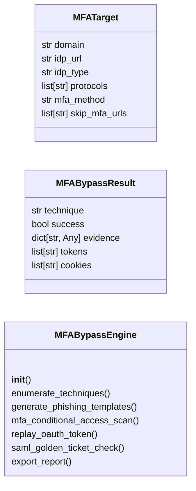

# `modules.mfa_bypass`

> Source: [modules/mfa_bypass.py:1](../../modules/mfa_bypass.py#L1) | language `py` | coverage 81.8% | [API index](../index.md)

MFA Bypass Toolkit — techniques for circumventing multi-factor authentication.

Provides automated and manual techniques for:
- Token theft and replay (session cookies, OAuth tokens, SAML assertions)
- MFA fatigue/push bombing automation
- Evilginx-style reverse proxy credential + token harvesting
- SAML/OAuth golden ticket attacks
- MFA enrollment abuse (enrolling attacker-controlled MFA device)
- Legacy protocol bypass (IMAP, POP3, SMTP with legacy auth)

Integrates with phishing_orchestrator.py for automated campaigns.

## Contents

- **Classes:** [`MFATarget`](#mfatarget), [`MFABypassResult`](#mfabypassresult), [`MFABypassEngine`](#mfabypassengine)
- **Constants:** [`MFA_TECHNIQUES`](#mfa_techniques)

## Type Diagram



## Classes

<a id="mfatarget"></a>

### `MFATarget`

`class` `dataclass` | [modules/mfa_bypass.py:103](../../modules/mfa_bypass.py#L103)

Decorators: `@dataclass`

```python
class MFATarget
```

**Attributes**

| Name | Type | Default | Description |
|---|---|---|---|
| [`domain`](#mfatarget-domain) | `str` |  |  |
| [`idp_url`](#mfatarget-idp_url) | `str` | `''` |  |
| [`idp_type`](#mfatarget-idp_type) | `str` | `''` |  |
| [`protocols`](#mfatarget-protocols) | `list[str]` | `field(default_factory=list)` |  |
| [`mfa_method`](#mfatarget-mfa_method) | `str` | `''` |  |
| [`skip_mfa_urls`](#mfatarget-skip_mfa_urls) | `list[str]` | `field(default_factory=list)` |  |

---

<a id="mfabypassresult"></a>

### `MFABypassResult`

`class` `dataclass` | [modules/mfa_bypass.py:113](../../modules/mfa_bypass.py#L113)

Decorators: `@dataclass`

```python
class MFABypassResult
```

**Attributes**

| Name | Type | Default | Description |
|---|---|---|---|
| [`technique`](#mfabypassresult-technique) | `str` |  |  |
| [`success`](#mfabypassresult-success) | `bool` |  |  |
| [`evidence`](#mfabypassresult-evidence) | `dict[str, Any]` | `field(default_factory=dict)` |  |
| [`tokens`](#mfabypassresult-tokens) | `list[str]` | `field(default_factory=list)` |  |
| [`cookies`](#mfabypassresult-cookies) | `list[str]` | `field(default_factory=list)` |  |

---

<a id="mfabypassengine"></a>

### `MFABypassEngine`

`class` | [modules/mfa_bypass.py:121](../../modules/mfa_bypass.py#L121)

```python
class MFABypassEngine
```

MFA bypass planning and execution engine.

**Parameters**

| Name | Type | Default | Description |
|---|---|---|---|
| `sessions_dir` |  |  | Output directory for captured tokens and evidence. |

**Members**

| Member | Kind | Summary |
|---|---|---|
| [`__init__`](#mfabypassengine-__init__) | constructor |  |
| [`enumerate_techniques`](#mfabypassengine-enumerate_techniques) | method | Enumerate viable MFA bypass techniques for a given target. |
| [`generate_phishing_templates`](#mfabypassengine-generate_phishing_templates) | method | Generate phishing templates tailored for MFA bypass. |
| [`mfa_conditional_access_scan`](#mfabypassengine-mfa_conditional_access_scan) | method | Scan for conditional access policy gaps. |
| [`replay_oauth_token`](#mfabypassengine-replay_oauth_token) | method | Test if an OAuth2 token is still valid and can be replayed. |
| [`saml_golden_ticket_check`](#mfabypassengine-saml_golden_ticket_check) | method | Check for ADFS token signing certificate exposure. |
| [`export_report`](#mfabypassengine-export_report) | method | Export MFA bypass results to a JSON report. |

<a id="mfabypassengine-__init__"></a>

#### `MFABypassEngine.__init__`

`constructor` | [modules/mfa_bypass.py:128](../../modules/mfa_bypass.py#L128)

```python
def __init__(self, sessions_dir: str = 'sessions')
```

**Parameters**

| Name | Type | Default | Description |
|---|---|---|---|
| `sessions_dir` | `str` | `'sessions'` | Output directory for captured tokens and evidence. |

*Called by:* [`CICDCommandSet.do_mfa_bypass`](cli.commands.cicd.py.md#cicdcommandset-do_mfa_bypass)

<a id="mfabypassengine-enumerate_techniques"></a>

#### `MFABypassEngine.enumerate_techniques`

`method` | [modules/mfa_bypass.py:133](../../modules/mfa_bypass.py#L133)

```python
def enumerate_techniques(self, target: MFATarget) -> list[dict]
```

Enumerate viable MFA bypass techniques for a given target.

**Parameters**

| Name | Type | Default | Description |
|---|---|---|---|
| `target` | `MFATarget` |  | MFATarget object with domain and IDP information. |

**Returns:** `list[dict]` - List of applicable technique dicts sorted by viability.

*Called by:* [`CICDCommandSet.do_mfa_bypass`](cli.commands.cicd.py.md#cicdcommandset-do_mfa_bypass)

<a id="mfabypassengine-generate_phishing_templates"></a>

#### `MFABypassEngine.generate_phishing_templates`

`method` | [modules/mfa_bypass.py:153](../../modules/mfa_bypass.py#L153)

```python
def generate_phishing_templates(self, target: MFATarget) -> list[dict[str, str]]
```

Generate phishing templates tailored for MFA bypass.

**Parameters**

| Name | Type | Default | Description |
|---|---|---|---|
| `target` | `MFATarget` |  | MFATarget with domain and IDP type. |

**Returns:** `list[dict[str, str]]` - List of dicts with template_name and html_content keys.

*Called by:* [`CICDCommandSet.do_mfa_bypass`](cli.commands.cicd.py.md#cicdcommandset-do_mfa_bypass)

<a id="mfabypassengine-mfa_conditional_access_scan"></a>

#### `MFABypassEngine.mfa_conditional_access_scan`

`method` | [modules/mfa_bypass.py:223](../../modules/mfa_bypass.py#L223)

```python
def mfa_conditional_access_scan(self, domain: str) -> dict
```

Scan for conditional access policy gaps.

Returns commands to enumerate CA policies and identify
applications excluded from MFA requirements.

**Parameters**

| Name | Type | Default | Description |
|---|---|---|---|
| `domain` | `str` |  | Target domain for Azure AD/Entra enumeration. |

**Returns:** `dict` - Dict with scan commands and expected output indicators.

*Called by:* [`CICDCommandSet.do_mfa_bypass`](cli.commands.cicd.py.md#cicdcommandset-do_mfa_bypass)

<a id="mfabypassengine-replay_oauth_token"></a>

#### `MFABypassEngine.replay_oauth_token`

`method` | [modules/mfa_bypass.py:252](../../modules/mfa_bypass.py#L252)

```python
def replay_oauth_token(self, access_token: str, refresh_token: str = '') -> dict
```

Test if an OAuth2 token is still valid and can be replayed.

**Parameters**

| Name | Type | Default | Description |
|---|---|---|---|
| `access_token` | `str` |  | OAuth2 access token. |
| `refresh_token` | `str` | `''` | Optional OAuth2 refresh token. |

**Returns:** `dict` - Dict with validation results.

<a id="mfabypassengine-saml_golden_ticket_check"></a>

#### `MFABypassEngine.saml_golden_ticket_check`

`method` | [modules/mfa_bypass.py:278](../../modules/mfa_bypass.py#L278)

```python
def saml_golden_ticket_check(self, adfs_server: str) -> dict
```

Check for ADFS token signing certificate exposure.

**Parameters**

| Name | Type | Default | Description |
|---|---|---|---|
| `adfs_server` | `str` |  | ADFS server hostname or IP. |

**Returns:** `dict` - Dict with ADFS reconnaissance commands.

<a id="mfabypassengine-export_report"></a>

#### `MFABypassEngine.export_report`

`method` | [modules/mfa_bypass.py:303](../../modules/mfa_bypass.py#L303)

```python
def export_report(self) -> str
```

Export MFA bypass results to a JSON report.

**Returns:** `str` - Path to the report file.

*Called by:* [`CICDCommandSet.do_mfa_bypass`](cli.commands.cicd.py.md#cicdcommandset-do_mfa_bypass)

---

## Constants

<a id="mfa_techniques"></a>

### `MFA_TECHNIQUES`

`constant` | [modules/mfa_bypass.py:21](../../modules/mfa_bypass.py#L21)

```python
MFA_TECHNIQUES
```

---
