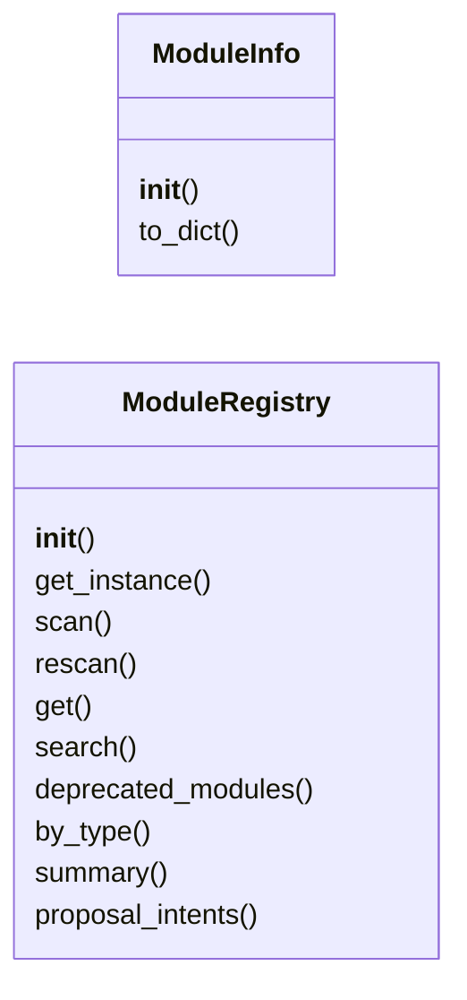
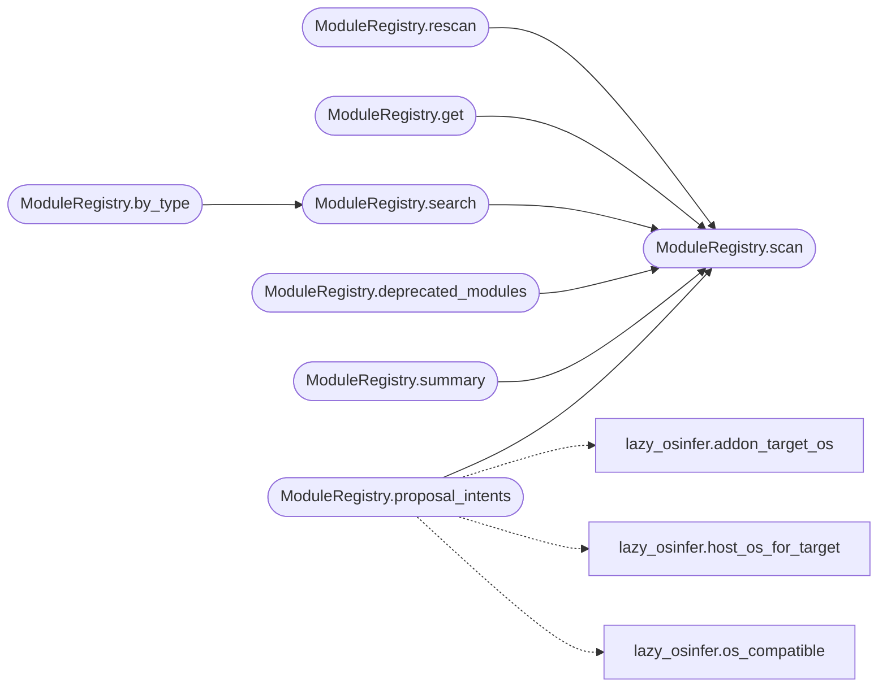

# `modules.module_registry`

> Source: [modules/module_registry.py:1](../../modules/module_registry.py#L1) | language `py` | coverage 88.2% | [API index](../index.md)

Unified module registry for LazyOwn — catalog, search, use/run workflow.

Scans ``lazyaddons/`` (YAML), ``plugins/`` (Lua + YAML), ``modules/``
(Python), ``tools/`` (pwntomate), and ``playbooks/`` for all discoverable
modules. Every module is indexed with its metadata (name, author, version,
category, description, params) for ``show exploits`` / ``search`` /
``info`` / ``use`` / ``run``.

## Contents

- **Classes:** [`ModuleInfo`](#moduleinfo), [`ModuleRegistry`](#moduleregistry)
- **Functions:** [`format_module_table`](#format_module_table), [`format_module_detail`](#format_module_detail)

## Type Diagram



## Call Graph

Solid arrows stay in this module, dashed arrows leave it.



## Classes

<a id="moduleinfo"></a>

### `ModuleInfo`

`class` | [modules/module_registry.py:194](../../modules/module_registry.py#L194)

```python
class ModuleInfo
```

Metadata for a single discoverable module.

**Members**

| Member | Kind | Summary |
|---|---|---|
| [`__init__`](#moduleinfo-__init__) | constructor |  |
| [`to_dict`](#moduleinfo-to_dict) | method |  |

<a id="moduleinfo-__init__"></a>

#### `ModuleInfo.__init__`

`constructor` | [modules/module_registry.py:216](../../modules/module_registry.py#L216)

```python
def __init__(self, name: str, module_type: str = 'auxiliary', author: str = '', version: str = '', description: str = '', category: str = '', path: str = '', source: str = 'yaml', params: list[dict[str, Any]] | None = None, enabled: bool = True, deprecated: bool = False, replaced_by: str = '', deprecation_message: str = '') -> None
```

**Parameters**

| Name | Type | Default | Description |
|---|---|---|---|
| `name` | `str` |  |  |
| `module_type` | `str` | `'auxiliary'` |  |
| `author` | `str` | `''` |  |
| `version` | `str` | `''` |  |
| `description` | `str` | `''` |  |
| `category` | `str` | `''` |  |
| `path` | `str` | `''` |  |
| `source` | `str` | `'yaml'` |  |
| `params` | `list[dict[str, Any]] \| None` | `None` |  |
| `enabled` | `bool` | `True` |  |
| `deprecated` | `bool` | `False` |  |
| `replaced_by` | `str` | `''` |  |
| `deprecation_message` | `str` | `''` |  |

<a id="moduleinfo-to_dict"></a>

#### `ModuleInfo.to_dict`

`method` | [modules/module_registry.py:246](../../modules/module_registry.py#L246)

```python
def to_dict(self) -> dict[str, Any]
```

**Returns:** `dict[str, Any]`

---

<a id="moduleregistry"></a>

### `ModuleRegistry`

`class` | [modules/module_registry.py:267](../../modules/module_registry.py#L267)

```python
class ModuleRegistry
```

Scans and indexes all discoverable modules in the framework.

The registry is a singleton per process — call
[`ModuleRegistry.get_instance`](#moduleregistry-get_instance) or just construct one and reuse it.

**Parameters**

| Name | Type | Default | Description |
|---|---|---|---|
| `base_dir` |  |  | Root directory of the LazyOwn project. |

**Members**

| Member | Kind | Summary |
|---|---|---|
| [`__init__`](#moduleregistry-__init__) | constructor |  |
| [`get_instance`](#moduleregistry-get_instance) | classmethod | Return the singleton registry instance. |
| [`scan`](#moduleregistry-scan) | method | Scan all module directories and return the full list. |
| [`rescan`](#moduleregistry-rescan) | method | Force a full rescan and return modules. |
| [`get`](#moduleregistry-get) | method | Get a module by name. |
| [`search`](#moduleregistry-search) | method | Search indexed modules. |
| [`deprecated_modules`](#moduleregistry-deprecated_modules) | method | Return all deprecated modules. |
| [`by_type`](#moduleregistry-by_type) | method | Shorthand for ``search(module_type=module_type)``. |
| [`summary`](#moduleregistry-summary) | method | Return counts by module type. |
| [`proposal_intents`](#moduleregistry-proposal_intents) | method | Loop bridge: map corpus mentions onto runnable module intents. |

<a id="moduleregistry-__init__"></a>

#### `ModuleRegistry.__init__`

`constructor` | [modules/module_registry.py:279](../../modules/module_registry.py#L279)

```python
def __init__(self, base_dir: str | Path | None = None) -> None
```

**Parameters**

| Name | Type | Default | Description |
|---|---|---|---|
| `base_dir` | `str \| Path \| None` | `None` | Root directory of the LazyOwn project. |

<a id="moduleregistry-get_instance"></a>

#### `ModuleRegistry.get_instance`

`classmethod` | [modules/module_registry.py:285](../../modules/module_registry.py#L285)

Decorators: `@classmethod`

```python
def get_instance(cls, base_dir: str | Path | None = None) -> ModuleRegistry
```

Return the singleton registry instance.

**Parameters**

| Name | Type | Default | Description |
|---|---|---|---|
| `base_dir` | `str \| Path \| None` | `None` |  |

**Returns:** `ModuleRegistry`

<a id="moduleregistry-scan"></a>

#### `ModuleRegistry.scan`

`method` | [modules/module_registry.py:291](../../modules/module_registry.py#L291)

```python
def scan(self) -> list[ModuleInfo]
```

Scan all module directories and return the full list.

**Returns:** `list[ModuleInfo]`

*Called by:* [`ModuleRegistry.deprecated_modules`](#moduleregistry-deprecated_modules), [`ModuleRegistry.get`](#moduleregistry-get), [`ModuleRegistry.proposal_intents`](#moduleregistry-proposal_intents), [`ModuleRegistry.rescan`](#moduleregistry-rescan), [`ModuleRegistry.search`](#moduleregistry-search), [`ModuleRegistry.summary`](#moduleregistry-summary)

<a id="moduleregistry-rescan"></a>

#### `ModuleRegistry.rescan`

`method` | [modules/module_registry.py:304](../../modules/module_registry.py#L304)

```python
def rescan(self) -> list[ModuleInfo]
```

Force a full rescan and return modules.

**Returns:** `list[ModuleInfo]`

*Calls:* [`ModuleRegistry.scan`](#moduleregistry-scan)

<a id="moduleregistry-get"></a>

#### `ModuleRegistry.get`

`method` | [modules/module_registry.py:313](../../modules/module_registry.py#L313)

```python
def get(self, name: str) -> ModuleInfo | None
```

Get a module by name.

**Parameters**

| Name | Type | Default | Description |
|---|---|---|---|
| `name` | `str` |  |  |

**Returns:** `ModuleInfo | None`

*Calls:* [`ModuleRegistry.scan`](#moduleregistry-scan)

<a id="moduleregistry-search"></a>

#### `ModuleRegistry.search`

`method` | [modules/module_registry.py:319](../../modules/module_registry.py#L319)

```python
def search(self, query: str = '', module_type: str | None = None, category: str | None = None, enabled_only: bool = True, include_deprecated: bool = False) -> list[ModuleInfo]
```

Search indexed modules.

**Parameters**

| Name | Type | Default | Description |
|---|---|---|---|
| `query` | `str` | `''` | Free-text search in name, description, author. |
| `module_type` | `str \| None` | `None` | Filter by type (``exploit``, `[`scanner`](contrib.legacy.lazycam.py.md#rtspscanner-scanner)`, ...). |
| `category` | `str \| None` | `None` | Filter by kill-chain category. |
| `enabled_only` | `bool` | `True` | Only return enabled modules. |
| `include_deprecated` | `bool` | `False` | Include deprecated modules in results. |

**Returns:** `list[ModuleInfo]` - List of matching [`ModuleInfo`](#moduleinfo).

*Calls:* [`ModuleRegistry.scan`](#moduleregistry-scan)

*Called by:* [`ModuleRegistry.by_type`](#moduleregistry-by_type)

<a id="moduleregistry-deprecated_modules"></a>

#### `ModuleRegistry.deprecated_modules`

`method` | [modules/module_registry.py:359](../../modules/module_registry.py#L359)

```python
def deprecated_modules(self) -> list[ModuleInfo]
```

Return all deprecated modules.

**Returns:** `list[ModuleInfo]`

*Calls:* [`ModuleRegistry.scan`](#moduleregistry-scan)

<a id="moduleregistry-by_type"></a>

#### `ModuleRegistry.by_type`

`method` | [modules/module_registry.py:365](../../modules/module_registry.py#L365)

```python
def by_type(self, module_type: str) -> list[ModuleInfo]
```

Shorthand for ``search(module_type=module_type)``.

**Parameters**

| Name | Type | Default | Description |
|---|---|---|---|
| `module_type` | `str` |  |  |

**Returns:** `list[ModuleInfo]`

*Calls:* [`ModuleRegistry.search`](#moduleregistry-search)

<a id="moduleregistry-summary"></a>

#### `ModuleRegistry.summary`

`method` | [modules/module_registry.py:369](../../modules/module_registry.py#L369)

```python
def summary(self) -> dict[str, int]
```

Return counts by module type.

**Returns:** `dict[str, int]`

*Calls:* [`ModuleRegistry.scan`](#moduleregistry-scan)

<a id="moduleregistry-proposal_intents"></a>

#### `ModuleRegistry.proposal_intents`

`method` | [modules/module_registry.py:378](../../modules/module_registry.py#L378)

```python
def proposal_intents(self, texts: Sequence[str], target: str = '', limit: int = _PROPOSAL_LIMIT) -> list[str]
```

Loop bridge: map corpus mentions onto runnable module intents.

Only modules with a routable execution verb become proposals:
YAML addons run one-to-one through ``lazy addon <name>``, APT
playbook entries through ``apt_playbook run <name>``. Python,
Lua, pwntomate and other module sources stay out of planning
because no safe loop verb executes them.

Matching is conservative by design: the tokens mined from the
module name (``lazy_`` prefixes dropped) must equal a whole
corpus token, so a mention like ``hydra`` can raise an
HYDRA-named addon while plain substrings never trigger
anything. OS compatibility mirrors `[`propose_addon_intents`](modules.auto_registry.py.md#propose_addon_intents)`.

**Parameters**

| Name | Type | Default | Description |
|---|---|---|---|
| `texts` | `Sequence[str]` |  | Operator goal, findings and service values to mine. |
| `target` | `str` | `''` | Optional target address appended to addon intents. |
| `limit` | `int` | `_PROPOSAL_LIMIT` | Maximum number of intents returned. |

**Returns:** `list[str]` - Deduplicated command lines in registry scan order, capped.

*Calls:* [`addon_target_os`](modules.lazy_osinfer.py.md#addon_target_os), [`host_os_for_target`](modules.lazy_osinfer.py.md#host_os_for_target), [`os_compatible`](modules.lazy_osinfer.py.md#os_compatible), [`ModuleRegistry.scan`](#moduleregistry-scan)

---

## Functions

<a id="format_module_table"></a>

### `format_module_table`

`function` | [modules/module_registry.py:666](../../modules/module_registry.py#L666)

```python
def format_module_table(modules: list[ModuleInfo], cols: tuple[str, ...] = ('name', 'type', 'author', 'description')) -> str
```

Format a list of modules as an aligned text table.

**Parameters**

| Name | Type | Default | Description |
|---|---|---|---|
| `modules` | `list[ModuleInfo]` |  | Module list to format. |
| `cols` | `tuple[str, ...]` | `('name', 'type', 'author', 'description')` | Column keys to include (in order). Valid keys: ``id``, ``name``, ``type``, ``author``, ``version``, ``description``. |

**Returns:** `str` - Multi-line string with aligned columns.

*Called by:* [`ModuleManagerCommandSet.do_search`](cli.commands.module_manager.py.md#modulemanagercommandset-do_search)

---

<a id="format_module_detail"></a>

### `format_module_detail`

`function` | [modules/module_registry.py:713](../../modules/module_registry.py#L713)

```python
def format_module_detail(m: ModuleInfo) -> str
```

Format a single module's full metadata.

**Parameters**

| Name | Type | Default | Description |
|---|---|---|---|
| `m` | `ModuleInfo` |  |  |

**Returns:** `str`

*Called by:* [`ModuleManagerCommandSet.do_use`](cli.commands.module_manager.py.md#modulemanagercommandset-do_use)

---
