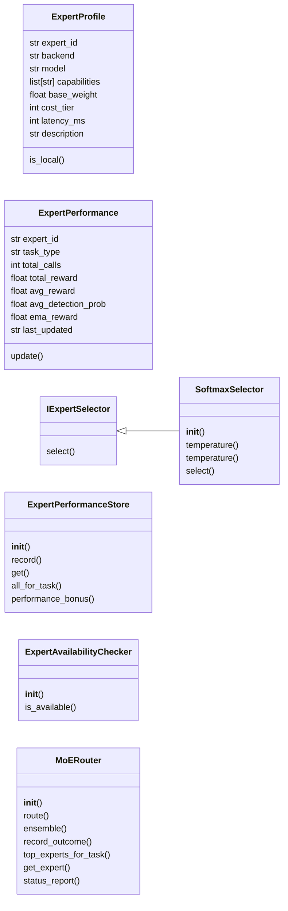
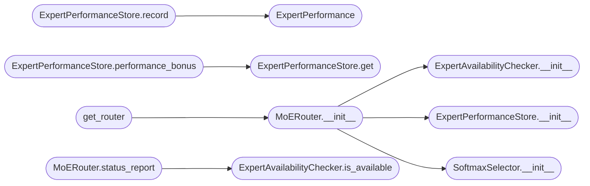

# `modules.moe_router`

> Source: [modules/moe_router.py:1](../../modules/moe_router.py#L1) | language `py` | coverage 65.5% | [API index](../index.md)

modules/moe_router.py ====================== Mixture-of-Experts (MoE) Router for LazyOwn.

Routes penetration-testing tasks to the most capable available LLM expert
based on task type, learned performance history, and detection risk.

Architecture
------------
                     task_type + goal
                           |
                     MoERouter.route()
                     /       |       \
           groq_fast  groq_powerful  ollama_reason  ...
                     \       |       /
               ExpertPerformanceStore (JSON)
                           |
                    SoftmaxSelector
                (temperature-scaled softmax
                 over RL-adjusted weights)

Design principles
-----------------
- Single Responsibility : each class owns one concept
- Open/Closed           : new experts added to _DEFAULT_EXPERTS list only
- Liskov Substitution   : IExpertSelector defines the routing contract
- Interface Segregation : separate read/write interfaces for performance store
- Dependency Inversion  : MoERouter depends on IExpertSelector, not on concrete impl

Expert selection algorithm
--------------------------
1. Filter experts whose capabilities include the requested task_type.
2. Retrieve per-(expert, task_type) performance score from store.
3. Compute adjusted_weight = base_weight * (1 + performance_bonus).
4. Apply temperature-scaled softmax to get selection probabilities.
5. Sample from distribution (or return argmax for deterministic mode).

Usage
-----
    from modules.moe_router import get_router

    router = get_router()
    expert = router.route("exploit", "Find a shell on Apache 2.4.49")
    print(expert.expert_id, expert.backend, expert.model)

    # Ensemble: top-3 experts for a critical decision
    experts = router.ensemble("credential", "Dump hashes from DC", n=3)

    # Record outcome after execution
    router.record_outcome("groq_powerful", "exploit", reward=6, detection_prob=0.82)

## Contents

- **Classes:** [`ExpertProfile`](#expertprofile), [`ExpertPerformance`](#expertperformance), [`IExpertSelector`](#iexpertselector), [`ExpertPerformanceStore`](#expertperformancestore), [`SoftmaxSelector`](#softmaxselector), [`ExpertAvailabilityChecker`](#expertavailabilitychecker), [`MoERouter`](#moerouter)
- **Functions:** [`get_router`](#get_router)

## Type Diagram



## Call Graph

Solid arrows stay in this module, dashed arrows leave it.



## Classes

<a id="expertprofile"></a>

### `ExpertProfile`

`class` `dataclass` | [modules/moe_router.py:83](../../modules/moe_router.py#L83)

Decorators: `@dataclass`

```python
class ExpertProfile
```

Static description of a single expert model.

**Attributes**

| Name | Type | Default | Description |
|---|---|---|---|
| [`expert_id`](#expertprofile-expert_id) | `str` |  |  |
| [`backend`](#expertprofile-backend) | `str` |  |  |
| [`model`](#expertprofile-model) | `str` |  |  |
| [`capabilities`](#expertprofile-capabilities) | `list[str]` |  |  |
| [`base_weight`](#expertprofile-base_weight) | `float` |  |  |
| [`cost_tier`](#expertprofile-cost_tier) | `int` |  |  |
| [`latency_ms`](#expertprofile-latency_ms) | `int` |  |  |
| [`description`](#expertprofile-description) | `str` | `''` |  |

**Members**

| Member | Kind | Summary |
|---|---|---|
| [`is_local`](#expertprofile-is_local) | property |  |

<a id="expertprofile-is_local"></a>

#### `ExpertProfile.is_local`

`property` | [modules/moe_router.py:96](../../modules/moe_router.py#L96)

Decorators: `@property`

```python
def is_local(self) -> bool
```

**Returns:** `bool`

---

<a id="expertperformance"></a>

### `ExpertPerformance`

`class` `dataclass` | [modules/moe_router.py:101](../../modules/moe_router.py#L101)

Decorators: `@dataclass`

```python
class ExpertPerformance
```

Mutable per-(expert_id, task_type) performance record.

**Attributes**

| Name | Type | Default | Description |
|---|---|---|---|
| [`expert_id`](#expertperformance-expert_id) | `str` |  |  |
| [`task_type`](#expertperformance-task_type) | `str` |  |  |
| [`total_calls`](#expertperformance-total_calls) | `int` | `0` |  |
| [`total_reward`](#expertperformance-total_reward) | `float` | `0.0` |  |
| [`avg_reward`](#expertperformance-avg_reward) | `float` | `0.0` |  |
| [`avg_detection_prob`](#expertperformance-avg_detection_prob) | `float` | `0.0` |  |
| [`ema_reward`](#expertperformance-ema_reward) | `float` | `0.0` |  |
| [`last_updated`](#expertperformance-last_updated) | `str` | `''` |  |

**Members**

| Member | Kind | Summary |
|---|---|---|
| [`update`](#expertperformance-update) | method |  |

<a id="expertperformance-update"></a>

#### `ExpertPerformance.update`

`method` | [modules/moe_router.py:115](../../modules/moe_router.py#L115)

```python
def update(self, reward: float, detection_prob: float) -> None
```

**Parameters**

| Name | Type | Default | Description |
|---|---|---|---|
| `reward` | `float` |  |  |
| `detection_prob` | `float` |  |  |

---

<a id="iexpertselector"></a>

### `IExpertSelector`

`class` `abstract` | [modules/moe_router.py:257](../../modules/moe_router.py#L257)

```python
class IExpertSelector(ABC)
```

Bases: `ABC`

Subclasses: [`SoftmaxSelector`](#softmaxselector)

Contract for expert selection strategies.

**Members**

| Member | Kind | Summary |
|---|---|---|
| [`select`](#iexpertselector-select) | method | Return the selected expert from candidates. |

<a id="iexpertselector-select"></a>

#### `IExpertSelector.select`

`method` `abstract` | [modules/moe_router.py:261](../../modules/moe_router.py#L261)

Decorators: `@abstractmethod`

```python
def select(self, candidates: list[ExpertProfile], task_type: str, performance_store: ExpertPerformanceStore, deterministic: bool = False) -> ExpertProfile
```

Return the selected expert from candidates.

**Parameters**

| Name | Type | Default | Description |
|---|---|---|---|
| `candidates` | `list[ExpertProfile]` |  |  |
| `task_type` | `str` |  |  |
| `performance_store` | `ExpertPerformanceStore` |  |  |
| `deterministic` | `bool` | `False` |  |

**Returns:** `ExpertProfile`

---

<a id="expertperformancestore"></a>

### `ExpertPerformanceStore`

`class` | [modules/moe_router.py:276](../../modules/moe_router.py#L276)

```python
class ExpertPerformanceStore
```

Persists per-(expert_id, task_type) performance records to JSON.

Thread-safe via RLock.

**Members**

| Member | Kind | Summary |
|---|---|---|
| [`__init__`](#expertperformancestore-__init__) | constructor |  |
| [`record`](#expertperformancestore-record) | method | Update performance for (expert, task_type) and persist. |
| [`get`](#expertperformancestore-get) | method |  |
| [`all_for_task`](#expertperformancestore-all_for_task) | method |  |
| [`performance_bonus`](#expertperformancestore-performance_bonus) | method | Return a bonus scalar in [-0.3, +0.5] based on EMA reward history. |

<a id="expertperformancestore-__init__"></a>

#### `ExpertPerformanceStore.__init__`

`constructor` | [modules/moe_router.py:283](../../modules/moe_router.py#L283)

```python
def __init__(self, path: Path = _PERF_FILE) -> None
```

**Parameters**

| Name | Type | Default | Description |
|---|---|---|---|
| `path` | `Path` | `_PERF_FILE` |  |

*Called by:* [`MoERouter.__init__`](#moerouter-__init__)

<a id="expertperformancestore-record"></a>

#### `ExpertPerformanceStore.record`

`method` | [modules/moe_router.py:298](../../modules/moe_router.py#L298)

```python
def record(self, expert_id: str, task_type: str, reward: float, detection_prob: float) -> ExpertPerformance
```

Update performance for (expert, task_type) and persist.

**Parameters**

| Name | Type | Default | Description |
|---|---|---|---|
| `expert_id` | `str` |  |  |
| `task_type` | `str` |  |  |
| `reward` | `float` |  |  |
| `detection_prob` | `float` |  |  |

**Returns:** `ExpertPerformance`

*Calls:* [`ExpertPerformance`](#expertperformance)

<a id="expertperformancestore-get"></a>

#### `ExpertPerformanceStore.get`

`method` | [modules/moe_router.py:316](../../modules/moe_router.py#L316)

```python
def get(self, expert_id: str, task_type: str) -> ExpertPerformance | None
```

**Parameters**

| Name | Type | Default | Description |
|---|---|---|---|
| `expert_id` | `str` |  |  |
| `task_type` | `str` |  |  |

**Returns:** `ExpertPerformance | None`

*Called by:* [`ExpertPerformanceStore.performance_bonus`](#expertperformancestore-performance_bonus)

<a id="expertperformancestore-all_for_task"></a>

#### `ExpertPerformanceStore.all_for_task`

`method` | [modules/moe_router.py:321](../../modules/moe_router.py#L321)

```python
def all_for_task(self, task_type: str) -> list[ExpertPerformance]
```

**Parameters**

| Name | Type | Default | Description |
|---|---|---|---|
| `task_type` | `str` |  |  |

**Returns:** `list[ExpertPerformance]`

<a id="expertperformancestore-performance_bonus"></a>

#### `ExpertPerformanceStore.performance_bonus`

`method` | [modules/moe_router.py:325](../../modules/moe_router.py#L325)

```python
def performance_bonus(self, expert_id: str, task_type: str) -> float
```

Return a bonus scalar in [-0.3, +0.5] based on EMA reward history.

Positive for above-average performance, negative for below-average.

**Parameters**

| Name | Type | Default | Description |
|---|---|---|---|
| `expert_id` | `str` |  |  |
| `task_type` | `str` |  |  |

**Returns:** `float`

*Calls:* [`ExpertPerformanceStore.get`](#expertperformancestore-get)

---

<a id="softmaxselector"></a>

### `SoftmaxSelector`

`class` | [modules/moe_router.py:368](../../modules/moe_router.py#L368)

```python
class SoftmaxSelector(IExpertSelector)
```

Bases: [`IExpertSelector`](#iexpertselector)

Selects an expert using temperature-scaled softmax over adjusted weights.

Higher weight → higher probability. Temperature controls exploration:
- High temperature (>1.0): near-uniform distribution (more exploration)
- Low temperature (<1.0): sharpened towards best expert (exploitation)

**Members**

| Member | Kind | Summary |
|---|---|---|
| [`__init__`](#softmaxselector-__init__) | constructor |  |
| [`temperature`](#softmaxselector-temperature) | property |  |
| [`temperature`](#softmaxselector-temperature) | property |  |
| [`select`](#softmaxselector-select) | method | Return the selected expert from candidates. |

<a id="softmaxselector-__init__"></a>

#### `SoftmaxSelector.__init__`

`constructor` | [modules/moe_router.py:377](../../modules/moe_router.py#L377)

```python
def __init__(self, temperature: float = 1.0) -> None
```

**Parameters**

| Name | Type | Default | Description |
|---|---|---|---|
| `temperature` | `float` | `1.0` |  |

*Called by:* [`MoERouter.__init__`](#moerouter-__init__)

<a id="softmaxselector-temperature"></a>

#### `SoftmaxSelector.temperature`

`property` | [modules/moe_router.py:385](../../modules/moe_router.py#L385)

Decorators: `@temperature.setter`

```python
def temperature(self, value: float) -> None
```

**Parameters**

| Name | Type | Default | Description |
|---|---|---|---|
| `value` | `float` |  |  |

<a id="softmaxselector-temperature"></a>

#### `SoftmaxSelector.temperature`

`property` | [modules/moe_router.py:385](../../modules/moe_router.py#L385)

Decorators: `@temperature.setter`

```python
def temperature(self, value: float) -> None
```

**Parameters**

| Name | Type | Default | Description |
|---|---|---|---|
| `value` | `float` |  |  |

<a id="softmaxselector-select"></a>

#### `SoftmaxSelector.select`

`method` | [modules/moe_router.py:388](../../modules/moe_router.py#L388)

```python
def select(self, candidates: list[ExpertProfile], task_type: str, performance_store: ExpertPerformanceStore, deterministic: bool = False) -> ExpertProfile
```

Return the selected expert from candidates.

**Parameters**

| Name | Type | Default | Description |
|---|---|---|---|
| `candidates` | `list[ExpertProfile]` |  |  |
| `task_type` | `str` |  |  |
| `performance_store` | `ExpertPerformanceStore` |  |  |
| `deterministic` | `bool` | `False` |  |

**Returns:** `ExpertProfile`

**Raises**

- `ValueError`: (raised in the body, not documented)

> **Inherited:** Documentation from [`IExpertSelector.select`](#iexpertselector-select) (modules/moe_router.py:261).

---

<a id="expertavailabilitychecker"></a>

### `ExpertAvailabilityChecker`

`class` | [modules/moe_router.py:437](../../modules/moe_router.py#L437)

```python
class ExpertAvailabilityChecker
```

Checks whether the backend for an expert is reachable.

Results are cached for _AVAIL_CACHE_TTL_S seconds to avoid hammering APIs.

**Members**

| Member | Kind | Summary |
|---|---|---|
| [`__init__`](#expertavailabilitychecker-__init__) | constructor |  |
| [`is_available`](#expertavailabilitychecker-is_available) | method |  |

<a id="expertavailabilitychecker-__init__"></a>

#### `ExpertAvailabilityChecker.__init__`

`constructor` | [modules/moe_router.py:443](../../modules/moe_router.py#L443)

```python
def __init__(self) -> None
```

*Called by:* [`MoERouter.__init__`](#moerouter-__init__)

<a id="expertavailabilitychecker-is_available"></a>

#### `ExpertAvailabilityChecker.is_available`

`method` | [modules/moe_router.py:447](../../modules/moe_router.py#L447)

```python
def is_available(self, expert: ExpertProfile, api_key: str = '') -> bool
```

**Parameters**

| Name | Type | Default | Description |
|---|---|---|---|
| `expert` | `ExpertProfile` |  |  |
| `api_key` | `str` | `''` |  |

**Returns:** `bool`

*Called by:* [`MoERouter.status_report`](#moerouter-status_report)

---

<a id="moerouter"></a>

### `MoERouter`

`class` | [modules/moe_router.py:489](../../modules/moe_router.py#L489)

```python
class MoERouter
```

Top-level Mixture-of-Experts router.

Maintains the expert registry, availability cache, and performance store.
Provides route() for single-expert selection and ensemble() for multi-expert.

Dependency Inversion: accepts IExpertSelector so the selection strategy
can be swapped (e.g., replace SoftmaxSelector with Q-learning selector).

**Members**

| Member | Kind | Summary |
|---|---|---|
| [`__init__`](#moerouter-__init__) | constructor |  |
| [`route`](#moerouter-route) | method | Return the single best expert for the given task_type. |
| [`ensemble`](#moerouter-ensemble) | method | Return up to *n* distinct experts for ensemble execution. |
| [`record_outcome`](#moerouter-record_outcome) | method | Record the outcome of an expert execution. |
| [`top_experts_for_task`](#moerouter-top_experts_for_task) | method | Return (expert, adjusted_weight) sorted descending for diagnostics. |
| [`get_expert`](#moerouter-get_expert) | method | Return expert by ID, or None. |
| [`status_report`](#moerouter-status_report) | method | Return a diagnostic snapshot of all experts and their weights. |

<a id="moerouter-__init__"></a>

#### `MoERouter.__init__`

`constructor` | [modules/moe_router.py:500](../../modules/moe_router.py#L500)

```python
def __init__(self, experts: list[ExpertProfile] | None = None, selector: IExpertSelector | None = None, performance_store: ExpertPerformanceStore | None = None, api_key: str = '') -> None
```

**Parameters**

| Name | Type | Default | Description |
|---|---|---|---|
| `experts` | `list[ExpertProfile] \| None` | `None` |  |
| `selector` | `IExpertSelector \| None` | `None` |  |
| `performance_store` | `ExpertPerformanceStore \| None` | `None` |  |
| `api_key` | `str` | `''` |  |

*Calls:* [`ExpertAvailabilityChecker.__init__`](#expertavailabilitychecker-__init__), [`ExpertPerformanceStore.__init__`](#expertperformancestore-__init__), [`SoftmaxSelector.__init__`](#softmaxselector-__init__)

*Called by:* [`get_router`](#get_router)

<a id="moerouter-route"></a>

#### `MoERouter.route`

`method` | [modules/moe_router.py:515](../../modules/moe_router.py#L515)

```python
def route(self, task_type: str, goal: str = '', deterministic: bool = False) -> ExpertProfile
```

Return the single best expert for the given task_type.

**Parameters**

| Name | Type | Default | Description |
|---|---|---|---|
| `task_type` | `str` |  |  |
| `goal` | `str` | `''` |  |
| `deterministic` | `bool` | `False` |  |

**Returns:** `ExpertProfile`

**Raises**

- `RuntimeError`: (raised in the body, not documented)

<a id="moerouter-ensemble"></a>

#### `MoERouter.ensemble`

`method` | [modules/moe_router.py:547](../../modules/moe_router.py#L547)

```python
def ensemble(self, task_type: str, goal: str = '', n: int = 2) -> list[ExpertProfile]
```

Return up to *n* distinct experts for ensemble execution.

Experts are sorted by adjusted weight (best first).

**Parameters**

| Name | Type | Default | Description |
|---|---|---|---|
| `task_type` | `str` |  |  |
| `goal` | `str` | `''` |  |
| `n` | `int` | `2` |  |

**Returns:** `list[ExpertProfile]`

<a id="moerouter-record_outcome"></a>

#### `MoERouter.record_outcome`

`method` | [modules/moe_router.py:575](../../modules/moe_router.py#L575)

```python
def record_outcome(self, expert_id: str, task_type: str, reward: float, detection_prob: float = 0.0) -> None
```

Record the outcome of an expert execution.

Updates the performance store and adjusts the selector temperature.

**Parameters**

| Name | Type | Default | Description |
|---|---|---|---|
| `expert_id` | `str` |  |  |
| `task_type` | `str` |  |  |
| `reward` | `float` |  |  |
| `detection_prob` | `float` | `0.0` |  |

<a id="moerouter-top_experts_for_task"></a>

#### `MoERouter.top_experts_for_task`

`method` | [modules/moe_router.py:589](../../modules/moe_router.py#L589)

```python
def top_experts_for_task(self, task_type: str, top_k: int = 3) -> list[tuple[ExpertProfile, float]]
```

Return (expert, adjusted_weight) sorted descending for diagnostics.

**Parameters**

| Name | Type | Default | Description |
|---|---|---|---|
| `task_type` | `str` |  |  |
| `top_k` | `int` | `3` |  |

**Returns:** `list[tuple[ExpertProfile, float]]`

<a id="moerouter-get_expert"></a>

#### `MoERouter.get_expert`

`method` | [modules/moe_router.py:605](../../modules/moe_router.py#L605)

```python
def get_expert(self, expert_id: str) -> ExpertProfile | None
```

Return expert by ID, or None.

**Parameters**

| Name | Type | Default | Description |
|---|---|---|---|
| `expert_id` | `str` |  |  |

**Returns:** `ExpertProfile | None`

<a id="moerouter-status_report"></a>

#### `MoERouter.status_report`

`method` | [modules/moe_router.py:609](../../modules/moe_router.py#L609)

```python
def status_report(self) -> dict
```

Return a diagnostic snapshot of all experts and their weights.

**Returns:** `dict`

*Calls:* [`ExpertAvailabilityChecker.is_available`](#expertavailabilitychecker-is_available)

---

## Functions

<a id="get_router"></a>

### `get_router`

`function` | [modules/moe_router.py:684](../../modules/moe_router.py#L684)

```python
def get_router(api_key: str = '') -> MoERouter
```

Return (or create) the module-level singleton MoERouter.

**Parameters**

| Name | Type | Default | Description |
|---|---|---|---|
| `api_key` | `str` | `''` |  |

**Returns:** `MoERouter`

*Calls:* [`MoERouter.__init__`](#moerouter-__init__)

*Called by:* [`ai_snapshot`](modules.loop_ai_bridge.py.md#ai_snapshot), [`moe_record_outcome`](modules.loop_ai_bridge.py.md#moe_record_outcome), [`moe_route`](modules.loop_ai_bridge.py.md#moe_route)

---
