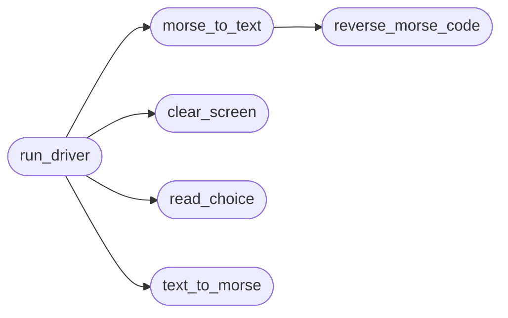

# `modules.morse`

> Source: [modules/morse.py:1](../../modules/morse.py#L1) | language `py` | coverage 100.0% | [API index](../index.md)

Morse code conversion service with interactive driver.

Contract:
    Single self-contained module providing text to Morse code conversion,
    Morse code to text conversion, and an interactive selection driver.
    No placeholders, no simplifications, production grade input handling.

## Contents

- **Classes:** [`MorseConfig`](#morseconfig)
- **Functions:** [`reverse_morse_code`](#reverse_morse_code), [`text_to_morse`](#text_to_morse), [`morse_to_text`](#morse_to_text), [`clear_screen`](#clear_screen), [`read_choice`](#read_choice), [`run_driver`](#run_driver)
- **Constants:** [`CONFIG`](#config), [`MORSE_CODE`](#morse_code), [`SPECIAL_CHARACTERS`](#special_characters), [`MORSE_CODE_REV`](#morse_code_rev)

## Call Graph

Solid arrows stay in this module, dashed arrows leave it.



## Classes

<a id="morseconfig"></a>

### `MorseConfig`

`class` `dataclass` | [modules/morse.py:16](../../modules/morse.py#L16)

Decorators: `@dataclass(frozen=True)`

```python
class MorseConfig
```

Centralized configuration for the Morse module.

**Attributes**

| Name | Type | Default | Description |
|---|---|---|---|
| [`word_separator`](#morseconfig-word_separator) | `str` | `'/'` |  |
| [`letter_separator`](#morseconfig-letter_separator) | `str` | `' '` |  |
| [`screen_reset_command`](#morseconfig-screen_reset_command) | `tuple[str, ...]` | `('tput', 'reset')` |  |
| [`subprocess_timeout_seconds`](#morseconfig-subprocess_timeout_seconds) | `int` | `5` |  |
| [`exit_choice`](#morseconfig-exit_choice) | `int` | `0` |  |
| [`encode_choice`](#morseconfig-encode_choice) | `int` | `1` |  |
| [`decode_choice`](#morseconfig-decode_choice) | `int` | `2` |  |
| [`continue_prompt`](#morseconfig-continue_prompt) | `str` | `'\n\nPress Enter to continue.\n\n'` |  |
| [`text_prompt`](#morseconfig-text_prompt) | `str` | `'\nEnter the text: '` |  |
| [`morse_prompt`](#morseconfig-morse_prompt) | `str` | `'\nEnter the Morse code: '` |  |
| [`choice_prompt`](#morseconfig-choice_prompt) | `str` | `'\nEnter your choice: '` |  |
| [`retry_prompt`](#morseconfig-retry_prompt) | `str` | `'\nEnter the correct choice: '` |  |

---

## Functions

<a id="reverse_morse_code"></a>

### `reverse_morse_code`

`function` | [modules/morse.py:98](../../modules/morse.py#L98)

```python
def reverse_morse_code() -> dict[str, str]
```

Build the reverse lookup table from Morse code to characters.

**Returns:** `dict[str, str]` - Mapping of Morse code sequences to uppercase characters.

*Called by:* [`morse_to_text`](#morse_to_text)

---

<a id="text_to_morse"></a>

### `text_to_morse`

`function` | [modules/morse.py:109](../../modules/morse.py#L109)

```python
def text_to_morse(text: str, config: MorseConfig = CONFIG) -> str
```

Convert plain text to Morse code.

**Parameters**

| Name | Type | Default | Description |
|---|---|---|---|
| `text` | `str` |  | Source text to encode. |
| `config` | `MorseConfig` | `CONFIG` | Module configuration. |

**Returns:** `str` - Morse code representation with word and letter separators.

*Called by:* [`run_driver`](#run_driver)

---

<a id="morse_to_text"></a>

### `morse_to_text`

`function` | [modules/morse.py:130](../../modules/morse.py#L130)

```python
def morse_to_text(morse_code: str, config: MorseConfig = CONFIG) -> str
```

Convert Morse code back to plain text.

**Parameters**

| Name | Type | Default | Description |
|---|---|---|---|
| `morse_code` | `str` |  | Morse code string using configured separators. |
| `config` | `MorseConfig` | `CONFIG` | Module configuration. |

**Returns:** `str` - Decoded uppercase text.

*Calls:* [`reverse_morse_code`](#reverse_morse_code)

*Called by:* [`run_driver`](#run_driver)

---

<a id="clear_screen"></a>

### `clear_screen`

`function` | [modules/morse.py:157](../../modules/morse.py#L157)

```python
def clear_screen(config: MorseConfig = CONFIG) -> None
```

Reset the terminal screen using a bounded subprocess call.

**Parameters**

| Name | Type | Default | Description |
|---|---|---|---|
| `config` | `MorseConfig` | `CONFIG` | Module configuration. |

*Called by:* [`run_driver`](#run_driver)

---

<a id="read_choice"></a>

### `read_choice`

`function` | [modules/morse.py:171](../../modules/morse.py#L171)

```python
def read_choice(config: MorseConfig = CONFIG) -> int | None
```

Read and validate the menu choice from standard input.

**Parameters**

| Name | Type | Default | Description |
|---|---|---|---|
| `config` | `MorseConfig` | `CONFIG` | Module configuration. |

**Returns:** `int | None` - Valid menu choice, or None when input is not a number.

*Called by:* [`run_driver`](#run_driver)

---

<a id="run_driver"></a>

### `run_driver`

`function` | [modules/morse.py:186](../../modules/morse.py#L186)

```python
def run_driver(config: MorseConfig = CONFIG) -> None
```

Run the interactive Morse code conversion loop.

**Parameters**

| Name | Type | Default | Description |
|---|---|---|---|
| `config` | `MorseConfig` | `CONFIG` | Module configuration. |

**Raises**

- `EOFError`: Propagated when standard input closes.
- `SystemExit`: (raised in the body, not documented)

*Calls:* [`clear_screen`](#clear_screen), [`morse_to_text`](#morse_to_text), [`read_choice`](#read_choice), [`text_to_morse`](#text_to_morse)

---

## Constants

<a id="config"></a>

### `CONFIG`

`constant` | [modules/morse.py:33](../../modules/morse.py#L33)

```python
CONFIG = MorseConfig()
```

---

<a id="morse_code"></a>

### `MORSE_CODE`

`constant` | [modules/morse.py:35](../../modules/morse.py#L35)

```python
MORSE_CODE: dict[str, str]
```

---

<a id="special_characters"></a>

### `SPECIAL_CHARACTERS`

`constant` | [modules/morse.py:74](../../modules/morse.py#L74)

```python
SPECIAL_CHARACTERS: dict[str, str]
```

---

<a id="morse_code_rev"></a>

### `MORSE_CODE_REV`

`constant` | [modules/morse.py:95](../../modules/morse.py#L95)

```python
MORSE_CODE_REV: dict[str, str] = {value: key for key, value in MORSE_CODE.items()}
```

---
