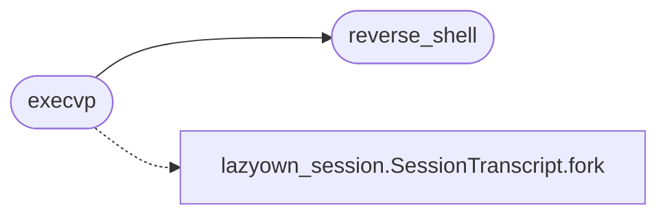

# `modules/mysql_hookandroot_lib.c`

> Source: [modules/mysql_hookandroot_lib.c:1](../../modules/mysql_hookandroot_lib.c#L1) | language `c` | coverage 28.6% | [API index](../index.md)

## Contents

- **Functions:** [`reverse_shell`](#reverse_shell), [`execvp`](#execvp)
- **Macros:** [`_GNU_SOURCE`](#_gnu_source), [`ATTACKERS_IP`](#attackers_ip), [`SHELL_PORT`](#shell_port), [`INJECTED_CONF`](#injected_conf)

## Call Graph

Solid arrows stay in this module, dashed arrows leave it.



## Functions

<a id="reverse_shell"></a>

### `reverse_shell`

`function` | [modules/mysql_hookandroot_lib.c:74](../../modules/mysql_hookandroot_lib.c#L74)

```c
void reverse_shell(void)
```

fork & send a bash shell to the attacker before starting mysqld

*Called by:* [`execvp`](#execvp)

---

<a id="execvp"></a>

### `execvp`

`function` | [modules/mysql_hookandroot_lib.c:128](../../modules/mysql_hookandroot_lib.c#L128)

```c
int execvp(const char* filename, char* const argv[])
```

execvp() hook

**Parameters**

| Name | Type | Default | Description |
|---|---|---|---|
| `filename` | `char*` |  |  |
| `argv` | `char* const []` |  |  |

**Returns:** `int`

*Calls:* [`reverse_shell`](#reverse_shell), [`SessionTranscript.fork`](skills.lazyown_session.py.md#sessiontranscript-fork)

*Called by:* [`handle_client`](modules.rootkit.mr.c.md#handle_client), [`mon_shell`](modules.rootkit.mr.c.md#mon_shell), [`reboot_system`](modules.rootkit.mr.c.md#reboot_system)

---

## Macros

<a id="_gnu_source"></a>

### `_GNU_SOURCE`

`macro` | [modules/mysql_hookandroot_lib.c:50](../../modules/mysql_hookandroot_lib.c#L50)

```c
#define _GNU_SOURCE
```

---

<a id="attackers_ip"></a>

### `ATTACKERS_IP`

`macro` | [modules/mysql_hookandroot_lib.c:64](../../modules/mysql_hookandroot_lib.c#L64)

```c
#define ATTACKERS_IP
```

---

<a id="shell_port"></a>

### `SHELL_PORT`

`macro` | [modules/mysql_hookandroot_lib.c:65](../../modules/mysql_hookandroot_lib.c#L65)

```c
#define SHELL_PORT
```

---

<a id="injected_conf"></a>

### `INJECTED_CONF`

`macro` | [modules/mysql_hookandroot_lib.c:66](../../modules/mysql_hookandroot_lib.c#L66)

```c
#define INJECTED_CONF
```

---
