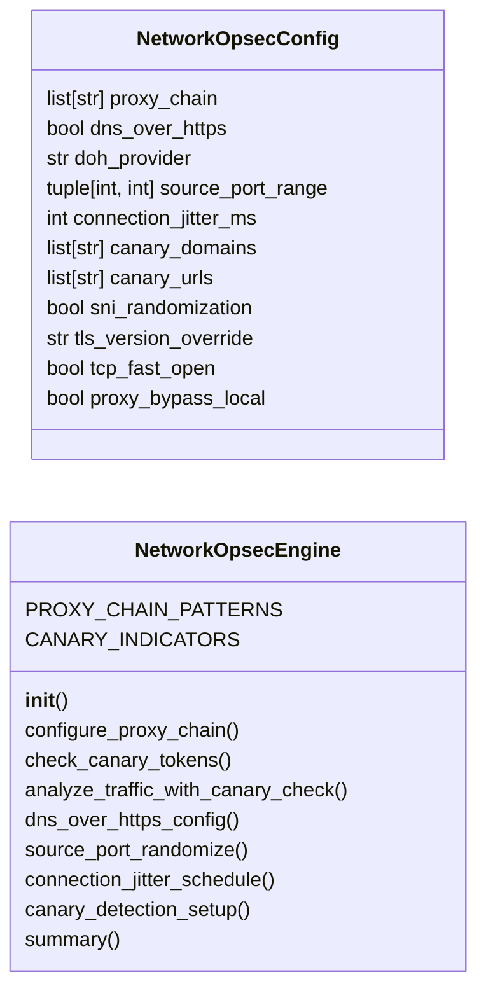

# `modules.network_opsec`

> Source: [modules/network_opsec.py:1](../../modules/network_opsec.py#L1) | language `py` | coverage 83.3% | [API index](../index.md)

Network OPSEC — proxy chain enforcement, canary detection, traffic randomization.

Provides network-level operational security: SOCKS5 → HTTP → SSH tunnel
proxy chain management, canary token detection (verify if traffic is being
analyzed), source port randomization, connection jitter scheduling, and
DNS-over-HTTPS resolution to avoid DNS logging.

All configurations derive from payload.json with sensible defaults for
covert C2 communication.

## Contents

- **Classes:** [`NetworkOpsecConfig`](#networkopsecconfig), [`NetworkOpsecEngine`](#networkopsecengine)
- **Constants:** [`SESSIONS_DIR`](#sessions_dir)

## Type Diagram



## Call Graph

Solid arrows stay in this module, dashed arrows leave it.


## Classes

<a id="networkopsecconfig"></a>

### `NetworkOpsecConfig`

`class` `dataclass` | [modules/network_opsec.py:23](../../modules/network_opsec.py#L23)

Decorators: `@dataclass`

```python
class NetworkOpsecConfig
```

Configuration for network OPSEC measures.

**Attributes**

| Name | Type | Default | Description |
|---|---|---|---|
| [`proxy_chain`](#networkopsecconfig-proxy_chain) | `list[str]` | `field(default_factory=list)` | Ordered list of proxy URIs (e.g. ['socks5://127.0.0.1:1080', 'http://proxy:8080']). |
| [`dns_over_https`](#networkopsecconfig-dns_over_https) | `bool` | `True` | Use DoH for DNS resolution (avoids DNS logging). |
| [`doh_provider`](#networkopsecconfig-doh_provider) | `str` | `'https://cloudflare-dns.com/dns-query'` | DoH resolver URL. |
| [`source_port_range`](#networkopsecconfig-source_port_range) | `tuple[int, int]` | `(49152, 65535)` | Random source port range (min, max). |
| [`connection_jitter_ms`](#networkopsecconfig-connection_jitter_ms) | `int` | `500` | Random delay before establishing connections. |
| [`canary_domains`](#networkopsecconfig-canary_domains) | `list[str]` | `field(default_factory=list)` | Domains to check for canary tokens in DNS. |
| [`canary_urls`](#networkopsecconfig-canary_urls) | `list[str]` | `field(default_factory=list)` | URLs to check for web bug canaries. |
| [`sni_randomization`](#networkopsecconfig-sni_randomization) | `bool` | `True` | Randomize TLS SNI field. |
| [`tls_version_override`](#networkopsecconfig-tls_version_override) | `str` | `''` | Force a specific TLS version. |
| [`tcp_fast_open`](#networkopsecconfig-tcp_fast_open) | `bool` | `False` | Use TCP fast open to reduce handshake signatures. |
| [`proxy_bypass_local`](#networkopsecconfig-proxy_bypass_local) | `bool` | `True` | Don't route local traffic through proxies. |

---

<a id="networkopsecengine"></a>

### `NetworkOpsecEngine`

`class` | [modules/network_opsec.py:53](../../modules/network_opsec.py#L53)

```python
class NetworkOpsecEngine
```

Manage network-level operational security for C2 and exfiltration.

Configures proxy chains, enforces DNS-over-HTTPS, randomizes
connection parameters, and detects canary/deception tokens.

**Attributes**

| Name | Type | Default | Description |
|---|---|---|---|
| [`PROXY_CHAIN_PATTERNS`](#networkopsecengine-proxy_chain_patterns) |  | `{'single_socks5': ['socks5://127.0.0.1:1080'], 'socks5_over_http': ['socks5://127.0.0.1:1080', 'http://127.0.0.1:8080'], 'socks5_over_ssh': ['socks5://127.0.0.1:1080', 'ssh://user@bastion:22'], 'http_over_ssh': ['http://127.0.0.1:8080', 'ssh://user@bastion:22'], 'chisel_socks5': ['socks5://127.0.0.1:1080'], 'metasploit_route': ['socks5://127.0.0.1:1080']}` |  |
| [`CANARY_INDICATORS`](#networkopsecengine-canary_indicators) |  | `['canarytokens', 'canary', 'tripwire', 'honeypot', 'honey', 'deception', 'thinkst']` |  |

**Members**

| Member | Kind | Summary |
|---|---|---|
| [`__init__`](#networkopsecengine-__init__) | constructor |  |
| [`configure_proxy_chain`](#networkopsecengine-configure_proxy_chain) | method | Configure a proxy chain for C2 communication. |
| [`check_canary_tokens`](#networkopsecengine-check_canary_tokens) | method | Check if the target has canary token / deception technology. |
| [`analyze_traffic_with_canary_check`](#networkopsecengine-analyze_traffic_with_canary_check) | method | Analyze whether target traffic is being intercepted or analyzed. |
| [`dns_over_https_config`](#networkopsecengine-dns_over_https_config) | method | Generate DNS-over-HTTPS configuration for proxy and system. |
| [`source_port_randomize`](#networkopsecengine-source_port_randomize) | method | Randomize source port for outbound connections. |
| [`connection_jitter_schedule`](#networkopsecengine-connection_jitter_schedule) | method | Generate a jitter schedule for beacon connections. |
| [`canary_detection_setup`](#networkopsecengine-canary_detection_setup) | method | Set up canary detection for the engagement. |
| [`summary`](#networkopsecengine-summary) | method |  |

<a id="networkopsecengine-__init__"></a>

#### `NetworkOpsecEngine.__init__`

`constructor` | [modules/network_opsec.py:83](../../modules/network_opsec.py#L83)

```python
def __init__(self, config: NetworkOpsecConfig | None = None)
```

**Parameters**

| Name | Type | Default | Description |
|---|---|---|---|
| `config` | `NetworkOpsecConfig \| None` | `None` |  |

*Calls:* [`NetworkOpsecConfig`](#networkopsecconfig)

*Called by:* [`OpsecCleanupCommandSet.do_network_opsec`](cli.commands.opsec_cleanup.py.md#opseccleanupcommandset-do_network_opsec)

<a id="networkopsecengine-configure_proxy_chain"></a>

#### `NetworkOpsecEngine.configure_proxy_chain`

`method` | [modules/network_opsec.py:87](../../modules/network_opsec.py#L87)

```python
def configure_proxy_chain(self, chain_type: str = 'single_socks5') -> dict[str, Any]
```

Configure a proxy chain for C2 communication.

**Parameters**

| Name | Type | Default | Description |
|---|---|---|---|
| `chain_type` | `str` | `'single_socks5'` | Preset chain configuration name. |

**Returns:** `dict[str, Any]` - Dict with chain configuration and environment setup.

*Called by:* [`OpsecCleanupCommandSet.do_network_opsec`](cli.commands.opsec_cleanup.py.md#opseccleanupcommandset-do_network_opsec)

<a id="networkopsecengine-check_canary_tokens"></a>

#### `NetworkOpsecEngine.check_canary_tokens`

`method` | [modules/network_opsec.py:131](../../modules/network_opsec.py#L131)

```python
def check_canary_tokens(self) -> dict[str, Any]
```

Check if the target has canary token / deception technology.

Analyzes DNS names, HTTP response headers, and behavioral
indicators for signs of canary tokens or honeypot deployment.

**Returns:** `dict[str, Any]` - Dict with detection results and risk assessment.

*Called by:* [`OpsecCleanupCommandSet.do_network_opsec`](cli.commands.opsec_cleanup.py.md#opseccleanupcommandset-do_network_opsec)

<a id="networkopsecengine-analyze_traffic_with_canary_check"></a>

#### `NetworkOpsecEngine.analyze_traffic_with_canary_check`

`method` | [modules/network_opsec.py:179](../../modules/network_opsec.py#L179)

```python
def analyze_traffic_with_canary_check(self, target_host: str, target_port: int = 443) -> dict[str, Any]
```

Analyze whether target traffic is being intercepted or analyzed.

Uses TLS fingerprint analysis, response header inspection, and
timing analysis to detect TLS inspection proxies or packet capture.

**Parameters**

| Name | Type | Default | Description |
|---|---|---|---|
| `target_host` | `str` |  | Target hostname or IP. |
| `target_port` | `int` | `443` | Target port. |

**Returns:** `dict[str, Any]` - Dict with traffic analysis results.

*Called by:* [`OpsecCleanupCommandSet.do_network_opsec`](cli.commands.opsec_cleanup.py.md#opseccleanupcommandset-do_network_opsec)

<a id="networkopsecengine-dns_over_https_config"></a>

#### `NetworkOpsecEngine.dns_over_https_config`

`method` | [modules/network_opsec.py:246](../../modules/network_opsec.py#L246)

```python
def dns_over_https_config(self) -> dict[str, Any]
```

Generate DNS-over-HTTPS configuration for proxy and system.

**Returns:** `dict[str, Any]` - Dict with DoH configuration commands for curl, python, and system.

*Called by:* [`OpsecCleanupCommandSet.do_network_opsec`](cli.commands.opsec_cleanup.py.md#opseccleanupcommandset-do_network_opsec)

<a id="networkopsecengine-source_port_randomize"></a>

#### `NetworkOpsecEngine.source_port_randomize`

`method` | [modules/network_opsec.py:269](../../modules/network_opsec.py#L269)

```python
def source_port_randomize(self) -> dict[str, Any]
```

Randomize source port for outbound connections.

**Returns:** `dict[str, Any]` - Dict with port randomization commands for iptables, python sockets, etc.

*Called by:* [`OpsecCleanupCommandSet.do_network_opsec`](cli.commands.opsec_cleanup.py.md#opseccleanupcommandset-do_network_opsec)

<a id="networkopsecengine-connection_jitter_schedule"></a>

#### `NetworkOpsecEngine.connection_jitter_schedule`

`method` | [modules/network_opsec.py:294](../../modules/network_opsec.py#L294)

```python
def connection_jitter_schedule(self, beacon_interval: int = 60) -> list[float]
```

Generate a jitter schedule for beacon connections.

Returns a list of sleep durations that appear irregular but stay
within the requested jitter window. This prevents pattern-based
detection in netflow/SIEM correlation.

**Parameters**

| Name | Type | Default | Description |
|---|---|---|---|
| `beacon_interval` | `int` | `60` | Base sleep interval in seconds. |

**Returns:** `list[float]` - List of jittered sleep durations.

*Called by:* [`OpsecCleanupCommandSet.do_network_opsec`](cli.commands.opsec_cleanup.py.md#opseccleanupcommandset-do_network_opsec)

<a id="networkopsecengine-canary_detection_setup"></a>

#### `NetworkOpsecEngine.canary_detection_setup`

`method` | [modules/network_opsec.py:317](../../modules/network_opsec.py#L317)

```python
def canary_detection_setup(self) -> dict[str, Any]
```

Set up canary detection for the engagement.

Generates canary tokens at configurable intervals to detect
if stolen data or credentials are being actively monitored.

**Returns:** `dict[str, Any]` - Dict with canary setup commands and monitoring instructions.

<a id="networkopsecengine-summary"></a>

#### `NetworkOpsecEngine.summary`

`method` | [modules/network_opsec.py:349](../../modules/network_opsec.py#L349)

```python
def summary(self) -> dict[str, Any]
```

**Returns:** `dict[str, Any]`

---

## Constants

<a id="sessions_dir"></a>

### `SESSIONS_DIR`

`constant` | [modules/network_opsec.py:19](../../modules/network_opsec.py#L19)

```python
SESSIONS_DIR = Path(__file__).resolve().parent.parent / 'sessions'
```

---
