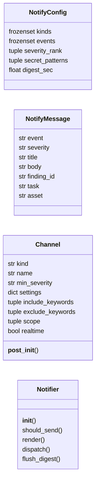
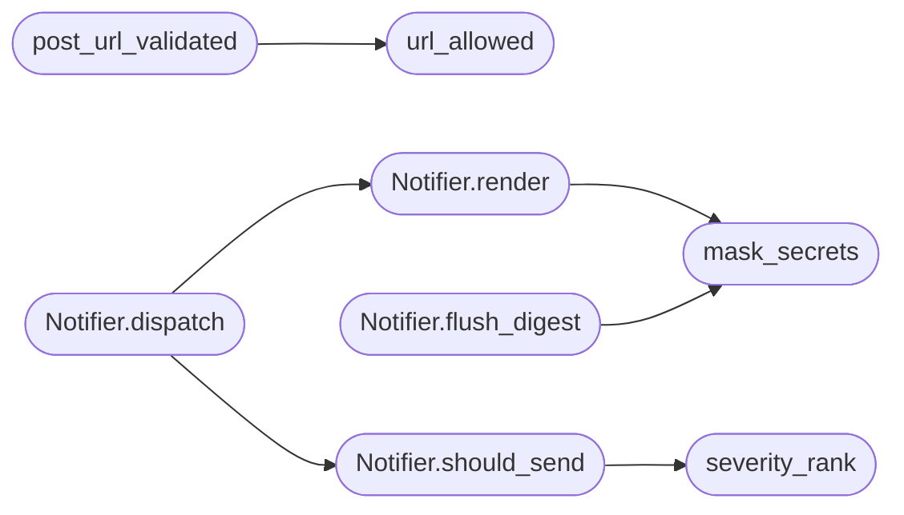

# `modules.notify`

> Source: [modules/notify.py:1](../../modules/notify.py#L1) | language `py` | coverage 100.0% | [API index](../index.md)

Stateless multi-channel notifier for finding events.

Ports the LAZY notify contract. Channels stay stateless so one
instance serves many configurations concurrently. Severity filters
drop noise and secret patterns are masked before dispatch.

## Contents

- **Classes:** [`NotifyConfig`](#notifyconfig), [`NotifyMessage`](#notifymessage), [`Channel`](#channel), [`Notifier`](#notifier)
- **Functions:** [`severity_rank`](#severity_rank), [`mask_secrets`](#mask_secrets), [`url_allowed`](#url_allowed), [`post_url_validated`](#post_url_validated)
- **Constants:** [`CONFIG`](#config)

## Type Diagram



## Call Graph

Solid arrows stay in this module, dashed arrows leave it.



## Classes

<a id="notifyconfig"></a>

### `NotifyConfig`

`class` `dataclass` | [modules/notify.py:15](../../modules/notify.py#L15)

Decorators: `@dataclass(frozen=True, slots=True)`

```python
class NotifyConfig
```

Centralized constants for notification behavior (LAZY parity).

**Attributes**

| Name | Type | Default | Description |
|---|---|---|---|
| [`kinds`](#notifyconfig-kinds) | `frozenset` | `frozenset({'dingtalk', 'feishu', 'wecom', 'webhook', 'telegram', 'email'})` |  |
| [`events`](#notifyconfig-events) | `frozenset` | `frozenset({'finding_created', 'finding_status_changed'})` |  |
| [`severity_rank`](#notifyconfig-severity_rank) | `tuple` | `('low', 'medium', 'high', 'critical')` |  |
| [`secret_patterns`](#notifyconfig-secret_patterns) | `tuple` | `('sk-', 'AKIA', 'xoxb-', 'ghp_', 'xoxp-', 'xoxa-', 'gho_', 'glpat-', '-----BEGIN', 'password=', 'passwd=')` |  |
| [`digest_sec`](#notifyconfig-digest_sec) | `float` | `1800.0` |  |

---

<a id="notifymessage"></a>

### `NotifyMessage`

`class` `dataclass` | [modules/notify.py:173](../../modules/notify.py#L173)

Decorators: `@dataclass`

```python
class NotifyMessage
```

Event payload awaiting channel fan-out.

**Attributes**

| Name | Type | Default | Description |
|---|---|---|---|
| [`event`](#notifymessage-event) | `str` |  |  |
| [`severity`](#notifymessage-severity) | `str` |  |  |
| [`title`](#notifymessage-title) | `str` |  |  |
| [`body`](#notifymessage-body) | `str` | `''` |  |
| [`finding_id`](#notifymessage-finding_id) | `str` | `''` |  |
| [`task`](#notifymessage-task) | `str` | `''` |  |
| [`asset`](#notifymessage-asset) | `str` | `''` |  |

---

<a id="channel"></a>

### `Channel`

`class` `dataclass` | [modules/notify.py:186](../../modules/notify.py#L186)

Decorators: `@dataclass`

```python
class Channel
```

Single destination with its own filter and credentials.

**Attributes**

| Name | Type | Default | Description |
|---|---|---|---|
| [`kind`](#channel-kind) | `str` |  |  |
| [`name`](#channel-name) | `str` |  |  |
| [`min_severity`](#channel-min_severity) | `str` | `'low'` |  |
| [`settings`](#channel-settings) | `dict` | `field(default_factory=dict)` |  |
| [`include_keywords`](#channel-include_keywords) | `tuple` | `()` |  |
| [`exclude_keywords`](#channel-exclude_keywords) | `tuple` | `()` |  |
| [`scope`](#channel-scope) | `tuple` | `()` |  |
| [`realtime`](#channel-realtime) | `bool` | `True` |  |

**Members**

| Member | Kind | Summary |
|---|---|---|
| [`__post_init__`](#channel-__post_init__) | method | Validate channel kind and event compatibility. |

<a id="channel-__post_init__"></a>

#### `Channel.__post_init__`

`method` | [modules/notify.py:198](../../modules/notify.py#L198)

```python
def __post_init__(self) -> None
```

Validate channel kind and event compatibility.

**Raises**

- `ValueError`: (raised in the body, not documented)

---

<a id="notifier"></a>

### `Notifier`

`class` | [modules/notify.py:204](../../modules/notify.py#L204)

```python
class Notifier
```

Filter, render, and dispatch messages across channels.

**Members**

| Member | Kind | Summary |
|---|---|---|
| [`__init__`](#notifier-__init__) | constructor | Initialize with shared notification constants. |
| [`should_send`](#notifier-should_send) | method | Apply event, severity, keyword and scope gates (LAZY parity). |
| [`render`](#notifier-render) | method | Render masked Markdown text for a message. |
| [`dispatch`](#notifier-dispatch) | method | Fan out to eligible channels and journal deliveries. |
| [`flush_digest`](#notifier-flush_digest) | method | Emit one digest per channel when due (default 30m, LAZY parity). |

<a id="notifier-__init__"></a>

#### `Notifier.__init__`

`constructor` | [modules/notify.py:207](../../modules/notify.py#L207)

```python
def __init__(self, config: NotifyConfig = CONFIG) -> None
```

Initialize with shared notification constants.

**Parameters**

| Name | Type | Default | Description |
|---|---|---|---|
| `config` | `NotifyConfig` | `CONFIG` |  |

<a id="notifier-should_send"></a>

#### `Notifier.should_send`

`method` | [modules/notify.py:215](../../modules/notify.py#L215)

```python
def should_send(self, message: NotifyMessage, channel: Channel) -> bool
```

Apply event, severity, keyword and scope gates (LAZY parity).

**Parameters**

| Name | Type | Default | Description |
|---|---|---|---|
| `message` | `NotifyMessage` |  |  |
| `channel` | `Channel` |  |  |

**Returns:** `bool`

*Calls:* [`severity_rank`](#severity_rank)

*Called by:* [`Notifier.dispatch`](#notifier-dispatch)

<a id="notifier-render"></a>

#### `Notifier.render`

`method` | [modules/notify.py:238](../../modules/notify.py#L238)

```python
def render(self, message: NotifyMessage) -> str
```

Render masked Markdown text for a message.

**Parameters**

| Name | Type | Default | Description |
|---|---|---|---|
| `message` | `NotifyMessage` |  |  |

**Returns:** `str`

*Calls:* [`mask_secrets`](#mask_secrets)

*Called by:* [`Notifier.dispatch`](#notifier-dispatch)

<a id="notifier-dispatch"></a>

#### `Notifier.dispatch`

`method` | [modules/notify.py:244](../../modules/notify.py#L244)

```python
def dispatch(self, message: NotifyMessage, channels: list[Channel]) -> list[dict]
```

Fan out to eligible channels and journal deliveries.

**Parameters**

| Name | Type | Default | Description |
|---|---|---|---|
| `message` | `NotifyMessage` |  |  |
| `channels` | `list[Channel]` |  |  |

**Returns:** `list[dict]`

*Calls:* [`Notifier.render`](#notifier-render), [`Notifier.should_send`](#notifier-should_send)

<a id="notifier-flush_digest"></a>

#### `Notifier.flush_digest`

`method` | [modules/notify.py:260](../../modules/notify.py#L260)

```python
def flush_digest(self, max_age_sec: float = 0.0) -> list[dict]
```

Emit one digest per channel when due (default 30m, LAZY parity).

**Parameters**

| Name | Type | Default | Description |
|---|---|---|---|
| `max_age_sec` | `float` | `0.0` |  |

**Returns:** `list[dict]`

*Calls:* [`mask_secrets`](#mask_secrets)

---

## Functions

<a id="severity_rank"></a>

### `severity_rank`

`function` | [modules/notify.py:31](../../modules/notify.py#L31)

```python
def severity_rank(severity: str, config: NotifyConfig = CONFIG) -> int
```

Return the comparable order for a severity label.

**Parameters**

| Name | Type | Default | Description |
|---|---|---|---|
| `severity` | `str` |  |  |
| `config` | `NotifyConfig` | `CONFIG` |  |

**Returns:** `int`

*Called by:* [`Notifier.should_send`](#notifier-should_send)

---

<a id="mask_secrets"></a>

### `mask_secrets`

`function` | [modules/notify.py:39](../../modules/notify.py#L39)

```python
def mask_secrets(text: str, config: NotifyConfig = CONFIG) -> str
```

Replace known secret prefixes with a redaction marker.

**Parameters**

| Name | Type | Default | Description |
|---|---|---|---|
| `text` | `str` |  |  |
| `config` | `NotifyConfig` | `CONFIG` |  |

**Returns:** `str`

*Called by:* [`Notifier.flush_digest`](#notifier-flush_digest), [`Notifier.render`](#notifier-render)

---

<a id="url_allowed"></a>

### `url_allowed`

`function` | [modules/notify.py:57](../../modules/notify.py#L57)

```python
def url_allowed(url: str) -> tuple[bool, str]
```

SSRF dial-guard for webhook delivery (LAZY parity).

Denies cloud metadata hosts/IPs always, denies loopback/link-local/
private/unspecified/multicast/reserved unless
``LAZY_NOTIFY_ALLOW_LOCAL=1``, denies userinfo credentials in the URL,
and resolves DNS names to catch metadata-address aliases. Redirects
must be re-checked by the caller with this same function.

Returns (allowed, reason).

**Parameters**

| Name | Type | Default | Description |
|---|---|---|---|
| `url` | `str` |  |  |

**Returns:** `tuple[bool, str]`

*Called by:* [`post_url_validated`](#post_url_validated)

---

<a id="post_url_validated"></a>

### `post_url_validated`

`function` | [modules/notify.py:145](../../modules/notify.py#L145)

```python
def post_url_validated(url: str, data: bytes, timeout: float = 8) -> None
```

POST data to a webhook URL after SSRF validation, guarding redirects.

Each redirect target is re-validated with [`url_allowed`](#url_allowed); a
denied redirect aborts without following it. Raises ValueError on a
denied URL and OSError on transport failure.

**Parameters**

| Name | Type | Default | Description |
|---|---|---|---|
| `url` | `str` |  |  |
| `data` | `bytes` |  |  |
| `timeout` | `float` | `8` |  |

**Raises**

- `ValueError`: (raised in the body, not documented)

*Calls:* [`url_allowed`](#url_allowed)

---

## Constants

<a id="config"></a>

### `CONFIG`

`constant` | [modules/notify.py:28](../../modules/notify.py#L28)

```python
CONFIG = NotifyConfig()
```

---
