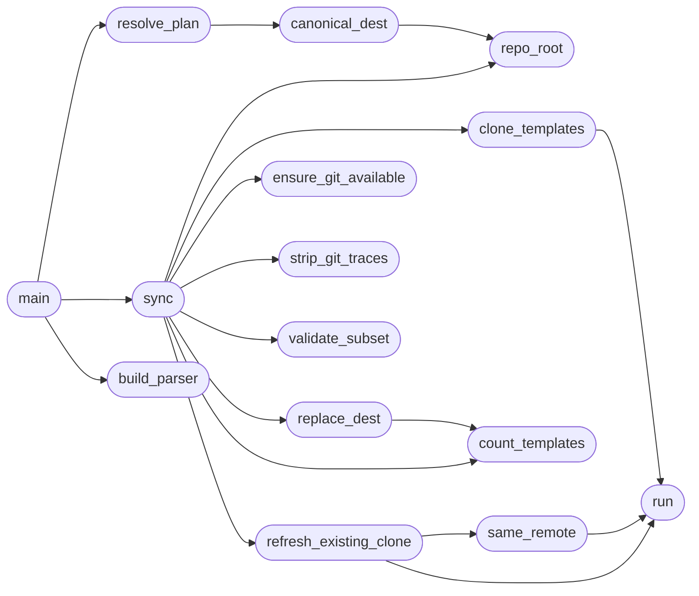

# `modules.nuclei_templates_sync`

> Source: [modules/nuclei_templates_sync.py:1](../../modules/nuclei_templates_sync.py#L1) | language `py` | coverage 100.0% | [API index](../index.md)

Sync community Nuclei template collections into the LazyOwn marketplace.

Clones each registered source into a temporary staging directory, removes
every ``.git`` trace to avoid mixed-repository contamination, then replaces
the canonical destination with the fresh working tree.

New template collections are registered in `[`SOURCES`](#sources)` (skill
``/marketplace-contributor`` Step 4c). Single-file tools, implants, and
runnable scanners are NOT sources here; they ship as plain lazyaddons.

Usage:
    python3 nuclei_templates_sync.py
    python3 nuclei_templates_sync.py --source nuclei-templates --refresh-existing
    python3 nuclei_templates_sync.py --source nuclei-templates --dest ~/nuclei-templates

## Contents

- **Functions:** [`repo_root`](#repo_root), [`canonical_dest`](#canonical_dest), [`run`](#run), [`ensure_git_available`](#ensure_git_available), [`clone_templates`](#clone_templates), [`strip_git_traces`](#strip_git_traces), [`count_templates`](#count_templates), [`replace_dest`](#replace_dest), [`same_remote`](#same_remote), [`refresh_existing_clone`](#refresh_existing_clone), [`validate_subset`](#validate_subset), [`build_parser`](#build_parser), [`sync`](#sync), [`resolve_plan`](#resolve_plan), [`main`](#main)
- **Constants:** [`SOURCES`](#sources), [`MIN_EXPECTED_TEMPLATES`](#min_expected_templates), [`CLONE_TIMEOUT`](#clone_timeout), [`VALIDATE_TIMEOUT`](#validate_timeout)

## Call Graph

Solid arrows stay in this module, dashed arrows leave it.



## Functions

<a id="repo_root"></a>

### `repo_root`

`function` | [modules/nuclei_templates_sync.py:39](../../modules/nuclei_templates_sync.py#L39)

```python
def repo_root() -> Path
```

Return the LazyOwn repository root derived from this file location.

**Returns:** `Path` - Repository root path (parent of the ``modules/`` directory).

*Called by:* [`canonical_dest`](#canonical_dest), [`sync`](#sync)

---

<a id="canonical_dest"></a>

### `canonical_dest`

`function` | [modules/nuclei_templates_sync.py:48](../../modules/nuclei_templates_sync.py#L48)

```python
def canonical_dest(subdir: str) -> Path
```

Return the canonical marketplace destination for a source.

**Parameters**

| Name | Type | Default | Description |
|---|---|---|---|
| `subdir` | `str` |  | Source subdirectory under ``external/.exploit``. |

**Returns:** `Path` - ``<repo>/external/.exploit/<subdir>`` path.

*Calls:* [`repo_root`](#repo_root)

*Called by:* [`resolve_plan`](#resolve_plan)

---

<a id="run"></a>

### `run`

`function` | [modules/nuclei_templates_sync.py:60](../../modules/nuclei_templates_sync.py#L60)

```python
def run(argv: list[str], cwd: Path | None = None) -> subprocess.CompletedProcess[str]
```

Run a subprocess capturing output as text without raising.

**Parameters**

| Name | Type | Default | Description |
|---|---|---|---|
| `argv` | `list[str]` |  | Command and arguments to execute. |
| `cwd` | `Path \| None` | `None` | Optional working directory. |

**Returns:** `subprocess.CompletedProcess[str]` - Completed process handle with captured stdout and stderr.

*Called by:* [`clone_templates`](#clone_templates), [`refresh_existing_clone`](#refresh_existing_clone), [`same_remote`](#same_remote)

---

<a id="ensure_git_available"></a>

### `ensure_git_available`

`function` | [modules/nuclei_templates_sync.py:73](../../modules/nuclei_templates_sync.py#L73)

```python
def ensure_git_available() -> None
```

Abort with a clear message when the git binary is missing.

**Raises**

- `SystemExit`: Always raised with code 1 when git is not on PATH.

*Called by:* [`sync`](#sync)

---

<a id="clone_templates"></a>

### `clone_templates`

`function` | [modules/nuclei_templates_sync.py:84](../../modules/nuclei_templates_sync.py#L84)

```python
def clone_templates(repo: str, staging: Path) -> tuple[Path, str]
```

Shallow-clone the template repository into the staging directory.

**Parameters**

| Name | Type | Default | Description |
|---|---|---|---|
| `repo` | `str` |  | Git URL of the template collection. |
| `staging` | `Path` |  | Empty staging directory that receives the clone. |

**Returns:** `tuple[Path, str]` - Tuple of the cloned tree path and its HEAD commit hash.

**Raises**

- `SystemExit`: Raised with code 1 when the clone fails.

*Calls:* [`run`](#run)

*Called by:* [`sync`](#sync)

---

<a id="strip_git_traces"></a>

### `strip_git_traces`

`function` | [modules/nuclei_templates_sync.py:113](../../modules/nuclei_templates_sync.py#L113)

```python
def strip_git_traces(tree: Path) -> int
```

Remove every .git file or directory under the staged tree.

**Parameters**

| Name | Type | Default | Description |
|---|---|---|---|
| `tree` | `Path` |  | Staged working tree to clean. |

**Returns:** `int` - Number of .git traces removed.

*Called by:* [`sync`](#sync)

---

<a id="count_templates"></a>

### `count_templates`

`function` | [modules/nuclei_templates_sync.py:132](../../modules/nuclei_templates_sync.py#L132)

```python
def count_templates(tree: Path) -> int
```

Count Nuclei template files under a directory tree.

**Parameters**

| Name | Type | Default | Description |
|---|---|---|---|
| `tree` | `Path` |  | Directory tree to scan. |

**Returns:** `int` - Number of ``*.yaml`` files found.

*Called by:* [`replace_dest`](#replace_dest), [`sync`](#sync)

---

<a id="replace_dest"></a>

### `replace_dest`

`function` | [modules/nuclei_templates_sync.py:144](../../modules/nuclei_templates_sync.py#L144)

```python
def replace_dest(src: Path, dest: Path, expected: str) -> None
```

Atomically replace the destination with the staged tree contents.

**Parameters**

| Name | Type | Default | Description |
|---|---|---|---|
| `src` | `Path` |  | Staged clean tree acting as the source. |
| `dest` | `Path` |  | Destination directory to replace. |
| `expected` | `str` |  | Expected destination directory name guard. |

**Raises**

- `SystemExit`: Raised with code 1 when the destination name guard fails or the staged tree holds fewer templates than expected.

*Calls:* [`count_templates`](#count_templates)

*Called by:* [`sync`](#sync)

---

<a id="same_remote"></a>

### `same_remote`

`function` | [modules/nuclei_templates_sync.py:168](../../modules/nuclei_templates_sync.py#L168)

```python
def same_remote(path: Path, repo: str) -> bool
```

Check whether an existing clone points at the expected remote.

**Parameters**

| Name | Type | Default | Description |
|---|---|---|---|
| `path` | `Path` |  | Local clone to inspect. |
| `repo` | `str` |  | Expected upstream repository URL. |

**Returns:** `bool` - True when the clone origin matches the expected remote.

*Calls:* [`run`](#run)

*Called by:* [`refresh_existing_clone`](#refresh_existing_clone)

---

<a id="refresh_existing_clone"></a>

### `refresh_existing_clone`

`function` | [modules/nuclei_templates_sync.py:188](../../modules/nuclei_templates_sync.py#L188)

```python
def refresh_existing_clone(path: Path, repo: str) -> bool
```

Fast-forward an existing clean clone of the same remote.

**Parameters**

| Name | Type | Default | Description |
|---|---|---|---|
| `path` | `Path` |  | Local clone candidate. |
| `repo` | `str` |  | Expected upstream repository URL. |

**Returns:** `bool` - True when the clone was fast-forwarded successfully.

*Calls:* [`run`](#run), [`same_remote`](#same_remote)

*Called by:* [`sync`](#sync)

---

<a id="validate_subset"></a>

### `validate_subset`

`function` | [modules/nuclei_templates_sync.py:209](../../modules/nuclei_templates_sync.py#L209)

```python
def validate_subset(dest: Path, subset: str) -> bool | None
```

Validate a template subset with the nuclei binary when available.

**Parameters**

| Name | Type | Default | Description |
|---|---|---|---|
| `dest` | `Path` |  | Destination directory holding the synced templates. |
| `subset` | `str` |  | Relative subset directory to validate. |

**Returns:** `bool | None` - True on success, False on validation failure, None when the nuclei
binary or the subset directory is unavailable.

*Called by:* [`sync`](#sync)

---

<a id="build_parser"></a>

### `build_parser`

`function` | [modules/nuclei_templates_sync.py:238](../../modules/nuclei_templates_sync.py#L238)

```python
def build_parser() -> argparse.ArgumentParser
```

Build the command line parser for the sync script.

**Returns:** `argparse.ArgumentParser` - Configured argument parser.

*Called by:* [`main`](#main)

---

<a id="sync"></a>

### `sync`

`function` | [modules/nuclei_templates_sync.py:263](../../modules/nuclei_templates_sync.py#L263)

```python
def sync(name: str, repo: str, dest: Path, refresh_existing: bool, skip_validate: bool) -> dict[str, object]
```

Clone, clean, and install one template source.

**Parameters**

| Name | Type | Default | Description |
|---|---|---|---|
| `name` | `str` |  | Registered source name. |
| `repo` | `str` |  | Template collection git URL. |
| `dest` | `Path` |  | Destination directory to replace. |
| `refresh_existing` | `bool` |  | Fast-forward existing clean clones as well. |
| `skip_validate` | `bool` |  | Skip the nuclei validation step. |

**Returns:** `dict[str, object]` - Summary dictionary with source, commit, counts, destination,
refreshed clones, removed git traces, and validation outcome.

*Calls:* [`clone_templates`](#clone_templates), [`count_templates`](#count_templates), [`ensure_git_available`](#ensure_git_available), [`refresh_existing_clone`](#refresh_existing_clone), [`replace_dest`](#replace_dest), [`repo_root`](#repo_root), [`strip_git_traces`](#strip_git_traces), [`validate_subset`](#validate_subset)

*Called by:* [`main`](#main)

---

<a id="resolve_plan"></a>

### `resolve_plan`

`function` | [modules/nuclei_templates_sync.py:308](../../modules/nuclei_templates_sync.py#L308)

```python
def resolve_plan(args: argparse.Namespace) -> list[tuple[str, str, Path]]
```

Resolve the requested sources into (name, repo, dest) work items.

**Parameters**

| Name | Type | Default | Description |
|---|---|---|---|
| `args` | `argparse.Namespace` |  | Parsed command line arguments. |

**Returns:** `list[tuple[str, str, Path]]` - Work item list, one tuple per source to sync.

**Raises**

- `SystemExit`: Raised with code 2 on unknown sources or overrides combined with multiple sources.

*Calls:* [`canonical_dest`](#canonical_dest)

*Called by:* [`main`](#main)

---

<a id="main"></a>

### `main`

`function` | [modules/nuclei_templates_sync.py:337](../../modules/nuclei_templates_sync.py#L337)

```python
def main(argv: list[str] | None = None) -> int
```

Entry point for the template sync script.

**Parameters**

| Name | Type | Default | Description |
|---|---|---|---|
| `argv` | `list[str] \| None` | `None` | Optional argument list for testing. |

**Returns:** `int` - Process exit code, 0 on success.

*Calls:* [`build_parser`](#build_parser), [`resolve_plan`](#resolve_plan), [`sync`](#sync)

---

## Constants

<a id="sources"></a>

### `SOURCES`

`constant` | [modules/nuclei_templates_sync.py:27](../../modules/nuclei_templates_sync.py#L27)

```python
SOURCES: dict[str, dict[str, str]]
```

---

<a id="min_expected_templates"></a>

### `MIN_EXPECTED_TEMPLATES`

`constant` | [modules/nuclei_templates_sync.py:34](../../modules/nuclei_templates_sync.py#L34)

```python
MIN_EXPECTED_TEMPLATES = 1000
```

---

<a id="clone_timeout"></a>

### `CLONE_TIMEOUT`

`constant` | [modules/nuclei_templates_sync.py:35](../../modules/nuclei_templates_sync.py#L35)

```python
CLONE_TIMEOUT = 600
```

---

<a id="validate_timeout"></a>

### `VALIDATE_TIMEOUT`

`constant` | [modules/nuclei_templates_sync.py:36](../../modules/nuclei_templates_sync.py#L36)

```python
VALIDATE_TIMEOUT = 120
```

---
