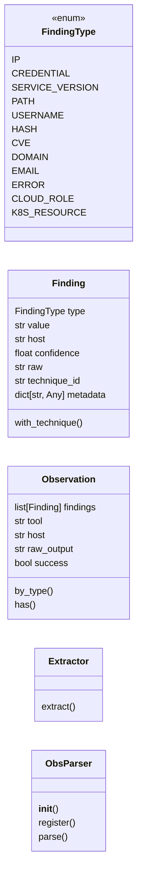
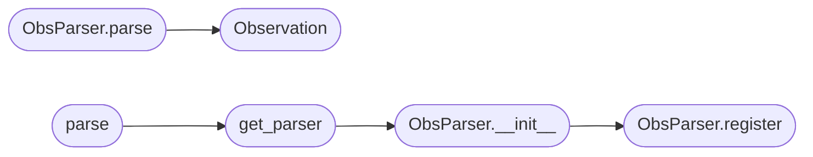

# `modules.obs_parser`

> Source: [modules/obs_parser.py:1](../../modules/obs_parser.py#L1) | language `py` | coverage 60.0% | [API index](../index.md)

modules/obs_parser.py ====================== Observation parser: extracts structured findings from raw tool output.

Converts unstructured text (nmap, gobuster, crackmapexec, enum4linux, etc.)
into typed Finding objects that the WorldModel can ingest directly.

Extractors are independent, additive, and follow Open/Closed:
  - Add a new extractor by subclassing Extractor and registering it.
  - Existing extractors are never modified to support new patterns.

Design
------
- Single Responsibility : each Extractor owns one finding type
- Open/Closed           : new types via new Extractor subclass
- Liskov                : all Extractor subclasses honour the same contract
- Interface Segregation : consumers only see FindingType, Finding, Observation
- Dependency Inversion  : ObsParser depends on Extractor abstraction

Usage
-----
    from modules.obs_parser import ObsParser

    parser = ObsParser()
    obs    = parser.parse(nmap_output, host="10.10.11.78", tool="nmap")

    for finding in obs.findings:
        print(finding.type, finding.value, finding.confidence)

## Contents

- **Classes:** [`Finding`](#finding), [`Observation`](#observation), [`Extractor`](#extractor), [`ObsParser`](#obsparser)
- **Enums:** [`FindingType`](#findingtype)
- **Functions:** [`get_parser`](#get_parser), [`parse`](#parse)

## Type Diagram



## Call Graph

Solid arrows stay in this module, dashed arrows leave it.



## Classes

<a id="finding"></a>

### `Finding`

`class` `dataclass` | [modules/obs_parser.py:79](../../modules/obs_parser.py#L79)

Decorators: `@dataclass`

```python
class Finding
```

**Attributes**

| Name | Type | Default | Description |
|---|---|---|---|
| [`type`](#finding-type) | `FindingType` |  |  |
| [`value`](#finding-value) | `str` |  |  |
| [`host`](#finding-host) | `str` | `''` |  |
| [`confidence`](#finding-confidence) | `float` | `1.0` |  |
| [`raw`](#finding-raw) | `str` | `''` |  |
| [`technique_id`](#finding-technique_id) | `str` | `''` |  |
| [`metadata`](#finding-metadata) | `dict[str, Any]` | `field(default_factory=dict)` |  |

**Members**

| Member | Kind | Summary |
|---|---|---|
| [`with_technique`](#finding-with_technique) | method | Fill `[`technique_id`](#finding-technique_id)` from a vulnerability-class mapping lens. |

<a id="finding-with_technique"></a>

#### `Finding.with_technique`

`method` | [modules/obs_parser.py:88](../../modules/obs_parser.py#L88)

```python
def with_technique(self, mapping: dict[str, str] | None = None) -> Finding
```

Fill `[`technique_id`](#finding-technique_id)` from a vulnerability-class mapping lens.

**Parameters**

| Name | Type | Default | Description |
|---|---|---|---|
| `mapping` | `dict[str, str] \| None` | `None` | Optional override of ``killchain.VULNCLASS_TECHNIQUES``. |

**Returns:** `Finding` - The same finding updated in place for call chaining.

---

<a id="observation"></a>

### `Observation`

`class` `dataclass` | [modules/obs_parser.py:107](../../modules/obs_parser.py#L107)

Decorators: `@dataclass`

```python
class Observation
```

**Attributes**

| Name | Type | Default | Description |
|---|---|---|---|
| [`findings`](#observation-findings) | `list[Finding]` | `field(default_factory=list)` |  |
| [`tool`](#observation-tool) | `str` | `''` |  |
| [`host`](#observation-host) | `str` | `''` |  |
| [`raw_output`](#observation-raw_output) | `str` | `''` |  |
| [`success`](#observation-success) | `bool` | `True` |  |

**Members**

| Member | Kind | Summary |
|---|---|---|
| [`by_type`](#observation-by_type) | method |  |
| [`has`](#observation-has) | method |  |

<a id="observation-by_type"></a>

#### `Observation.by_type`

`method` | [modules/obs_parser.py:114](../../modules/obs_parser.py#L114)

```python
def by_type(self, ftype: FindingType) -> list[Finding]
```

**Parameters**

| Name | Type | Default | Description |
|---|---|---|---|
| `ftype` | `FindingType` |  |  |

**Returns:** `list[Finding]`

<a id="observation-has"></a>

#### `Observation.has`

`method` | [modules/obs_parser.py:117](../../modules/obs_parser.py#L117)

```python
def has(self, ftype: FindingType) -> bool
```

**Parameters**

| Name | Type | Default | Description |
|---|---|---|---|
| `ftype` | `FindingType` |  |  |

**Returns:** `bool`

---

<a id="extractor"></a>

### `Extractor`

`class` `abstract` | [modules/obs_parser.py:126](../../modules/obs_parser.py#L126)

```python
class Extractor(ABC)
```

Bases: `ABC`

Base class for a single finding-type extractor.

**Members**

| Member | Kind | Summary |
|---|---|---|
| [`extract`](#extractor-extract) | method | Return all findings of this type found in *text*. |

<a id="extractor-extract"></a>

#### `Extractor.extract`

`method` `abstract` | [modules/obs_parser.py:130](../../modules/obs_parser.py#L130)

Decorators: `@abstractmethod`

```python
def extract(self, text: str, host: str) -> list[Finding]
```

Return all findings of this type found in *text*.

**Parameters**

| Name | Type | Default | Description |
|---|---|---|---|
| `text` | `str` |  |  |
| `host` | `str` |  |  |

**Returns:** `list[Finding]`

---

<a id="obsparser"></a>

### `ObsParser`

`class` | [modules/obs_parser.py:454](../../modules/obs_parser.py#L454)

```python
class ObsParser
```

Parses raw tool output into an Observation containing typed Findings.

Each registered Extractor runs independently. The order does not matter.
New extractors can be added via ObsParser.register(extractor).

**Members**

| Member | Kind | Summary |
|---|---|---|
| [`__init__`](#obsparser-__init__) | constructor |  |
| [`register`](#obsparser-register) | method | Register an additional Extractor (Open/Closed extension point). |
| [`parse`](#obsparser-parse) | method | Parse *output* and return an Observation. |

<a id="obsparser-__init__"></a>

#### `ObsParser.__init__`

`constructor` | [modules/obs_parser.py:462](../../modules/obs_parser.py#L462)

```python
def __init__(self) -> None
```

*Calls:* [`ObsParser.register`](#obsparser-register)

*Called by:* [`IntelligenceEngine.collect_from_tool`](modules.intelligence_engine.py.md#intelligenceengine-collect_from_tool), [`get_parser`](#get_parser)

<a id="obsparser-register"></a>

#### `ObsParser.register`

`method` | [modules/obs_parser.py:481](../../modules/obs_parser.py#L481)

```python
def register(self, extractor: Extractor) -> None
```

Register an additional Extractor (Open/Closed extension point).

**Parameters**

| Name | Type | Default | Description |
|---|---|---|---|
| `extractor` | `Extractor` |  |  |

*Called by:* [`ObsParser.__init__`](#obsparser-__init__)

<a id="obsparser-parse"></a>

#### `ObsParser.parse`

`method` | [modules/obs_parser.py:485](../../modules/obs_parser.py#L485)

```python
def parse(self, output: str, host: str = '', tool: str = '') -> Observation
```

Parse *output* and return an Observation.

**Parameters**

| Name | Type | Default | Description |
|---|---|---|---|
| `output` | `str` |  |  |
| `host` | `str` | `''` |  |
| `tool` | `str` | `''` |  |

**Returns:** `Observation`

*Calls:* [`Observation`](#observation)

*Called by:* [`IntelligenceEngine.collect_from_tool`](modules.intelligence_engine.py.md#intelligenceengine-collect_from_tool)

---

## Enums

<a id="findingtype"></a>

### `FindingType`

`enum` | [modules/obs_parser.py:63](../../modules/obs_parser.py#L63)

```python
class FindingType(StrEnum)
```

Bases: `StrEnum`

**Attributes**

| Name | Type | Default | Description |
|---|---|---|---|
| [`IP`](#findingtype-ip) |  | `'ip'` |  |
| [`CREDENTIAL`](#findingtype-credential) |  | `'credential'` |  |
| [`SERVICE_VERSION`](#findingtype-service_version) |  | `'service_version'` |  |
| [`PATH`](#findingtype-path) |  | `'path'` |  |
| [`USERNAME`](#findingtype-username) |  | `'username'` |  |
| [`HASH`](#findingtype-hash) |  | `'hash'` |  |
| [`CVE`](#findingtype-cve) |  | `'cve'` |  |
| [`DOMAIN`](#findingtype-domain) |  | `'domain'` |  |
| [`EMAIL`](#findingtype-email) |  | `'email'` |  |
| [`ERROR`](#findingtype-error) |  | `'error'` |  |
| [`CLOUD_ROLE`](#findingtype-cloud_role) |  | `'cloud_role'` |  |
| [`K8S_RESOURCE`](#findingtype-k8s_resource) |  | `'k8s_resource'` |  |

---

## Functions

<a id="get_parser"></a>

### `get_parser`

`function` | [modules/obs_parser.py:531](../../modules/obs_parser.py#L531)

```python
def get_parser() -> ObsParser
```

Return (or create) the module-level singleton ObsParser.

**Returns:** `ObsParser`

*Calls:* [`ObsParser.__init__`](#obsparser-__init__)

*Called by:* [`parse`](#parse), [`OperationManager.start`](modules.operation.py.md#operationmanager-start)

---

<a id="parse"></a>

### `parse`

`function` | [modules/obs_parser.py:539](../../modules/obs_parser.py#L539)

```python
def parse(output: str, host: str = '', tool: str = '') -> Observation
```

Module-level convenience wrapper.

**Parameters**

| Name | Type | Default | Description |
|---|---|---|---|
| `output` | `str` |  |  |
| `host` | `str` | `''` |  |
| `tool` | `str` | `''` |  |

**Returns:** `Observation`

*Calls:* [`get_parser`](#get_parser)

---
