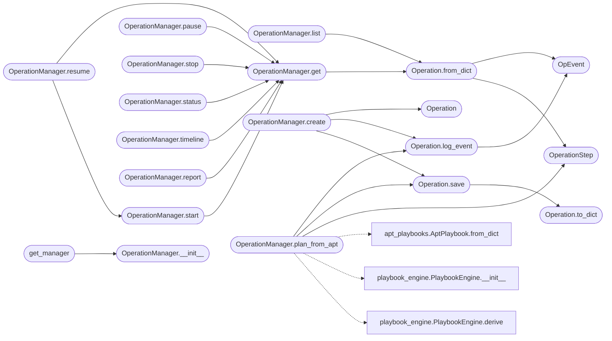

# `modules.operation`

> Source: [modules/operation.py:1](../../modules/operation.py#L1) | language `py` | coverage 33.3% | [API index](../index.md)

Caldera-style operation lifecycle: create, start, pause, resume, stop, status.

Operations are persistent, time-bounded adversary emulations that wrap
the existing [`modules.playbook_engine.PlaybookEngine`](modules.playbook_engine.py.md#playbookengine) and bridge
its output into the [`modules.world_model.WorldModel`](modules.world_model.py.md#worldmodel) and
[`modules.obs_parser.ObsParser`](modules.obs_parser.py.md#obsparser) fact store.

Each operation has:
- A name and target
- A list of steps (PlaybookStep from playbook_engine)
- A status (planned, running, paused, completed, stopped, failed)
- An event log (timeline)
- A produced-facts index
- A TTP coverage map (technique_id -> status)

Operations persist to ``sessions/operations/<id>.json`` so they survive
shell restarts and can be resumed across shifts.

## Contents

- **Classes:** [`OpEvent`](#opevent), [`OperationStep`](#operationstep), [`Operation`](#operation), [`OperationManager`](#operationmanager)
- **Enums:** [`OperationStatus`](#operationstatus)
- **Functions:** [`get_manager`](#get_manager)

## Type Diagram

```mermaid
classDiagram
    direction LR
    class OperationStatus
    <<enum>> OperationStatus
    OperationStatus : PLANNED
    OperationStatus : RUNNING
    OperationStatus : PAUSED
    OperationStatus : COMPLETED
    OperationStatus : STOPPED
    OperationStatus : FAILED
    class OpEvent
    OpEvent : str timestamp
    OpEvent : int step_index
    OpEvent : str step_name
    OpEvent : str status
    OpEvent : str summary
    OpEvent : int findings_count
    OpEvent : str error
    class OperationStep
    OperationStep : int step_index
    OperationStep : str name
    OperationStep : str technique_id
    OperationStep : str tactic
    OperationStep : str command
    OperationStep : str description
    OperationStep : str status
    OperationStep : str started_at
    OperationStep : str finished_at
    OperationStep : str output_excerpt
    OperationStep : int findings_count
    OperationStep : str error
    class Operation
    Operation : str id
    Operation : str name
    Operation : str target
    Operation : str apt_name
    Operation : str status
    Operation : str created_at
    Operation : str started_at
    Operation : str finished_at
    Operation : list[OperationStep] steps
    Operation : list[OpEvent] events
    Operation : list[dict[str, Any]] facts_produced
    Operation : dict[str, str] ttp_coverage
    Operation : str description
    Operation : to_dict()
    Operation : from_dict()
    Operation : save()
    Operation : log_event()
    Operation : record_facts()
    class OperationManager
    OperationManager : __init__()
    OperationManager : list()
    OperationManager : get()
    OperationManager : create()
    OperationManager : plan_from_apt()
    OperationManager : start()
    OperationManager : pause()
    OperationManager : resume()
    OperationManager : stop()
    OperationManager : status()
    OperationManager : timeline()
    OperationManager : report()
```



## Call Graph

Solid arrows stay in this module, dashed arrows leave it.



## Classes

<a id="opevent"></a>

### `OpEvent`

`class` `dataclass` | [modules/operation.py:52](../../modules/operation.py#L52)

Decorators: `@dataclass`

```python
class OpEvent
```

**Attributes**

| Name | Type | Default | Description |
|---|---|---|---|
| [`timestamp`](#opevent-timestamp) | `str` |  |  |
| [`step_index`](#opevent-step_index) | `int` |  |  |
| [`step_name`](#opevent-step_name) | `str` |  |  |
| [`status`](#opevent-status) | `str` |  |  |
| [`summary`](#opevent-summary) | `str` |  |  |
| [`findings_count`](#opevent-findings_count) | `int` | `0` |  |
| [`error`](#opevent-error) | `str` | `''` |  |

---

<a id="operationstep"></a>

### `OperationStep`

`class` `dataclass` | [modules/operation.py:63](../../modules/operation.py#L63)

Decorators: `@dataclass`

```python
class OperationStep
```

**Attributes**

| Name | Type | Default | Description |
|---|---|---|---|
| [`step_index`](#operationstep-step_index) | `int` |  |  |
| [`name`](#operationstep-name) | `str` |  |  |
| [`technique_id`](#operationstep-technique_id) | `str` |  |  |
| [`tactic`](#operationstep-tactic) | `str` |  |  |
| [`command`](#operationstep-command) | `str` |  |  |
| [`description`](#operationstep-description) | `str` | `''` |  |
| [`status`](#operationstep-status) | `str` | `'pending'` |  |
| [`started_at`](#operationstep-started_at) | `str` | `''` |  |
| [`finished_at`](#operationstep-finished_at) | `str` | `''` |  |
| [`output_excerpt`](#operationstep-output_excerpt) | `str` | `''` |  |
| [`findings_count`](#operationstep-findings_count) | `int` | `0` |  |
| [`error`](#operationstep-error) | `str` | `''` |  |

---

<a id="operation"></a>

### `Operation`

`class` `dataclass` | [modules/operation.py:79](../../modules/operation.py#L79)

Decorators: `@dataclass`

```python
class Operation
```

**Attributes**

| Name | Type | Default | Description |
|---|---|---|---|
| [`id`](#operation-id) | `str` |  |  |
| [`name`](#operation-name) | `str` |  |  |
| [`target`](#operation-target) | `str` |  |  |
| [`apt_name`](#operation-apt_name) | `str` |  |  |
| [`status`](#operation-status) | `str` | `OperationStatus.PLANNED.value` |  |
| [`created_at`](#operation-created_at) | `str` | `field(default_factory=lambda: datetime.now().isoformat())` |  |
| [`started_at`](#operation-started_at) | `str` | `''` |  |
| [`finished_at`](#operation-finished_at) | `str` | `''` |  |
| [`steps`](#operation-steps) | `list[OperationStep]` | `field(default_factory=list)` |  |
| [`events`](#operation-events) | `list[OpEvent]` | `field(default_factory=list)` |  |
| [`facts_produced`](#operation-facts_produced) | `list[dict[str, Any]]` | `field(default_factory=list)` |  |
| [`ttp_coverage`](#operation-ttp_coverage) | `dict[str, str]` | `field(default_factory=dict)` |  |
| [`description`](#operation-description) | `str` | `''` |  |

**Members**

| Member | Kind | Summary |
|---|---|---|
| [`to_dict`](#operation-to_dict) | method |  |
| [`from_dict`](#operation-from_dict) | classmethod |  |
| [`save`](#operation-save) | method |  |
| [`log_event`](#operation-log_event) | method |  |
| [`record_facts`](#operation-record_facts) | method |  |

<a id="operation-to_dict"></a>

#### `Operation.to_dict`

`method` | [modules/operation.py:98](../../modules/operation.py#L98)

```python
def to_dict(self) -> dict
```

**Returns:** `dict`

*Called by:* [`Operation.save`](#operation-save)

<a id="operation-from_dict"></a>

#### `Operation.from_dict`

`classmethod` | [modules/operation.py:116](../../modules/operation.py#L116)

Decorators: `@classmethod`

```python
def from_dict(cls, d: dict) -> Operation
```

**Parameters**

| Name | Type | Default | Description |
|---|---|---|---|
| `d` | `dict` |  |  |

**Returns:** `Operation`

*Calls:* [`OpEvent`](#opevent), [`OperationStep`](#operationstep)

*Called by:* [`OperationManager.get`](#operationmanager-get), [`OperationManager.list`](#operationmanager-list)

<a id="operation-save"></a>

#### `Operation.save`

`method` | [modules/operation.py:134](../../modules/operation.py#L134)

```python
def save(self) -> None
```

*Calls:* [`Operation.to_dict`](#operation-to_dict)

*Called by:* [`OperationManager.create`](#operationmanager-create), [`OperationManager.plan_from_apt`](#operationmanager-plan_from_apt)

<a id="operation-log_event"></a>

#### `Operation.log_event`

`method` | [modules/operation.py:143](../../modules/operation.py#L143)

```python
def log_event(self, step_index: int, step_name: str, status: str, summary: str, findings_count: int = 0, error: str = '') -> None
```

**Parameters**

| Name | Type | Default | Description |
|---|---|---|---|
| `step_index` | `int` |  |  |
| `step_name` | `str` |  |  |
| `status` | `str` |  |  |
| `summary` | `str` |  |  |
| `findings_count` | `int` | `0` |  |
| `error` | `str` | `''` |  |

*Calls:* [`OpEvent`](#opevent)

*Called by:* [`OperationManager.create`](#operationmanager-create), [`OperationManager.plan_from_apt`](#operationmanager-plan_from_apt)

<a id="operation-record_facts"></a>

#### `Operation.record_facts`

`method` | [modules/operation.py:164](../../modules/operation.py#L164)

```python
def record_facts(self, findings: list[dict[str, Any]]) -> None
```

**Parameters**

| Name | Type | Default | Description |
|---|---|---|---|
| `findings` | `list[dict[str, Any]]` |  |  |

---

<a id="operationmanager"></a>

### `OperationManager`

`class` | [modules/operation.py:180](../../modules/operation.py#L180)

```python
class OperationManager
```

Persistent store and executor for Operation objects.

**Members**

| Member | Kind | Summary |
|---|---|---|
| [`__init__`](#operationmanager-__init__) | constructor |  |
| [`list`](#operationmanager-list) | method | List all persisted operations. |
| [`get`](#operationmanager-get) | method |  |
| [`create`](#operationmanager-create) | method | Create a new planned operation. |
| [`plan_from_apt`](#operationmanager-plan_from_apt) | method | Populate steps from an APT playbook YAML (or fall back to a derived MITRE playbook). |
| [`start`](#operationmanager-start) | method | Start or resume a planned operation. |
| [`pause`](#operationmanager-pause) | method |  |
| [`resume`](#operationmanager-resume) | method |  |
| [`stop`](#operationmanager-stop) | method |  |
| [`status`](#operationmanager-status) | method | Return a structured status dict for an operation. |
| [`timeline`](#operationmanager-timeline) | method |  |
| [`report`](#operationmanager-report) | method |  |

<a id="operationmanager-__init__"></a>

#### `OperationManager.__init__`

`constructor` | [modules/operation.py:183](../../modules/operation.py#L183)

```python
def __init__(self) -> None
```

*Called by:* [`get_manager`](#get_manager)

<a id="operationmanager-list"></a>

#### `OperationManager.list`

`method` | [modules/operation.py:187](../../modules/operation.py#L187)

```python
def list(self) -> builtins.list[Operation]
```

List all persisted operations.

**Returns:** `builtins.list[Operation]`

*Calls:* [`Operation.from_dict`](#operation-from_dict)

<a id="operationmanager-get"></a>

#### `OperationManager.get`

`method` | [modules/operation.py:199](../../modules/operation.py#L199)

```python
def get(self, op_id: str) -> Operation | None
```

**Parameters**

| Name | Type | Default | Description |
|---|---|---|---|
| `op_id` | `str` |  |  |

**Returns:** `Operation | None`

*Calls:* [`Operation.from_dict`](#operation-from_dict)

*Called by:* [`OperationManager.pause`](#operationmanager-pause), [`OperationManager.report`](#operationmanager-report), [`OperationManager.resume`](#operationmanager-resume), [`OperationManager.start`](#operationmanager-start), [`OperationManager.status`](#operationmanager-status), [`OperationManager.stop`](#operationmanager-stop), [`OperationManager.timeline`](#operationmanager-timeline)

<a id="operationmanager-create"></a>

#### `OperationManager.create`

`method` | [modules/operation.py:206](../../modules/operation.py#L206)

```python
def create(self, name: str, target: str, apt_name: str = '', description: str = '') -> Operation
```

Create a new planned operation.

**Parameters**

| Name | Type | Default | Description |
|---|---|---|---|
| `name` | `str` |  |  |
| `target` | `str` |  |  |
| `apt_name` | `str` | `''` |  |
| `description` | `str` | `''` |  |

**Returns:** `Operation`

*Calls:* [`Operation`](#operation), [`Operation.log_event`](#operation-log_event), [`Operation.save`](#operation-save)

<a id="operationmanager-plan_from_apt"></a>

#### `OperationManager.plan_from_apt`

`method` | [modules/operation.py:225](../../modules/operation.py#L225)

```python
def plan_from_apt(self, op: Operation, playbook_yaml_path: str | None = None) -> Operation
```

Populate steps from an APT playbook YAML (or fall back to a derived MITRE playbook).

**Parameters**

| Name | Type | Default | Description |
|---|---|---|---|
| `op` | `Operation` |  | The operation to populate. |
| `playbook_yaml_path` | `str \| None` | `None` | Path to a playbook YAML. If ``None``, derives a playbook from the MITRE STIX2 store. |

**Returns:** `Operation`

*Calls:* [`AptPlaybook.from_dict`](modules.apt_playbooks.py.md#aptplaybook-from_dict), [`Operation.log_event`](#operation-log_event), [`Operation.save`](#operation-save), [`OperationStep`](#operationstep), [`PlaybookEngine.__init__`](modules.playbook_engine.py.md#playbookengine-__init__), [`PlaybookEngine.derive`](modules.playbook_engine.py.md#playbookengine-derive)

<a id="operationmanager-start"></a>

#### `OperationManager.start`

`method` | [modules/operation.py:287](../../modules/operation.py#L287)

```python
def start(self, op_id: str, executor: Callable[[str, str], str] | None = None) -> Operation
```

Start or resume a planned operation.

**Parameters**

| Name | Type | Default | Description |
|---|---|---|---|
| `op_id` | `str` |  | The operation ID. |
| `executor` | `Callable[[str, str], str] \| None` | `None` | Optional callable ``(command, host) -> output``. Defaults to a no-op for safe dry-runs. |

**Returns:** `Operation`

**Raises**

- `ValueError`: (raised in the body, not documented)

*Calls:* [`get_parser`](modules.obs_parser.py.md#get_parser), [`OperationManager.get`](#operationmanager-get), [`get_world_model`](modules.world_model.py.md#get_world_model)

*Called by:* [`OperationManager.resume`](#operationmanager-resume)

<a id="operationmanager-pause"></a>

#### `OperationManager.pause`

`method` | [modules/operation.py:369](../../modules/operation.py#L369)

```python
def pause(self, op_id: str) -> Operation
```

**Parameters**

| Name | Type | Default | Description |
|---|---|---|---|
| `op_id` | `str` |  |  |

**Returns:** `Operation`

**Raises**

- `ValueError`: (raised in the body, not documented)

*Calls:* [`OperationManager.get`](#operationmanager-get)

<a id="operationmanager-resume"></a>

#### `OperationManager.resume`

`method` | [modules/operation.py:378](../../modules/operation.py#L378)

```python
def resume(self, op_id: str, executor: Callable[[str, str], str] | None = None) -> Operation
```

**Parameters**

| Name | Type | Default | Description |
|---|---|---|---|
| `op_id` | `str` |  |  |
| `executor` | `Callable[[str, str], str] \| None` | `None` |  |

**Returns:** `Operation`

**Raises**

- `ValueError`: (raised in the body, not documented)

*Calls:* [`OperationManager.get`](#operationmanager-get), [`OperationManager.start`](#operationmanager-start)

<a id="operationmanager-stop"></a>

#### `OperationManager.stop`

`method` | [modules/operation.py:386](../../modules/operation.py#L386)

```python
def stop(self, op_id: str) -> Operation
```

**Parameters**

| Name | Type | Default | Description |
|---|---|---|---|
| `op_id` | `str` |  |  |

**Returns:** `Operation`

**Raises**

- `ValueError`: (raised in the body, not documented)

*Calls:* [`OperationManager.get`](#operationmanager-get)

<a id="operationmanager-status"></a>

#### `OperationManager.status`

`method` | [modules/operation.py:396](../../modules/operation.py#L396)

```python
def status(self, op_id: str) -> dict[str, Any]
```

Return a structured status dict for an operation.

**Parameters**

| Name | Type | Default | Description |
|---|---|---|---|
| `op_id` | `str` |  |  |

**Returns:** `dict[str, Any]`

*Calls:* [`OperationManager.get`](#operationmanager-get)

<a id="operationmanager-timeline"></a>

#### `OperationManager.timeline`

`method` | [modules/operation.py:425](../../modules/operation.py#L425)

```python
def timeline(self, op_id: str) -> builtins.list[dict[str, Any]]
```

**Parameters**

| Name | Type | Default | Description |
|---|---|---|---|
| `op_id` | `str` |  |  |

**Returns:** `builtins.list[dict[str, Any]]`

*Calls:* [`OperationManager.get`](#operationmanager-get)

<a id="operationmanager-report"></a>

#### `OperationManager.report`

`method` | [modules/operation.py:431](../../modules/operation.py#L431)

```python
def report(self, op_id: str) -> str
```

**Parameters**

| Name | Type | Default | Description |
|---|---|---|---|
| `op_id` | `str` |  |  |

**Returns:** `str`

*Calls:* [`OperationManager.get`](#operationmanager-get)

---

## Enums

<a id="operationstatus"></a>

### `OperationStatus`

`enum` | [modules/operation.py:42](../../modules/operation.py#L42)

```python
class OperationStatus(StrEnum)
```

Bases: `StrEnum`

**Attributes**

| Name | Type | Default | Description |
|---|---|---|---|
| [`PLANNED`](#operationstatus-planned) |  | `'planned'` |  |
| [`RUNNING`](#operationstatus-running) |  | `'running'` |  |
| [`PAUSED`](#operationstatus-paused) |  | `'paused'` |  |
| [`COMPLETED`](#operationstatus-completed) |  | `'completed'` |  |
| [`STOPPED`](#operationstatus-stopped) |  | `'stopped'` |  |
| [`FAILED`](#operationstatus-failed) |  | `'failed'` |  |

---

## Functions

<a id="get_manager"></a>

### `get_manager`

`function` | [modules/operation.py:471](../../modules/operation.py#L471)

```python
def get_manager() -> OperationManager
```

Return a fresh [`OperationManager`](#operationmanager).

**Returns:** `OperationManager`

*Calls:* [`OperationManager.__init__`](#operationmanager-__init__)

---
