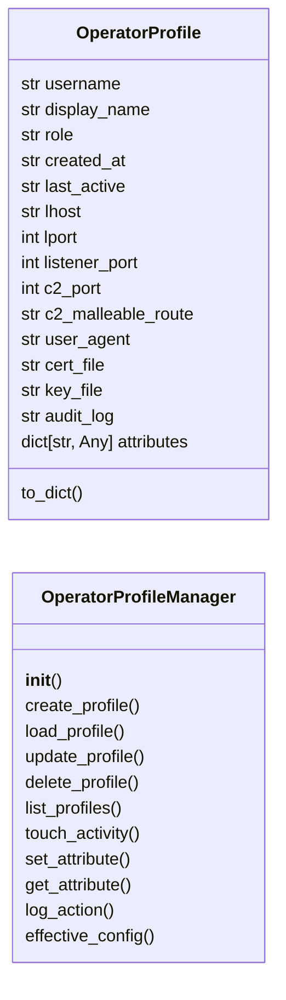
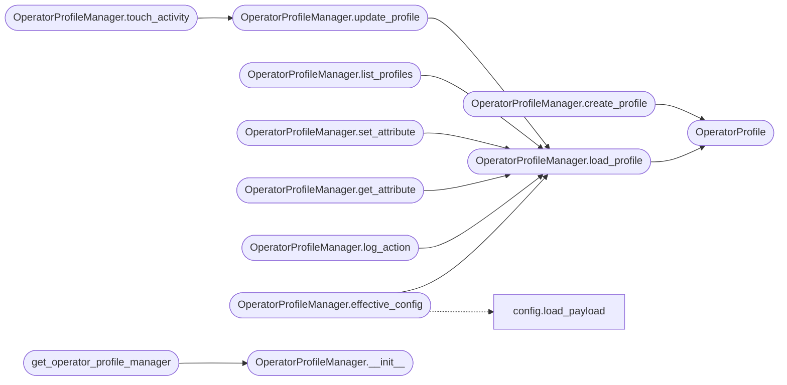

# `modules.operator_profiles`

> Source: [modules/operator_profiles.py:1](../../modules/operator_profiles.py#L1) | language `py` | coverage 87.5% | [API index](../index.md)

Multi-operator profile management for LazyOwn team server.

Each operator gets an isolated profile directory with its own:
- config (payload subset: lhost, lport, listeners)
- generated TLS certificates (per-operator C2 identity)
- command history and audit log

Design
------
- Profiles stored under ``sessions/operators/<username>/``
- Master ``payload.json`` is the team-wide baseline
- Per-operator overrides in ``operator.json`` inside each profile
- Certificates auto-generated on profile creation (CA + operator cert)
- All actions attributed to the operator who performed them

## Contents

- **Classes:** [`OperatorProfile`](#operatorprofile), [`OperatorProfileManager`](#operatorprofilemanager)
- **Functions:** [`get_operator_profile_manager`](#get_operator_profile_manager)

## Type Diagram



## Call Graph

Solid arrows stay in this module, dashed arrows leave it.



## Classes

<a id="operatorprofile"></a>

### `OperatorProfile`

`class` `dataclass` | [modules/operator_profiles.py:38](../../modules/operator_profiles.py#L38)

Decorators: `@dataclass`

```python
class OperatorProfile
```

Per-operator configuration and state.

**Attributes**

| Name | Type | Default | Description |
|---|---|---|---|
| [`username`](#operatorprofile-username) | `str` |  |  |
| [`display_name`](#operatorprofile-display_name) | `str` | `''` |  |
| [`role`](#operatorprofile-role) | `str` | `'operator'` |  |
| [`created_at`](#operatorprofile-created_at) | `str` | `field(default_factory=lambda: datetime.now(UTC).isoformat())` |  |
| [`last_active`](#operatorprofile-last_active) | `str` | `''` |  |
| [`lhost`](#operatorprofile-lhost) | `str` | `''` |  |
| [`lport`](#operatorprofile-lport) | `int` | `0` |  |
| [`listener_port`](#operatorprofile-listener_port) | `int` | `0` |  |
| [`c2_port`](#operatorprofile-c2_port) | `int` | `0` |  |
| [`c2_malleable_route`](#operatorprofile-c2_malleable_route) | `str` | `''` |  |
| [`user_agent`](#operatorprofile-user_agent) | `str` | `''` |  |
| [`cert_file`](#operatorprofile-cert_file) | `str` | `''` |  |
| [`key_file`](#operatorprofile-key_file) | `str` | `''` |  |
| [`audit_log`](#operatorprofile-audit_log) | `str` | `''` |  |
| [`attributes`](#operatorprofile-attributes) | `dict[str, Any]` | `field(default_factory=dict)` |  |

**Members**

| Member | Kind | Summary |
|---|---|---|
| [`to_dict`](#operatorprofile-to_dict) | method |  |

<a id="operatorprofile-to_dict"></a>

#### `OperatorProfile.to_dict`

`method` | [modules/operator_profiles.py:57](../../modules/operator_profiles.py#L57)

```python
def to_dict(self) -> dict[str, Any]
```

**Returns:** `dict[str, Any]`

---

<a id="operatorprofilemanager"></a>

### `OperatorProfileManager`

`class` | [modules/operator_profiles.py:77](../../modules/operator_profiles.py#L77)

```python
class OperatorProfileManager
```

CRUD for operator profiles with certificate generation.

Usage::

    mgr = OperatorProfileManager()
    mgr.create_profile("grisun0", display_name="Gris Iscomeback")
    profile = mgr.load_profile("grisun0")
    mgr.set_attribute("grisun0", "elo", 1500)

**Members**

| Member | Kind | Summary |
|---|---|---|
| [`__init__`](#operatorprofilemanager-__init__) | constructor |  |
| [`create_profile`](#operatorprofilemanager-create_profile) | method | Create a new operator profile. |
| [`load_profile`](#operatorprofilemanager-load_profile) | method | Load an operator profile. |
| [`update_profile`](#operatorprofilemanager-update_profile) | method | Update fields on an existing profile. |
| [`delete_profile`](#operatorprofilemanager-delete_profile) | method | Delete an operator profile and its directory. |
| [`list_profiles`](#operatorprofilemanager-list_profiles) | method | Return all operator profiles. |
| [`touch_activity`](#operatorprofilemanager-touch_activity) | method | Update last_active timestamp. |
| [`set_attribute`](#operatorprofilemanager-set_attribute) | method | Set a custom attribute on an operator profile. |
| [`get_attribute`](#operatorprofilemanager-get_attribute) | method | Get a custom attribute from an operator profile. |
| [`log_action`](#operatorprofilemanager-log_action) | method | Append an audited action to the operator's audit log. |
| [`effective_config`](#operatorprofilemanager-effective_config) | method | Merge team baseline (payload.json) with per-operator overrides. |

<a id="operatorprofilemanager-__init__"></a>

#### `OperatorProfileManager.__init__`

`constructor` | [modules/operator_profiles.py:88](../../modules/operator_profiles.py#L88)

```python
def __init__(self) -> None
```

*Called by:* [`get_operator_profile_manager`](#get_operator_profile_manager)

<a id="operatorprofilemanager-create_profile"></a>

#### `OperatorProfileManager.create_profile`

`method` | [modules/operator_profiles.py:192](../../modules/operator_profiles.py#L192)

```python
def create_profile(self, username: str, display_name: str = '', role: str = 'operator', lhost: str = '', lport: int = 0, listener_port: int = 0, c2_port: int = 0, c2_malleable_route: str = '', user_agent: str = '', attributes: dict[str, Any] | None = None) -> OperatorProfile
```

Create a new operator profile.

**Parameters**

| Name | Type | Default | Description |
|---|---|---|---|
| `username` | `str` |  | Unique operator identifier. |
| `display_name` | `str` | `''` | Human-readable name. |
| `role` | `str` | `'operator'` | RBAC role (``operator``, ``admin``, ``viewer``). |
| `lhost` | `str` | `''` | Operator's C2 listener IP override. |
| `lport` | `int` | `0` | Operator's reverse shell port override. |
| `listener_port` | `int` | `0` | Operator's listener port override. |
| `c2_port` | `int` | `0` | Operator's C2 dashboard port override. |
| `c2_malleable_route` | `str` | `''` | Per-operator malleable route. |
| `user_agent` | `str` | `''` | Per-operator user agent. |
| `attributes` | `dict[str, Any] \| None` | `None` | Arbitrary key-value metadata. |

**Returns:** `OperatorProfile` - The created [`OperatorProfile`](#operatorprofile).

**Raises**

- `ValueError`: If the profile already exists.

*Calls:* [`OperatorProfile`](#operatorprofile)

<a id="operatorprofilemanager-load_profile"></a>

#### `OperatorProfileManager.load_profile`

`method` | [modules/operator_profiles.py:260](../../modules/operator_profiles.py#L260)

```python
def load_profile(self, username: str) -> OperatorProfile | None
```

Load an operator profile.

**Parameters**

| Name | Type | Default | Description |
|---|---|---|---|
| `username` | `str` |  |  |

**Returns:** `OperatorProfile | None` - [`OperatorProfile`](#operatorprofile) or None.

*Calls:* [`OperatorProfile`](#operatorprofile)

*Called by:* [`OperatorProfileManager.effective_config`](#operatorprofilemanager-effective_config), [`OperatorProfileManager.get_attribute`](#operatorprofilemanager-get_attribute), [`OperatorProfileManager.list_profiles`](#operatorprofilemanager-list_profiles), [`OperatorProfileManager.log_action`](#operatorprofilemanager-log_action), [`OperatorProfileManager.set_attribute`](#operatorprofilemanager-set_attribute), [`OperatorProfileManager.update_profile`](#operatorprofilemanager-update_profile)

<a id="operatorprofilemanager-update_profile"></a>

#### `OperatorProfileManager.update_profile`

`method` | [modules/operator_profiles.py:276](../../modules/operator_profiles.py#L276)

```python
def update_profile(self, username: str, **kwargs: Any) -> OperatorProfile | None
```

Update fields on an existing profile.

**Parameters**

| Name | Type | Default | Description |
|---|---|---|---|
| `username` | `str` |  |  |
| `**kwargs` | `Any` |  |  |

**Returns:** `OperatorProfile | None`

*Calls:* [`OperatorProfileManager.load_profile`](#operatorprofilemanager-load_profile)

*Called by:* [`OperatorProfileManager.touch_activity`](#operatorprofilemanager-touch_activity)

<a id="operatorprofilemanager-delete_profile"></a>

#### `OperatorProfileManager.delete_profile`

`method` | [modules/operator_profiles.py:289](../../modules/operator_profiles.py#L289)

```python
def delete_profile(self, username: str) -> bool
```

Delete an operator profile and its directory.

**Parameters**

| Name | Type | Default | Description |
|---|---|---|---|
| `username` | `str` |  |  |

**Returns:** `bool`

<a id="operatorprofilemanager-list_profiles"></a>

#### `OperatorProfileManager.list_profiles`

`method` | [modules/operator_profiles.py:300](../../modules/operator_profiles.py#L300)

```python
def list_profiles(self) -> list[OperatorProfile]
```

Return all operator profiles.

**Returns:** `list[OperatorProfile]`

*Calls:* [`OperatorProfileManager.load_profile`](#operatorprofilemanager-load_profile)

<a id="operatorprofilemanager-touch_activity"></a>

#### `OperatorProfileManager.touch_activity`

`method` | [modules/operator_profiles.py:312](../../modules/operator_profiles.py#L312)

```python
def touch_activity(self, username: str) -> None
```

Update last_active timestamp.

**Parameters**

| Name | Type | Default | Description |
|---|---|---|---|
| `username` | `str` |  |  |

*Calls:* [`OperatorProfileManager.update_profile`](#operatorprofilemanager-update_profile)

<a id="operatorprofilemanager-set_attribute"></a>

#### `OperatorProfileManager.set_attribute`

`method` | [modules/operator_profiles.py:319](../../modules/operator_profiles.py#L319)

```python
def set_attribute(self, username: str, key: str, value: Any) -> bool
```

Set a custom attribute on an operator profile.

**Parameters**

| Name | Type | Default | Description |
|---|---|---|---|
| `username` | `str` |  |  |
| `key` | `str` |  |  |
| `value` | `Any` |  |  |

**Returns:** `bool`

*Calls:* [`OperatorProfileManager.load_profile`](#operatorprofilemanager-load_profile)

<a id="operatorprofilemanager-get_attribute"></a>

#### `OperatorProfileManager.get_attribute`

`method` | [modules/operator_profiles.py:328](../../modules/operator_profiles.py#L328)

```python
def get_attribute(self, username: str, key: str, default: Any = None) -> Any
```

Get a custom attribute from an operator profile.

**Parameters**

| Name | Type | Default | Description |
|---|---|---|---|
| `username` | `str` |  |  |
| `key` | `str` |  |  |
| `default` | `Any` | `None` |  |

**Returns:** `Any`

*Calls:* [`OperatorProfileManager.load_profile`](#operatorprofilemanager-load_profile)

<a id="operatorprofilemanager-log_action"></a>

#### `OperatorProfileManager.log_action`

`method` | [modules/operator_profiles.py:335](../../modules/operator_profiles.py#L335)

```python
def log_action(self, username: str, action: str, details: dict[str, Any] | None = None) -> None
```

Append an audited action to the operator's audit log.

**Parameters**

| Name | Type | Default | Description |
|---|---|---|---|
| `username` | `str` |  | Operator identifier. |
| `action` | `str` |  | Action name (e.g. ``"issue_command"``, ``"modify_config"``). |
| `details` | `dict[str, Any] \| None` | `None` | Optional structured context. |

*Calls:* [`OperatorProfileManager.load_profile`](#operatorprofilemanager-load_profile)

<a id="operatorprofilemanager-effective_config"></a>

#### `OperatorProfileManager.effective_config`

`method` | [modules/operator_profiles.py:360](../../modules/operator_profiles.py#L360)

```python
def effective_config(self, username: str) -> dict[str, Any]
```

Merge team baseline (payload.json) with per-operator overrides.

Operator-specific fields (lhost, lport, listener_port, c2_port,
c2_malleable_route, user_agent) take precedence over the team
baseline. All other fields come from the team config.

**Parameters**

| Name | Type | Default | Description |
|---|---|---|---|
| `username` | `str` |  | Operator identifier. |

**Returns:** `dict[str, Any]` - Merged configuration dict.

*Calls:* [`load_payload`](core.config.py.md#load_payload), [`OperatorProfileManager.load_profile`](#operatorprofilemanager-load_profile)

---

## Functions

<a id="get_operator_profile_manager"></a>

### `get_operator_profile_manager`

`function` | [modules/operator_profiles.py:398](../../modules/operator_profiles.py#L398)

```python
def get_operator_profile_manager() -> OperatorProfileManager
```

Return the singleton [`OperatorProfileManager`](#operatorprofilemanager).

**Returns:** `OperatorProfileManager`

*Calls:* [`OperatorProfileManager.__init__`](#operatorprofilemanager-__init__)

*Called by:* [`AutomationCommandSet.do_operator_create`](cli.commands.automation.py.md#automationcommandset-do_operator_create), [`AutomationCommandSet.do_operator_delete`](cli.commands.automation.py.md#automationcommandset-do_operator_delete), [`AutomationCommandSet.do_operator_load`](cli.commands.automation.py.md#automationcommandset-do_operator_load), [`AutomationCommandSet.do_operators`](cli.commands.automation.py.md#automationcommandset-do_operators)

---
