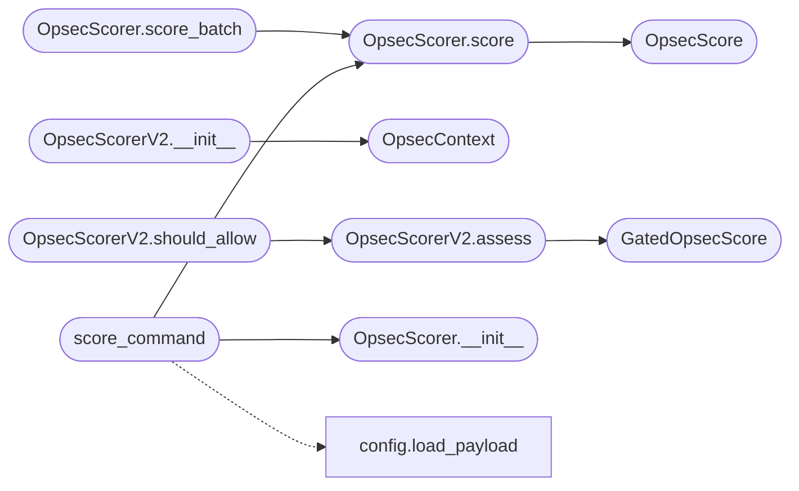

# `modules.opsec_scorer`

> Source: [modules/opsec_scorer.py:1](../../modules/opsec_scorer.py#L1) | language `py` | coverage 80.0% | [API index](../index.md)

OPSEC scoring engine — pre-execution noise assessment and gated scoring.

Single contract module for every OPSEC evaluation in the framework. It
exposes two complementary scorers that share one set of risk primitives:

- [`OpsecScorer`](#opsecscorer) — lightweight pre-execution noise assessment that
  returns a [`OpsecScore`](#opsecscore) with a plain-text risk label. Used for
  advisory warnings before running a command.

- [`OpsecScorerV2`](#opsecscorerv2) — real-time, context-aware scoring with action
  gating (allow / warn / confirm / block) and session trend tracking.
  Returns a [`GatedOpsecScore`](#gatedopsecscore).

Both share the risk-threshold mapping (see `_risk_bucket`), so the
noise-to-risk translation is defined exactly once. The two command tables
— [`COMMAND_NOISE`](#command_noise) and [`COMMAND_RISK_PROFILES`](#command_risk_profiles) — remain distinct
by design: the former drives advisory noise scoring while the latter drives
gating with its own threat model and extra exfiltration payload profiles.

Usage:
    from modules.opsec_scorer import OpsecScorer, OpsecScorerV2, OpsecContext

    scorer = OpsecScorer(payload)
    score = scorer.score("secretsdump", rhost="10.10.11.5")

    gated = OpsecScorerV2(context=OpsecContext(killchain_phase="credential_access"))
    assessment = gated.assess("mimikatz")

## Contents

- **Classes:** [`OpsecContext`](#opseccontext), [`OpsecScore`](#opsecscore), [`GatedOpsecScore`](#gatedopsecscore), [`OpsecScorer`](#opsecscorer), [`OpsecScorerV2`](#opsecscorerv2)
- **Enums:** [`RiskLevel`](#risklevel), [`GateAction`](#gateaction)
- **Functions:** [`score_command`](#score_command)
- **Constants:** [`PHASE_NOISE`](#phase_noise), [`PHASE_BASE_NOISE`](#phase_base_noise), [`COMMAND_NOISE`](#command_noise), [`COMMAND_RISK_PROFILES`](#command_risk_profiles), [`TARGET_SENSITIVITY_BONUS`](#target_sensitivity_bonus), [`MITIGATIONS`](#mitigations)

## Type Diagram

```mermaid
classDiagram
    direction LR
    class RiskLevel
    <<enum>> RiskLevel
    RiskLevel : NONE
    RiskLevel : LOW
    RiskLevel : MEDIUM
    RiskLevel : HIGH
    RiskLevel : CRITICAL
    class GateAction
    <<enum>> GateAction
    GateAction : ALLOW
    GateAction : WARN
    GateAction : CONFIRM
    GateAction : BLOCK
    class OpsecContext
    OpsecContext : str killchain_phase
    OpsecContext : str rhost
    OpsecContext : str target_environment
    OpsecContext : str access_level
    OpsecContext : bool edr_detected
    OpsecContext : bool siem_detected
    OpsecContext : str time_window
    OpsecContext : str credential_type
    OpsecContext : bool is_privileged
    OpsecContext : bool evasion_active
    OpsecContext : int artifacts_created
    OpsecContext : int session_uptime_minutes
    class OpsecScore
    OpsecScore : str command
    OpsecScore : int noise_score
    OpsecScore : str detection_risk
    OpsecScore : str risk_level
    OpsecScore : float confidence
    OpsecScore : list[str] detectable_by
    OpsecScore : list[str] mitigation
    OpsecScore : str recommendation
    OpsecScore : to_dict()
    class GatedOpsecScore
    GatedOpsecScore : str command
    GatedOpsecScore : RiskLevel risk_level
    GatedOpsecScore : str risk_label
    GatedOpsecScore : int noise_score
    GatedOpsecScore : list[str] detection_surface
    GatedOpsecScore : GateAction gate_action
    GatedOpsecScore : list[str] mitigations
    GatedOpsecScore : list[str] alternative_commands
    GatedOpsecScore : str explanation
    GatedOpsecScore : float timestamp
    class OpsecScorer
    OpsecScorer : __init__()
    OpsecScorer : evasion_active()
    OpsecScorer : traffic_morphing_active()
    OpsecScorer : score()
    OpsecScorer : score_batch()
    OpsecScorer : suggest_mitigations()
    class OpsecScorerV2
    OpsecScorerV2 : dict[str, dict[str, Any]] ENVIRONMENT_PROFILES
    OpsecScorerV2 : __init__()
    OpsecScorerV2 : assess()
    OpsecScorerV2 : should_allow()
    OpsecScorerV2 : get_trend()
```



## Call Graph

Solid arrows stay in this module, dashed arrows leave it.



## Classes

<a id="opseccontext"></a>

### `OpsecContext`

`class` `dataclass` | [modules/opsec_scorer.py:232](../../modules/opsec_scorer.py#L232)

Decorators: `@dataclass`

```python
class OpsecContext
```

Real-time operational context for gated OPSEC scoring.

**Attributes**

| Name | Type | Default | Description |
|---|---|---|---|
| [`killchain_phase`](#opseccontext-killchain_phase) | `str` | `'recon'` | Current phase (recon, scan, enum, exploit, etc.). |
| [`rhost`](#opseccontext-rhost) | `str` | `''` | Target IP address. |
| [`target_environment`](#opseccontext-target_environment) | `str` | `'unknown'` | Target environment type. |
| [`access_level`](#opseccontext-access_level) | `str` | `'none'` | Current access level on target. |
| [`edr_detected`](#opseccontext-edr_detected) | `bool` | `False` | Whether EDR/AV was detected on target. |
| [`siem_detected`](#opseccontext-siem_detected) | `bool` | `False` | Whether SIEM/correlation was observed. |
| [`time_window`](#opseccontext-time_window) | `str` | `'business_hours'` | Operation time window. |
| [`credential_type`](#opseccontext-credential_type) | `str` | `'none'` | Type of credentials in use. |
| [`is_privileged`](#opseccontext-is_privileged) | `bool` | `False` | Whether running as privileged user on target. |
| [`evasion_active`](#opseccontext-evasion_active) | `bool` | `False` | Whether evasion measures are active. |
| [`artifacts_created`](#opseccontext-artifacts_created) | `int` | `0` | Count of artifacts left so far. |
| [`session_uptime_minutes`](#opseccontext-session_uptime_minutes) | `int` | `0` | Minutes since session start. |

---

<a id="opsecscore"></a>

### `OpsecScore`

`class` `dataclass` | [modules/opsec_scorer.py:265](../../modules/opsec_scorer.py#L265)

Decorators: `@dataclass`

```python
class OpsecScore
```

Advisory OPSEC assessment for a single command.

**Attributes**

| Name | Type | Default | Description |
|---|---|---|---|
| [`command`](#opsecscore-command) | `str` |  | Command being assessed. |
| [`noise_score`](#opsecscore-noise_score) | `int` |  | 0-10 noise rating. |
| [`detection_risk`](#opsecscore-detection_risk) | `str` |  | Human-readable detection risk label. |
| [`risk_level`](#opsecscore-risk_level) | `str` |  | Plain-text risk label (low/medium/high/critical). |
| [`confidence`](#opsecscore-confidence) | `float` |  | 0-1 confidence in the assessment. |
| [`detectable_by`](#opsecscore-detectable_by) | `list[str]` | `field(default_factory=list)` | Detection systems that may observe the command. |
| [`mitigation`](#opsecscore-mitigation) | `list[str]` | `field(default_factory=list)` | Suggested mitigations. |
| [`recommendation`](#opsecscore-recommendation) | `str` | `''` | Human-readable guidance. |

**Members**

| Member | Kind | Summary |
|---|---|---|
| [`to_dict`](#opsecscore-to_dict) | method | Return the score serialized as a plain dictionary. |

<a id="opsecscore-to_dict"></a>

#### `OpsecScore.to_dict`

`method` | [modules/opsec_scorer.py:288](../../modules/opsec_scorer.py#L288)

```python
def to_dict(self) -> dict[str, Any]
```

Return the score serialized as a plain dictionary.

**Returns:** `dict[str, Any]`

---

<a id="gatedopsecscore"></a>

### `GatedOpsecScore`

`class` `dataclass` | [modules/opsec_scorer.py:303](../../modules/opsec_scorer.py#L303)

Decorators: `@dataclass`

```python
class GatedOpsecScore
```

Context-aware, gated OPSEC assessment for a single command.

**Attributes**

| Name | Type | Default | Description |
|---|---|---|---|
| [`command`](#gatedopsecscore-command) | `str` | `''` | Command being assessed. |
| [`risk_level`](#gatedopsecscore-risk_level) | `RiskLevel` | `RiskLevel.LOW` | Numeric risk level. |
| [`risk_label`](#gatedopsecscore-risk_label) | `str` | `'LOW'` | Human-readable risk label. |
| [`noise_score`](#gatedopsecscore-noise_score) | `int` | `0` | 0-10 noise rating. |
| [`detection_surface`](#gatedopsecscore-detection_surface) | `list[str]` | `field(default_factory=list)` | Detection systems triggered. |
| [`gate_action`](#gatedopsecscore-gate_action) | `GateAction` | `GateAction.ALLOW` | Whether to allow, warn, confirm, or block. |
| [`mitigations`](#gatedopsecscore-mitigations) | `list[str]` | `field(default_factory=list)` | Suggested mitigations ranked by effectiveness. |
| [`alternative_commands`](#gatedopsecscore-alternative_commands) | `list[str]` | `field(default_factory=list)` | Lower-noise alternatives if available. |
| [`explanation`](#gatedopsecscore-explanation) | `str` | `''` | Human-readable rationale for the score. |
| [`timestamp`](#gatedopsecscore-timestamp) | `float` | `0.0` | Unix timestamp of the assessment. |

---

<a id="opsecscorer"></a>

### `OpsecScorer`

`class` | [modules/opsec_scorer.py:331](../../modules/opsec_scorer.py#L331)

```python
class OpsecScorer
```

Pre-execution OPSEC evaluator for LazyOwn commands.

Scores commands on base noise, phase-appropriate tool usage, target
sensitivity, evasion status, and detection tool coverage.

**Members**

| Member | Kind | Summary |
|---|---|---|
| [`__init__`](#opsecscorer-__init__) | constructor |  |
| [`evasion_active`](#opsecscorer-evasion_active) | property |  |
| [`traffic_morphing_active`](#opsecscorer-traffic_morphing_active) | property |  |
| [`score`](#opsecscorer-score) | method | Score an OPSEC risk for `[`command`](#opsecscore-command)` against `[`rhost`](#opseccontext-rhost)`. |
| [`score_batch`](#opsecscorer-score_batch) | method | Score multiple commands and return {command: OpsecScore}. |
| [`suggest_mitigations`](#opsecscorer-suggest_mitigations) | method | Return mitigation suggestions for a given command. |

<a id="opsecscorer-__init__"></a>

#### `OpsecScorer.__init__`

`constructor` | [modules/opsec_scorer.py:343](../../modules/opsec_scorer.py#L343)

```python
def __init__(self, payload: dict[str, Any] | None = None, world_model: Any = None) -> None
```

**Parameters**

| Name | Type | Default | Description |
|---|---|---|---|
| `payload` | `dict[str, Any] \| None` | `None` |  |
| `world_model` | `Any` | `None` |  |

*Called by:* [`SecurityCommandSet.do_opsec`](cli.commands.security.py.md#securitycommandset-do_opsec), [`score_command`](#score_command)

<a id="opsecscorer-evasion_active"></a>

#### `OpsecScorer.evasion_active`

`property` | [modules/opsec_scorer.py:352](../../modules/opsec_scorer.py#L352)

Decorators: `@property`

```python
def evasion_active(self) -> bool
```

**Returns:** `bool`

<a id="opsecscorer-traffic_morphing_active"></a>

#### `OpsecScorer.traffic_morphing_active`

`property` | [modules/opsec_scorer.py:357](../../modules/opsec_scorer.py#L357)

Decorators: `@property`

```python
def traffic_morphing_active(self) -> bool
```

**Returns:** `bool`

<a id="opsecscorer-score"></a>

#### `OpsecScorer.score`

`method` | [modules/opsec_scorer.py:365](../../modules/opsec_scorer.py#L365)

```python
def score(self, command: str, rhost: str = '', phase_override: str | None = None) -> OpsecScore
```

Score an OPSEC risk for `[`command`](#opsecscore-command)` against `[`rhost`](#opseccontext-rhost)`.

**Parameters**

| Name | Type | Default | Description |
|---|---|---|---|
| `command` | `str` |  | LazyOwn command alias to evaluate. |
| `rhost` | `str` | `''` | Target IP for sensitivity analysis. |
| `phase_override` | `str \| None` | `None` | Force a phase context (default: from world_model). |

**Returns:** `OpsecScore` - OpsecScore with risk assessment and recommendations.

*Calls:* [`OpsecScore`](#opsecscore)

*Called by:* [`SecurityCommandSet.do_opsec`](cli.commands.security.py.md#securitycommandset-do_opsec), [`OpsecScorer.score_batch`](#opsecscorer-score_batch), [`score_command`](#score_command)

<a id="opsecscorer-score_batch"></a>

#### `OpsecScorer.score_batch`

`method` | [modules/opsec_scorer.py:413](../../modules/opsec_scorer.py#L413)

```python
def score_batch(self, commands: list[str], rhost: str = '') -> dict[str, OpsecScore]
```

Score multiple commands and return {command: OpsecScore}.

**Parameters**

| Name | Type | Default | Description |
|---|---|---|---|
| `commands` | `list[str]` |  |  |
| `rhost` | `str` | `''` |  |

**Returns:** `dict[str, OpsecScore]`

*Calls:* [`OpsecScorer.score`](#opsecscorer-score)

<a id="opsecscorer-suggest_mitigations"></a>

#### `OpsecScorer.suggest_mitigations`

`method` | [modules/opsec_scorer.py:417](../../modules/opsec_scorer.py#L417)

```python
def suggest_mitigations(self, command: str, detectable_by: list[str] | None = None) -> list[str]
```

Return mitigation suggestions for a given command.

**Parameters**

| Name | Type | Default | Description |
|---|---|---|---|
| `command` | `str` |  |  |
| `detectable_by` | `list[str] \| None` | `None` |  |

**Returns:** `list[str]`

---

<a id="opsecscorerv2"></a>

### `OpsecScorerV2`

`class` | [modules/opsec_scorer.py:559](../../modules/opsec_scorer.py#L559)

```python
class OpsecScorerV2
```

Real-time OPSEC scoring engine with action gating.

Evaluates each command against the current operational context,
producing a [`RiskLevel`](#risklevel) and [`GateAction`](#gateaction).

**Attributes**

| Name | Type | Default | Description |
|---|---|---|---|
| [`ENVIRONMENT_PROFILES`](#opsecscorerv2-environment_profiles) | `dict[str, dict[str, Any]]` | `{'enterprise': {'edr_likely': True, 'siem_likely': True, 'base_noise': 3, 'threat_hunting_likely': True, 'description': 'Well-defended enterprise with EDR + SIEM'}, 'smb': {'edr_likely': False, 'siem_likely': False, 'base_noise': 1, 'threat_hunting_likely': False, 'description': 'Small business with little security'}, 'government': {'edr_likely': True, 'siem_likely': True, 'base_noise': 5, 'threat_hunting_likely': True, 'description': 'Government/military with aggressive monitoring'}, 'critical_infrastructure': {'edr_likely': True, 'siem_likely': True, 'base_noise': 4, 'threat_hunting_likely': True, 'description': 'OT/ICS environment with segregation'}, 'cloud': {'edr_likely': True, 'siem_likely': True, 'base_noise': 3, 'threat_hunting_likely': False, 'description': 'Cloud-native environment (AWS/Azure/GCP)'}, 'dark_web': {'edr_likely': False, 'siem_likely': False, 'base_noise': 0, 'threat_hunting_likely': False, 'description': 'Anonymous/dark web target - low monitoring'}}` |  |

**Members**

| Member | Kind | Summary |
|---|---|---|
| [`__init__`](#opsecscorerv2-__init__) | constructor |  |
| [`assess`](#opsecscorerv2-assess) | method | Assess OPSEC risk for a command in the current context. |
| [`should_allow`](#opsecscorerv2-should_allow) | method | Quick gating check - returns (allowed, score). |
| [`get_trend`](#opsecscorerv2-get_trend) | method | Analyze OPSEC risk trend over the session. |

<a id="opsecscorerv2-__init__"></a>

#### `OpsecScorerV2.__init__`

`constructor` | [modules/opsec_scorer.py:617](../../modules/opsec_scorer.py#L617)

```python
def __init__(self, context: OpsecContext | None = None)
```

**Parameters**

| Name | Type | Default | Description |
|---|---|---|---|
| `context` | `OpsecContext \| None` | `None` |  |

*Calls:* [`OpsecContext`](#opseccontext)

*Called by:* [`OpsecCleanupCommandSet.do_opsec_score`](cli.commands.opsec_cleanup.py.md#opseccleanupcommandset-do_opsec_score)

<a id="opsecscorerv2-assess"></a>

#### `OpsecScorerV2.assess`

`method` | [modules/opsec_scorer.py:622](../../modules/opsec_scorer.py#L622)

```python
def assess(self, command: str, extra_context: dict[str, Any] | None = None) -> GatedOpsecScore
```

Assess OPSEC risk for a command in the current context.

**Parameters**

| Name | Type | Default | Description |
|---|---|---|---|
| `command` | `str` |  | The command string to evaluate. |
| `extra_context` | `dict[str, Any] \| None` | `None` | Additional context overrides. |

**Returns:** `GatedOpsecScore` - GatedOpsecScore with risk assessment and gating decision.

*Calls:* [`GatedOpsecScore`](#gatedopsecscore)

*Called by:* [`OpsecCleanupCommandSet.do_opsec_score`](cli.commands.opsec_cleanup.py.md#opseccleanupcommandset-do_opsec_score), [`OpsecScorerV2.should_allow`](#opsecscorerv2-should_allow)

<a id="opsecscorerv2-should_allow"></a>

#### `OpsecScorerV2.should_allow`

`method` | [modules/opsec_scorer.py:696](../../modules/opsec_scorer.py#L696)

```python
def should_allow(self, command: str) -> tuple[bool, GatedOpsecScore]
```

Quick gating check - returns (allowed, score).

**Parameters**

| Name | Type | Default | Description |
|---|---|---|---|
| `command` | `str` |  | Command string to check. |

**Returns:** `tuple[bool, GatedOpsecScore]` - Tuple of (is_allowed: bool, assessment: GatedOpsecScore).

*Calls:* [`OpsecScorerV2.assess`](#opsecscorerv2-assess)

<a id="opsecscorerv2-get_trend"></a>

#### `OpsecScorerV2.get_trend`

`method` | [modules/opsec_scorer.py:709](../../modules/opsec_scorer.py#L709)

```python
def get_trend(self) -> dict[str, Any]
```

Analyze OPSEC risk trend over the session.

**Returns:** `dict[str, Any]` - Dict with trend data: escalating, stable, or improving.

*Called by:* [`OpsecCleanupCommandSet.do_opsec_score`](cli.commands.opsec_cleanup.py.md#opseccleanupcommandset-do_opsec_score)

---

## Enums

<a id="risklevel"></a>

### `RiskLevel`

`enum` | [modules/opsec_scorer.py:170](../../modules/opsec_scorer.py#L170)

```python
class RiskLevel(IntEnum)
```

Bases: `IntEnum`

OPSEC risk levels ordered by severity.

**Attributes**

| Name | Type | Default | Description |
|---|---|---|---|
| [`NONE`](#risklevel-none) |  | `0` |  |
| [`LOW`](#risklevel-low) |  | `1` |  |
| [`MEDIUM`](#risklevel-medium) |  | `2` |  |
| [`HIGH`](#risklevel-high) |  | `3` |  |
| [`CRITICAL`](#risklevel-critical) |  | `4` |  |

---

<a id="gateaction"></a>

### `GateAction`

`enum` | [modules/opsec_scorer.py:180](../../modules/opsec_scorer.py#L180)

```python
class GateAction(IntEnum)
```

Bases: `IntEnum`

Action gating decisions for command execution.

**Attributes**

| Name | Type | Default | Description |
|---|---|---|---|
| [`ALLOW`](#gateaction-allow) |  | `0` |  |
| [`WARN`](#gateaction-warn) |  | `1` |  |
| [`CONFIRM`](#gateaction-confirm) |  | `2` |  |
| [`BLOCK`](#gateaction-block) |  | `3` |  |

---

## Functions

<a id="score_command"></a>

### `score_command`

`function` | [modules/opsec_scorer.py:811](../../modules/opsec_scorer.py#L811)

```python
def score_command(command: str, payload: dict[str, Any] | None = None, rhost: str = '') -> OpsecScore
```

Convenience function: score a single command without creating a scorer instance.

**Parameters**

| Name | Type | Default | Description |
|---|---|---|---|
| `command` | `str` |  | LazyOwn command to evaluate. |
| `payload` | `dict[str, Any] \| None` | `None` | Configuration dict (loaded from payload.json if None). |
| `rhost` | `str` | `''` | Target IP for sensitivity. |

**Returns:** `OpsecScore` - OpsecScore dataclass instance.

*Calls:* [`load_payload`](core.config.py.md#load_payload), [`OpsecScorer.__init__`](#opsecscorer-__init__), [`OpsecScorer.score`](#opsecscorer-score)

---

## Constants

<a id="phase_noise"></a>

### `PHASE_NOISE`

`constant` | [modules/opsec_scorer.py:40](../../modules/opsec_scorer.py#L40)

```python
PHASE_NOISE: dict[str, int]
```

---

<a id="phase_base_noise"></a>

### `PHASE_BASE_NOISE`

`constant` | [modules/opsec_scorer.py:56](../../modules/opsec_scorer.py#L56)

```python
PHASE_BASE_NOISE: dict[str, int]
```

---

<a id="command_noise"></a>

### `COMMAND_NOISE`

`constant` | [modules/opsec_scorer.py:72](../../modules/opsec_scorer.py#L72)

```python
COMMAND_NOISE: dict[str, dict[str, Any]]
```

---

<a id="command_risk_profiles"></a>

### `COMMAND_RISK_PROFILES`

`constant` | [modules/opsec_scorer.py:109](../../modules/opsec_scorer.py#L109)

```python
COMMAND_RISK_PROFILES: dict[str, dict[str, Any]]
```

---

<a id="target_sensitivity_bonus"></a>

### `TARGET_SENSITIVITY_BONUS`

`constant` | [modules/opsec_scorer.py:138](../../modules/opsec_scorer.py#L138)

```python
TARGET_SENSITIVITY_BONUS: dict[str, int]
```

---

<a id="mitigations"></a>

### `MITIGATIONS`

`constant` | [modules/opsec_scorer.py:150](../../modules/opsec_scorer.py#L150)

```python
MITIGATIONS: dict[str, list[str]]
```

---
