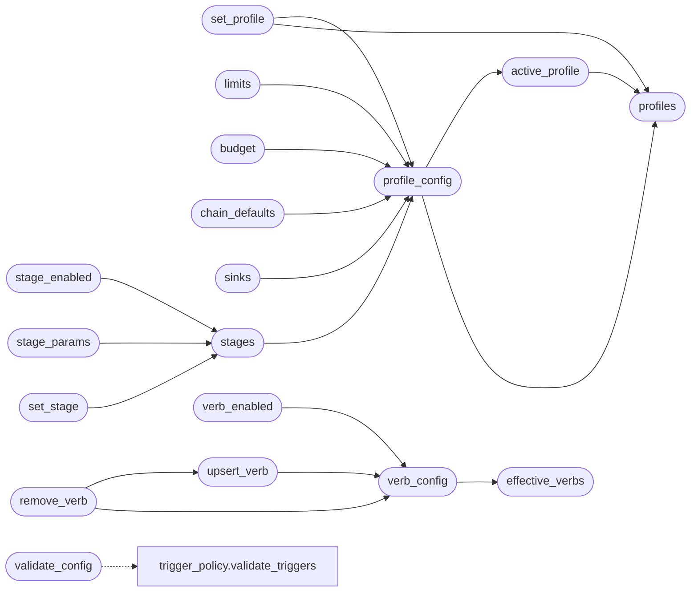

# `modules.orchestrator_config`

> Source: [modules/orchestrator_config.py:1](../../modules/orchestrator_config.py#L1) | language `py` | coverage 100.0% | [API index](../index.md)

Operator configuration for the loop core: profiles, stages and auto verbs.

YAML is the default source of truth. ``config/orchestrator.yaml`` declares
profiles, pipeline stages, numeric limits, budgets, default chain/playbook
and outcome sink toggles. ``payload.json`` keeps runtime overrides under
``orchestrator``; an override always wins over YAML.

The module exposes one merged view so the TUI, the runner and the engine
read the same values. A missing or invalid YAML never stops the loop: the
built-in fallback table keeps it running.

## Contents

- **Functions:** [`reload`](#reload), [`profiles`](#profiles), [`active_profile`](#active_profile), [`profile_config`](#profile_config), [`set_profile`](#set_profile), [`limits`](#limits), [`budget`](#budget), [`chain_defaults`](#chain_defaults), [`sinks`](#sinks), [`stages`](#stages), [`stage_enabled`](#stage_enabled), [`stage_params`](#stage_params), [`set_stage`](#set_stage), [`effective_verbs`](#effective_verbs), [`verb_config`](#verb_config), [`verb_enabled`](#verb_enabled), [`upsert_verb`](#upsert_verb), [`remove_verb`](#remove_verb), [`reset`](#reset), [`validate_config`](#validate_config)
- **Constants:** [`ORCHESTRATOR_YAML_PATH`](#orchestrator_yaml_path), [`STAGE_DEFS`](#stage_defs), [`FALLBACK_STAGES`](#fallback_stages), [`FALLBACK_LIMITS`](#fallback_limits), [`FALLBACK_BUDGET`](#fallback_budget), [`FALLBACK_SINKS`](#fallback_sinks), [`DEFAULT_STAGES`](#default_stages)

## Call Graph

Solid arrows stay in this module, dashed arrows leave it.



## Functions

<a id="reload"></a>

### `reload`

`function` | [modules/orchestrator_config.py:113](../../modules/orchestrator_config.py#L113)

```python
def reload() -> None
```

Invalidate every merged view after an external configuration change.

---

<a id="profiles"></a>

### `profiles`

`function` | [modules/orchestrator_config.py:232](../../modules/orchestrator_config.py#L232)

```python
def profiles() -> dict[str, dict]
```

Return every resolved profile, including inherited values.

**Returns:** `dict[str, dict]`

*Called by:* [`active_profile`](#active_profile), [`profile_config`](#profile_config), [`set_profile`](#set_profile)

---

<a id="active_profile"></a>

### `active_profile`

`function` | [modules/orchestrator_config.py:257](../../modules/orchestrator_config.py#L257)

```python
def active_profile() -> str
```

Return the profile selected by the payload, falling back safely.

**Returns:** `str`

*Calls:* [`profiles`](#profiles)

*Called by:* [`harness_enabled`](modules.harness.py.md#harness_enabled), [`profile_config`](#profile_config)

---

<a id="profile_config"></a>

### `profile_config`

`function` | [modules/orchestrator_config.py:269](../../modules/orchestrator_config.py#L269)

```python
def profile_config(name: str = '') -> dict
```

Return one resolved profile by name, or the active profile.

**Parameters**

| Name | Type | Default | Description |
|---|---|---|---|
| `name` | `str` | `''` |  |

**Returns:** `dict`

*Calls:* [`active_profile`](#active_profile), [`profiles`](#profiles)

*Called by:* [`resolve_loop_defaults`](modules.lazy_runner.py.md#resolve_loop_defaults), [`budget`](#budget), [`chain_defaults`](#chain_defaults), [`limits`](#limits), [`set_profile`](#set_profile), [`sinks`](#sinks), [`stages`](#stages)

---

<a id="set_profile"></a>

### `set_profile`

`function` | [modules/orchestrator_config.py:276](../../modules/orchestrator_config.py#L276)

```python
def set_profile(name: str) -> dict
```

Persist the active profile name.

**Parameters**

| Name | Type | Default | Description |
|---|---|---|---|
| `name` | `str` |  | Profile declared in the YAML or the fallback table. |

**Returns:** `dict` - The resolved profile after persisting.

**Raises**

- `KeyError`: Unknown profile name.

*Calls:* [`profile_config`](#profile_config), [`profiles`](#profiles)

---

<a id="limits"></a>

### `limits`

`function` | [modules/orchestrator_config.py:332](../../modules/orchestrator_config.py#L332)

```python
def limits() -> dict
```

Return resolved numeric limits for the active profile.

**Returns:** `dict`

*Calls:* [`profile_config`](#profile_config)

---

<a id="budget"></a>

### `budget`

`function` | [modules/orchestrator_config.py:339](../../modules/orchestrator_config.py#L339)

```python
def budget() -> dict
```

Return resolved budgets for the active profile.

**Returns:** `dict`

*Calls:* [`profile_config`](#profile_config)

---

<a id="chain_defaults"></a>

### `chain_defaults`

`function` | [modules/orchestrator_config.py:346](../../modules/orchestrator_config.py#L346)

```python
def chain_defaults() -> dict
```

Return the default chain and playbook for the active profile.

**Returns:** `dict`

*Calls:* [`profile_config`](#profile_config)

---

<a id="sinks"></a>

### `sinks`

`function` | [modules/orchestrator_config.py:355](../../modules/orchestrator_config.py#L355)

```python
def sinks() -> dict
```

Return outcome sink toggles for the active profile plus payload overrides.

**Returns:** `dict`

*Calls:* [`profile_config`](#profile_config)

---

<a id="stages"></a>

### `stages`

`function` | [modules/orchestrator_config.py:366](../../modules/orchestrator_config.py#L366)

```python
def stages() -> dict[str, dict]
```

Merged stage view: enabled flag, label, firing condition and params.

**Returns:** `dict[str, dict]`

*Calls:* [`profile_config`](#profile_config)

*Called by:* [`LazyCommandSet.do_lazy_stage`](cli.commands.lazyops.py.md#lazycommandset-do_lazy_stage), [`stage_names`](lazyc2.blueprints.orchestrator.py.md#stage_names), [`set_stage`](#set_stage), [`stage_enabled`](#stage_enabled), [`stage_params`](#stage_params)

---

<a id="stage_enabled"></a>

### `stage_enabled`

`function` | [modules/orchestrator_config.py:396](../../modules/orchestrator_config.py#L396)

```python
def stage_enabled(name: str) -> bool
```

Return whether one pipeline stage is enabled (unknown = enabled).

**Parameters**

| Name | Type | Default | Description |
|---|---|---|---|
| `name` | `str` |  |  |

**Returns:** `bool`

*Calls:* [`stages`](#stages)

*Called by:* [`LazyOrchestratorApp.toggle_stage`](cli.lazy_orchestrator.py.md#lazyorchestratorapp-toggle_stage), [`stages_toggle`](lazyc2.blueprints.orchestrator.py.md#stages_toggle)

---

<a id="stage_params"></a>

### `stage_params`

`function` | [modules/orchestrator_config.py:402](../../modules/orchestrator_config.py#L402)

```python
def stage_params(name: str) -> dict
```

Return the resolved parameter mapping of one stage.

**Parameters**

| Name | Type | Default | Description |
|---|---|---|---|
| `name` | `str` |  |  |

**Returns:** `dict`

*Calls:* [`stages`](#stages)

---

<a id="set_stage"></a>

### `set_stage`

`function` | [modules/orchestrator_config.py:407](../../modules/orchestrator_config.py#L407)

```python
def set_stage(name: str, enabled: bool) -> dict
```

Persist the enabled flag of one stage.

**Parameters**

| Name | Type | Default | Description |
|---|---|---|---|
| `name` | `str` |  | Stage identifier from the active profile. |
| `enabled` | `bool` |  | New flag. |

**Returns:** `dict` - The updated merged stage view for that stage.

**Raises**

- `KeyError`: Unknown stage name.

*Calls:* [`stages`](#stages)

*Called by:* [`LazyCommandSet.do_lazy_stage`](cli.commands.lazyops.py.md#lazycommandset-do_lazy_stage), [`LazyOrchestratorApp.toggle_stage`](cli.lazy_orchestrator.py.md#lazyorchestratorapp-toggle_stage), [`stages_toggle`](lazyc2.blueprints.orchestrator.py.md#stages_toggle)

---

<a id="effective_verbs"></a>

### `effective_verbs`

`function` | [modules/orchestrator_config.py:432](../../modules/orchestrator_config.py#L432)

```python
def effective_verbs() -> list[dict]
```

Merged auto-verb view: built-ins plus operator overrides, additions and catalog.

**Returns:** `list[dict]`

*Called by:* [`LazyCommandSet.do_lazy_verb`](cli.commands.lazyops.py.md#lazycommandset-do_lazy_verb), [`verb_config`](#verb_config)

---

<a id="verb_config"></a>

### `verb_config`

`function` | [modules/orchestrator_config.py:524](../../modules/orchestrator_config.py#L524)

```python
def verb_config(name: str) -> dict | None
```

Return the merged configuration of one auto verb, or None.

**Parameters**

| Name | Type | Default | Description |
|---|---|---|---|
| `name` | `str` |  |  |

**Returns:** `dict | None`

*Calls:* [`effective_verbs`](#effective_verbs)

*Called by:* [`remove_verb`](#remove_verb), [`upsert_verb`](#upsert_verb), [`verb_enabled`](#verb_enabled)

---

<a id="verb_enabled"></a>

### `verb_enabled`

`function` | [modules/orchestrator_config.py:533](../../modules/orchestrator_config.py#L533)

```python
def verb_enabled(name: str) -> bool
```

Return whether one auto verb may be proposed or executed.

**Parameters**

| Name | Type | Default | Description |
|---|---|---|---|
| `name` | `str` |  |  |

**Returns:** `bool`

*Calls:* [`verb_config`](#verb_config)

*Called by:* [`LazyOrchestratorApp.toggle_verb`](cli.lazy_orchestrator.py.md#lazyorchestratorapp-toggle_verb)

---

<a id="upsert_verb"></a>

### `upsert_verb`

`function` | [modules/orchestrator_config.py:539](../../modules/orchestrator_config.py#L539)

```python
def upsert_verb(name: str, *, enabled: bool | None = None, keywords: list[str] | None = None, phases: list[str] | None = None, needs_target: bool | None = None, extra_args: str | None = None, description: str | None = None, custom: bool = False) -> dict
```

Create or update one auto-verb override in the payload.

**Parameters**

| Name | Type | Default | Description |
|---|---|---|---|
| `name` | `str` |  | Verb (must match an existing shell command when custom). |
| `enabled` | `bool \| None` | `None` | New enabled flag. |
| `keywords` | `list[str] \| None` | `None` | Intent/goal signals selecting the verb. |
| `phases` | `list[str] \| None` | `None` | Kill-chain phases the verb serves. |
| `needs_target` | `bool \| None` | `None` | Whether the built line carries the loop target. |
| `extra_args` | `str \| None` | `None` | Fixed tail args appended after the target. |
| `description` | `str \| None` | `None` | Operator-facing note. |
| `custom` | `bool` | `False` | Mark as a new operator-defined verb. |

**Returns:** `dict` - The merged entry after persisting.

**Raises**

- `ValueError`: Empty verb name.

*Calls:* [`verb_config`](#verb_config)

*Called by:* [`LazyCommandSet.do_lazy_verb`](cli.commands.lazyops.py.md#lazycommandset-do_lazy_verb), [`LazyOrchestratorApp.add_auto_verb`](cli.lazy_orchestrator.py.md#lazyorchestratorapp-add_auto_verb), [`LazyOrchestratorApp.toggle_verb`](cli.lazy_orchestrator.py.md#lazyorchestratorapp-toggle_verb), [`remove_verb`](#remove_verb)

---

<a id="remove_verb"></a>

### `remove_verb`

`function` | [modules/orchestrator_config.py:596](../../modules/orchestrator_config.py#L596)

```python
def remove_verb(name: str) -> bool
```

Remove a custom verb, or disable a built-in one.

**Parameters**

| Name | Type | Default | Description |
|---|---|---|---|
| `name` | `str` |  |  |

**Returns:** `bool`

*Calls:* [`upsert_verb`](#upsert_verb), [`verb_config`](#verb_config)

*Called by:* [`LazyCommandSet.do_lazy_verb`](cli.commands.lazyops.py.md#lazycommandset-do_lazy_verb), [`LazyOrchestratorApp.remove_auto_verb`](cli.lazy_orchestrator.py.md#lazyorchestratorapp-remove_auto_verb)

---

<a id="reset"></a>

### `reset`

`function` | [modules/orchestrator_config.py:617](../../modules/orchestrator_config.py#L617)

```python
def reset() -> None
```

Drop every orchestrator override (back to YAML defaults).

*Called by:* [`LazyCommandSet.do_lazy_stage`](cli.commands.lazyops.py.md#lazycommandset-do_lazy_stage)

---

<a id="validate_config"></a>

### `validate_config`

`function` | [modules/orchestrator_config.py:624](../../modules/orchestrator_config.py#L624)

```python
def validate_config(data: Any) -> list[str]
```

Validate one raw orchestration mapping.

**Parameters**

| Name | Type | Default | Description |
|---|---|---|---|
| `data` | `Any` |  | Parsed YAML document. |

**Returns:** `list[str]` - Human-readable errors; an empty list means the document is valid.

*Calls:* [`validate_triggers`](modules.trigger_policy.py.md#validate_triggers)

---

## Constants

<a id="orchestrator_yaml_path"></a>

### `ORCHESTRATOR_YAML_PATH`

`constant` | [modules/orchestrator_config.py:30](../../modules/orchestrator_config.py#L30)

```python
ORCHESTRATOR_YAML_PATH = BASE_DIR / 'config' / 'orchestrator.yaml'
```

---

<a id="stage_defs"></a>

### `STAGE_DEFS`

`constant` | [modules/orchestrator_config.py:33](../../modules/orchestrator_config.py#L33)

```python
STAGE_DEFS
```

---

<a id="fallback_stages"></a>

### `FALLBACK_STAGES`

`constant` | [modules/orchestrator_config.py:58](../../modules/orchestrator_config.py#L58)

```python
FALLBACK_STAGES: dict[str, dict[str, Any]]
```

---

<a id="fallback_limits"></a>

### `FALLBACK_LIMITS`

`constant` | [modules/orchestrator_config.py:68](../../modules/orchestrator_config.py#L68)

```python
FALLBACK_LIMITS: dict[str, int | float]
```

---

<a id="fallback_budget"></a>

### `FALLBACK_BUDGET`

`constant` | [modules/orchestrator_config.py:84](../../modules/orchestrator_config.py#L84)

```python
FALLBACK_BUDGET: dict[str, int] = {'max_rounds': 10, 'max_toolcalls': 200, 'max_findings': 50}
```

---

<a id="fallback_sinks"></a>

### `FALLBACK_SINKS`

`constant` | [modules/orchestrator_config.py:86](../../modules/orchestrator_config.py#L86)

```python
FALLBACK_SINKS: dict[str, bool]
```

---

<a id="default_stages"></a>

### `DEFAULT_STAGES`

`constant` | [modules/orchestrator_config.py:98](../../modules/orchestrator_config.py#L98)

```python
DEFAULT_STAGES: dict[str, bool] = {name: bool(data['enabled']) for name, data in FALLBACK_STAGES.items()}
```

---
