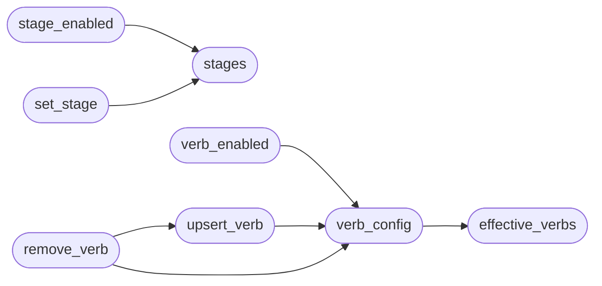

# `modules.orchestrator_config`

> Source: [modules/orchestrator_config.py:1](../../modules/orchestrator_config.py#L1) | language `py` | coverage 100.0% | [API index](../index.md)

Operator configuration for the loop core: pipeline stages and auto verbs.

Single source of truth for *what the orchestrator fires* and *which auto
verbs it may propose or execute*. Defaults live here; operator overrides
persist under ``payload.json`` -> ``orchestrator`` so the TUI, the engine
and the registry always read the same merged view.

Layout of the payload section::

    {
      "orchestrator": {
        "stages": {"compact": {"enabled": false}},
        "auto_verbs": {
          "automsf": {"enabled": false},
          "myscan": {"enabled": true, "keywords": ["myscan"],
                     "needs_target": true, "description": "custom verb"}
        }
      }
    }

## Contents

- **Functions:** [`stages`](#stages), [`stage_enabled`](#stage_enabled), [`set_stage`](#set_stage), [`effective_verbs`](#effective_verbs), [`verb_config`](#verb_config), [`verb_enabled`](#verb_enabled), [`upsert_verb`](#upsert_verb), [`remove_verb`](#remove_verb), [`reset`](#reset)
- **Constants:** [`STAGE_DEFS`](#stage_defs), [`DEFAULT_STAGES`](#default_stages)

## Call Graph

Solid arrows stay in this module, dashed arrows leave it.



## Functions

<a id="stages"></a>

### `stages`

`function` | [modules/orchestrator_config.py:105](../../modules/orchestrator_config.py#L105)

```python
def stages() -> dict[str, dict]
```

Merged stage view: enabled flag, label and firing condition.

**Returns:** `dict[str, dict]`

*Called by:* [`set_stage`](#set_stage), [`stage_enabled`](#stage_enabled)

---

<a id="stage_enabled"></a>

### `stage_enabled`

`function` | [modules/orchestrator_config.py:130](../../modules/orchestrator_config.py#L130)

```python
def stage_enabled(name: str) -> bool
```

Return whether one pipeline stage is enabled (unknown = enabled).

**Parameters**

| Name | Type | Default | Description |
|---|---|---|---|
| `name` | `str` |  |  |

**Returns:** `bool`

*Calls:* [`stages`](#stages)

*Called by:* [`LazyOrchestratorApp.toggle_stage`](cli.lazy_orchestrator.py.md#lazyorchestratorapp-toggle_stage)

---

<a id="set_stage"></a>

### `set_stage`

`function` | [modules/orchestrator_config.py:136](../../modules/orchestrator_config.py#L136)

```python
def set_stage(name: str, enabled: bool) -> dict
```

Persist the enabled flag of one stage.

**Parameters**

| Name | Type | Default | Description |
|---|---|---|---|
| `name` | `str` |  | Stage identifier from [`STAGE_DEFS`](#stage_defs). |
| `enabled` | `bool` |  | New flag. |

**Returns:** `dict` - The updated merged stage view for that stage.

**Raises**

- `KeyError`: Unknown stage name.

*Calls:* [`stages`](#stages)

*Called by:* [`LazyOrchestratorApp.toggle_stage`](cli.lazy_orchestrator.py.md#lazyorchestratorapp-toggle_stage)

---

<a id="effective_verbs"></a>

### `effective_verbs`

`function` | [modules/orchestrator_config.py:161](../../modules/orchestrator_config.py#L161)

```python
def effective_verbs() -> list[dict]
```

Merged auto-verb view: built-ins plus operator overrides and additions.

Each entry carries ``name``, ``enabled``, ``phases``, ``keywords``,
`[`needs_target`](modules.auto_registry.py.md#autoverb-needs_target)`, ``extra_args``, ``description`` and ``source``
(`[`builtin`](modules.intercept.py.md#interceptrule-builtin)` or ``custom``).

**Returns:** `list[dict]`

*Called by:* [`verb_config`](#verb_config)

---

<a id="verb_config"></a>

### `verb_config`

`function` | [modules/orchestrator_config.py:218](../../modules/orchestrator_config.py#L218)

```python
def verb_config(name: str) -> dict | None
```

Return the merged configuration of one auto verb, or None.

**Parameters**

| Name | Type | Default | Description |
|---|---|---|---|
| `name` | `str` |  |  |

**Returns:** `dict | None`

*Calls:* [`effective_verbs`](#effective_verbs)

*Called by:* [`remove_verb`](#remove_verb), [`upsert_verb`](#upsert_verb), [`verb_enabled`](#verb_enabled)

---

<a id="verb_enabled"></a>

### `verb_enabled`

`function` | [modules/orchestrator_config.py:227](../../modules/orchestrator_config.py#L227)

```python
def verb_enabled(name: str) -> bool
```

Return whether one auto verb may be proposed or executed.

**Parameters**

| Name | Type | Default | Description |
|---|---|---|---|
| `name` | `str` |  |  |

**Returns:** `bool`

*Calls:* [`verb_config`](#verb_config)

*Called by:* [`LazyOrchestratorApp.toggle_verb`](cli.lazy_orchestrator.py.md#lazyorchestratorapp-toggle_verb)

---

<a id="upsert_verb"></a>

### `upsert_verb`

`function` | [modules/orchestrator_config.py:233](../../modules/orchestrator_config.py#L233)

```python
def upsert_verb(name: str, *, enabled: bool | None = None, keywords: list[str] | None = None, phases: list[str] | None = None, needs_target: bool | None = None, extra_args: str | None = None, description: str | None = None, custom: bool = False) -> dict
```

Create or update one auto-verb override in the payload.

**Parameters**

| Name | Type | Default | Description |
|---|---|---|---|
| `name` | `str` |  | Verb (must match an existing shell command when custom). |
| `enabled` | `bool \| None` | `None` | New enabled flag. |
| `keywords` | `list[str] \| None` | `None` | Intent/goal signals selecting the verb. |
| `phases` | `list[str] \| None` | `None` | Kill-chain phases the verb serves. |
| `needs_target` | `bool \| None` | `None` | Whether the built line carries the loop target. |
| `extra_args` | `str \| None` | `None` | Fixed tail args appended after the target. |
| `description` | `str \| None` | `None` | Operator-facing note. |
| `custom` | `bool` | `False` | Mark as a new operator-defined verb. |

**Returns:** `dict` - The merged entry after persisting.

**Raises**

- `ValueError`: Empty verb name.

*Calls:* [`verb_config`](#verb_config)

*Called by:* [`LazyOrchestratorApp.add_auto_verb`](cli.lazy_orchestrator.py.md#lazyorchestratorapp-add_auto_verb), [`LazyOrchestratorApp.toggle_verb`](cli.lazy_orchestrator.py.md#lazyorchestratorapp-toggle_verb), [`remove_verb`](#remove_verb)

---

<a id="remove_verb"></a>

### `remove_verb`

`function` | [modules/orchestrator_config.py:290](../../modules/orchestrator_config.py#L290)

```python
def remove_verb(name: str) -> bool
```

Remove a custom verb, or disable a built-in one.

**Parameters**

| Name | Type | Default | Description |
|---|---|---|---|
| `name` | `str` |  |  |

**Returns:** `bool` - True when something changed.

*Calls:* [`upsert_verb`](#upsert_verb), [`verb_config`](#verb_config)

*Called by:* [`LazyOrchestratorApp.remove_auto_verb`](cli.lazy_orchestrator.py.md#lazyorchestratorapp-remove_auto_verb)

---

<a id="reset"></a>

### `reset`

`function` | [modules/orchestrator_config.py:315](../../modules/orchestrator_config.py#L315)

```python
def reset() -> None
```

Drop every orchestrator override (back to defaults).

---

## Constants

<a id="stage_defs"></a>

### `STAGE_DEFS`

`constant` | [modules/orchestrator_config.py:27](../../modules/orchestrator_config.py#L27)

```python
STAGE_DEFS
```

---

<a id="default_stages"></a>

### `DEFAULT_STAGES`

`constant` | [modules/orchestrator_config.py:68](../../modules/orchestrator_config.py#L68)

```python
DEFAULT_STAGES: dict[str, bool] = {name: name != 'swan_ensemble' for name, _label, _fires in STAGE_DEFS}
```

---
