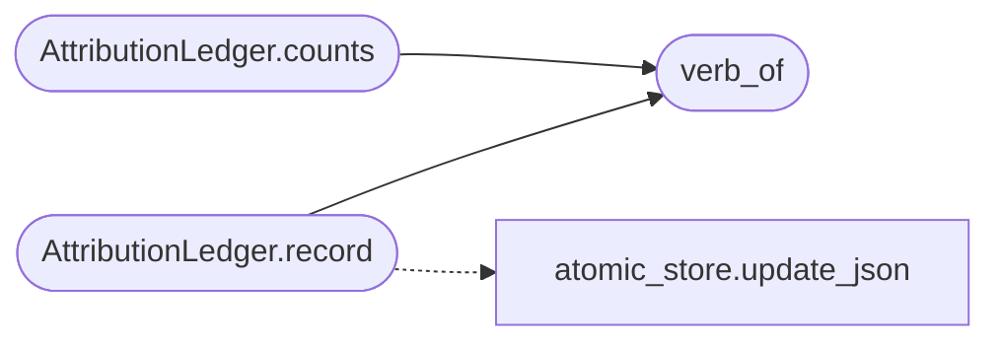

# `modules.outcome_attribution`

> Source: [modules/outcome_attribution.py:1](../../modules/outcome_attribution.py#L1) | language `py` | coverage 100.0% | [API index](../index.md)

Observer-style failure attribution for autonomous loop steps.

Every executed step is classified into `[`ok`](scripts.top_tier_check.py.md#ok)`, ``blocked`` or ``error`` so the
planner can change strategy instead of hammering a defence. ``blocked`` means
the target actively refused (a WAF, a 403/429, a rate limiter) rather than the
host tooling failing; that distinction is what lets the loop pivot verbs at a
web application firewall instead of re-issuing the same request until the budget
drains.

The per-verb tally is persisted so a verb the target has repeatedly blocked can
be demoted on the next planner round. Host anti-virus and EDR detections are
deliberately out of scope here: those belong to ``reactive_engine`` which
escalates evasion. This module only attributes target-side refusal and tooling
failure, and never imports the loop runtime so it stays cycle-free.

## Contents

- **Classes:** [`AttributionLedger`](#attributionledger)
- **Functions:** [`classify`](#classify), [`verb_of`](#verb_of)
- **Constants:** [`OK`](#ok), [`BLOCKED`](#blocked), [`ERROR`](#error)

## Call Graph

Solid arrows stay in this module, dashed arrows leave it.



## Classes

<a id="attributionledger"></a>

### `AttributionLedger`

`class` | [modules/outcome_attribution.py:141](../../modules/outcome_attribution.py#L141)

```python
class AttributionLedger
```

Persist per-verb outcome tallies and expose repeatedly-blocked verbs.

The ledger lives at ``sessions/attribution_<task>.json`` and maps each verb
to its `[`ok`](scripts.top_tier_check.py.md#ok)`/``blocked``/``error`` counts. It is the single place the
planner consults to learn which verbs the target keeps refusing.

**Members**

| Member | Kind | Summary |
|---|---|---|
| [`__init__`](#attributionledger-__init__) | constructor | Bind the ledger to a task, creating its file lazily on write. |
| [`record`](#attributionledger-record) | method | Tally one classified step under its verb and persist the ledger. |
| [`counts`](#attributionledger-counts) | method | Return the `[`ok`](scripts.top_tier_check.py.md#ok)`/``blocked``/``error`` counts for one verb. |
| [`blocked_verbs`](#attributionledger-blocked_verbs) | method | Return verbs the target has blocked at least `[`threshold`](modules.guardrails.budget.py.md#capacityenvelope-threshold)` times. |

<a id="attributionledger-__init__"></a>

#### `AttributionLedger.__init__`

`constructor` | [modules/outcome_attribution.py:149](../../modules/outcome_attribution.py#L149)

```python
def __init__(self, task_id: str = '', base_dir: Path | None = None) -> None
```

Bind the ledger to a task, creating its file lazily on write.

**Parameters**

| Name | Type | Default | Description |
|---|---|---|---|
| `task_id` | `str` | `''` | Campaign/task identifier; blank uses a shared stream. |
| `base_dir` | `Path \| None` | `None` | Optional directory override for tests. |

<a id="attributionledger-record"></a>

#### `AttributionLedger.record`

`method` | [modules/outcome_attribution.py:167](../../modules/outcome_attribution.py#L167)

```python
def record(self, command: str, classification: str) -> str
```

Tally one classified step under its verb and persist the ledger.

The load-mutate-save cycle runs under a cross-process lock so two
concurrent workers never lose each other's tally, and a persist failure
returns an empty string rather than the verb, so a caller is never told
a block was recorded when it was not.

**Parameters**

| Name | Type | Default | Description |
|---|---|---|---|
| `command` | `str` |  | The executed command line. |
| `classification` | `str` |  | One of [`OK`](#ok), [`BLOCKED`](#blocked), [`ERROR`](#error). |

**Returns:** `str` - The verb the step was tallied under, empty when none was parsed or
the write failed.

*Calls:* [`update_json`](core.atomic_store.py.md#update_json), [`verb_of`](#verb_of)

<a id="attributionledger-counts"></a>

#### `AttributionLedger.counts`

`method` | [modules/outcome_attribution.py:199](../../modules/outcome_attribution.py#L199)

```python
def counts(self, verb: str) -> dict
```

Return the `[`ok`](scripts.top_tier_check.py.md#ok)`/``blocked``/``error`` counts for one verb.

**Parameters**

| Name | Type | Default | Description |
|---|---|---|---|
| `verb` | `str` |  |  |

**Returns:** `dict`

*Calls:* [`verb_of`](#verb_of)

<a id="attributionledger-blocked_verbs"></a>

#### `AttributionLedger.blocked_verbs`

`method` | [modules/outcome_attribution.py:204](../../modules/outcome_attribution.py#L204)

```python
def blocked_verbs(self, threshold: int = _DEFAULT_BLOCK_THRESHOLD) -> set[str]
```

Return verbs the target has blocked at least `[`threshold`](modules.guardrails.budget.py.md#capacityenvelope-threshold)` times.

A verb that has since produced a success is not demoted: a single later
`[`ok`](scripts.top_tier_check.py.md#ok)` clears it, so a transient block does not ban a verb for the rest
of the campaign.

**Parameters**

| Name | Type | Default | Description |
|---|---|---|---|
| `threshold` | `int` | `_DEFAULT_BLOCK_THRESHOLD` | Minimum blocked count before a verb is demoted. |

**Returns:** `set[str]` - The set of verbs the planner should avoid re-proposing.

---

## Functions

<a id="classify"></a>

### `classify`

`function` | [modules/outcome_attribution.py:100](../../modules/outcome_attribution.py#L100)

```python
def classify(output: str, is_error: bool = False) -> str
```

Attribute one step's result to `[`ok`](scripts.top_tier_check.py.md#ok)`, ``blocked`` or ``error``.

A hard rejection marker is a block outright. A bare CDN/WAF vendor name is a
block only when a rejection signal co-occurs, so a successful recon probe
that merely observes ``server: cloudflare`` is never demoted. Blocked is
tested before error so a WAF answer is read as a strategy signal, not a
transport failure the planner would simply retry.

**Parameters**

| Name | Type | Default | Description |
|---|---|---|---|
| `output` | `str` |  | Captured command output. |
| `is_error` | `bool` | `False` | True when the executor already flagged a non-zero result. |

**Returns:** `str` - One of [`OK`](#ok), [`BLOCKED`](#blocked), [`ERROR`](#error).

---

<a id="verb_of"></a>

### `verb_of`

`function` | [modules/outcome_attribution.py:126](../../modules/outcome_attribution.py#L126)

```python
def verb_of(command: str) -> str
```

Return the leading verb of a command line for per-verb attribution.

**Parameters**

| Name | Type | Default | Description |
|---|---|---|---|
| `command` | `str` |  | The executed command line. |

**Returns:** `str` - The basename of the first token, or an empty string.

*Called by:* [`AttributionLedger.counts`](#attributionledger-counts), [`AttributionLedger.record`](#attributionledger-record)

---

## Constants

<a id="ok"></a>

### `OK`

`constant` | [modules/outcome_attribution.py:24](../../modules/outcome_attribution.py#L24)

```python
OK = 'ok'
```

---

<a id="blocked"></a>

### `BLOCKED`

`constant` | [modules/outcome_attribution.py:25](../../modules/outcome_attribution.py#L25)

```python
BLOCKED = 'blocked'
```

---

<a id="error"></a>

### `ERROR`

`constant` | [modules/outcome_attribution.py:26](../../modules/outcome_attribution.py#L26)

```python
ERROR = 'error'
```

---
