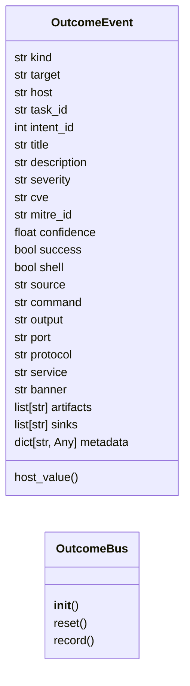
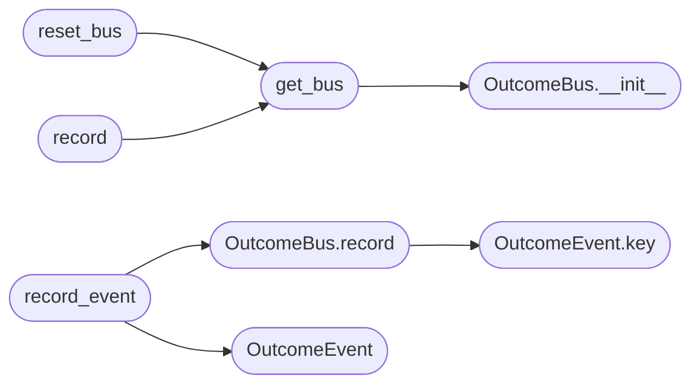

# `modules.outcome_bus`

> Source: [modules/outcome_bus.py:1](../../modules/outcome_bus.py#L1) | language `py` | coverage 100.0% | [API index](../index.md)

Single fan-out contract for engagement outcomes.

Every exploit, emulation step, chain result and loop finding publishes one
[`OutcomeEvent`](#outcomeevent) here. The bus calls the configured sink adapters in
``modules/sinks/`` so the world model, kill-chain, routing priors, C2
surfaces, objectives, event bus, intel graph, attack graph and reports
stay consistent without each caller reimplementing the fan-out.

Sinks are best-effort: one failing surface never blocks the others. The
bus deduplicates identical events inside one process and appends every
decision to ``sessions/outcomes.jsonl`` for audit.

## Contents

- **Classes:** [`OutcomeEvent`](#outcomeevent), [`OutcomeBus`](#outcomebus)
- **Functions:** [`get_bus`](#get_bus), [`reset_bus`](#reset_bus), [`record`](#record), [`record_event`](#record_event), [`severity_for_event`](#severity_for_event), [`category_for_event`](#category_for_event)
- **Constants:** [`SESSIONS_DIR`](#sessions_dir), [`SINK_LOADERS`](#sink_loaders), [`DEFAULT_SINKS`](#default_sinks)

## Type Diagram



## Call Graph

Solid arrows stay in this module, dashed arrows leave it.



## Classes

<a id="outcomeevent"></a>

### `OutcomeEvent`

`class` `dataclass` | [modules/outcome_bus.py:75](../../modules/outcome_bus.py#L75)

Decorators: `@dataclass`

```python
class OutcomeEvent
```

One engagement outcome ready for sink fan-out.

**Attributes**

| Name | Type | Default | Description |
|---|---|---|---|
| [`kind`](#outcomeevent-kind) | `str` | `'finding'` |  |
| [`target`](#outcomeevent-target) | `str` | `''` |  |
| [`host`](#outcomeevent-host) | `str` | `''` |  |
| [`task_id`](#outcomeevent-task_id) | `str` | `''` |  |
| [`intent_id`](#outcomeevent-intent_id) | `int` | `0` |  |
| [`title`](#outcomeevent-title) | `str` | `''` |  |
| [`description`](#outcomeevent-description) | `str` | `''` |  |
| [`severity`](#outcomeevent-severity) | `str` | `'medium'` |  |
| [`cve`](#outcomeevent-cve) | `str` | `''` |  |
| [`mitre_id`](#outcomeevent-mitre_id) | `str` | `''` |  |
| [`confidence`](#outcomeevent-confidence) | `float` | `1.0` |  |
| [`success`](#outcomeevent-success) | `bool` | `False` |  |
| [`shell`](#outcomeevent-shell) | `bool` | `False` |  |
| [`source`](#outcomeevent-source) | `str` | `'outcome_bus'` |  |
| [`command`](#outcomeevent-command) | `str` | `''` |  |
| [`output`](#outcomeevent-output) | `str` | `''` |  |
| [`port`](#outcomeevent-port) | `str` | `''` |  |
| [`protocol`](#outcomeevent-protocol) | `str` | `'tcp'` |  |
| [`service`](#outcomeevent-service) | `str` | `''` |  |
| [`banner`](#outcomeevent-banner) | `str` | `''` |  |
| [`artifacts`](#outcomeevent-artifacts) | `list[str]` | `field(default_factory=list)` |  |
| [`sinks`](#outcomeevent-sinks) | `list[str]` | `field(default_factory=list)` |  |
| [`metadata`](#outcomeevent-metadata) | `dict[str, Any]` | `field(default_factory=dict)` |  |

**Members**

| Member | Kind | Summary |
|---|---|---|
| [`host_value`](#outcomeevent-host_value) | property | Return the best host identifier available. |
| [`key`](#outcomeevent-key) | method | Return the idempotency key for this event. |
| [`to_dict`](#outcomeevent-to_dict) | method | Return a JSON-serializable view. |

<a id="outcomeevent-host_value"></a>

#### `OutcomeEvent.host_value`

`property` | [modules/outcome_bus.py:103](../../modules/outcome_bus.py#L103)

Decorators: `@property`

```python
def host_value(self) -> str
```

Return the best host identifier available.

**Returns:** `str`

<a id="outcomeevent-key"></a>

#### `OutcomeEvent.key`

`method` | [modules/outcome_bus.py:107](../../modules/outcome_bus.py#L107)

```python
def key(self) -> str
```

Return the idempotency key for this event.

**Returns:** `str`

*Called by:* [`OutcomeBus.record`](#outcomebus-record), [`apply`](modules.sinks.objectives.py.md#apply), [`write_c2_api`](scripts.publish_wiki.sh.md#write_c2_api)

<a id="outcomeevent-to_dict"></a>

#### `OutcomeEvent.to_dict`

`method` | [modules/outcome_bus.py:125](../../modules/outcome_bus.py#L125)

```python
def to_dict(self) -> dict[str, Any]
```

Return a JSON-serializable view.

**Returns:** `dict[str, Any]`

---

<a id="outcomebus"></a>

### `OutcomeBus`

`class` | [modules/outcome_bus.py:153](../../modules/outcome_bus.py#L153)

```python
class OutcomeBus
```

Fan out outcome events to every configured sink.

**Members**

| Member | Kind | Summary |
|---|---|---|
| [`__init__`](#outcomebus-__init__) | constructor | Bind the audit ledger and an optional sink map for tests. |
| [`reset`](#outcomebus-reset) | method | Clear the in-process dedupe cache. |
| [`record`](#outcomebus-record) | method | Publish one event to every enabled sink. |

<a id="outcomebus-__init__"></a>

#### `OutcomeBus.__init__`

`constructor` | [modules/outcome_bus.py:156](../../modules/outcome_bus.py#L156)

```python
def __init__(self, ledger_path: Path | str | None = None, sink_map: dict[str, Any] | None = None) -> None
```

Bind the audit ledger and an optional sink map for tests.

**Parameters**

| Name | Type | Default | Description |
|---|---|---|---|
| `ledger_path` | `Path \| str \| None` | `None` |  |
| `sink_map` | `dict[str, Any] \| None` | `None` |  |

*Called by:* [`get_bus`](#get_bus)

<a id="outcomebus-reset"></a>

#### `OutcomeBus.reset`

`method` | [modules/outcome_bus.py:169](../../modules/outcome_bus.py#L169)

```python
def reset(self) -> None
```

Clear the in-process dedupe cache.

<a id="outcomebus-record"></a>

#### `OutcomeBus.record`

`method` | [modules/outcome_bus.py:201](../../modules/outcome_bus.py#L201)

```python
def record(self, event: OutcomeEvent, sinks: list[str] | None = None) -> dict[str, bool]
```

Publish one event to every enabled sink.

**Parameters**

| Name | Type | Default | Description |
|---|---|---|---|
| `event` | `OutcomeEvent` |  | Outcome payload. |
| `sinks` | `list[str] \| None` | `None` | Optional explicit sink list; defaults to the event tags merged with the global sink list. |

**Returns:** `dict[str, bool]` - Mapping of sink name to success. ``_deduplicated`` is true when
the same event was already processed in this process.

*Calls:* [`OutcomeEvent.key`](#outcomeevent-key)

*Called by:* [`record_outcome`](modules.atomic_exploit_bridge.py.md#record_outcome), [`record_event`](#record_event)

---

## Functions

<a id="get_bus"></a>

### `get_bus`

`function` | [modules/outcome_bus.py:269](../../modules/outcome_bus.py#L269)

```python
def get_bus() -> OutcomeBus
```

Return the process-wide outcome bus.

**Returns:** `OutcomeBus`

*Calls:* [`OutcomeBus.__init__`](#outcomebus-__init__)

*Called by:* [`record`](#record), [`reset_bus`](#reset_bus)

---

<a id="reset_bus"></a>

### `reset_bus`

`function` | [modules/outcome_bus.py:278](../../modules/outcome_bus.py#L278)

```python
def reset_bus() -> None
```

Reset the process-wide bus cache (tests and long-lived operators).

*Calls:* [`get_bus`](#get_bus)

---

<a id="record"></a>

### `record`

`function` | [modules/outcome_bus.py:283](../../modules/outcome_bus.py#L283)

```python
def record(event: OutcomeEvent, sinks: list[str] | None = None) -> dict[str, bool]
```

Publish one event through the process-wide bus.

**Parameters**

| Name | Type | Default | Description |
|---|---|---|---|
| `event` | `OutcomeEvent` |  |  |
| `sinks` | `list[str] \| None` | `None` |  |

**Returns:** `dict[str, bool]`

*Calls:* [`get_bus`](#get_bus)

---

<a id="record_event"></a>

### `record_event`

`function` | [modules/outcome_bus.py:288](../../modules/outcome_bus.py#L288)

```python
def record_event(**kwargs: Any) -> dict[str, bool]
```

Build and publish one event from keyword fields.

**Parameters**

| Name | Type | Default | Description |
|---|---|---|---|
| `**kwargs` | `Any` |  |  |

**Returns:** `dict[str, bool]`

*Calls:* [`OutcomeBus.record`](#outcomebus-record), [`OutcomeEvent`](#outcomeevent)

*Called by:* [`CommandAndControlMigratedCommandSet.do_apt_chain`](cli.commands.command_and_control_migrated.py.md#commandandcontrolmigratedcommandset-do_apt_chain), [`AutonomousExploitEngine.execute_candidate`](modules.autonomous_exploit_engine.py.md#autonomousexploitengine-execute_candidate), [`ingest_beacon_recon`](modules.beacon_recon.py.md#ingest_beacon_recon), [`ExploitChain.save_report`](modules.exploit_chain.py.md#exploitchain-save_report), [`submit_challenge`](modules.redteam_gym.py.md#submit_challenge)

---

<a id="severity_for_event"></a>

### `severity_for_event`

`function` | [modules/outcome_bus.py:293](../../modules/outcome_bus.py#L293)

```python
def severity_for_event(severity: str) -> str
```

Map an outcome severity to the event-bus severity vocabulary.

**Parameters**

| Name | Type | Default | Description |
|---|---|---|---|
| `severity` | `str` |  |  |

**Returns:** `str`

*Called by:* [`apply`](modules.sinks.event_bus.py.md#apply)

---

<a id="category_for_event"></a>

### `category_for_event`

`function` | [modules/outcome_bus.py:298](../../modules/outcome_bus.py#L298)

```python
def category_for_event(kind: str) -> str
```

Map an outcome kind to the event-bus category vocabulary.

**Parameters**

| Name | Type | Default | Description |
|---|---|---|---|
| `kind` | `str` |  |  |

**Returns:** `str`

*Called by:* [`apply`](modules.sinks.event_bus.py.md#apply)

---

## Constants

<a id="sessions_dir"></a>

### `SESSIONS_DIR`

`constant` | [modules/outcome_bus.py:30](../../modules/outcome_bus.py#L30)

```python
SESSIONS_DIR = BASE_DIR / 'sessions'
```

---

<a id="sink_loaders"></a>

### `SINK_LOADERS`

`constant` | [modules/outcome_bus.py:34](../../modules/outcome_bus.py#L34)

```python
SINK_LOADERS: dict[str, tuple[str, str]]
```

---

<a id="default_sinks"></a>

### `DEFAULT_SINKS`

`constant` | [modules/outcome_bus.py:49](../../modules/outcome_bus.py#L49)

```python
DEFAULT_SINKS = tuple((name for name in SINK_LOADERS if name != 'campaign_db'))
```

---
