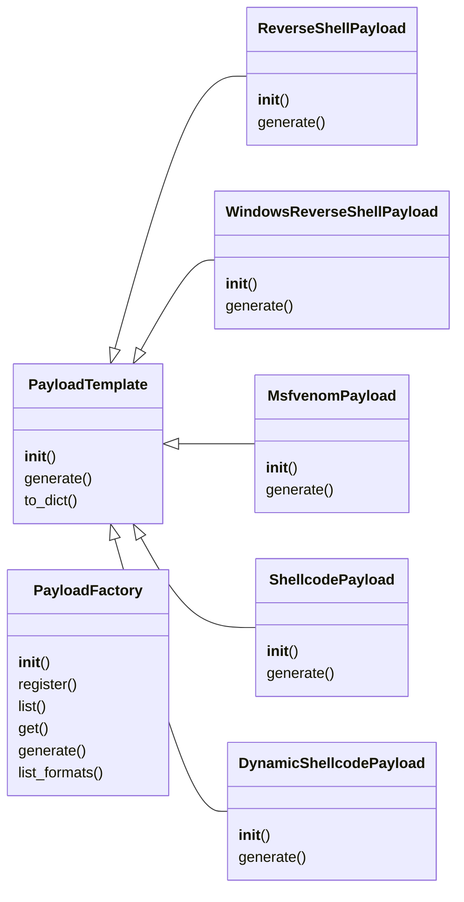
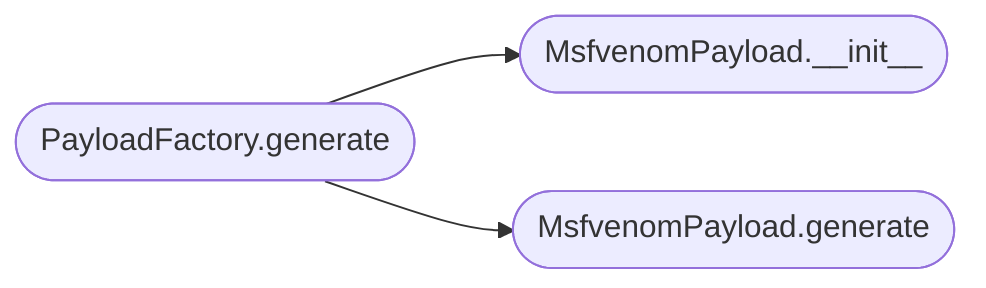

# `modules.payload_factory`

> Source: [modules/payload_factory.py:1](../../modules/payload_factory.py#L1) | language `py` | coverage 71.4% | [API index](../index.md)

Native payload generation framework — stagers, stages, singles, formats.

Provides a `[`PayloadFactory`](#payloadfactory)` that can generate payloads for multiple
platforms and architectures without depending on ``msfvenom``. Supports
a ``show payloads`` catalog and a `[`generate`](modules.lazypassgen.py.md#generate)` command modelled on
Metasploit's `[`generate`](modules.lazypassgen.py.md#generate)` workflow.

Payloads are registered as `[`PayloadTemplate`](#payloadtemplate)` instances with metadata
(name, platform, arch, description, options) and a `[`generate`](modules.lazypassgen.py.md#generate)` method.

Dynamic shellcode patching is supported for reverse-TCP payloads: the
`[`ShellcodePayload`](#shellcodepayload)` class replaces known IP / port placeholders inside
embedded templates at generation time, removing the need for msfvenom on
the most common combos.

## Contents

- **Classes:** [`PayloadTemplate`](#payloadtemplate), [`ReverseShellPayload`](#reverseshellpayload), [`WindowsReverseShellPayload`](#windowsreverseshellpayload), [`MsfvenomPayload`](#msfvenompayload), [`ShellcodePayload`](#shellcodepayload), [`DynamicShellcodePayload`](#dynamicshellcodepayload), [`PayloadFactory`](#payloadfactory)
- **Functions:** [`format_payload_table`](#format_payload_table)
- **Constants:** [`OUTPUT_FORMATS`](#output_formats), [`SHELLCODE_TEMPLATES`](#shellcode_templates), [`IP_PLACEHOLDER_X64`](#ip_placeholder_x64), [`PORT_PLACEHOLDER_X64`](#port_placeholder_x64)

## Type Diagram



## Call Graph

Solid arrows stay in this module, dashed arrows leave it.



## Classes

<a id="payloadtemplate"></a>

### `PayloadTemplate`

`class` `abstract` | [modules/payload_factory.py:216](../../modules/payload_factory.py#L216)

```python
class PayloadTemplate(ABC)
```

Bases: `ABC`

Subclasses: [`DynamicShellcodePayload`](#dynamicshellcodepayload), [`MsfvenomPayload`](#msfvenompayload), [`ReverseShellPayload`](#reverseshellpayload), [`ShellcodePayload`](#shellcodepayload), [`WindowsReverseShellPayload`](#windowsreverseshellpayload)

Base class for a registered payload template.

Subclasses must implement [`generate`](modules.lazypassgen.py.md#generate) which returns raw bytes.

**Members**

| Member | Kind | Summary |
|---|---|---|
| [`__init__`](#payloadtemplate-__init__) | constructor |  |
| [`generate`](#payloadtemplate-generate) | method | Generate the raw payload bytes. |
| [`to_dict`](#payloadtemplate-to_dict) | method |  |

<a id="payloadtemplate-__init__"></a>

#### `PayloadTemplate.__init__`

`constructor` | [modules/payload_factory.py:222](../../modules/payload_factory.py#L222)

```python
def __init__(self, name: str, platform: str, arch: str, description: str, options: dict[str, Any] | None = None) -> None
```

**Parameters**

| Name | Type | Default | Description |
|---|---|---|---|
| `name` | `str` |  |  |
| `platform` | `str` |  |  |
| `arch` | `str` |  |  |
| `description` | `str` |  |  |
| `options` | `dict[str, Any] \| None` | `None` |  |

<a id="payloadtemplate-generate"></a>

#### `PayloadTemplate.generate`

`method` `abstract` | [modules/payload_factory.py:237](../../modules/payload_factory.py#L237)

Decorators: `@abstractmethod`

```python
def generate(self, **kwargs: Any) -> bytes
```

Generate the raw payload bytes.

**Parameters**

| Name | Type | Default | Description |
|---|---|---|---|
| `**kwargs` | `Any` |  |  |

**Returns:** `bytes`

<a id="payloadtemplate-to_dict"></a>

#### `PayloadTemplate.to_dict`

`method` | [modules/payload_factory.py:241](../../modules/payload_factory.py#L241)

```python
def to_dict(self) -> dict[str, Any]
```

**Returns:** `dict[str, Any]`

---

<a id="reverseshellpayload"></a>

### `ReverseShellPayload`

`class` | [modules/payload_factory.py:251](../../modules/payload_factory.py#L251)

```python
class ReverseShellPayload(PayloadTemplate)
```

Bases: [`PayloadTemplate`](#payloadtemplate)

Generate a reverse shell one-liner for various interpreters.

**Members**

| Member | Kind | Summary |
|---|---|---|
| [`__init__`](#reverseshellpayload-__init__) | constructor |  |
| [`generate`](#reverseshellpayload-generate) | method | Generate the raw payload bytes. |

<a id="reverseshellpayload-__init__"></a>

#### `ReverseShellPayload.__init__`

`constructor` | [modules/payload_factory.py:254](../../modules/payload_factory.py#L254)

```python
def __init__(self) -> None
```

*Called by:* [`apply`](modules.sinks.beacon_dispatch.py.md#apply)

<a id="reverseshellpayload-generate"></a>

#### `ReverseShellPayload.generate`

`method` | [modules/payload_factory.py:272](../../modules/payload_factory.py#L272)

```python
def generate(self, **kwargs: Any) -> bytes
```

Generate the raw payload bytes.

**Parameters**

| Name | Type | Default | Description |
|---|---|---|---|
| `**kwargs` | `Any` |  |  |

**Returns:** `bytes`

> **Inherited:** Documentation from [`PayloadTemplate.generate`](#payloadtemplate-generate) (modules/payload_factory.py:237).

*Called by:* [`apply`](modules.sinks.beacon_dispatch.py.md#apply)

---

<a id="windowsreverseshellpayload"></a>

### `WindowsReverseShellPayload`

`class` | [modules/payload_factory.py:290](../../modules/payload_factory.py#L290)

```python
class WindowsReverseShellPayload(PayloadTemplate)
```

Bases: [`PayloadTemplate`](#payloadtemplate)

Generate a Windows reverse shell one-liner (PowerShell).

**Members**

| Member | Kind | Summary |
|---|---|---|
| [`__init__`](#windowsreverseshellpayload-__init__) | constructor |  |
| [`generate`](#windowsreverseshellpayload-generate) | method | Generate the raw payload bytes. |

<a id="windowsreverseshellpayload-__init__"></a>

#### `WindowsReverseShellPayload.__init__`

`constructor` | [modules/payload_factory.py:293](../../modules/payload_factory.py#L293)

```python
def __init__(self) -> None
```

<a id="windowsreverseshellpayload-generate"></a>

#### `WindowsReverseShellPayload.generate`

`method` | [modules/payload_factory.py:305](../../modules/payload_factory.py#L305)

```python
def generate(self, **kwargs: Any) -> bytes
```

Generate the raw payload bytes.

**Parameters**

| Name | Type | Default | Description |
|---|---|---|---|
| `**kwargs` | `Any` |  |  |

**Returns:** `bytes`

> **Inherited:** Documentation from [`PayloadTemplate.generate`](#payloadtemplate-generate) (modules/payload_factory.py:237).

---

<a id="msfvenompayload"></a>

### `MsfvenomPayload`

`class` | [modules/payload_factory.py:322](../../modules/payload_factory.py#L322)

```python
class MsfvenomPayload(PayloadTemplate)
```

Bases: [`PayloadTemplate`](#payloadtemplate)

Proxy to ``msfvenom`` for payloads we don't natively support.

**Members**

| Member | Kind | Summary |
|---|---|---|
| [`__init__`](#msfvenompayload-__init__) | constructor |  |
| [`generate`](#msfvenompayload-generate) | method | Generate the raw payload bytes. |

<a id="msfvenompayload-__init__"></a>

#### `MsfvenomPayload.__init__`

`constructor` | [modules/payload_factory.py:325](../../modules/payload_factory.py#L325)

```python
def __init__(self, name: str, platform: str = '', arch: str = '') -> None
```

**Parameters**

| Name | Type | Default | Description |
|---|---|---|---|
| `name` | `str` |  |  |
| `platform` | `str` | `''` |  |
| `arch` | `str` | `''` |  |

*Called by:* [`PayloadFactory.generate`](#payloadfactory-generate)

<a id="msfvenompayload-generate"></a>

#### `MsfvenomPayload.generate`

`method` | [modules/payload_factory.py:337](../../modules/payload_factory.py#L337)

```python
def generate(self, **kwargs: Any) -> bytes
```

Generate the raw payload bytes.

**Parameters**

| Name | Type | Default | Description |
|---|---|---|---|
| `**kwargs` | `Any` |  |  |

**Returns:** `bytes`

> **Inherited:** Documentation from [`PayloadTemplate.generate`](#payloadtemplate-generate) (modules/payload_factory.py:237).

*Called by:* [`PayloadFactory.generate`](#payloadfactory-generate)

---

<a id="shellcodepayload"></a>

### `ShellcodePayload`

`class` | [modules/payload_factory.py:363](../../modules/payload_factory.py#L363)

```python
class ShellcodePayload(PayloadTemplate)
```

Bases: [`PayloadTemplate`](#payloadtemplate)

Generate raw shellcode bytes from an embedded template.

When ``lhost`` and ``lport`` are both provided, the shellcode is
dynamically patched: known IP / port placeholder byte sequences inside
the template are replaced with the caller's values so the resulting
blob connects back to the correct listener.

**Members**

| Member | Kind | Summary |
|---|---|---|
| [`__init__`](#shellcodepayload-__init__) | constructor |  |
| [`generate`](#shellcodepayload-generate) | method | Return the shellcode, optionally patching LHOST / LPORT. |

<a id="shellcodepayload-__init__"></a>

#### `ShellcodePayload.__init__`

`constructor` | [modules/payload_factory.py:374](../../modules/payload_factory.py#L374)

```python
def __init__(self, name: str, platform: str, arch: str, description: str, escaped_hex: str, patcher: Any | None = None) -> None
```

**Parameters**

| Name | Type | Default | Description |
|---|---|---|---|
| `name` | `str` |  |  |
| `platform` | `str` |  |  |
| `arch` | `str` |  |  |
| `description` | `str` |  |  |
| `escaped_hex` | `str` |  |  |
| `patcher` | `Any \| None` | `None` |  |

<a id="shellcodepayload-generate"></a>

#### `ShellcodePayload.generate`

`method` | [modules/payload_factory.py:397](../../modules/payload_factory.py#L397)

```python
def generate(self, **kwargs: Any) -> bytes
```

Return the shellcode, optionally patching LHOST / LPORT.

**Parameters**

| Name | Type | Default | Description |
|---|---|---|---|
| `**kwargs` | `Any` |  |  |

**Returns:** `bytes`

---

<a id="dynamicshellcodepayload"></a>

### `DynamicShellcodePayload`

`class` | [modules/payload_factory.py:409](../../modules/payload_factory.py#L409)

```python
class DynamicShellcodePayload(PayloadTemplate)
```

Bases: [`PayloadTemplate`](#payloadtemplate)

Generate shellcode entirely at runtime — no static template needed.

The ``builder`` callable receives ``(lhost, lport)`` and must return
the complete position-independent shellcode as ``bytes``.

**Members**

| Member | Kind | Summary |
|---|---|---|
| [`__init__`](#dynamicshellcodepayload-__init__) | constructor |  |
| [`generate`](#dynamicshellcodepayload-generate) | method | Generate the raw payload bytes. |

<a id="dynamicshellcodepayload-__init__"></a>

#### `DynamicShellcodePayload.__init__`

`constructor` | [modules/payload_factory.py:416](../../modules/payload_factory.py#L416)

```python
def __init__(self, name: str, platform: str, arch: str, description: str, builder: Any) -> None
```

**Parameters**

| Name | Type | Default | Description |
|---|---|---|---|
| `name` | `str` |  |  |
| `platform` | `str` |  |  |
| `arch` | `str` |  |  |
| `description` | `str` |  |  |
| `builder` | `Any` |  |  |

<a id="dynamicshellcodepayload-generate"></a>

#### `DynamicShellcodePayload.generate`

`method` | [modules/payload_factory.py:436](../../modules/payload_factory.py#L436)

```python
def generate(self, **kwargs: Any) -> bytes
```

Generate the raw payload bytes.

**Parameters**

| Name | Type | Default | Description |
|---|---|---|---|
| `**kwargs` | `Any` |  |  |

**Returns:** `bytes`

> **Inherited:** Documentation from [`PayloadTemplate.generate`](#payloadtemplate-generate) (modules/payload_factory.py:237).

---

<a id="payloadfactory"></a>

### `PayloadFactory`

`class` | [modules/payload_factory.py:457](../../modules/payload_factory.py#L457)

```python
class PayloadFactory
```

Registry and generator for payload templates.

Provides a catalogue of built-in payloads and falls through to
``msfvenom`` for Metasploit payloads when available.

**Members**

| Member | Kind | Summary |
|---|---|---|
| [`__init__`](#payloadfactory-__init__) | constructor |  |
| [`register`](#payloadfactory-register) | method | Register a custom payload template. |
| [`list`](#payloadfactory-list) | method | List all registered payloads, optionally filtered by platform. |
| [`get`](#payloadfactory-get) | method | Get a payload template by name. |
| [`generate`](#payloadfactory-generate) | method | Generate a payload by name. |
| [`list_formats`](#payloadfactory-list_formats) | staticmethod | List all available output formats. |

<a id="payloadfactory-__init__"></a>

#### `PayloadFactory.__init__`

`constructor` | [modules/payload_factory.py:464](../../modules/payload_factory.py#L464)

```python
def __init__(self) -> None
```

*Called by:* [`check_calls`](scripts.devtools.core_smoke.py.md#check_calls)

<a id="payloadfactory-register"></a>

#### `PayloadFactory.register`

`method` | [modules/payload_factory.py:512](../../modules/payload_factory.py#L512)

```python
def register(self, template: PayloadTemplate) -> None
```

Register a custom payload template.

**Parameters**

| Name | Type | Default | Description |
|---|---|---|---|
| `template` | `PayloadTemplate` |  |  |

<a id="payloadfactory-list"></a>

#### `PayloadFactory.list`

`method` | [modules/payload_factory.py:516](../../modules/payload_factory.py#L516)

```python
def list(self, platform: str | None = None) -> builtins.list[dict[str, Any]]
```

List all registered payloads, optionally filtered by platform.

**Parameters**

| Name | Type | Default | Description |
|---|---|---|---|
| `platform` | `str \| None` | `None` |  |

**Returns:** `builtins.list[dict[str, Any]]`

<a id="payloadfactory-get"></a>

#### `PayloadFactory.get`

`method` | [modules/payload_factory.py:525](../../modules/payload_factory.py#L525)

```python
def get(self, name: str) -> PayloadTemplate | None
```

Get a payload template by name.

**Parameters**

| Name | Type | Default | Description |
|---|---|---|---|
| `name` | `str` |  |  |

**Returns:** `PayloadTemplate | None`

<a id="payloadfactory-generate"></a>

#### `PayloadFactory.generate`

`method` | [modules/payload_factory.py:529](../../modules/payload_factory.py#L529)

```python
def generate(self, name: str, format: str = 'raw', output: str | None = None, **kwargs: Any) -> bytes
```

Generate a payload by name.

If the payload is not registered natively, attempts
``msfvenom``.

**Parameters**

| Name | Type | Default | Description |
|---|---|---|---|
| `name` | `str` |  | Payload name (e.g. ``cmd/unix/reverse_shell``). |
| `format` | `str` | `'raw'` | Output format (``raw``, ``py``, ``ps1``, ``c``, ``hex``, ``base64``, ``exe``, ``elf``, etc.). |
| `output` | `str \| None` | `None` | Optional file path to write the payload. |
| `**kwargs` | `Any` |  | Payload-specific options (lhost, lport, etc.). |

**Returns:** `bytes` - Raw payload bytes.

*Calls:* [`MsfvenomPayload.__init__`](#msfvenompayload-__init__), [`MsfvenomPayload.generate`](#msfvenompayload-generate)

*Called by:* [`check_calls`](scripts.devtools.core_smoke.py.md#check_calls)

<a id="payloadfactory-list_formats"></a>

#### `PayloadFactory.list_formats`

`staticmethod` | [modules/payload_factory.py:664](../../modules/payload_factory.py#L664)

Decorators: `@staticmethod`

```python
def list_formats() -> builtins.list[dict[str, str]]
```

List all available output formats.

**Returns:** `builtins.list[dict[str, str]]`

---

## Functions

<a id="format_payload_table"></a>

### `format_payload_table`

`function` | [modules/payload_factory.py:672](../../modules/payload_factory.py#L672)

```python
def format_payload_table(payloads: list[dict[str, Any]]) -> str
```

Format a list of payload dicts as an aligned table.

**Parameters**

| Name | Type | Default | Description |
|---|---|---|---|
| `payloads` | `list[dict[str, Any]]` |  | List of payload metadata dicts from [`PayloadFactory.list`](#payloadfactory-list). |

**Returns:** `str` - Multi-line string with aligned columns.

---

## Constants

<a id="output_formats"></a>

### `OUTPUT_FORMATS`

`constant` | [modules/payload_factory.py:28](../../modules/payload_factory.py#L28)

```python
OUTPUT_FORMATS
```

---

<a id="shellcode_templates"></a>

### `SHELLCODE_TEMPLATES`

`constant` | [modules/payload_factory.py:54](../../modules/payload_factory.py#L54)

```python
SHELLCODE_TEMPLATES: dict[str, str]
```

---

<a id="ip_placeholder_x64"></a>

### `IP_PLACEHOLDER_X64`

`constant` | [modules/payload_factory.py:114](../../modules/payload_factory.py#L114)

```python
IP_PLACEHOLDER_X64 = bytes(range(1, 9))
```

---

<a id="port_placeholder_x64"></a>

### `PORT_PLACEHOLDER_X64`

`constant` | [modules/payload_factory.py:115](../../modules/payload_factory.py#L115)

```python
PORT_PLACEHOLDER_X64 = b'BBBB'
```

---
