# `modules.pipeline_engine`

> Source: [modules/pipeline_engine.py:1](../../modules/pipeline_engine.py#L1) | language `py` | coverage 73.2% | [API index](../index.md)

modules/pipeline_engine.py — Declarative YAML pipelines for LazyOwn ====================================================================

Pillar 3: composition without code. Operators describe a kill-chain (or
any other ordered sequence of LazyOwn commands) as a YAML document under
``pipelines/`` and run it with ``pipeline run <name>``. Pipelines may call
other pipelines so larger playbooks compose from smaller building blocks.

The engine is intentionally minimal: it never calls ``eval`` or executes
template code. Variable interpolation is restricted to a safe dotted-path
resolver over a typed StepContext, and conditional execution is a strict
truthy check on the resolved value. Each step runs through the existing
LazyOwn command runner (the same one the autonomous daemon uses) so the
333+ commands remain the canonical implementation.

Layered architecture (SOLID):

  - PipelineLoader     : parses YAML + validates schema. No execution.
  - TemplateResolver   : safe ``{{ scope.path.to.value }}`` substitution.
  - ConditionEvaluator : truthy check on a resolved template.
  - StepValidator      : ``validate:`` predicate (substring or ``re:`` regex).
  - StepDerivers       : per-command output parsers (has_exploit, findings,
                         services, ttl, ports, ...). Pluggable registry so
                         new commands extend the engine without changes.
  - IStepRunner        : execution contract for one step.
  - LazyOwnStepRunner  : default runner wrapping the daemon command runner.
  - RunArtifactStore   : persists every run under sessions/pipelines/.
  - INarrator          : optional narrator (default: engagement_hooks).
  - PipelineEngine     : orchestrates the plan. Detects nested-pipeline
                         cycles, enforces depth limits, honours on_success
                         and on_failure semantics.

Security:
  - No template-language code execution.
  - YAML loaded with ``yaml.safe_load``.
  - Pipeline names normalised and verified against a whitelist regex so
    operators cannot escape ``pipelines/`` via traversal.
  - Artifact paths constructed with ``Path.resolve`` and a containment
    check; writes refuse paths outside the run directory.

## Contents

- **Classes:** [`PipelineStep`](#pipelinestep), [`PipelineSpec`](#pipelinespec), [`StepResult`](#stepresult), [`PipelineRun`](#pipelinerun), [`TemplateResolver`](#templateresolver), [`ConditionEvaluator`](#conditionevaluator), [`StepValidator`](#stepvalidator), [`StepDerivers`](#stepderivers), [`IStepRunner`](#isteprunner), [`LazyOwnStepRunner`](#lazyownsteprunner), [`PipelineLoader`](#pipelineloader), [`RunArtifactStore`](#runartifactstore), [`INarratorAdapter`](#inarratoradapter), [`EngagementNarratorAdapter`](#engagementnarratoradapter), [`PipelineEngine`](#pipelineengine)
- **Exceptions:** [`PipelineError`](#pipelineerror), [`PipelineSchemaError`](#pipelineschemaerror), [`PipelineNotFoundError`](#pipelinenotfounderror), [`PipelineCycleError`](#pipelinecycleerror)
- **Functions:** [`get_default_engine`](#get_default_engine), [`mcp_pipeline_run`](#mcp_pipeline_run), [`mcp_pipeline_list`](#mcp_pipeline_list), [`mcp_pipeline_validate`](#mcp_pipeline_validate), [`mcp_pipeline_status`](#mcp_pipeline_status), [`cmd_pipeline`](#cmd_pipeline)
- **Constants:** [`PIPELINES_DIR`](#pipelines_dir), [`RUNS_DIR`](#runs_dir)

## Type Diagram

```mermaid
classDiagram
    direction LR
    class PipelineError
    <<exception>> PipelineError
    class PipelineSchemaError
    <<exception>> PipelineSchemaError
    class PipelineNotFoundError
    <<exception>> PipelineNotFoundError
    class PipelineCycleError
    <<exception>> PipelineCycleError
    class PipelineStep
    PipelineStep : int index
    PipelineStep : str name
    PipelineStep : str command
    PipelineStep : str pipeline
    PipelineStep : str args
    PipelineStep : str input_from
    PipelineStep : str validate
    PipelineStep : str condition
    PipelineStep : str on_success
    PipelineStep : str on_failure
    PipelineStep : int timeout_s
    PipelineStep : dict[str, Any] with_inputs
    class PipelineSpec
    PipelineSpec : str name
    PipelineSpec : str description
    PipelineSpec : str target
    PipelineSpec : tuple[PipelineStep, ] steps
    PipelineSpec : Path source_path
    class StepResult
    StepResult : int step_index
    StepResult : str step_name
    StepResult : str command
    StepResult : str args
    StepResult : str started_ts
    StepResult : str finished_ts
    StepResult : str output
    StepResult : bool success
    StepResult : bool skipped
    StepResult : str skipped_reason
    StepResult : str error
    StepResult : dict[str, Any] derived
    StepResult : str nested_run_id
    StepResult : to_context()
    class PipelineRun
    PipelineRun : str run_id
    PipelineRun : str pipeline
    PipelineRun : str target
    PipelineRun : str started_ts
    PipelineRun : str finished_ts
    PipelineRun : bool success
    PipelineRun : list[StepResult] steps
    PipelineRun : list[str] nested_runs
    PipelineRun : str error
    PipelineRun : str artifacts_dir
    PipelineRun : to_dict()
    class TemplateResolver
    TemplateResolver : __init__()
    TemplateResolver : render()
    TemplateResolver : resolve()
    class ConditionEvaluator
    ConditionEvaluator : is_truthy()
    class StepValidator
    StepValidator : validate()
    class StepDerivers
    StepDerivers : register()
    StepDerivers : derive()
    class IStepRunner
    IStepRunner : run()
    class LazyOwnStepRunner
    LazyOwnStepRunner : __init__()
    LazyOwnStepRunner : run()
    class PipelineLoader
    PipelineLoader : SUPPORTED_EXTENSIONS
    PipelineLoader : __init__()
    PipelineLoader : pipelines_dir()
    PipelineLoader : list()
    PipelineLoader : resolve_path()
    PipelineLoader : load()
    class RunArtifactStore
    RunArtifactStore : __init__()
    RunArtifactStore : runs_dir()
    RunArtifactStore : open_run()
    RunArtifactStore : write_plan()
    RunArtifactStore : write_step()
    RunArtifactStore : write_summary()
    class INarratorAdapter
    INarratorAdapter : narrate()
    class EngagementNarratorAdapter
    EngagementNarratorAdapter : __init__()
    EngagementNarratorAdapter : narrate()
    class PipelineEngine
    PipelineEngine : __init__()
    PipelineEngine : loader()
    PipelineEngine : validate()
    PipelineEngine : run()
    PipelineError <|-- PipelineSchemaError
    PipelineError <|-- PipelineNotFoundError
    PipelineError <|-- PipelineCycleError
    IStepRunner <|-- LazyOwnStepRunner
    INarratorAdapter <|-- EngagementNarratorAdapter
```



## Call Graph

Solid arrows stay in this module, dashed arrows leave it.

```mermaid
flowchart LR
    n_modules_pipeline_engine_py__TemplateResolver_render(["TemplateResolver.render"])
    n_modules_pipeline_engine_py__TemplateResolver_resolve(["TemplateResolver.resolve"])
    n_modules_pipeline_engine_py__LazyOwnStepRunner___init__(["LazyOwnStepRunner.__init__"])
    n_modules_pipeline_engine_py__PipelineError(["PipelineError"])
    n_modules_pipeline_engine_py__PipelineLoader_resolve_path(["PipelineLoader.resolve_path"])
    n_modules_pipeline_engine_py__PipelineNotFoundError(["PipelineNotFoundError"])
    n_modules_pipeline_engine_py__PipelineLoader_load(["PipelineLoader.load"])
    n_modules_pipeline_engine_py__RunArtifactStore_open_run(["RunArtifactStore.open_run"])
    n_modules_pipeline_engine_py__RunArtifactStore_write_summary(["RunArtifactStore.write_summary"])
    n_modules_pipeline_engine_py__PipelineRun_to_dict(["PipelineRun.to_dict"])
    n_modules_pipeline_engine_py__PipelineEngine___init__(["PipelineEngine.__init__"])
    n_modules_pipeline_engine_py__EngagementNarratorAdapter___init__(["EngagementNarratorAdapter.__init__"])
    n_modules_pipeline_engine_py__PipelineLoader___init__(["PipelineLoader.__init__"])
    n_modules_pipeline_engine_py__RunArtifactStore___init__(["RunArtifactStore.__init__"])
    n_modules_pipeline_engine_py__PipelineEngine_run(["PipelineEngine.run"])
    n_modules_pipeline_engine_py__ConditionEvaluator_is_truthy(["ConditionEvaluator.is_truthy"])
    n_modules_pipeline_engine_py__PipelineCycleError(["PipelineCycleError"])
    n_modules_pipeline_engine_py__PipelineRun(["PipelineRun"])
    n_modules_pipeline_engine_py__TemplateResolver___init__(["TemplateResolver.__init__"])
    n_modules_pipeline_engine_py__get_default_engine(["get_default_engine"])
    n_modules_pipeline_engine_py__mcp_pipeline_run(["mcp_pipeline_run"])
    n_modules_pipeline_engine_py__mcp_pipeline_list(["mcp_pipeline_list"])
    n_modules_pipeline_engine_py__mcp_pipeline_validate(["mcp_pipeline_validate"])
    n_modules_pipeline_engine_py__cmd_pipeline(["cmd_pipeline"])
    n_modules_pipeline_engine_py__TemplateResolver_render --> n_modules_pipeline_engine_py__TemplateResolver_resolve
    n_modules_pipeline_engine_py__LazyOwnStepRunner___init__ --> n_modules_pipeline_engine_py__PipelineError
    n_modules_pipeline_engine_py__PipelineLoader_resolve_path --> n_modules_pipeline_engine_py__PipelineNotFoundError
    n_modules_pipeline_engine_py__PipelineLoader_load --> n_modules_pipeline_engine_py__PipelineLoader_resolve_path
    n_modules_pipeline_engine_py__RunArtifactStore_open_run --> n_modules_pipeline_engine_py__PipelineError
    n_modules_pipeline_engine_py__RunArtifactStore_write_summary --> n_modules_pipeline_engine_py__PipelineRun_to_dict
    n_modules_pipeline_engine_py__PipelineEngine___init__ --> n_modules_pipeline_engine_py__EngagementNarratorAdapter___init__
    n_modules_pipeline_engine_py__PipelineEngine___init__ --> n_modules_pipeline_engine_py__LazyOwnStepRunner___init__
    n_modules_pipeline_engine_py__PipelineEngine___init__ --> n_modules_pipeline_engine_py__PipelineLoader___init__
    n_modules_pipeline_engine_py__PipelineEngine___init__ --> n_modules_pipeline_engine_py__RunArtifactStore___init__
    n_modules_pipeline_engine_py__PipelineEngine_run --> n_modules_pipeline_engine_py__ConditionEvaluator_is_truthy
    n_modules_pipeline_engine_py__PipelineEngine_run --> n_modules_pipeline_engine_py__PipelineCycleError
    n_modules_pipeline_engine_py__PipelineEngine_run --> n_modules_pipeline_engine_py__PipelineError
    n_modules_pipeline_engine_py__PipelineEngine_run --> n_modules_pipeline_engine_py__PipelineRun
    n_modules_pipeline_engine_py__PipelineEngine_run --> n_modules_pipeline_engine_py__TemplateResolver___init__
    n_modules_pipeline_engine_py__PipelineEngine_run --> n_modules_pipeline_engine_py__TemplateResolver_render
    n_modules_pipeline_engine_py__get_default_engine --> n_modules_pipeline_engine_py__LazyOwnStepRunner___init__
    n_modules_pipeline_engine_py__get_default_engine --> n_modules_pipeline_engine_py__PipelineEngine___init__
    n_modules_pipeline_engine_py__mcp_pipeline_run --> n_modules_pipeline_engine_py__get_default_engine
    n_modules_pipeline_engine_py__mcp_pipeline_list --> n_modules_pipeline_engine_py__PipelineLoader___init__
    n_modules_pipeline_engine_py__mcp_pipeline_validate --> n_modules_pipeline_engine_py__PipelineLoader___init__
    n_modules_pipeline_engine_py__mcp_pipeline_validate --> n_modules_pipeline_engine_py__PipelineLoader_load
    n_modules_pipeline_engine_py__cmd_pipeline --> n_modules_pipeline_engine_py__mcp_pipeline_list
    n_modules_pipeline_engine_py__cmd_pipeline --> n_modules_pipeline_engine_py__mcp_pipeline_run
```



## Classes

<a id="pipelinestep"></a>

### `PipelineStep`

`class` `dataclass` | [modules/pipeline_engine.py:111](../../modules/pipeline_engine.py#L111)

Decorators: `@dataclass(frozen=True)`

```python
class PipelineStep
```

One declared step inside a pipeline spec.

**Attributes**

| Name | Type | Default | Description |
|---|---|---|---|
| [`index`](#pipelinestep-index) | `int` |  | Position in the plan (0-based). |
| [`name`](#pipelinestep-name) | `str` |  | Step identifier used for the steps.<name> scope. Defaults to the command/pipeline name when not specified. |
| [`command`](#pipelinestep-command) | `str` | `''` | LazyOwn shell command to execute. Mutually exclusive with pipeline. |
| [`pipeline`](#pipelinestep-pipeline) | `str` | `''` | Nested pipeline to invoke. Mutually exclusive with command. |
| [`args`](#pipelinestep-args) | `str` | `''` | Optional argument string appended after the command. |
| [`input_from`](#pipelinestep-input_from) | `str` | `''` | Template resolved to the args (overrides args when truthy after resolution). |
| [`validate`](#pipelinestep-validate) | `str` | `''` | Optional ``validate:`` predicate. |
| [`condition`](#pipelinestep-condition) | `str` | `''` | Optional ``condition:`` template. Falsy -> step is skipped. |
| [`on_success`](#pipelinestep-on_success) | `str` | `''` | Optional follow-up command executed only when this step succeeded. The hook is itself a LazyOwn command name with no args. |
| [`on_failure`](#pipelinestep-on_failure) | `str` | `'stop'` | One of stop\|continue\|skip. Defaults to stop. |
| [`timeout_s`](#pipelinestep-timeout_s) | `int` | `_STEP_TIMEOUT_DEFAULT_S` | Per-step timeout. |
| [`with_inputs`](#pipelinestep-with_inputs) | `dict[str, Any]` | `field(default_factory=dict)` | Free-form dict of step-level template values accessible via ``inputs.X`` inside the same step. |

---

<a id="pipelinespec"></a>

### `PipelineSpec`

`class` `dataclass` | [modules/pipeline_engine.py:152](../../modules/pipeline_engine.py#L152)

Decorators: `@dataclass(frozen=True)`

```python
class PipelineSpec
```

A loaded, schema-validated pipeline document.

**Attributes**

| Name | Type | Default | Description |
|---|---|---|---|
| [`name`](#pipelinespec-name) | `str` |  |  |
| [`description`](#pipelinespec-description) | `str` |  |  |
| [`target`](#pipelinespec-target) | `str` |  |  |
| [`steps`](#pipelinespec-steps) | `tuple[PipelineStep, ...]` |  |  |
| [`source_path`](#pipelinespec-source_path) | `Path` |  |  |

---

<a id="stepresult"></a>

### `StepResult`

`class` `dataclass` | [modules/pipeline_engine.py:163](../../modules/pipeline_engine.py#L163)

Decorators: `@dataclass`

```python
class StepResult
```

Outcome of executing a single PipelineStep.

**Attributes**

| Name | Type | Default | Description |
|---|---|---|---|
| [`step_index`](#stepresult-step_index) | `int` |  |  |
| [`step_name`](#stepresult-step_name) | `str` |  |  |
| [`command`](#stepresult-command) | `str` |  |  |
| [`args`](#stepresult-args) | `str` |  |  |
| [`started_ts`](#stepresult-started_ts) | `str` |  |  |
| [`finished_ts`](#stepresult-finished_ts) | `str` |  |  |
| [`output`](#stepresult-output) | `str` | `''` |  |
| [`success`](#stepresult-success) | `bool` | `False` |  |
| [`skipped`](#stepresult-skipped) | `bool` | `False` |  |
| [`skipped_reason`](#stepresult-skipped_reason) | `str` | `''` |  |
| [`error`](#stepresult-error) | `str` | `''` |  |
| [`derived`](#stepresult-derived) | `dict[str, Any]` | `field(default_factory=dict)` |  |
| [`nested_run_id`](#stepresult-nested_run_id) | `str` | `''` |  |

**Members**

| Member | Kind | Summary |
|---|---|---|
| [`to_context`](#stepresult-to_context) | method | Render the step result as a dict for template lookups. |

<a id="stepresult-to_context"></a>

#### `StepResult.to_context`

`method` | [modules/pipeline_engine.py:180](../../modules/pipeline_engine.py#L180)

```python
def to_context(self) -> dict[str, Any]
```

Render the step result as a dict for template lookups.

**Returns:** `dict[str, Any]`

---

<a id="pipelinerun"></a>

### `PipelineRun`

`class` `dataclass` | [modules/pipeline_engine.py:199](../../modules/pipeline_engine.py#L199)

Decorators: `@dataclass`

```python
class PipelineRun
```

Aggregate result returned by PipelineEngine.run.

**Attributes**

| Name | Type | Default | Description |
|---|---|---|---|
| [`run_id`](#pipelinerun-run_id) | `str` |  |  |
| [`pipeline`](#pipelinerun-pipeline) | `str` |  |  |
| [`target`](#pipelinerun-target) | `str` |  |  |
| [`started_ts`](#pipelinerun-started_ts) | `str` |  |  |
| [`finished_ts`](#pipelinerun-finished_ts) | `str` |  |  |
| [`success`](#pipelinerun-success) | `bool` |  |  |
| [`steps`](#pipelinerun-steps) | `list[StepResult]` | `field(default_factory=list)` |  |
| [`nested_runs`](#pipelinerun-nested_runs) | `list[str]` | `field(default_factory=list)` |  |
| [`error`](#pipelinerun-error) | `str` | `''` |  |
| [`artifacts_dir`](#pipelinerun-artifacts_dir) | `str` | `''` |  |

**Members**

| Member | Kind | Summary |
|---|---|---|
| [`to_dict`](#pipelinerun-to_dict) | method | Return a JSON-friendly representation of the full run. |

<a id="pipelinerun-to_dict"></a>

#### `PipelineRun.to_dict`

`method` | [modules/pipeline_engine.py:213](../../modules/pipeline_engine.py#L213)

```python
def to_dict(self) -> dict[str, Any]
```

Return a JSON-friendly representation of the full run.

**Returns:** `dict[str, Any]`

*Called by:* [`RunArtifactStore.write_summary`](#runartifactstore-write_summary)

---

<a id="templateresolver"></a>

### `TemplateResolver`

`class` | [modules/pipeline_engine.py:260](../../modules/pipeline_engine.py#L260)

```python
class TemplateResolver
```

Resolves ``{{ scope.path.to.value }}`` against a context dict.

Supported lookups:
  ``previous.<field>`` — most recent non-skipped step result.
  ``steps.<name>.<field>`` — explicit named step lookup.
  ``payload.<key>`` — value from payload.json (read at call time).
  ``inputs.<key>`` — step-level `[`with_inputs`](#pipelinestep-with_inputs)` values.
  ``findings.<key>`` — aggregated derived values across the run.

Unknown paths resolve to empty string; the engine never raises on a
bad template. Lists are stringified with ``" ".join`` so they slot
cleanly into command-line argument strings.

**Members**

| Member | Kind | Summary |
|---|---|---|
| [`__init__`](#templateresolver-__init__) | constructor |  |
| [`render`](#templateresolver-render) | method |  |
| [`resolve`](#templateresolver-resolve) | method | Return the value at dotted_path or None when not found. |

<a id="templateresolver-__init__"></a>

#### `TemplateResolver.__init__`

`constructor` | [modules/pipeline_engine.py:275](../../modules/pipeline_engine.py#L275)

```python
def __init__(self, context: dict[str, Any]) -> None
```

**Parameters**

| Name | Type | Default | Description |
|---|---|---|---|
| `context` | `dict[str, Any]` |  |  |

*Called by:* [`PipelineEngine.run`](#pipelineengine-run)

<a id="templateresolver-render"></a>

#### `TemplateResolver.render`

`method` | [modules/pipeline_engine.py:278](../../modules/pipeline_engine.py#L278)

```python
def render(self, template: str) -> str
```

**Parameters**

| Name | Type | Default | Description |
|---|---|---|---|
| `template` | `str` |  |  |

**Returns:** `str`

*Calls:* [`TemplateResolver.resolve`](#templateresolver-resolve)

*Called by:* [`PipelineEngine.run`](#pipelineengine-run)

<a id="templateresolver-resolve"></a>

#### `TemplateResolver.resolve`

`method` | [modules/pipeline_engine.py:289](../../modules/pipeline_engine.py#L289)

```python
def resolve(self, dotted_path: str) -> Any
```

Return the value at dotted_path or None when not found.

**Parameters**

| Name | Type | Default | Description |
|---|---|---|---|
| `dotted_path` | `str` |  |  |

**Returns:** `Any`

*Called by:* [`TemplateResolver.render`](#templateresolver-render)

---

<a id="conditionevaluator"></a>

### `ConditionEvaluator`

`class` | [modules/pipeline_engine.py:326](../../modules/pipeline_engine.py#L326)

```python
class ConditionEvaluator
```

Truthy check on a resolved template expression.

**Members**

| Member | Kind | Summary |
|---|---|---|
| [`is_truthy`](#conditionevaluator-is_truthy) | staticmethod |  |

<a id="conditionevaluator-is_truthy"></a>

#### `ConditionEvaluator.is_truthy`

`staticmethod` | [modules/pipeline_engine.py:330](../../modules/pipeline_engine.py#L330)

Decorators: `@staticmethod`

```python
def is_truthy(rendered: str) -> bool
```

**Parameters**

| Name | Type | Default | Description |
|---|---|---|---|
| `rendered` | `str` |  |  |

**Returns:** `bool`

*Called by:* [`PipelineEngine.run`](#pipelineengine-run)

---

<a id="stepvalidator"></a>

### `StepValidator`

`class` | [modules/pipeline_engine.py:341](../../modules/pipeline_engine.py#L341)

```python
class StepValidator
```

Implements the ``validate:`` predicate for one step.

Forms:
  ``ttl=64``       → output must contain the substring "ttl=64".
  ``re:^ttl=\d+`` → output must match the trailing Python regex.
  ``empty``        → output trimmed must be empty.
  ``non_empty``    → output trimmed must be non-empty.

**Members**

| Member | Kind | Summary |
|---|---|---|
| [`validate`](#stepvalidator-validate) | staticmethod |  |

<a id="stepvalidator-validate"></a>

#### `StepValidator.validate`

`staticmethod` | [modules/pipeline_engine.py:352](../../modules/pipeline_engine.py#L352)

Decorators: `@staticmethod`

```python
def validate(predicate: str, output: str) -> bool
```

**Parameters**

| Name | Type | Default | Description |
|---|---|---|---|
| `predicate` | `str` |  |  |
| `output` | `str` |  |  |

**Returns:** `bool`

---

<a id="stepderivers"></a>

### `StepDerivers`

`class` | [modules/pipeline_engine.py:375](../../modules/pipeline_engine.py#L375)

```python
class StepDerivers
```

Per-command output parsers producing structured derived fields.

Each deriver returns a dict of additional keys merged into
`[`StepResult.derived`](#stepresult-derived)`. The set of derivers is intentionally small
and uses defensive parsing — a deriver never raises and always
returns a dict.

Extension: register a new deriver via `[`StepDerivers.register`](#stepderivers-register)`.

**Members**

| Member | Kind | Summary |
|---|---|---|
| [`register`](#stepderivers-register) | classmethod | Bind a deriver to a top-level command name (case-insensitive). |
| [`derive`](#stepderivers-derive) | classmethod | Run the registered deriver for command on output, defensive. |

<a id="stepderivers-register"></a>

#### `StepDerivers.register`

`classmethod` | [modules/pipeline_engine.py:389](../../modules/pipeline_engine.py#L389)

Decorators: `@classmethod`

```python
def register(cls, command: str, deriver: Callable[[str], dict[str, Any]]) -> None
```

Bind a deriver to a top-level command name (case-insensitive).

**Parameters**

| Name | Type | Default | Description |
|---|---|---|---|
| `command` | `str` |  |  |
| `deriver` | `Callable[[str], dict[str, Any]]` |  |  |

<a id="stepderivers-derive"></a>

#### `StepDerivers.derive`

`classmethod` | [modules/pipeline_engine.py:396](../../modules/pipeline_engine.py#L396)

Decorators: `@classmethod`

```python
def derive(cls, command: str, output: str) -> dict[str, Any]
```

Run the registered deriver for command on output, defensive.

**Parameters**

| Name | Type | Default | Description |
|---|---|---|---|
| `command` | `str` |  |  |
| `output` | `str` |  |  |

**Returns:** `dict[str, Any]`

---

<a id="isteprunner"></a>

### `IStepRunner`

`class` `abstract` | [modules/pipeline_engine.py:509](../../modules/pipeline_engine.py#L509)

```python
class IStepRunner(ABC)
```

Bases: `ABC`

Subclasses: [`LazyOwnStepRunner`](#lazyownsteprunner)

Execution contract for one resolved step.

**Members**

| Member | Kind | Summary |
|---|---|---|
| [`run`](#isteprunner-run) | method | Execute one command. |

<a id="isteprunner-run"></a>

#### `IStepRunner.run`

`method` `abstract` | [modules/pipeline_engine.py:513](../../modules/pipeline_engine.py#L513)

Decorators: `@abstractmethod`

```python
def run(self, command: str, args: str, target: str, timeout_s: int) -> tuple[str, bool, str]
```

Execute one command.

Return (output, success, error_text).

**Parameters**

| Name | Type | Default | Description |
|---|---|---|---|
| `command` | `str` |  |  |
| `args` | `str` |  |  |
| `target` | `str` |  |  |
| `timeout_s` | `int` |  |  |

**Returns:** `tuple[str, bool, str]`

---

<a id="lazyownsteprunner"></a>

### `LazyOwnStepRunner`

`class` | [modules/pipeline_engine.py:523](../../modules/pipeline_engine.py#L523)

```python
class LazyOwnStepRunner(IStepRunner)
```

Bases: [`IStepRunner`](#isteprunner)

Default runner reusing the autonomous-daemon command runner factory.

Each invocation prefixes the command with an ``assign rhost <target>``
line so steps that read payload.json[rhost] always see the pipeline's
target value, mirroring the autonomous daemon and EngageOrchestrator
contract.

When *onecmd* is provided (a ``LazyOwnShell.onecmd`` bound method),
commands execute directly inside the calling shell instead of spawning
a new PTY subprocess.  This is significantly faster in headless/CI
contexts and avoids the startup overhead of the daemon runner.

**Members**

| Member | Kind | Summary |
|---|---|---|
| [`__init__`](#lazyownsteprunner-__init__) | constructor |  |
| [`run`](#lazyownsteprunner-run) | method | Execute one command. |

<a id="lazyownsteprunner-__init__"></a>

#### `LazyOwnStepRunner.__init__`

`constructor` | [modules/pipeline_engine.py:537](../../modules/pipeline_engine.py#L537)

```python
def __init__(self, runner: Any = None, onecmd: Any = None) -> None
```

**Parameters**

| Name | Type | Default | Description |
|---|---|---|---|
| `runner` | `Any` | `None` |  |
| `onecmd` | `Any` | `None` |  |

**Raises**

- [`PipelineError`](#pipelineerror): (raised in the body, not documented)

*Calls:* [`PipelineError`](#pipelineerror)

*Called by:* [`PipelineEngine.__init__`](#pipelineengine-__init__), [`get_default_engine`](#get_default_engine)

<a id="lazyownsteprunner-run"></a>

#### `LazyOwnStepRunner.run`

`method` | [modules/pipeline_engine.py:548](../../modules/pipeline_engine.py#L548)

```python
def run(self, command: str, args: str, target: str, timeout_s: int) -> tuple[str, bool, str]
```

Execute one command.

Return (output, success, error_text).

**Parameters**

| Name | Type | Default | Description |
|---|---|---|---|
| `command` | `str` |  |  |
| `args` | `str` |  |  |
| `target` | `str` |  |  |
| `timeout_s` | `int` |  |  |

**Returns:** `tuple[str, bool, str]`

> **Inherited:** Documentation from [`IStepRunner.run`](#isteprunner-run) (modules/pipeline_engine.py:513).

---

<a id="pipelineloader"></a>

### `PipelineLoader`

`class` | [modules/pipeline_engine.py:626](../../modules/pipeline_engine.py#L626)

```python
class PipelineLoader
```

Loads pipeline YAML files into [`PipelineSpec`](#pipelinespec) objects.

SOLID:
  - SRP: parses and validates; never executes.
  - LSP: any custom YAML-source backend can subclass and override
    ``_read``.
  - Security: yaml.safe_load only; pipeline name validated.

**Attributes**

| Name | Type | Default | Description |
|---|---|---|---|
| [`SUPPORTED_EXTENSIONS`](#pipelineloader-supported_extensions) |  | `('.yaml', '.yml')` |  |

**Members**

| Member | Kind | Summary |
|---|---|---|
| [`__init__`](#pipelineloader-__init__) | constructor |  |
| [`pipelines_dir`](#pipelineloader-pipelines_dir) | property |  |
| [`list`](#pipelineloader-list) | method | Return every pipeline name discoverable in pipelines_dir. |
| [`resolve_path`](#pipelineloader-resolve_path) | method | Return the absolute path to the YAML file for the given name. |
| [`load`](#pipelineloader-load) | method | Parse the YAML file for name and return a validated spec. |

<a id="pipelineloader-__init__"></a>

#### `PipelineLoader.__init__`

`constructor` | [modules/pipeline_engine.py:638](../../modules/pipeline_engine.py#L638)

```python
def __init__(self, pipelines_dir: Path | None = None) -> None
```

**Parameters**

| Name | Type | Default | Description |
|---|---|---|---|
| `pipelines_dir` | `Path \| None` | `None` |  |

*Called by:* [`PipelineEngine.__init__`](#pipelineengine-__init__), [`mcp_pipeline_list`](#mcp_pipeline_list), [`mcp_pipeline_validate`](#mcp_pipeline_validate)

<a id="pipelineloader-pipelines_dir"></a>

#### `PipelineLoader.pipelines_dir`

`property` | [modules/pipeline_engine.py:642](../../modules/pipeline_engine.py#L642)

Decorators: `@property`

```python
def pipelines_dir(self) -> Path
```

**Returns:** `Path`

<a id="pipelineloader-list"></a>

#### `PipelineLoader.list`

`method` | [modules/pipeline_engine.py:645](../../modules/pipeline_engine.py#L645)

```python
def list(self) -> builtins.list[str]
```

Return every pipeline name discoverable in pipelines_dir.

**Returns:** `builtins.list[str]`

<a id="pipelineloader-resolve_path"></a>

#### `PipelineLoader.resolve_path`

`method` | [modules/pipeline_engine.py:658](../../modules/pipeline_engine.py#L658)

```python
def resolve_path(self, name: str) -> Path
```

Return the absolute path to the YAML file for the given name.

**Parameters**

| Name | Type | Default | Description |
|---|---|---|---|
| `name` | `str` |  |  |

**Returns:** `Path`

**Raises**

- [`PipelineNotFoundError`](#pipelinenotfounderror): (raised in the body, not documented)

*Calls:* [`PipelineNotFoundError`](#pipelinenotfounderror)

*Called by:* [`PipelineLoader.load`](#pipelineloader-load)

<a id="pipelineloader-load"></a>

#### `PipelineLoader.load`

`method` | [modules/pipeline_engine.py:683](../../modules/pipeline_engine.py#L683)

```python
def load(self, name: str) -> PipelineSpec
```

Parse the YAML file for name and return a validated spec.

**Parameters**

| Name | Type | Default | Description |
|---|---|---|---|
| `name` | `str` |  |  |

**Returns:** `PipelineSpec`

*Calls:* [`PipelineLoader.resolve_path`](#pipelineloader-resolve_path)

*Called by:* [`mcp_pipeline_validate`](#mcp_pipeline_validate)

---

<a id="runartifactstore"></a>

### `RunArtifactStore`

`class` | [modules/pipeline_engine.py:769](../../modules/pipeline_engine.py#L769)

```python
class RunArtifactStore
```

Persists pipeline runs under sessions/pipelines/<pipeline>__<runid>/.

Writes:
  - plan.yaml      : the frozen spec used by the run
  - step_<n>.json  : one record per executed step
  - summary.json   : aggregate PipelineRun

**Members**

| Member | Kind | Summary |
|---|---|---|
| [`__init__`](#runartifactstore-__init__) | constructor |  |
| [`runs_dir`](#runartifactstore-runs_dir) | property |  |
| [`open_run`](#runartifactstore-open_run) | method | Create and return the directory for this run. |
| [`write_plan`](#runartifactstore-write_plan) | method |  |
| [`write_step`](#runartifactstore-write_step) | method |  |
| [`write_summary`](#runartifactstore-write_summary) | method |  |

<a id="runartifactstore-__init__"></a>

#### `RunArtifactStore.__init__`

`constructor` | [modules/pipeline_engine.py:778](../../modules/pipeline_engine.py#L778)

```python
def __init__(self, runs_dir: Path | None = None) -> None
```

**Parameters**

| Name | Type | Default | Description |
|---|---|---|---|
| `runs_dir` | `Path \| None` | `None` |  |

*Called by:* [`PipelineEngine.__init__`](#pipelineengine-__init__)

<a id="runartifactstore-runs_dir"></a>

#### `RunArtifactStore.runs_dir`

`property` | [modules/pipeline_engine.py:782](../../modules/pipeline_engine.py#L782)

Decorators: `@property`

```python
def runs_dir(self) -> Path
```

**Returns:** `Path`

<a id="runartifactstore-open_run"></a>

#### `RunArtifactStore.open_run`

`method` | [modules/pipeline_engine.py:785](../../modules/pipeline_engine.py#L785)

```python
def open_run(self, pipeline_name: str, run_id: str) -> Path
```

Create and return the directory for this run.

**Parameters**

| Name | Type | Default | Description |
|---|---|---|---|
| `pipeline_name` | `str` |  |  |
| `run_id` | `str` |  |  |

**Returns:** `Path`

**Raises**

- [`PipelineError`](#pipelineerror): (raised in the body, not documented)

*Calls:* [`PipelineError`](#pipelineerror)

<a id="runartifactstore-write_plan"></a>

#### `RunArtifactStore.write_plan`

`method` | [modules/pipeline_engine.py:797](../../modules/pipeline_engine.py#L797)

```python
def write_plan(self, run_dir: Path, spec: PipelineSpec) -> None
```

**Parameters**

| Name | Type | Default | Description |
|---|---|---|---|
| `run_dir` | `Path` |  |  |
| `spec` | `PipelineSpec` |  |  |

<a id="runartifactstore-write_step"></a>

#### `RunArtifactStore.write_step`

`method` | [modules/pipeline_engine.py:814](../../modules/pipeline_engine.py#L814)

```python
def write_step(self, run_dir: Path, result: StepResult) -> None
```

**Parameters**

| Name | Type | Default | Description |
|---|---|---|---|
| `run_dir` | `Path` |  |  |
| `result` | `StepResult` |  |  |

<a id="runartifactstore-write_summary"></a>

#### `RunArtifactStore.write_summary`

`method` | [modules/pipeline_engine.py:828](../../modules/pipeline_engine.py#L828)

```python
def write_summary(self, run_dir: Path, run: PipelineRun) -> None
```

**Parameters**

| Name | Type | Default | Description |
|---|---|---|---|
| `run_dir` | `Path` |  |  |
| `run` | `PipelineRun` |  |  |

*Calls:* [`PipelineRun.to_dict`](#pipelinerun-to_dict)

---

<a id="inarratoradapter"></a>

### `INarratorAdapter`

`class` `abstract` | [modules/pipeline_engine.py:848](../../modules/pipeline_engine.py#L848)

```python
class INarratorAdapter(ABC)
```

Bases: `ABC`

Subclasses: [`EngagementNarratorAdapter`](#engagementnarratoradapter)

Optional narration interface used by the engine.

**Members**

| Member | Kind | Summary |
|---|---|---|
| [`narrate`](#inarratoradapter-narrate) | method | Emit one narration event. |

<a id="inarratoradapter-narrate"></a>

#### `INarratorAdapter.narrate`

`method` `abstract` | [modules/pipeline_engine.py:852](../../modules/pipeline_engine.py#L852)

Decorators: `@abstractmethod`

```python
def narrate(self, kind: str, target: str, message: str, payload: dict[str, Any] | None = None, severity: str = 'info') -> None
```

Emit one narration event.

**Parameters**

| Name | Type | Default | Description |
|---|---|---|---|
| `kind` | `str` |  |  |
| `target` | `str` |  |  |
| `message` | `str` |  |  |
| `payload` | `dict[str, Any] \| None` | `None` |  |
| `severity` | `str` | `'info'` |  |

---

<a id="engagementnarratoradapter"></a>

### `EngagementNarratorAdapter`

`class` | [modules/pipeline_engine.py:868](../../modules/pipeline_engine.py#L868)

```python
class EngagementNarratorAdapter(INarratorAdapter)
```

Bases: [`INarratorAdapter`](#inarratoradapter)

Bridges to modules.engagement_hooks.EngagementNarrator when present.

**Members**

| Member | Kind | Summary |
|---|---|---|
| [`__init__`](#engagementnarratoradapter-__init__) | constructor |  |
| [`narrate`](#engagementnarratoradapter-narrate) | method | Emit one narration event. |

<a id="engagementnarratoradapter-__init__"></a>

#### `EngagementNarratorAdapter.__init__`

`constructor` | [modules/pipeline_engine.py:871](../../modules/pipeline_engine.py#L871)

```python
def __init__(self, narrator: Any = None) -> None
```

**Parameters**

| Name | Type | Default | Description |
|---|---|---|---|
| `narrator` | `Any` | `None` |  |

*Calls:* [`get_default_narrator`](modules.engagement_hooks.py.md#get_default_narrator)

*Called by:* [`PipelineEngine.__init__`](#pipelineengine-__init__)

<a id="engagementnarratoradapter-narrate"></a>

#### `EngagementNarratorAdapter.narrate`

`method` | [modules/pipeline_engine.py:881](../../modules/pipeline_engine.py#L881)

```python
def narrate(self, kind: str, target: str, message: str, payload: dict[str, Any] | None = None, severity: str = 'info') -> None
```

Emit one narration event.

**Parameters**

| Name | Type | Default | Description |
|---|---|---|---|
| `kind` | `str` |  |  |
| `target` | `str` |  |  |
| `message` | `str` |  |  |
| `payload` | `dict[str, Any] \| None` | `None` |  |
| `severity` | `str` | `'info'` |  |

> **Inherited:** Documentation from [`INarratorAdapter.narrate`](#inarratoradapter-narrate) (modules/pipeline_engine.py:852).

---

<a id="pipelineengine"></a>

### `PipelineEngine`

`class` | [modules/pipeline_engine.py:908](../../modules/pipeline_engine.py#L908)

```python
class PipelineEngine
```

Executes a PipelineSpec against the LazyOwn runtime.

Construction:

    engine = PipelineEngine()              # production defaults
    engine = PipelineEngine(runner=mock,   # test injection
                            narrator=...,
                            artifact_store=...,
                            loader=...)

Execution:

    run = engine.run("linux-initial-access", target="10.10.11.5")

Nested pipelines reuse the same engine instance, threading the
nesting stack through ``run`` to detect cycles.

**Members**

| Member | Kind | Summary |
|---|---|---|
| [`__init__`](#pipelineengine-__init__) | constructor |  |
| [`loader`](#pipelineengine-loader) | property |  |
| [`validate`](#pipelineengine-validate) | method | Load and validate without executing. |
| [`run`](#pipelineengine-run) | method | Execute the pipeline. |

<a id="pipelineengine-__init__"></a>

#### `PipelineEngine.__init__`

`constructor` | [modules/pipeline_engine.py:927](../../modules/pipeline_engine.py#L927)

```python
def __init__(self, runner: IStepRunner | None = None, loader: PipelineLoader | None = None, artifact_store: RunArtifactStore | None = None, narrator: INarratorAdapter | None = None, max_nesting: int = _DEFAULT_MAX_NESTING) -> None
```

**Parameters**

| Name | Type | Default | Description |
|---|---|---|---|
| `runner` | `IStepRunner \| None` | `None` |  |
| `loader` | `PipelineLoader \| None` | `None` |  |
| `artifact_store` | `RunArtifactStore \| None` | `None` |  |
| `narrator` | `INarratorAdapter \| None` | `None` |  |
| `max_nesting` | `int` | `_DEFAULT_MAX_NESTING` |  |

*Calls:* [`EngagementNarratorAdapter.__init__`](#engagementnarratoradapter-__init__), [`LazyOwnStepRunner.__init__`](#lazyownsteprunner-__init__), [`PipelineLoader.__init__`](#pipelineloader-__init__), [`RunArtifactStore.__init__`](#runartifactstore-__init__)

*Called by:* [`get_default_engine`](#get_default_engine)

<a id="pipelineengine-loader"></a>

#### `PipelineEngine.loader`

`property` | [modules/pipeline_engine.py:942](../../modules/pipeline_engine.py#L942)

Decorators: `@property`

```python
def loader(self) -> PipelineLoader
```

**Returns:** `PipelineLoader`

<a id="pipelineengine-validate"></a>

#### `PipelineEngine.validate`

`method` | [modules/pipeline_engine.py:945](../../modules/pipeline_engine.py#L945)

```python
def validate(self, name: str) -> PipelineSpec
```

Load and validate without executing.

Raises on schema errors.

**Parameters**

| Name | Type | Default | Description |
|---|---|---|---|
| `name` | `str` |  |  |

**Returns:** `PipelineSpec`

<a id="pipelineengine-run"></a>

#### `PipelineEngine.run`

`method` | [modules/pipeline_engine.py:949](../../modules/pipeline_engine.py#L949)

```python
def run(self, name: str, target: str = '', nesting_stack: tuple[str, ...] | None = None) -> PipelineRun
```

Execute the pipeline.

Returns a fully-populated PipelineRun.

**Parameters**

| Name | Type | Default | Description |
|---|---|---|---|
| `name` | `str` |  |  |
| `target` | `str` | `''` |  |
| `nesting_stack` | `tuple[str, ...] \| None` | `None` |  |

**Returns:** `PipelineRun`

**Raises**

- [`PipelineCycleError`](#pipelinecycleerror): (raised in the body, not documented)
- [`PipelineError`](#pipelineerror): (raised in the body, not documented)

*Calls:* [`ConditionEvaluator.is_truthy`](#conditionevaluator-is_truthy), [`PipelineCycleError`](#pipelinecycleerror), [`PipelineError`](#pipelineerror), [`PipelineRun`](#pipelinerun), [`TemplateResolver.__init__`](#templateresolver-__init__), [`TemplateResolver.render`](#templateresolver-render)

---

## Exceptions

<a id="pipelineerror"></a>

### `PipelineError`

`exception` | [modules/pipeline_engine.py:89](../../modules/pipeline_engine.py#L89)

```python
class PipelineError(Exception)
```

Bases: `Exception`

Subclasses: [`PipelineCycleError`](#pipelinecycleerror), [`PipelineNotFoundError`](#pipelinenotfounderror), [`PipelineSchemaError`](#pipelineschemaerror)

Base error class for pipeline engine failures.

---

<a id="pipelineschemaerror"></a>

### `PipelineSchemaError`

`exception` | [modules/pipeline_engine.py:93](../../modules/pipeline_engine.py#L93)

```python
class PipelineSchemaError(PipelineError)
```

Bases: [`PipelineError`](#pipelineerror)

YAML structure does not match the documented schema.

---

<a id="pipelinenotfounderror"></a>

### `PipelineNotFoundError`

`exception` | [modules/pipeline_engine.py:97](../../modules/pipeline_engine.py#L97)

```python
class PipelineNotFoundError(PipelineError)
```

Bases: [`PipelineError`](#pipelineerror)

Requested pipeline name does not resolve to a YAML file.

---

<a id="pipelinecycleerror"></a>

### `PipelineCycleError`

`exception` | [modules/pipeline_engine.py:101](../../modules/pipeline_engine.py#L101)

```python
class PipelineCycleError(PipelineError)
```

Bases: [`PipelineError`](#pipelineerror)

Nested pipeline call would form an execution cycle.

---

## Functions

<a id="get_default_engine"></a>

### `get_default_engine`

`function` | [modules/pipeline_engine.py:1300](../../modules/pipeline_engine.py#L1300)

```python
def get_default_engine(onecmd: Any = None) -> PipelineEngine
```

Process-wide default engine for production callers.

When *onecmd* is given, the engine's step runner will execute commands
directly through the caller's shell instead of spawning a new PTY.

**Parameters**

| Name | Type | Default | Description |
|---|---|---|---|
| `onecmd` | `Any` | `None` |  |

**Returns:** `PipelineEngine`

*Calls:* [`LazyOwnStepRunner.__init__`](#lazyownsteprunner-__init__), [`PipelineEngine.__init__`](#pipelineengine-__init__)

*Called by:* [`mcp_pipeline_run`](#mcp_pipeline_run), [`PlaybookEngine.run`](modules.playbook_executor.py.md#playbookengine-run)

---

<a id="mcp_pipeline_run"></a>

### `mcp_pipeline_run`

`function` | [modules/pipeline_engine.py:1314](../../modules/pipeline_engine.py#L1314)

```python
def mcp_pipeline_run(name: str, target: str = '', background: bool = False, onecmd: Any = None) -> str
```

Public MCP / CLI entry: run a pipeline.

When *onecmd* is provided (a ``LazyOwnShell.onecmd`` bound method),
commands execute directly inside the caller's shell instead of spawning
a new PTY subprocess.  This is the recommended path when running from
inside an interactive shell or headless runner.

Returns a JSON string with either the full PipelineRun dict (when
``background=False``) or an immediate ``{status: started, run_id}``
response (when ``background=True``).

**Parameters**

| Name | Type | Default | Description |
|---|---|---|---|
| `name` | `str` |  |  |
| `target` | `str` | `''` |  |
| `background` | `bool` | `False` |  |
| `onecmd` | `Any` | `None` |  |

**Returns:** `str`

*Calls:* [`get_default_engine`](#get_default_engine)

*Called by:* [`cmd_pipeline`](#cmd_pipeline)

---

<a id="mcp_pipeline_list"></a>

### `mcp_pipeline_list`

`function` | [modules/pipeline_engine.py:1368](../../modules/pipeline_engine.py#L1368)

```python
def mcp_pipeline_list() -> str
```

Return the list of available pipelines under pipelines/.

**Returns:** `str`

*Calls:* [`PipelineLoader.__init__`](#pipelineloader-__init__)

*Called by:* [`cmd_pipeline`](#cmd_pipeline)

---

<a id="mcp_pipeline_validate"></a>

### `mcp_pipeline_validate`

`function` | [modules/pipeline_engine.py:1385](../../modules/pipeline_engine.py#L1385)

```python
def mcp_pipeline_validate(name: str) -> str
```

Validate a pipeline's YAML schema without executing it.

**Parameters**

| Name | Type | Default | Description |
|---|---|---|---|
| `name` | `str` |  |  |

**Returns:** `str`

*Calls:* [`PipelineLoader.__init__`](#pipelineloader-__init__), [`PipelineLoader.load`](#pipelineloader-load)

*Called by:* [`cmd_pipeline`](#cmd_pipeline)

---

<a id="mcp_pipeline_status"></a>

### `mcp_pipeline_status`

`function` | [modules/pipeline_engine.py:1414](../../modules/pipeline_engine.py#L1414)

```python
def mcp_pipeline_status(last_n: int = 5) -> str
```

Return the N most recent pipeline runs and their summaries.

**Parameters**

| Name | Type | Default | Description |
|---|---|---|---|
| `last_n` | `int` | `5` |  |

**Returns:** `str`

*Called by:* [`cmd_pipeline`](#cmd_pipeline)

---

<a id="cmd_pipeline"></a>

### `cmd_pipeline`

`function` | [modules/pipeline_engine.py:1436](../../modules/pipeline_engine.py#L1436)

```python
def cmd_pipeline(action: str, name: str = '', target: str = '', background: bool = False) -> None
```

CLI helper bound to the `[`pipeline`](#pipelinestep-pipeline)` daemon subcommand.

**Parameters**

| Name | Type | Default | Description |
|---|---|---|---|
| `action` | `str` |  |  |
| `name` | `str` | `''` |  |
| `target` | `str` | `''` |  |
| `background` | `bool` | `False` |  |

*Calls:* [`mcp_pipeline_list`](#mcp_pipeline_list), [`mcp_pipeline_run`](#mcp_pipeline_run), [`mcp_pipeline_status`](#mcp_pipeline_status), [`mcp_pipeline_validate`](#mcp_pipeline_validate)

---

## Constants

<a id="pipelines_dir"></a>

### `PIPELINES_DIR`

`constant` | [modules/pipeline_engine.py:70](../../modules/pipeline_engine.py#L70)

```python
PIPELINES_DIR = _LAZYOWN_DIR / 'pipelines'
```

---

<a id="runs_dir"></a>

### `RUNS_DIR`

`constant` | [modules/pipeline_engine.py:72](../../modules/pipeline_engine.py#L72)

```python
RUNS_DIR = SESSIONS_DIR / 'pipelines'
```

---
