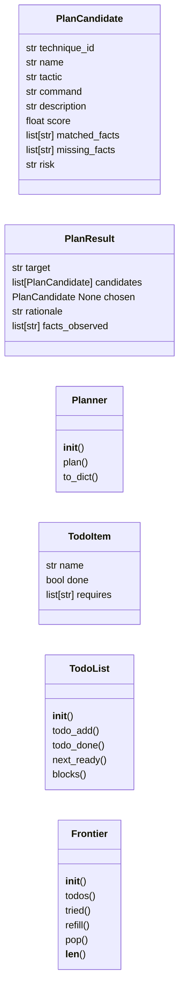
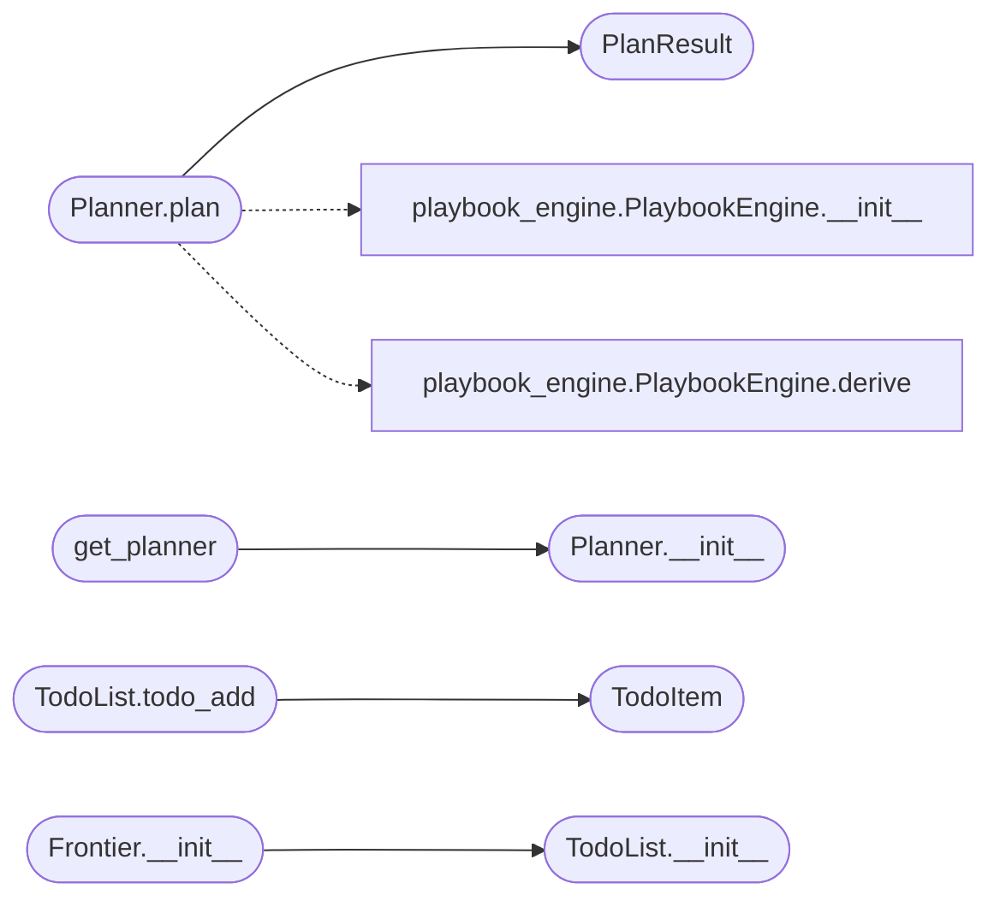

# `modules.planner`

> Source: [modules/planner.py:1](../../modules/planner.py#L1) | language `py` | coverage 90.9% | [API index](../index.md)

Fact-based planner — decides the next ability to run.

The planner queries [`modules.world_model.WorldModel`](modules.world_model.py.md#worldmodel) for the
current facts, [`modules.obs_parser.ObsParser`](modules.obs_parser.py.md#obsparser) for fresh
findings, and [`modules.playbook_engine.PlaybookEngine`](modules.playbook_engine.py.md#playbookengine) for the
candidate abilities pulled from STIX2 + Atomic Red Team. It then
applies a deterministic ranking rule (no LLM dependency) to pick the
best next step.

Why this exists separately from ``PlaybookEngine``:
- `[`PlaybookEngine.derive`](modules.playbook_engine.py.md#playbookengine-derive)` produces a *batch* playbook at planning
  time. The planner picks a *single* next step at runtime.
- The planner respects observed facts (e.g. "smb signing disabled")
  and gates techniques that depend on them.

Ranking rule (transparent, no LLM):
    score = base + matched_fact_bonus - risk_penalty
where:
    base            : 100
    matched_fact    : +25 per required fact the world model satisfies
    confidence      : + author-rating (heuristic from technique description)
    risk_penalty    : -20 if technique is loud/destructive

If ``api_key`` is set, the planner can delegate re-ranking to the LLM
as a tie-breaker only.

## Contents

- **Classes:** [`PlanCandidate`](#plancandidate), [`PlanResult`](#planresult), [`Planner`](#planner), [`TodoItem`](#todoitem), [`TodoList`](#todolist), [`Frontier`](#frontier)
- **Functions:** [`get_planner`](#get_planner)

## Type Diagram



## Call Graph

Solid arrows stay in this module, dashed arrows leave it.



## Classes

<a id="plancandidate"></a>

### `PlanCandidate`

`class` `dataclass` | [modules/planner.py:41](../../modules/planner.py#L41)

Decorators: `@dataclass`

```python
class PlanCandidate
```

**Attributes**

| Name | Type | Default | Description |
|---|---|---|---|
| [`technique_id`](#plancandidate-technique_id) | `str` |  |  |
| [`name`](#plancandidate-name) | `str` |  |  |
| [`tactic`](#plancandidate-tactic) | `str` |  |  |
| [`command`](#plancandidate-command) | `str` |  |  |
| [`description`](#plancandidate-description) | `str` | `''` |  |
| [`score`](#plancandidate-score) | `float` | `0.0` |  |
| [`matched_facts`](#plancandidate-matched_facts) | `list[str]` | `field(default_factory=list)` |  |
| [`missing_facts`](#plancandidate-missing_facts) | `list[str]` | `field(default_factory=list)` |  |
| [`risk`](#plancandidate-risk) | `str` | `'low'` |  |

---

<a id="planresult"></a>

### `PlanResult`

`class` `dataclass` | [modules/planner.py:54](../../modules/planner.py#L54)

Decorators: `@dataclass`

```python
class PlanResult
```

Ranked planning outcome for one target.

**Attributes**

| Name | Type | Default | Description |
|---|---|---|---|
| [`target`](#planresult-target) | `str` |  |  |
| [`candidates`](#planresult-candidates) | `list[PlanCandidate]` |  |  |
| [`chosen`](#planresult-chosen) | `PlanCandidate \| None` |  |  |
| [`rationale`](#planresult-rationale) | `str` |  |  |
| [`facts_observed`](#planresult-facts_observed) | `list[str]` | `field(default_factory=list)` |  |

---

<a id="planner"></a>

### `Planner`

`class` | [modules/planner.py:260](../../modules/planner.py#L260)

```python
class Planner
```

Fact-based next-ability selector.

**Parameters**

| Name | Type | Default | Description |
|---|---|---|---|
| `world_model` |  |  | Lazy-initialised callable returning a WorldModel. |
| `obs_parser` |  |  | Lazy-initialised callable returning an ObsParser. |
| `api_key` |  |  | Optional LLM key for tie-breaking only. |

**Members**

| Member | Kind | Summary |
|---|---|---|
| [`__init__`](#planner-__init__) | constructor |  |
| [`plan`](#planner-plan) | method | Return a ranked list of next-step candidates for *target*. |
| [`to_dict`](#planner-to_dict) | method |  |

<a id="planner-__init__"></a>

#### `Planner.__init__`

`constructor` | [modules/planner.py:269](../../modules/planner.py#L269)

```python
def __init__(self, world_model=None, obs_parser=None, api_key: str = '') -> None
```

**Parameters**

| Name | Type | Default | Description |
|---|---|---|---|
| `world_model` |  | `None` | Lazy-initialised callable returning a WorldModel. |
| `obs_parser` |  | `None` | Lazy-initialised callable returning an ObsParser. |
| `api_key` | `str` | `''` | Optional LLM key for tie-breaking only. |

*Called by:* [`get_planner`](#get_planner)

<a id="planner-plan"></a>

#### `Planner.plan`

`method` | [modules/planner.py:313](../../modules/planner.py#L313)

```python
def plan(self, target: str, max_candidates: int = 10) -> PlanResult
```

Return a ranked list of next-step candidates for *target*.

**Parameters**

| Name | Type | Default | Description |
|---|---|---|---|
| `target` | `str` |  | The IP/hostname being engaged. |
| `max_candidates` | `int` | `10` | How many candidates to return. |

**Returns:** `PlanResult` - [`PlanResult`](#planresult) with ranked candidates and the chosen one.

*Calls:* [`PlanResult`](#planresult), [`PlaybookEngine.__init__`](modules.playbook_engine.py.md#playbookengine-__init__), [`PlaybookEngine.derive`](modules.playbook_engine.py.md#playbookengine-derive)

<a id="planner-to_dict"></a>

#### `Planner.to_dict`

`method` | [modules/planner.py:413](../../modules/planner.py#L413)

```python
def to_dict(self, result: PlanResult) -> dict
```

**Parameters**

| Name | Type | Default | Description |
|---|---|---|---|
| `result` | `PlanResult` |  |  |

**Returns:** `dict`

---

<a id="todoitem"></a>

### `TodoItem`

`class` `dataclass` | [modules/planner.py:452](../../modules/planner.py#L452)

Decorators: `@dataclass`

```python
class TodoItem
```

One serial step in a multi-step chain with named requirements.

**Attributes**

| Name | Type | Default | Description |
|---|---|---|---|
| [`name`](#todoitem-name) | `str` |  |  |
| [`done`](#todoitem-done) | `bool` | `False` |  |
| [`requires`](#todoitem-requires) | `list[str]` | `field(default_factory=list)` |  |

---

<a id="todolist"></a>

### `TodoList`

`class` | [modules/planner.py:460](../../modules/planner.py#L460)

```python
class TodoList
```

Dependency-safe todo sequence shared across planner wake-ups.

The planner records a serial exploit chain once (for example
credential capture before lateral movement) and the engine only
emits the step whose requirements are already satisfied.

**Members**

| Member | Kind | Summary |
|---|---|---|
| [`__init__`](#todolist-__init__) | constructor | Initialize an empty todo sequence. |
| [`todo_add`](#todolist-todo_add) | method | Append a step and return it. |
| [`todo_done`](#todolist-todo_done) | method | Mark a step done when its requirements hold. |
| [`next_ready`](#todolist-next_ready) | method | Return the first pending step whose requirements hold. |
| [`blocks`](#todolist-blocks) | method | Return True when a tactic must wait for an unfinished chain. |

<a id="todolist-__init__"></a>

#### `TodoList.__init__`

`constructor` | [modules/planner.py:468](../../modules/planner.py#L468)

```python
def __init__(self) -> None
```

Initialize an empty todo sequence.

*Called by:* [`SessionOpsCommandSet.do_frontier`](cli.commands.session_ops.py.md#sessionopscommandset-do_frontier), [`Frontier.__init__`](#frontier-__init__)

<a id="todolist-todo_add"></a>

#### `TodoList.todo_add`

`method` | [modules/planner.py:472](../../modules/planner.py#L472)

```python
def todo_add(self, name: str, requires: list[str] | None = None) -> TodoItem
```

Append a step and return it.

**Parameters**

| Name | Type | Default | Description |
|---|---|---|---|
| `name` | `str` |  |  |
| `requires` | `list[str] \| None` | `None` |  |

**Returns:** `TodoItem`

*Calls:* [`TodoItem`](#todoitem)

<a id="todolist-todo_done"></a>

#### `TodoList.todo_done`

`method` | [modules/planner.py:478](../../modules/planner.py#L478)

```python
def todo_done(self, name: str) -> bool
```

Mark a step done when its requirements hold.

**Parameters**

| Name | Type | Default | Description |
|---|---|---|---|
| `name` | `str` |  |  |

**Returns:** `bool`

<a id="todolist-next_ready"></a>

#### `TodoList.next_ready`

`method` | [modules/planner.py:489](../../modules/planner.py#L489)

```python
def next_ready(self) -> TodoItem | None
```

Return the first pending step whose requirements hold.

**Returns:** `TodoItem | None`

<a id="todolist-blocks"></a>

#### `TodoList.blocks`

`method` | [modules/planner.py:497](../../modules/planner.py#L497)

```python
def blocks(self, tactic: str) -> bool
```

Return True when a tactic must wait for an unfinished chain.

**Parameters**

| Name | Type | Default | Description |
|---|---|---|---|
| `tactic` | `str` |  |  |

**Returns:** `bool`

---

<a id="frontier"></a>

### `Frontier`

`class` | [modules/planner.py:505](../../modules/planner.py#L505)

```python
class Frontier
```

Per-target intent queue fed by planner wake-ups.

Each wake-up emits zero or more untried intents. Most wake-ups emit
zero, which tells the engine there is no new direction and it should
stop instead of re-running fallbacks. A facts fingerprint detects
whether the world changed since the last wake-up.

**Members**

| Member | Kind | Summary |
|---|---|---|
| [`__init__`](#frontier-__init__) | constructor | Bind the frontier to a planner and an optional todo list. |
| [`todos`](#frontier-todos) | property | Expose the shared todo list. |
| [`tried`](#frontier-tried) | property | Return the tried technique identifiers. |
| [`refill`](#frontier-refill) | method | Plan fresh intents, keeping only untried and unblocked ones. |
| [`pop`](#frontier-pop) | method | Claim the oldest queued intent and mark its technique tried. |
| [`__len__`](#frontier-__len__) | method | Return the queued intent count. |

<a id="frontier-__init__"></a>

#### `Frontier.__init__`

`constructor` | [modules/planner.py:514](../../modules/planner.py#L514)

```python
def __init__(self, planner: Planner, todos: TodoList | None = None) -> None
```

Bind the frontier to a planner and an optional todo list.

**Parameters**

| Name | Type | Default | Description |
|---|---|---|---|
| `planner` | `Planner` |  |  |
| `todos` | `TodoList \| None` | `None` |  |

*Calls:* [`TodoList.__init__`](#todolist-__init__)

<a id="frontier-todos"></a>

#### `Frontier.todos`

`property` | [modules/planner.py:523](../../modules/planner.py#L523)

Decorators: `@property`

```python
def todos(self) -> TodoList
```

Expose the shared todo list.

**Returns:** `TodoList`

<a id="frontier-tried"></a>

#### `Frontier.tried`

`property` | [modules/planner.py:528](../../modules/planner.py#L528)

Decorators: `@property`

```python
def tried(self) -> set[str]
```

Return the tried technique identifiers.

**Returns:** `set[str]`

<a id="frontier-refill"></a>

#### `Frontier.refill`

`method` | [modules/planner.py:532](../../modules/planner.py#L532)

```python
def refill(self, target: str, max_intents: int = 4) -> list[PlanCandidate]
```

Plan fresh intents, keeping only untried and unblocked ones.

**Parameters**

| Name | Type | Default | Description |
|---|---|---|---|
| `target` | `str` |  |  |
| `max_intents` | `int` | `4` |  |

**Returns:** `list[PlanCandidate]`

*Called by:* [`SessionOpsCommandSet.do_frontier`](cli.commands.session_ops.py.md#sessionopscommandset-do_frontier)

<a id="frontier-pop"></a>

#### `Frontier.pop`

`method` | [modules/planner.py:551](../../modules/planner.py#L551)

```python
def pop(self) -> PlanCandidate | None
```

Claim the oldest queued intent and mark its technique tried.

**Returns:** `PlanCandidate | None`

<a id="frontier-__len__"></a>

#### `Frontier.__len__`

`method` | [modules/planner.py:560](../../modules/planner.py#L560)

```python
def __len__(self) -> int
```

Return the queued intent count.

**Returns:** `int`

---

## Functions

<a id="get_planner"></a>

### `get_planner`

`function` | [modules/planner.py:446](../../modules/planner.py#L446)

```python
def get_planner(api_key: str = '') -> Planner
```

Return a fact-based planner with an optional LLM tie-break key.

**Parameters**

| Name | Type | Default | Description |
|---|---|---|---|
| `api_key` | `str` | `''` |  |

**Returns:** `Planner`

*Calls:* [`Planner.__init__`](#planner-__init__)

---
