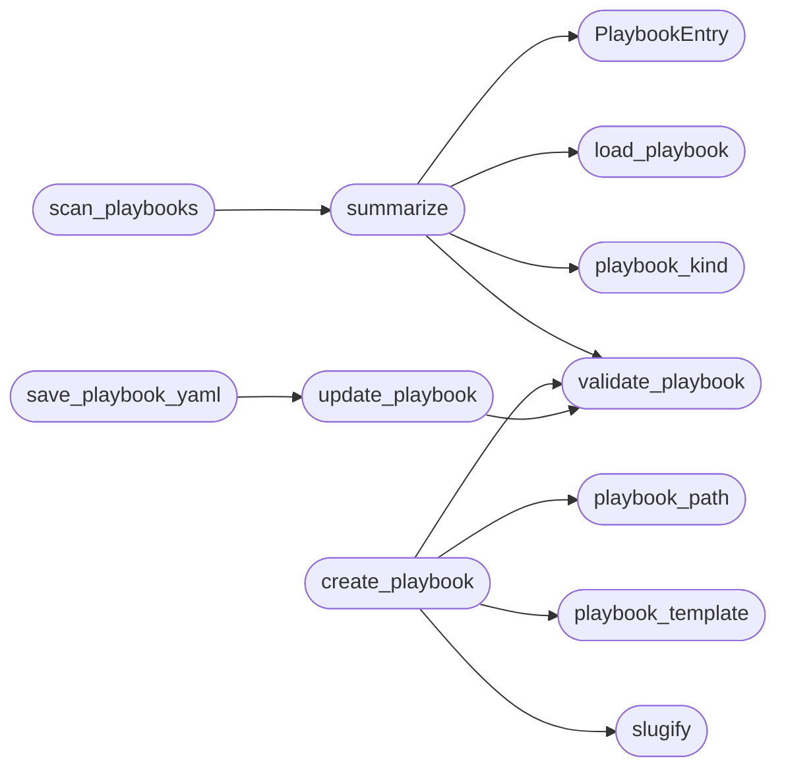

# `modules.playbook_admin`

> Source: [modules/playbook_admin.py:1](../../modules/playbook_admin.py#L1) | language `py` | coverage 100.0% | [API index](../index.md)

Safe CRUD for the YAML playbooks under ``playbooks/``.

Two playbook shapes coexist on disk:

- APT playbooks (``apt_*.yaml``) declare ``apt_name``, `[`platforms`](#playbookentry-platforms)` and a
  `[`phases`](#playbookentry-phases)` list consumed by [`modules.apt_playbooks`](modules.apt_playbooks.py.md);
- generated plans (``attack_plan*.yaml``) declare ``apt_name`` plus a
  `[`steps`](#playbookentry-steps)` list consumed by [`modules.playbook_engine`](modules.playbook_engine.py.md).

This module is the single writer for both. Every mutation is validated,
confined to the playbooks directory and written atomically so the TUI can
administrate files without ever leaving a half-written YAML behind.

The TUI (``lazy_orchestrator``) imports only this module for playbook
CRUD; readers keep loading YAML themselves.

## Contents

- **Classes:** [`PlaybookEntry`](#playbookentry)
- **Functions:** [`slugify`](#slugify), [`playbook_path`](#playbook_path), [`load_playbook`](#load_playbook), [`playbook_kind`](#playbook_kind), [`validate_playbook`](#validate_playbook), [`summarize`](#summarize), [`scan_playbooks`](#scan_playbooks), [`preview_playbook`](#preview_playbook), [`playbook_template`](#playbook_template), [`create_playbook`](#create_playbook), [`update_playbook`](#update_playbook), [`save_playbook_yaml`](#save_playbook_yaml), [`delete_playbook`](#delete_playbook)
- **Constants:** [`PLAYBOOKS_DIR`](#playbooks_dir), [`MAX_PLAYBOOK_BYTES`](#max_playbook_bytes)

## Call Graph

Solid arrows stay in this module, dashed arrows leave it.



## Classes

<a id="playbookentry"></a>

### `PlaybookEntry`

`class` `dataclass` | [modules/playbook_admin.py:40](../../modules/playbook_admin.py#L40)

Decorators: `@dataclass(frozen=True)`

```python
class PlaybookEntry
```

One playbook file rendered for the admin table.

**Attributes**

| Name | Type | Default | Description |
|---|---|---|---|
| [`file`](#playbookentry-file) | `str` |  |  |
| [`path`](#playbookentry-path) | `str` |  |  |
| [`name`](#playbookentry-name) | `str` |  |  |
| [`kind`](#playbookentry-kind) | `str` |  |  |
| [`steps`](#playbookentry-steps) | `int` |  |  |
| [`phases`](#playbookentry-phases) | `int` |  |  |
| [`platforms`](#playbookentry-platforms) | `tuple[str, ...]` |  |  |
| [`description`](#playbookentry-description) | `str` |  |  |
| [`valid`](#playbookentry-valid) | `bool` |  |  |
| [`error`](#playbookentry-error) | `str` |  |  |

---

## Functions

<a id="slugify"></a>

### `slugify`

`function` | [modules/playbook_admin.py:62](../../modules/playbook_admin.py#L62)

```python
def slugify(value: str) -> str
```

Return a safe playbook filename stem.

**Parameters**

| Name | Type | Default | Description |
|---|---|---|---|
| `value` | `str` |  | Operator-supplied name. |

**Returns:** `str` - Lowercase ``[a-z0-9_-]`` slug with a 64-character cap.

*Called by:* [`create_playbook`](#create_playbook)

---

<a id="playbook_path"></a>

### `playbook_path`

`function` | [modules/playbook_admin.py:75](../../modules/playbook_admin.py#L75)

```python
def playbook_path(filename: str, directory: Path | str | None = None) -> Path
```

Resolve one playbook file inside the playbooks root.

**Parameters**

| Name | Type | Default | Description |
|---|---|---|---|
| `filename` | `str` |  | File name, with or without the ``.yaml`` suffix. |
| `directory` | `Path \| str \| None` | `None` | Override for tests; defaults to [`PLAYBOOKS_DIR`](#playbooks_dir). |

**Returns:** `Path` - The confined path.

**Raises**

- `ValueError`: Empty name, path traversal or unsupported suffix.

*Called by:* [`create_playbook`](#create_playbook)

---

<a id="load_playbook"></a>

### `load_playbook`

`function` | [modules/playbook_admin.py:102](../../modules/playbook_admin.py#L102)

```python
def load_playbook(path: Path | str) -> dict[str, Any]
```

Read one playbook YAML mapping.

**Parameters**

| Name | Type | Default | Description |
|---|---|---|---|
| `path` | `Path \| str` |  | File to read. |

**Returns:** `dict[str, Any]` - The parsed mapping; empty when the file is not a mapping.

**Raises**

- `OSError`: File unreadable.
- `RuntimeError`: PyYAML unavailable.

*Called by:* [`summarize`](#summarize)

---

<a id="playbook_kind"></a>

### `playbook_kind`

`function` | [modules/playbook_admin.py:123](../../modules/playbook_admin.py#L123)

```python
def playbook_kind(data: dict[str, Any]) -> str
```

Return ``apt``, ``plan``, ``mixed`` or `[`unknown`](skills.lazyown_policy.py.md#classificationresult-unknown)` for one mapping.

**Parameters**

| Name | Type | Default | Description |
|---|---|---|---|
| `data` | `dict[str, Any]` |  |  |

**Returns:** `str`

*Called by:* [`summarize`](#summarize)

---

<a id="validate_playbook"></a>

### `validate_playbook`

`function` | [modules/playbook_admin.py:136](../../modules/playbook_admin.py#L136)

```python
def validate_playbook(data: Any) -> list[str]
```

Validate the minimal shape shared by both playbook formats.

**Parameters**

| Name | Type | Default | Description |
|---|---|---|---|
| `data` | `Any` |  | Parsed YAML document. |

**Returns:** `list[str]` - Human-readable errors; empty means valid.

*Called by:* [`create_playbook`](#create_playbook), [`summarize`](#summarize), [`update_playbook`](#update_playbook)

---

<a id="summarize"></a>

### `summarize`

`function` | [modules/playbook_admin.py:197](../../modules/playbook_admin.py#L197)

```python
def summarize(path: Path | str) -> PlaybookEntry
```

Build the admin-table row for one file without raising.

**Parameters**

| Name | Type | Default | Description |
|---|---|---|---|
| `path` | `Path \| str` |  |  |

**Returns:** `PlaybookEntry`

*Calls:* [`PlaybookEntry`](#playbookentry), [`load_playbook`](#load_playbook), [`playbook_kind`](#playbook_kind), [`validate_playbook`](#validate_playbook)

*Called by:* [`scan_playbooks`](#scan_playbooks)

---

<a id="scan_playbooks"></a>

### `scan_playbooks`

`function` | [modules/playbook_admin.py:231](../../modules/playbook_admin.py#L231)

```python
def scan_playbooks(directory: Path | str | None = None) -> list[PlaybookEntry]
```

Return every ``*.yaml``/``*.yml`` playbook, sorted by file name.

**Parameters**

| Name | Type | Default | Description |
|---|---|---|---|
| `directory` | `Path \| str \| None` | `None` | Override for tests; defaults to [`PLAYBOOKS_DIR`](#playbooks_dir). |

**Returns:** `list[PlaybookEntry]` - One entry per parseable or failing file; never raises.

*Calls:* [`summarize`](#summarize)

*Called by:* [`LazyOrchestratorApp.playbook_rows`](cli.lazy_orchestrator.py.md#lazyorchestratorapp-playbook_rows)

---

<a id="preview_playbook"></a>

### `preview_playbook`

`function` | [modules/playbook_admin.py:251](../../modules/playbook_admin.py#L251)

```python
def preview_playbook(path: Path | str, limit: int = _PREVIEW_LINES) -> str
```

Return a bounded, sanitized text preview for the detail pane.

**Parameters**

| Name | Type | Default | Description |
|---|---|---|---|
| `path` | `Path \| str` |  |  |
| `limit` | `int` | `_PREVIEW_LINES` |  |

**Returns:** `str`

*Called by:* [`LazyOrchestratorApp.playbook_preview`](cli.lazy_orchestrator.py.md#lazyorchestratorapp-playbook_preview)

---

<a id="playbook_template"></a>

### `playbook_template`

`function` | [modules/playbook_admin.py:265](../../modules/playbook_admin.py#L265)

```python
def playbook_template(name: str, description: str = '', platforms: tuple[str, ...] | list[str] = ('linux',)) -> dict[str, Any]
```

Return a minimal APT playbook mapping ready for ``yaml.safe_dump``.

**Parameters**

| Name | Type | Default | Description |
|---|---|---|---|
| `name` | `str` |  |  |
| `description` | `str` | `''` |  |
| `platforms` | `tuple[str, ...] \| list[str]` | `('linux',)` |  |

**Returns:** `dict[str, Any]`

*Called by:* [`create_playbook`](#create_playbook)

---

<a id="create_playbook"></a>

### `create_playbook`

`function` | [modules/playbook_admin.py:297](../../modules/playbook_admin.py#L297)

```python
def create_playbook(filename: str, *, name: str = '', description: str = '', platforms: tuple[str, ...] | list[str] = ('linux',), directory: Path | str | None = None, overwrite: bool = False) -> Path
```

Create one APT playbook file.

**Parameters**

| Name | Type | Default | Description |
|---|---|---|---|
| `filename` | `str` |  | Desired file name (slug); ``.yaml`` is appended when absent. |
| `name` | `str` | `''` | ``apt_name`` value; defaults to the slug. |
| `description` | `str` | `''` | Free-form description. |
| `platforms` | `tuple[str, ...] \| list[str]` | `('linux',)` | Platform list. |
| `directory` | `Path \| str \| None` | `None` | Override for tests. |
| `overwrite` | `bool` | `False` | Replace an existing file instead of failing. |

**Returns:** `Path` - The created path.

**Raises**

- `FileExistsError`: The file exists and ``overwrite`` is False.
- `ValueError`: Invalid slug, path or document.

*Calls:* [`playbook_path`](#playbook_path), [`playbook_template`](#playbook_template), [`slugify`](#slugify), [`validate_playbook`](#validate_playbook)

*Called by:* [`LazyOrchestratorApp.create_playbook_file`](cli.lazy_orchestrator.py.md#lazyorchestratorapp-create_playbook_file)

---

<a id="update_playbook"></a>

### `update_playbook`

`function` | [modules/playbook_admin.py:350](../../modules/playbook_admin.py#L350)

```python
def update_playbook(path: Path | str, data: dict[str, Any], directory: Path | str | None = None) -> Path
```

Validate and atomically rewrite one playbook.

**Parameters**

| Name | Type | Default | Description |
|---|---|---|---|
| `path` | `Path \| str` |  | Existing file path or file name inside ``directory``. |
| `data` | `dict[str, Any]` |  | New mapping. |
| `directory` | `Path \| str \| None` | `None` | Override for tests. |

**Returns:** `Path` - The written path.

**Raises**

- `ValueError`: Invalid document or unsupported suffix.
- `FileNotFoundError`: The target does not exist.

*Calls:* [`validate_playbook`](#validate_playbook)

*Called by:* [`save_playbook_yaml`](#save_playbook_yaml)

---

<a id="save_playbook_yaml"></a>

### `save_playbook_yaml`

`function` | [modules/playbook_admin.py:377](../../modules/playbook_admin.py#L377)

```python
def save_playbook_yaml(path: Path | str, text: str, directory: Path | str | None = None) -> Path
```

Parse, validate and write a raw YAML document.

**Parameters**

| Name | Type | Default | Description |
|---|---|---|---|
| `path` | `Path \| str` |  | Existing file path or file name. |
| `text` | `str` |  | Raw YAML edited by the operator. |
| `directory` | `Path \| str \| None` | `None` | Override for tests. |

**Returns:** `Path` - The written path.

**Raises**

- `ValueError`: Unparseable YAML or invalid playbook shape.
- `FileNotFoundError`: The target does not exist.

*Calls:* [`update_playbook`](#update_playbook)

*Called by:* [`LazyOrchestratorApp.save_playbook_text`](cli.lazy_orchestrator.py.md#lazyorchestratorapp-save_playbook_text)

---

<a id="delete_playbook"></a>

### `delete_playbook`

`function` | [modules/playbook_admin.py:406](../../modules/playbook_admin.py#L406)

```python
def delete_playbook(path: Path | str, directory: Path | str | None = None) -> bool
```

Delete one playbook confined to the playbooks root.

**Parameters**

| Name | Type | Default | Description |
|---|---|---|---|
| `path` | `Path \| str` |  | File path or file name. |
| `directory` | `Path \| str \| None` | `None` | Override for tests. |

**Returns:** `bool` - True when the file was removed.

*Called by:* [`LazyOrchestratorApp.delete_playbook_file`](cli.lazy_orchestrator.py.md#lazyorchestratorapp-delete_playbook_file)

---

## Constants

<a id="playbooks_dir"></a>

### `PLAYBOOKS_DIR`

`constant` | [modules/playbook_admin.py:32](../../modules/playbook_admin.py#L32)

```python
PLAYBOOKS_DIR = BASE_DIR / 'playbooks'
```

---

<a id="max_playbook_bytes"></a>

### `MAX_PLAYBOOK_BYTES`

`constant` | [modules/playbook_admin.py:33](../../modules/playbook_admin.py#L33)

```python
MAX_PLAYBOOK_BYTES = 500000
```

---
