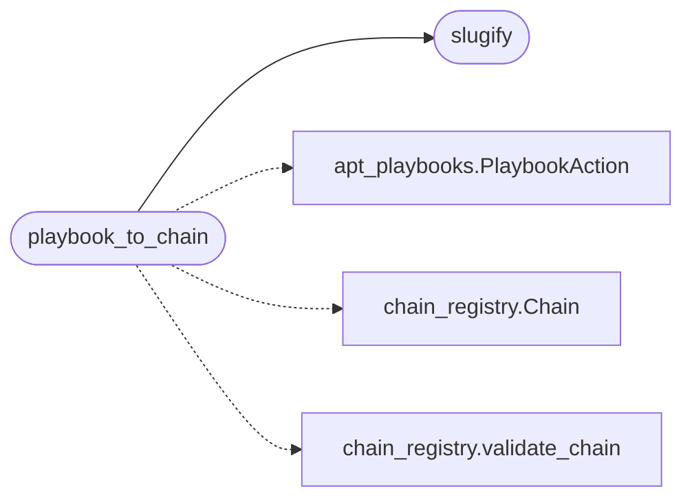

# `modules.playbook_chain`

> Source: [modules/playbook_chain.py:1](../../modules/playbook_chain.py#L1) | language `py` | coverage 100.0% | [API index](../index.md)

Playbook to chain lowering: one contract, one destination.

Every playbook phase becomes ordered chain steps. Declared
``phases[].steps[]`` actions map by ``kind`` (atomic, command,
lazyscript, lua, plugin, lazyaddon, chain); the phase's ``atomic_tests``
lower to a single ``atomic_emulate`` step per technique, exactly the
contract `[`do_atomic_emulate`](cli.commands.command_and_control_migrated.py.md#commandandcontrolmigratedcommandset-do_atomic_emulate)` already executes. The produced chain
validates through ``chain_registry.validate_chain`` so the runner is
the only executor, and the loop reaches playbooks through the same
``apt_chain`` decision path as every other chain.

## Contents

- **Functions:** [`slugify`](#slugify), [`playbook_to_chain`](#playbook_to_chain), [`write_playbook_chain`](#write_playbook_chain)

## Call Graph

Solid arrows stay in this module, dashed arrows leave it.



## Functions

<a id="slugify"></a>

### `slugify`

`function` | [modules/playbook_chain.py:29](../../modules/playbook_chain.py#L29)

```python
def slugify(name: str) -> str
```

Return a chain-safe slug for a playbook name.

**Parameters**

| Name | Type | Default | Description |
|---|---|---|---|
| `name` | `str` |  |  |

**Returns:** `str`

*Called by:* [`playbook_to_chain`](#playbook_to_chain)

---

<a id="playbook_to_chain"></a>

### `playbook_to_chain`

`function` | [modules/playbook_chain.py:69](../../modules/playbook_chain.py#L69)

```python
def playbook_to_chain(playbook: AptPlaybook, target: str = '', playbook_dir: str = 'playbooks') -> tuple[Chain | None, list[str]]
```

Lower one playbook into a validated in-memory chain.

**Parameters**

| Name | Type | Default | Description |
|---|---|---|---|
| `playbook` | `AptPlaybook` |  | Loaded [`AptPlaybook`](modules.apt_playbooks.py.md#aptplaybook). |
| `target` | `str` | `''` | Default target token rendered into every step. |
| `playbook_dir` | `str` | `'playbooks'` | Unused hook kept for caller symmetry. |

**Returns:** `tuple[Chain | None, list[str]]` - ``(chain, errors)``; the chain is None when no step survives
the lowering.

*Calls:* [`PlaybookAction`](modules.apt_playbooks.py.md#playbookaction), [`Chain`](modules.chain_registry.py.md#chain), [`validate_chain`](modules.chain_registry.py.md#validate_chain), [`slugify`](#slugify)

---

<a id="write_playbook_chain"></a>

### `write_playbook_chain`

`function` | [modules/playbook_chain.py:152](../../modules/playbook_chain.py#L152)

```python
def write_playbook_chain(chain: Chain, chains_dir: str = 'chains') -> str
```

Persist a lowered chain next to the shipped ones.

**Parameters**

| Name | Type | Default | Description |
|---|---|---|---|
| `chain` | `Chain` |  | Validated lowered chain. |
| `chains_dir` | `str` | `'chains'` | Destination directory (defaults to ``chains/``). |

**Returns:** `str` - The written file path.

---
