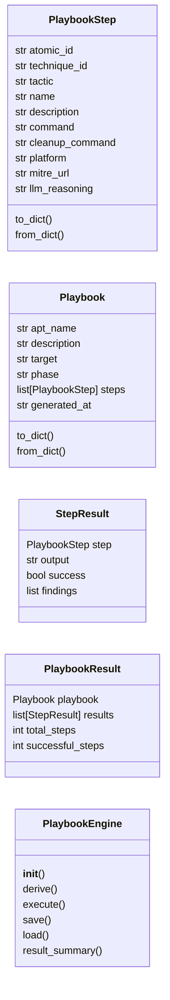
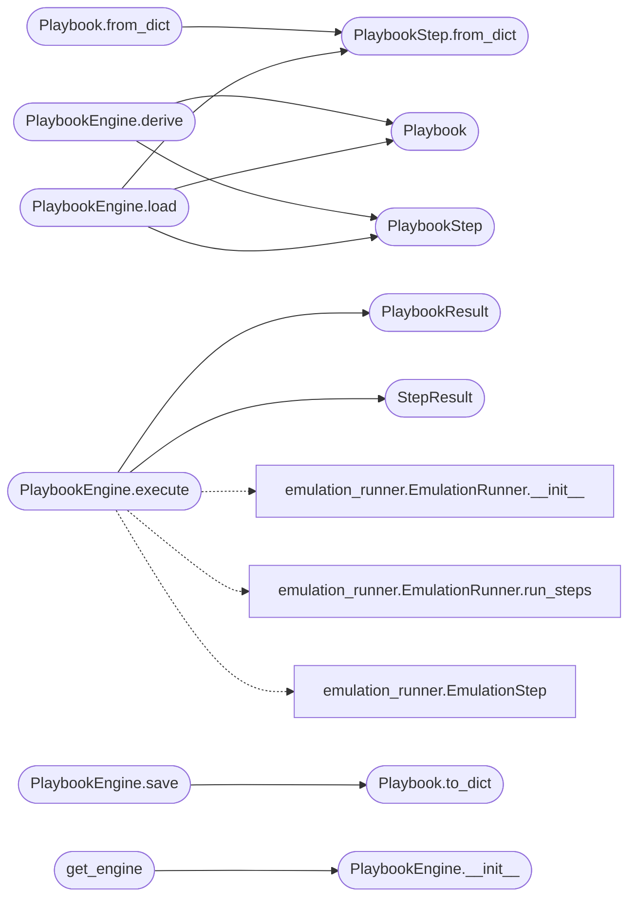

# `modules.playbook_engine`

> Source: [modules/playbook_engine.py:1](../../modules/playbook_engine.py#L1) | language `py` | coverage 52.9% | [API index](../index.md)

modules/playbook_engine.py =========================== Bridges MITRE ATT&CK (STIX2), Atomic Red Team, WorldModel, and LLMClient into a closed autonomous execution cycle.

Workflow
--------
1.  derive(target, phase) -> Playbook
      - Resolve MITRE tactics for the current phase
      - Query STIX2 enterprise-attack store for techniques under those tactics
      - Filter by target platform (linux / windows / macos from WorldModel)
      - Match techniques to Atomic Red Team YAML test files
      - Ask LLM to select and rank the most relevant N tests (optional)
      - Return a Playbook ready for execution

2.  execute(playbook, executor) -> PlaybookResult
      - Run each PlaybookStep via the provided executor callable
      - Parse output with ObsParser -> update WorldModel
      - Record outcome per step
      - Return full PlaybookResult

3.  save(playbook, path) / load(path) -> Playbook
      - Persist / restore playbooks as YAML (compatible with existing format)

Design
------
- Single Responsibility : PlaybookEngine composes, not executes (executor is injected)
- Open/Closed           : new tactic mappings via PHASE_TACTIC_MAP extension
- Dependency Inversion  : depends on WorldModel and ObsParser protocols, not
                          concrete singletons (accepts instances or creates defaults)

Usage
-----
    from modules.playbook_engine import PlaybookEngine

    engine = PlaybookEngine()
    playbook = engine.derive("10.10.11.78", phase="scanning")
    result   = engine.execute(playbook, executor=lambda cmd, host: run(cmd))

    # Or via CLI:
    python3 modules/playbook_engine.py derive --target 10.10.11.78 --phase scanning
    python3 modules/playbook_engine.py run    --playbook playbooks/myplan.yaml --dry-run

## Contents

- **Classes:** [`PlaybookStep`](#playbookstep), [`Playbook`](#playbook), [`StepResult`](#stepresult), [`PlaybookResult`](#playbookresult), [`PlaybookEngine`](#playbookengine)
- **Functions:** [`get_engine`](#get_engine)
- **Constants:** [`PHASE_TACTIC_MAP`](#phase_tactic_map)

## Type Diagram



## Call Graph

Solid arrows stay in this module, dashed arrows leave it.



## Classes

<a id="playbookstep"></a>

### `PlaybookStep`

`class` `dataclass` | [modules/playbook_engine.py:101](../../modules/playbook_engine.py#L101)

Decorators: `@dataclass`

```python
class PlaybookStep
```

**Attributes**

| Name | Type | Default | Description |
|---|---|---|---|
| [`atomic_id`](#playbookstep-atomic_id) | `str` |  |  |
| [`technique_id`](#playbookstep-technique_id) | `str` |  |  |
| [`tactic`](#playbookstep-tactic) | `str` |  |  |
| [`name`](#playbookstep-name) | `str` |  |  |
| [`description`](#playbookstep-description) | `str` | `''` |  |
| [`command`](#playbookstep-command) | `str` | `''` |  |
| [`cleanup_command`](#playbookstep-cleanup_command) | `str` | `''` |  |
| [`platform`](#playbookstep-platform) | `str` | `'linux'` |  |
| [`mitre_url`](#playbookstep-mitre_url) | `str` | `''` |  |
| [`llm_reasoning`](#playbookstep-llm_reasoning) | `str` | `''` |  |

**Members**

| Member | Kind | Summary |
|---|---|---|
| [`to_dict`](#playbookstep-to_dict) | method |  |
| [`from_dict`](#playbookstep-from_dict) | classmethod |  |

<a id="playbookstep-to_dict"></a>

#### `PlaybookStep.to_dict`

`method` | [modules/playbook_engine.py:113](../../modules/playbook_engine.py#L113)

```python
def to_dict(self) -> dict
```

**Returns:** `dict`

<a id="playbookstep-from_dict"></a>

#### `PlaybookStep.from_dict`

`classmethod` | [modules/playbook_engine.py:128](../../modules/playbook_engine.py#L128)

Decorators: `@classmethod`

```python
def from_dict(cls, d: dict) -> PlaybookStep
```

**Parameters**

| Name | Type | Default | Description |
|---|---|---|---|
| `d` | `dict` |  |  |

**Returns:** `PlaybookStep`

*Called by:* [`Playbook.from_dict`](#playbook-from_dict), [`PlaybookEngine.load`](#playbookengine-load)

---

<a id="playbook"></a>

### `Playbook`

`class` `dataclass` | [modules/playbook_engine.py:133](../../modules/playbook_engine.py#L133)

Decorators: `@dataclass`

```python
class Playbook
```

**Attributes**

| Name | Type | Default | Description |
|---|---|---|---|
| [`apt_name`](#playbook-apt_name) | `str` |  |  |
| [`description`](#playbook-description) | `str` |  |  |
| [`target`](#playbook-target) | `str` |  |  |
| [`phase`](#playbook-phase) | `str` |  |  |
| [`steps`](#playbook-steps) | `list[PlaybookStep]` | `field(default_factory=list)` |  |
| [`generated_at`](#playbook-generated_at) | `str` | `field(default_factory=lambda: datetime.now().isoformat())` |  |

**Members**

| Member | Kind | Summary |
|---|---|---|
| [`to_dict`](#playbook-to_dict) | method |  |
| [`from_dict`](#playbook-from_dict) | classmethod |  |

<a id="playbook-to_dict"></a>

#### `Playbook.to_dict`

`method` | [modules/playbook_engine.py:141](../../modules/playbook_engine.py#L141)

```python
def to_dict(self) -> dict
```

**Returns:** `dict`

*Called by:* [`PlaybookEngine.save`](#playbookengine-save)

<a id="playbook-from_dict"></a>

#### `Playbook.from_dict`

`classmethod` | [modules/playbook_engine.py:152](../../modules/playbook_engine.py#L152)

Decorators: `@classmethod`

```python
def from_dict(cls, d: dict) -> Playbook
```

**Parameters**

| Name | Type | Default | Description |
|---|---|---|---|
| `d` | `dict` |  |  |

**Returns:** `Playbook`

*Calls:* [`PlaybookStep.from_dict`](#playbookstep-from_dict)

---

<a id="stepresult"></a>

### `StepResult`

`class` `dataclass` | [modules/playbook_engine.py:165](../../modules/playbook_engine.py#L165)

Decorators: `@dataclass`

```python
class StepResult
```

**Attributes**

| Name | Type | Default | Description |
|---|---|---|---|
| [`step`](#stepresult-step) | `PlaybookStep` |  |  |
| [`output`](#stepresult-output) | `str` |  |  |
| [`success`](#stepresult-success) | `bool` |  |  |
| [`findings`](#stepresult-findings) | `list` | `field(default_factory=list)` |  |

---

<a id="playbookresult"></a>

### `PlaybookResult`

`class` `dataclass` | [modules/playbook_engine.py:173](../../modules/playbook_engine.py#L173)

Decorators: `@dataclass`

```python
class PlaybookResult
```

**Attributes**

| Name | Type | Default | Description |
|---|---|---|---|
| [`playbook`](#playbookresult-playbook) | `Playbook` |  |  |
| [`results`](#playbookresult-results) | `list[StepResult]` | `field(default_factory=list)` |  |
| [`total_steps`](#playbookresult-total_steps) | `int` | `0` |  |
| [`successful_steps`](#playbookresult-successful_steps) | `int` | `0` |  |

---

<a id="playbookengine"></a>

### `PlaybookEngine`

`class` | [modules/playbook_engine.py:375](../../modules/playbook_engine.py#L375)

```python
class PlaybookEngine
```

Derives, executes, saves, and loads structured ATT&CK-grounded playbooks.

**Parameters**

| Name | Type | Default | Description |
|---|---|---|---|
| `world_model` | `WorldModel instance (created lazily if None)` |  |  |
| `obs_parser` | `ObsParser instance (created lazily if None)` |  |  |
| `api_key` | `Groq API key for LLM-based technique selection` |  |  |
| `top_n` | `maximum number of steps per generated playbook` |  |  |

**Members**

| Member | Kind | Summary |
|---|---|---|
| [`__init__`](#playbookengine-__init__) | constructor |  |
| [`derive`](#playbookengine-derive) | method | Generate a Playbook for *target* at the given *phase*. |
| [`execute`](#playbookengine-execute) | method | Execute a Playbook step by step. |
| [`save`](#playbookengine-save) | method | Persist playbook to YAML (compatible with existing playbooks/ format). |
| [`load`](#playbookengine-load) | method | Load a playbook from YAML. |
| [`result_summary`](#playbookengine-result_summary) | method | Return a human-readable / LLM-readable summary of a PlaybookResult. |

<a id="playbookengine-__init__"></a>

#### `PlaybookEngine.__init__`

`constructor` | [modules/playbook_engine.py:387](../../modules/playbook_engine.py#L387)

```python
def __init__(self, world_model=None, obs_parser=None, api_key: str = '', top_n: int = 5) -> None
```

**Parameters**

| Name | Type | Default | Description |
|---|---|---|---|
| `world_model` | `WorldModel instance (created lazily if None)` | `None` |  |
| `obs_parser` | `ObsParser instance (created lazily if None)` | `None` |  |
| `api_key` | `str` | `''` |  |
| `top_n` | `int` | `5` |  |

*Called by:* [`CalderaCommandSet.do_plan_apply`](cli.commands.caldera.py.md#calderacommandset-do_plan_apply), [`McpBridgeCommandSet.do_playbook_run`](cli.commands.mcp_bridge.py.md#mcpbridgecommandset-do_playbook_run), [`OperationManager.plan_from_apt`](modules.operation.py.md#operationmanager-plan_from_apt), [`Planner.plan`](modules.planner.py.md#planner-plan), [`get_engine`](#get_engine)

<a id="playbookengine-derive"></a>

#### `PlaybookEngine.derive`

`method` | [modules/playbook_engine.py:427](../../modules/playbook_engine.py#L427)

```python
def derive(self, target: str, phase: str | None = None, platform: str | None = None, apt_name: str = 'LazyOwn_auto') -> Playbook
```

Generate a Playbook for *target* at the given *phase*.

If phase is None, derives it from the WorldModel.
If platform is None, infers from WorldModel os_hint.

**Parameters**

| Name | Type | Default | Description |
|---|---|---|---|
| `target` | `str` |  |  |
| `phase` | `str \| None` | `None` |  |
| `platform` | `str \| None` | `None` |  |
| `apt_name` | `str` | `'LazyOwn_auto'` |  |

**Returns:** `Playbook`

*Calls:* [`Playbook`](#playbook), [`PlaybookStep`](#playbookstep)

*Called by:* [`CalderaCommandSet.do_plan_apply`](cli.commands.caldera.py.md#calderacommandset-do_plan_apply), [`OperationManager.plan_from_apt`](modules.operation.py.md#operationmanager-plan_from_apt), [`Planner.plan`](modules.planner.py.md#planner-plan)

<a id="playbookengine-execute"></a>

#### `PlaybookEngine.execute`

`method` | [modules/playbook_engine.py:529](../../modules/playbook_engine.py#L529)

```python
def execute(self, playbook: Playbook, executor: Callable[[str, str], str], dry_run: bool = False) -> PlaybookResult
```

Execute a Playbook step by step.

**Parameters**

| Name | Type | Default | Description |
|---|---|---|---|
| `playbook` | `Playbook` |  |  |
| `executor` | `Callable[[str, str], str]` |  |  |
| `dry_run` | `bool` | `False` |  |

**Returns:** `PlaybookResult`

*Calls:* [`EmulationRunner.__init__`](modules.emulation_runner.py.md#emulationrunner-__init__), [`EmulationRunner.run_steps`](modules.emulation_runner.py.md#emulationrunner-run_steps), [`EmulationStep`](modules.emulation_runner.py.md#emulationstep), [`PlaybookResult`](#playbookresult), [`StepResult`](#stepresult)

*Called by:* [`McpBridgeCommandSet.do_playbook_run`](cli.commands.mcp_bridge.py.md#mcpbridgecommandset-do_playbook_run)

<a id="playbookengine-save"></a>

#### `PlaybookEngine.save`

`method` | [modules/playbook_engine.py:599](../../modules/playbook_engine.py#L599)

```python
def save(self, playbook: Playbook, path: str | Path | None = None) -> Path
```

Persist playbook to YAML (compatible with existing playbooks/ format).

**Parameters**

| Name | Type | Default | Description |
|---|---|---|---|
| `playbook` | `Playbook` |  |  |
| `path` | `str \| Path \| None` | `None` |  |

**Returns:** `Path`

*Calls:* [`Playbook.to_dict`](#playbook-to_dict)

<a id="playbookengine-load"></a>

#### `PlaybookEngine.load`

`method` | [modules/playbook_engine.py:611](../../modules/playbook_engine.py#L611)

```python
def load(self, path: str | Path) -> Playbook
```

Load a playbook from YAML.

Supports both new extended format and legacy format.

**Parameters**

| Name | Type | Default | Description |
|---|---|---|---|
| `path` | `str \| Path` |  |  |

**Returns:** `Playbook`

*Calls:* [`Playbook`](#playbook), [`PlaybookStep`](#playbookstep), [`PlaybookStep.from_dict`](#playbookstep-from_dict)

*Called by:* [`McpBridgeCommandSet.do_playbook_run`](cli.commands.mcp_bridge.py.md#mcpbridgecommandset-do_playbook_run)

<a id="playbookengine-result_summary"></a>

#### `PlaybookEngine.result_summary`

`method` | [modules/playbook_engine.py:640](../../modules/playbook_engine.py#L640)

```python
def result_summary(self, result: PlaybookResult) -> str
```

Return a human-readable / LLM-readable summary of a PlaybookResult.

**Parameters**

| Name | Type | Default | Description |
|---|---|---|---|
| `result` | `PlaybookResult` |  |  |

**Returns:** `str`

*Called by:* [`McpBridgeCommandSet.do_playbook_run`](cli.commands.mcp_bridge.py.md#mcpbridgecommandset-do_playbook_run)

---

## Functions

<a id="get_engine"></a>

### `get_engine`

`function` | [modules/playbook_engine.py:669](../../modules/playbook_engine.py#L669)

```python
def get_engine(api_key: str = '') -> PlaybookEngine
```

Return (or create) the module-level singleton PlaybookEngine.

**Parameters**

| Name | Type | Default | Description |
|---|---|---|---|
| `api_key` | `str` | `''` |  |

**Returns:** `PlaybookEngine`

*Calls:* [`PlaybookEngine.__init__`](#playbookengine-__init__)

---

## Constants

<a id="phase_tactic_map"></a>

### `PHASE_TACTIC_MAP`

`constant` | [modules/playbook_engine.py:76](../../modules/playbook_engine.py#L76)

```python
PHASE_TACTIC_MAP: dict[str, list[str]]
```

---
