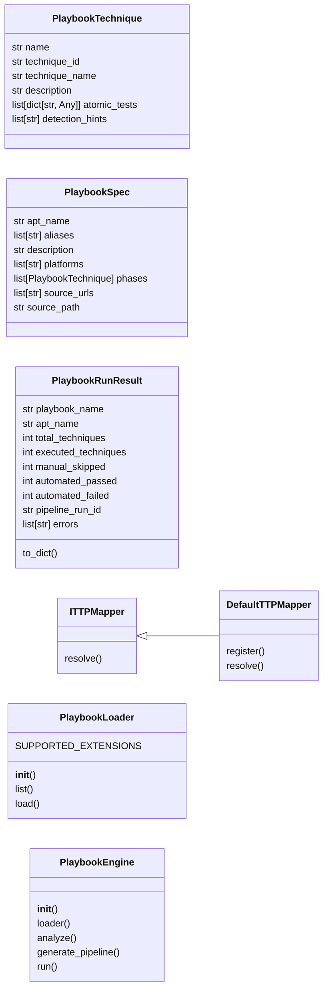
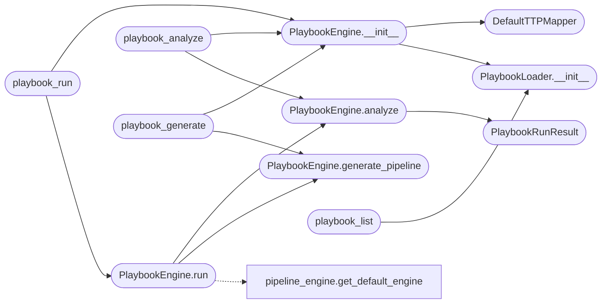

# `modules.playbook_executor`

> Source: [modules/playbook_executor.py:1](../../modules/playbook_executor.py#L1) | language `py` | coverage 83.3% | [API index](../index.md)

Playbook Executor — bridges MITRE ATT&CK playbooks to the pipeline engine.

Reads YAML playbooks from ``playbooks/``, maps atomic test procedures to
LazyOwn shell commands, and either executes them through the pipeline engine
or generates a runnable pipeline spec for manual review.

Architecture:
    PlaybookLoader   — parses and validates playbook YAML.
    TTPMapper         — resolves technique_id + atomic_test to LazyOwn commands.
    PlaybookEngine    — orchestrates execution via PipelineEngine or dry-run.

## Contents

- **Classes:** [`PlaybookTechnique`](#playbooktechnique), [`PlaybookSpec`](#playbookspec), [`PlaybookRunResult`](#playbookrunresult), [`ITTPMapper`](#ittpmapper), [`DefaultTTPMapper`](#defaultttpmapper), [`PlaybookLoader`](#playbookloader), [`PlaybookEngine`](#playbookengine)
- **Functions:** [`playbook_list`](#playbook_list), [`playbook_analyze`](#playbook_analyze), [`playbook_generate`](#playbook_generate), [`playbook_run`](#playbook_run)

## Type Diagram



## Call Graph

Solid arrows stay in this module, dashed arrows leave it.



## Classes

<a id="playbooktechnique"></a>

### `PlaybookTechnique`

`class` `dataclass` | [modules/playbook_executor.py:36](../../modules/playbook_executor.py#L36)

Decorators: `@dataclass`

```python
class PlaybookTechnique
```

One technique (sub)phase within a playbook.

**Attributes**

| Name | Type | Default | Description |
|---|---|---|---|
| [`name`](#playbooktechnique-name) | `str` |  |  |
| [`technique_id`](#playbooktechnique-technique_id) | `str` |  |  |
| [`technique_name`](#playbooktechnique-technique_name) | `str` |  |  |
| [`description`](#playbooktechnique-description) | `str` |  |  |
| [`atomic_tests`](#playbooktechnique-atomic_tests) | `list[dict[str, Any]]` | `field(default_factory=list)` |  |
| [`detection_hints`](#playbooktechnique-detection_hints) | `list[str]` | `field(default_factory=list)` |  |

---

<a id="playbookspec"></a>

### `PlaybookSpec`

`class` `dataclass` | [modules/playbook_executor.py:48](../../modules/playbook_executor.py#L48)

Decorators: `@dataclass`

```python
class PlaybookSpec
```

A loaded, validated playbook document.

**Attributes**

| Name | Type | Default | Description |
|---|---|---|---|
| [`apt_name`](#playbookspec-apt_name) | `str` |  |  |
| [`aliases`](#playbookspec-aliases) | `list[str]` |  |  |
| [`description`](#playbookspec-description) | `str` |  |  |
| [`platforms`](#playbookspec-platforms) | `list[str]` |  |  |
| [`phases`](#playbookspec-phases) | `list[PlaybookTechnique]` |  |  |
| [`source_urls`](#playbookspec-source_urls) | `list[str]` | `field(default_factory=list)` |  |
| [`source_path`](#playbookspec-source_path) | `str` | `''` |  |

---

<a id="playbookrunresult"></a>

### `PlaybookRunResult`

`class` `dataclass` | [modules/playbook_executor.py:61](../../modules/playbook_executor.py#L61)

Decorators: `@dataclass`

```python
class PlaybookRunResult
```

Summary of one playbook execution.

**Attributes**

| Name | Type | Default | Description |
|---|---|---|---|
| [`playbook_name`](#playbookrunresult-playbook_name) | `str` |  |  |
| [`apt_name`](#playbookrunresult-apt_name) | `str` |  |  |
| [`total_techniques`](#playbookrunresult-total_techniques) | `int` |  |  |
| [`executed_techniques`](#playbookrunresult-executed_techniques) | `int` |  |  |
| [`manual_skipped`](#playbookrunresult-manual_skipped) | `int` |  |  |
| [`automated_passed`](#playbookrunresult-automated_passed) | `int` |  |  |
| [`automated_failed`](#playbookrunresult-automated_failed) | `int` |  |  |
| [`pipeline_run_id`](#playbookrunresult-pipeline_run_id) | `str` | `''` |  |
| [`errors`](#playbookrunresult-errors) | `list[str]` | `field(default_factory=list)` |  |

**Members**

| Member | Kind | Summary |
|---|---|---|
| [`to_dict`](#playbookrunresult-to_dict) | method |  |

<a id="playbookrunresult-to_dict"></a>

#### `PlaybookRunResult.to_dict`

`method` | [modules/playbook_executor.py:74](../../modules/playbook_executor.py#L74)

```python
def to_dict(self) -> dict[str, Any]
```

**Returns:** `dict[str, Any]`

---

<a id="ittpmapper"></a>

### `ITTPMapper`

`class` `abstract` | [modules/playbook_executor.py:93](../../modules/playbook_executor.py#L93)

```python
class ITTPMapper(ABC)
```

Bases: `ABC`

Subclasses: [`DefaultTTPMapper`](#defaultttpmapper)

Resolves a MITRE technique + atomic test to a LazyOwn command.

**Members**

| Member | Kind | Summary |
|---|---|---|
| [`resolve`](#ittpmapper-resolve) | method | Return a LazyOwn shell command string or None if unmapped. |

<a id="ittpmapper-resolve"></a>

#### `ITTPMapper.resolve`

`method` `abstract` | [modules/playbook_executor.py:97](../../modules/playbook_executor.py#L97)

Decorators: `@abstractmethod`

```python
def resolve(self, technique_id: str, atomic_test: dict[str, Any], platform: str) -> str | None
```

Return a LazyOwn shell command string or None if unmapped.

**Parameters**

| Name | Type | Default | Description |
|---|---|---|---|
| `technique_id` | `str` |  |  |
| `atomic_test` | `dict[str, Any]` |  |  |
| `platform` | `str` |  |  |

**Returns:** `str | None`

---

<a id="defaultttpmapper"></a>

### `DefaultTTPMapper`

`class` | [modules/playbook_executor.py:101](../../modules/playbook_executor.py#L101)

```python
class DefaultTTPMapper(ITTPMapper)
```

Bases: [`ITTPMapper`](#ittpmapper)

Maps known technique IDs to LazyOwn commands via a dictionary.

The mapping is extensible; operators can register additional commands
at runtime via ``register``.

**Members**

| Member | Kind | Summary |
|---|---|---|
| [`register`](#defaultttpmapper-register) | classmethod | Add a new technique-to-command mapping. |
| [`resolve`](#defaultttpmapper-resolve) | method | Return a LazyOwn shell command string or None if unmapped. |

<a id="defaultttpmapper-register"></a>

#### `DefaultTTPMapper.register`

`classmethod` | [modules/playbook_executor.py:180](../../modules/playbook_executor.py#L180)

Decorators: `@classmethod`

```python
def register(cls, technique_id: str, platform: str, command: str) -> None
```

Add a new technique-to-command mapping.

**Parameters**

| Name | Type | Default | Description |
|---|---|---|---|
| `technique_id` | `str` |  |  |
| `platform` | `str` |  |  |
| `command` | `str` |  |  |

<a id="defaultttpmapper-resolve"></a>

#### `DefaultTTPMapper.resolve`

`method` | [modules/playbook_executor.py:185](../../modules/playbook_executor.py#L185)

```python
def resolve(self, technique_id: str, atomic_test: dict[str, Any], platform: str) -> str | None
```

Return a LazyOwn shell command string or None if unmapped.

**Parameters**

| Name | Type | Default | Description |
|---|---|---|---|
| `technique_id` | `str` |  |  |
| `atomic_test` | `dict[str, Any]` |  |  |
| `platform` | `str` |  |  |

**Returns:** `str | None`

> **Inherited:** Documentation from [`ITTPMapper.resolve`](#ittpmapper-resolve) (modules/playbook_executor.py:97).

---

<a id="playbookloader"></a>

### `PlaybookLoader`

`class` | [modules/playbook_executor.py:203](../../modules/playbook_executor.py#L203)

```python
class PlaybookLoader
```

Parses playbook YAML files into PlaybookSpec objects.

**Attributes**

| Name | Type | Default | Description |
|---|---|---|---|
| [`SUPPORTED_EXTENSIONS`](#playbookloader-supported_extensions) |  | `('.yaml', '.yml')` |  |

**Members**

| Member | Kind | Summary |
|---|---|---|
| [`__init__`](#playbookloader-__init__) | constructor |  |
| [`list`](#playbookloader-list) | method | Return every discoverable playbook name. |
| [`load`](#playbookloader-load) | method | Load and validate a playbook by name. |

<a id="playbookloader-__init__"></a>

#### `PlaybookLoader.__init__`

`constructor` | [modules/playbook_executor.py:208](../../modules/playbook_executor.py#L208)

```python
def __init__(self, playbooks_dir: Path | None = None) -> None
```

**Parameters**

| Name | Type | Default | Description |
|---|---|---|---|
| `playbooks_dir` | `Path \| None` | `None` |  |

*Called by:* [`PlaybookEngine.__init__`](#playbookengine-__init__), [`playbook_list`](#playbook_list)

<a id="playbookloader-list"></a>

#### `PlaybookLoader.list`

`method` | [modules/playbook_executor.py:211](../../modules/playbook_executor.py#L211)

```python
def list(self) -> list[str]
```

Return every discoverable playbook name.

**Returns:** `list[str]`

<a id="playbookloader-load"></a>

#### `PlaybookLoader.load`

`method` | [modules/playbook_executor.py:224](../../modules/playbook_executor.py#L224)

```python
def load(self, name: str) -> PlaybookSpec
```

Load and validate a playbook by name.

**Parameters**

| Name | Type | Default | Description |
|---|---|---|---|
| `name` | `str` |  |  |

**Returns:** `PlaybookSpec`

**Raises**

- `FileNotFoundError`: (raised in the body, not documented)

---

<a id="playbookengine"></a>

### `PlaybookEngine`

`class` | [modules/playbook_executor.py:336](../../modules/playbook_executor.py#L336)

```python
class PlaybookEngine
```

Orchestrates playbook analysis, pipeline generation, and execution.

**Members**

| Member | Kind | Summary |
|---|---|---|
| [`__init__`](#playbookengine-__init__) | constructor |  |
| [`loader`](#playbookengine-loader) | property |  |
| [`analyze`](#playbookengine-analyze) | method | Analyze a playbook: count techniques, automated vs manual, coverage. |
| [`generate_pipeline`](#playbookengine-generate_pipeline) | method | Generate a pipeline YAML file from a playbook. |
| [`run`](#playbookengine-run) | method | Generate and execute a pipeline from a playbook. |

<a id="playbookengine-__init__"></a>

#### `PlaybookEngine.__init__`

`constructor` | [modules/playbook_executor.py:339](../../modules/playbook_executor.py#L339)

```python
def __init__(self, loader: PlaybookLoader | None = None, mapper: ITTPMapper | None = None, pipelines_dir: Path | None = None) -> None
```

**Parameters**

| Name | Type | Default | Description |
|---|---|---|---|
| `loader` | `PlaybookLoader \| None` | `None` |  |
| `mapper` | `ITTPMapper \| None` | `None` |  |
| `pipelines_dir` | `Path \| None` | `None` |  |

*Calls:* [`DefaultTTPMapper`](#defaultttpmapper), [`PlaybookLoader.__init__`](#playbookloader-__init__)

*Called by:* [`playbook_analyze`](#playbook_analyze), [`playbook_generate`](#playbook_generate), [`playbook_run`](#playbook_run)

<a id="playbookengine-loader"></a>

#### `PlaybookEngine.loader`

`property` | [modules/playbook_executor.py:350](../../modules/playbook_executor.py#L350)

Decorators: `@property`

```python
def loader(self) -> PlaybookLoader
```

**Returns:** `PlaybookLoader`

<a id="playbookengine-analyze"></a>

#### `PlaybookEngine.analyze`

`method` | [modules/playbook_executor.py:353](../../modules/playbook_executor.py#L353)

```python
def analyze(self, name: str, platform: str = 'windows') -> PlaybookRunResult
```

Analyze a playbook: count techniques, automated vs manual, coverage.

**Parameters**

| Name | Type | Default | Description |
|---|---|---|---|
| `name` | `str` |  |  |
| `platform` | `str` | `'windows'` |  |

**Returns:** `PlaybookRunResult`

*Calls:* [`PlaybookRunResult`](#playbookrunresult)

*Called by:* [`PlaybookEngine.run`](#playbookengine-run), [`playbook_analyze`](#playbook_analyze)

<a id="playbookengine-generate_pipeline"></a>

#### `PlaybookEngine.generate_pipeline`

`method` | [modules/playbook_executor.py:378](../../modules/playbook_executor.py#L378)

```python
def generate_pipeline(self, name: str, platform: str = 'windows') -> str
```

Generate a pipeline YAML file from a playbook.

Returns the path to the generated pipeline file.

**Parameters**

| Name | Type | Default | Description |
|---|---|---|---|
| `name` | `str` |  |  |
| `platform` | `str` | `'windows'` |  |

**Returns:** `str`

*Called by:* [`PlaybookEngine.run`](#playbookengine-run), [`playbook_generate`](#playbook_generate)

<a id="playbookengine-run"></a>

#### `PlaybookEngine.run`

`method` | [modules/playbook_executor.py:390](../../modules/playbook_executor.py#L390)

```python
def run(self, name: str, platform: str = 'windows', target: str = '', onecmd: Any = None) -> PlaybookRunResult
```

Generate and execute a pipeline from a playbook.

Requires the pipeline engine to be available. When *onecmd* is
provided, commands execute inside the caller's shell.

**Parameters**

| Name | Type | Default | Description |
|---|---|---|---|
| `name` | `str` |  |  |
| `platform` | `str` | `'windows'` |  |
| `target` | `str` | `''` |  |
| `onecmd` | `Any` | `None` |  |

**Returns:** `PlaybookRunResult`

*Calls:* [`get_default_engine`](modules.pipeline_engine.py.md#get_default_engine), [`PlaybookEngine.analyze`](#playbookengine-analyze), [`PlaybookEngine.generate_pipeline`](#playbookengine-generate_pipeline)

*Called by:* [`playbook_run`](#playbook_run)

---

## Functions

<a id="playbook_list"></a>

### `playbook_list`

`function` | [modules/playbook_executor.py:416](../../modules/playbook_executor.py#L416)

```python
def playbook_list() -> str
```

Return a JSON array of available playbooks.

**Returns:** `str`

*Calls:* [`PlaybookLoader.__init__`](#playbookloader-__init__)

---

<a id="playbook_analyze"></a>

### `playbook_analyze`

`function` | [modules/playbook_executor.py:422](../../modules/playbook_executor.py#L422)

```python
def playbook_analyze(name: str, platform: str = 'windows') -> str
```

Return a JSON summary of one playbook.

**Parameters**

| Name | Type | Default | Description |
|---|---|---|---|
| `name` | `str` |  |  |
| `platform` | `str` | `'windows'` |  |

**Returns:** `str`

*Calls:* [`PlaybookEngine.__init__`](#playbookengine-__init__), [`PlaybookEngine.analyze`](#playbookengine-analyze)

---

<a id="playbook_generate"></a>

### `playbook_generate`

`function` | [modules/playbook_executor.py:429](../../modules/playbook_executor.py#L429)

```python
def playbook_generate(name: str, platform: str = 'windows') -> str
```

Generate a runnable pipeline from a playbook.

Returns the path.

**Parameters**

| Name | Type | Default | Description |
|---|---|---|---|
| `name` | `str` |  |  |
| `platform` | `str` | `'windows'` |  |

**Returns:** `str`

*Calls:* [`PlaybookEngine.__init__`](#playbookengine-__init__), [`PlaybookEngine.generate_pipeline`](#playbookengine-generate_pipeline)

---

<a id="playbook_run"></a>

### `playbook_run`

`function` | [modules/playbook_executor.py:436](../../modules/playbook_executor.py#L436)

```python
def playbook_run(name: str, platform: str = 'windows', target: str = '', onecmd: Any = None) -> str
```

Analyze, generate, and execute a playbook.

Returns a JSON summary.

**Parameters**

| Name | Type | Default | Description |
|---|---|---|---|
| `name` | `str` |  |  |
| `platform` | `str` | `'windows'` |  |
| `target` | `str` | `''` |  |
| `onecmd` | `Any` | `None` |  |

**Returns:** `str`

*Calls:* [`PlaybookEngine.__init__`](#playbookengine-__init__), [`PlaybookEngine.run`](#playbookengine-run)

---
